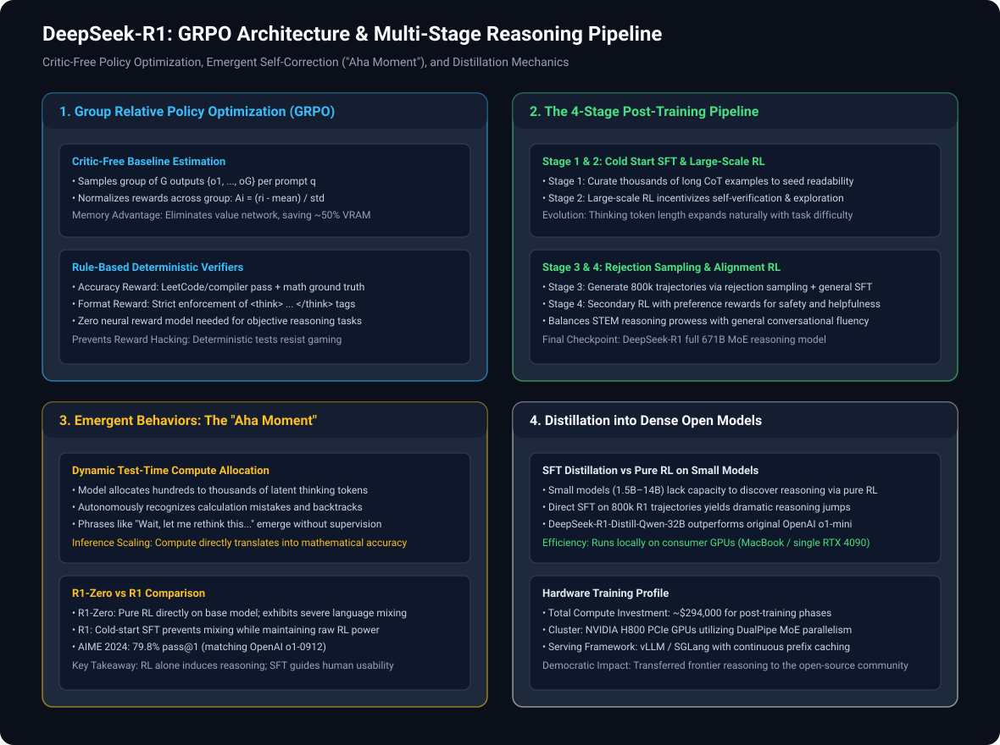
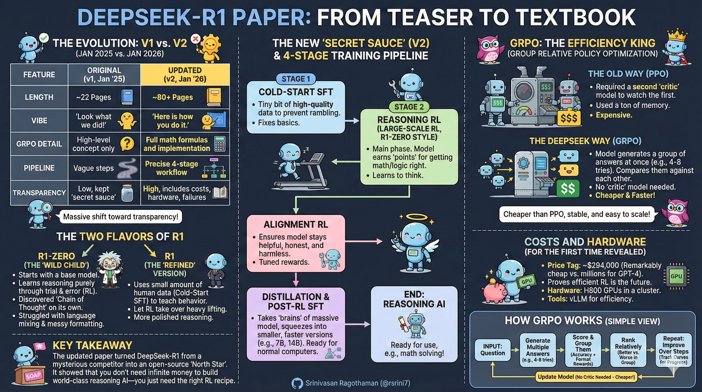

# DeepSeek-R1: Incentivizing Reasoning in LLMs via Large-Scale Reinforcement Learning

`Learning note · Revised November 2026 · AI Research & Reinforcement Learning`  
*By Srinivasan Ragothaman ([@rsrini7](https://github.com/rsrini7))*

> DeepSeek-R1 demonstrates that complex reasoning, long-chain mathematical deduction, and autonomous error self-correction ("aha moments") can be elicited entirely through pure reinforcement learning on a base model without prior supervised human demonstration. By introducing Group Relative Policy Optimization (GRPO), DeepSeek eliminated the memory-intensive critic network and scaled test-time compute to match frontier proprietary models like OpenAI o1.

---

## 1. Foundations: Reinforcement Learning for Test-Time Compute

Prior to DeepSeek-R1, the industry consensus held that advanced reasoning capabilities required tens or hundreds of thousands of meticulously human-annotated Chain-of-Thought (CoT) trajectories before reinforcement learning (RL) could be applied. DeepSeek-R1 overturned this paradigm by demonstrating that a base foundation model—equipped only with rule-based verification rewards—can independently discover reasoning strategies through exploration.

```
+----------------------------------------------------------------------------------------------------+
|                                    REASONING MODEL PARADIGM SHIFT                                  |
+----------------------------------------------------------------------------------------------------+
|  TRADITIONAL RLHF PIPELINE (PPO)                      DEEPSEEK-R1 PIPELINE (GRPO + RULE VERIFIERS) |
|  - Actor Model (Generates completions)                - Actor Model (Generates group of G rollouts)|
|  - Critic / Value Network (Estimates baseline value)  - NO Critic Network (Saves 50% GPU VRAM)     |
|  - Neural Reward Model (Scores subjective quality)    - Rule-based deterministic verifiers (Math)  |
|  - Susceptible to reward hacking & drift              - Group Relative Normalization: A_i = (r-μ)/σ|
|  - Heavy dependence on human CoT SFT seeds            - Pure RL discovers thinking autonomously    |
+----------------------------------------------------------------------------------------------------+
```

### Essential Technical Terms & Component Roles

| Component / Term | Mathematical / Architectural Role | Engineering Significance |
| :--- | :--- | :--- |
| **GRPO (Group Relative Policy Optimization)** | Variant of PPO that computes advantage by normalizing rewards across $G$ sampled completions per prompt | Eliminates the separate critic/value network $V_\phi(s)$, reducing training memory by ~50%. |
| **R1-Zero** | Pure RL trained directly on DeepSeek-V3-Base without any supervised warm-start | Proves reasoning emerges spontaneously from RL; suffers from language mixing and readability issues. |
| **Cold-Start SFT** | Thousands of curated, readable Long-CoT trajectories used to fine-tune the base model before RL | Prevents language mixing and establishes structured `<think>...</think>` tags while preserving RL search. |
| **Rule-Based Verifiers** | Deterministic ground-truth checks (compiler execution, regex equation matching, unit tests) | Eliminates neural reward model drift and gameability for mathematical and coding tasks. |
| **Test-Time Compute** | Dynamic generation of thousands of intermediate "thinking" tokens during inference | Allows the model to explore multiple solution paths, evaluate intermediate steps, and self-correct. |
| **Rejection Sampling SFT** | Generating 800,000 reasoning trajectories from R1 checkpoints, filtering for correctness | Produces high-density synthetic data used to distill reasoning into smaller dense models (1.5B–70B). |

---

## 2. Deep Technical Mechanisms: The GRPO Algorithm & 4-Stage Pipeline

### 2.1 Group Relative Policy Optimization (GRPO) Formulation

In standard Proximal Policy Optimization (PPO), the advantage function $A_t$ requires evaluating both an Actor network $\pi_\theta$ and a Value network $V_\phi$:

$$A_t = R_t - V_\phi(s_t)$$

Maintaining a Value model of identical scale to a 671B Mixture-of-Experts (MoE) foundation model requires massive GPU VRAM allocation. GRPO circumvents this by sampling a group of $G$ outputs $\{o_1, o_2, \dots, o_G\}$ from the previous policy $\pi_{\theta_{\text{old}}}$ for each input query $q$.

For each output $o_i$, the environment assigns a scalar reward $r_i$. The advantage $A_i$ is computed by standardizing rewards across the sampled group:

$$A_i = \frac{r_i - \text{mean}(\{r_1, \dots, r_G\})}{\text{std}(\{r_1, \dots, r_G\}) + \epsilon}$$

The objective function optimized by GRPO is defined as:

$$\mathcal{J}_{\text{GRPO}}(\theta) = \mathbb{E}_{q \sim P(Q), \{o_i\}_{i=1}^G \sim \pi_{\theta_{\text{old}}}(O|q)} \left[ \frac{1}{G} \sum_{i=1}^G \left( \min \left( \frac{\pi_\theta(o_i|q)}{\pi_{\theta_{\text{old}}}(o_i|q)} A_i, \text{clip}\left(\frac{\pi_\theta(o_i|q)}{\pi_{\theta_{\text{old}}}(o_i|q)}, 1-\epsilon, 1+\epsilon\right) A_i \right) - \beta D_{\text{KL}}(\pi_\theta \| \pi_{\text{ref}}) \right) \right]$$

```
                      GRPO COMPUTATION GRAPH (PER PROMPT q)
                                        │
           Prompt q ────────────────────┼────────────────────┐
                                        ▼                    ▼
                                 Rollout Group G=4 (Sampled from π_old)
                                 ├── o1: Attempt A ──► Verifier ──► r1 = 1.0 (Pass)
                                 ├── o2: Attempt B ──► Verifier ──► r2 = 0.0 (Fail)
                                 ├── o3: Attempt C ──► Verifier ──► r3 = 1.0 (Pass)
                                 └── o4: Attempt D ──► Verifier ──► r4 = 0.0 (Fail)
                                        │
                                        ▼
                         Group Mean: 0.50 | Group Std: 0.50
                                        │
                         Compute Normalized Advantage:
                         ├── A1 = (1.0 - 0.50) / 0.50 = +1.0
                         ├── A2 = (0.0 - 0.50) / 0.50 = -1.0
                         ├── A3 = (1.0 - 0.50) / 0.50 = +1.0
                         └── A4 = (0.0 - 0.50) / 0.50 = -1.0
                                        │
                                        ▼
                         Clip PPO Ratio & Update Actor π_θ
                         (Zero Critic Network VRAM Needed!)
```

---

### 2.2 Reward Modeling Architecture: Deterministic Rule Verifiers

DeepSeek-R1 utilizes two deterministic reward signals during the reasoning phase:
1. **Accuracy Reward ($R_{\text{acc}}$)**: Evaluates whether the proposed solution matches ground truth. For mathematical benchmarks, solutions are boxed in `\boxed{}` and parsed. For programming problems, code completions are compiled and evaluated against unit tests in an isolated sandbox.
2. **Format Reward ($R_{\text{format}}$)**: Enforces that the model's thinking process resides strictly within `<think>` and `</think>` tags, separating intermediate chain-of-thought exploration from the final user response.

Because these rewards are rule-based, the model cannot engage in "reward hacking" (exploiting blind spots in a neural reward model to gain high scores without solving the problem).

---

### 2.3 The 4-Stage Post-Training Pipeline

DeepSeek-R1 solves the usability flaws of R1-Zero through a four-stage training lifecycle:

```
STAGE 1: COLD-START SFT (Few Thousand Examples)
- Collect readable long-CoT data with markdown formatting and <think> delimiters
- Warm-start DeepSeek-V3-Base to prevent language mixing and repetitive loops
                         │
                         ▼
STAGE 2: REASONING-ORIENTED REINFORCEMENT LEARNING (Large-Scale GRPO)
- Apply GRPO over coding, math, and logic problems with rule verifiers
- Induces test-time compute expansion: average response length grows to 4k-8k tokens
- Emergence of autonomous self-correction ("Wait, let me recalculate...")
                         │
                         ▼
STAGE 3: REJECTION SAMPLING SFT (800k Synthetic Trajectories)
- Checkpoint from Stage 2 generates multiple solutions for extensive query sets
- Filter solutions via deterministic verifiers; retain only correct reasoning paths
- Augment with ~200k non-reasoning SFT samples (writing, translation, factual Q&A)
                         │
                         ▼
STAGE 4: ALIGNMENT REINFORCEMENT LEARNING (Helpfulness & Safety)
- Secondary RL phase using reward models trained on human preferences
- Aligns tone, safety, and helpfulness without degrading mathematical deduction
```

---

## 3. Architectural Visuals: End-to-End GRPO Pipeline

The architectural infographic below illustrates the GRPO group sampling mechanics, rule-based reward evaluation, the four-stage lifecycle, and the downstream distillation into dense architectures:



---

## 4. Production Implementations & Code Recipes

### 4.1 PyTorch Implementation of GRPO Loss Calculation

This standalone recipe computes the GRPO clipped surrogate loss with group advantage normalization without requiring an external critic network:

```python
import torch
import torch.nn as nn
import torch.nn.functional as F

class GRPOLoss(nn.Module):
    def __init__(self, clip_eps: float = 0.2, kl_weight: float = 0.04):
        super().__init__()
        self.clip_eps = clip_eps
        self.kl_weight = kl_weight

    def compute_group_advantages(self, rewards: torch.Tensor, group_size: int, eps: float = 1e-8) -> torch.Tensor:
        """
        rewards: Tensor of shape (batch_size * group_size,)
        Computes standardized advantages within each group.
        """
        reshaped = rewards.view(-1, group_size)
        mean = reshaped.mean(dim=1, keepdim=True)
        std = reshaped.std(dim=1, keepdim=True)
        advantages = (reshaped - mean) / (std + eps)
        return advantages.view(-1)

    def forward(
        self,
        log_probs: torch.Tensor,         # Current policy log π_θ(o|q)
        old_log_probs: torch.Tensor,     # Rollout policy log π_old(o|q)
        ref_log_probs: torch.Tensor,     # Reference policy log π_ref(o|q)
        rewards: torch.Tensor,           # Raw verification rewards
        group_size: int,
        mask: torch.Tensor               # Token mask (ignoring prompt tokens)
    ) -> torch.Tensor:
        # Step 1: Standardize advantages across the rollout group
        advantages = self.compute_group_advantages(rewards, group_size)
        
        # Expand advantage to match token sequence dimension: (B*G, SeqLen)
        adv_expanded = advantages.unsqueeze(-1)

        # Step 2: Probability ratio r(θ) = π_θ / π_old
        ratio = torch.exp(log_probs - old_log_probs)

        # Step 3: Clipped surrogate loss
        surr1 = ratio * adv_expanded
        surr2 = torch.clamp(ratio, 1.0 - self.clip_eps, 1.0 + self.clip_eps) * adv_expanded
        policy_loss = -torch.min(surr1, surr2)

        # Step 4: Per-token KL divergence penalty with reference model: D_KL(π_θ || π_ref)
        kl = torch.exp(ref_log_probs - log_probs) - (ref_log_probs - log_probs) - 1.0
        
        total_loss = policy_loss + self.kl_weight * kl

        # Average loss over valid completion tokens
        masked_loss = (total_loss * mask).sum() / mask.sum().clamp(min=1.0)
        return masked_loss

# Verification and test execution
if __name__ == "__main__":
    batch_size = 2
    group_size = 4
    seq_len = 64
    total_rollouts = batch_size * group_size

    # Simulated tensors
    log_p = torch.randn(total_rollouts, seq_len, requires_grad=True)
    old_log_p = log_p.detach() + torch.randn(total_rollouts, seq_len) * 0.05
    ref_log_p = log_p.detach() + torch.randn(total_rollouts, seq_len) * 0.1
    rewards = torch.tensor([1.0, 0.0, 1.0, 0.0, 0.0, 0.0, 1.0, 0.0]) # Pass/Fail test results
    mask = torch.ones(total_rollouts, seq_len)

    grpo = GRPOLoss()
    loss = grpo(log_p, old_log_p, ref_log_p, rewards, group_size, mask)
    loss.backward()

    print(f"GRPO Loss computed successfully: {loss.item():.4f}")
    print(f"Gradient norm on policy log_probs: {log_p.grad.norm().item():.4f}")
```

---

## 5. Benchmark Performance & Distillation Metrics

### 5.1 Frontier Reasoning Benchmarks

DeepSeek-R1 performance against OpenAI o1-0912 and Claude 3.5 Sonnet on standard mathematical and coding benchmarks:

| Benchmark / Task | DeepSeek-V3 (Base MoE) | DeepSeek-R1-Zero (Pure RL) | DeepSeek-R1 (Full 4-Stage) | OpenAI o1-0912 |
| :--- | :--- | :--- | :--- | :--- |
| **AIME 2024 (pass@1)** | 39.2% | 71.0% | **79.8%** | 79.2% |
| **MATH-500 (pass@1)** | 74.6% | 95.9% | **97.3%** | 96.4% |
| **Codeforces (Percentile)** | 58.7th | 86.4th | **96.3th** | 96.6th |
| **GPQA Diamond (pass@1)** | 59.1% | 65.2% | **71.5%** | 75.7% |
| **SWE-bench Verified (Resolved)** | 42.0% | 44.8% | **49.2%** | 48.9% |

---

### 5.2 Distillation: Small Models Outperform Pure RL

A critical empirical discovery documented in the updated DeepSeek-R1 technical report is the asymmetry between large foundation models and small dense models under RL:
- Training small models (e.g., Qwen-2.5-7B) with pure RL yields mediocre improvements because the model lacks the parameter capacity to explore and discover long reasoning paths from scratch.
- Distilling 800,000 reasoning trajectories generated by DeepSeek-R1 directly into Qwen-2.5-7B via Supervised Fine-Tuning produces dramatic gains:

```
+----------------------------------------------------------------------------------------------------+
|                                    DISTILLATION EFFICIENCY COMPARISON                              |
+----------------------------------------------------------------------------------------------------+
|  MODEL VARIANT                          AIME 2024 (pass@1)          MATH-500 (pass@1)              |
|  - Qwen-2.5-7B-Base + Pure RL           28.4%                       68.2%                          |
|  - DeepSeek-R1-Distill-Qwen-1.5B        28.9%                       83.9%                          |
|  - DeepSeek-R1-Distill-Qwen-7B          55.5%                       92.8%                          |
|  - DeepSeek-R1-Distill-Qwen-14B         69.7%                       93.9%                          |
|  - DeepSeek-R1-Distill-Qwen-32B         72.6%                       94.3%                          |
|  - DeepSeek-R1-Distill-Llama-70B        70.0%                       94.5%                          |
+----------------------------------------------------------------------------------------------------+
```

---

## 6. Common Claims vs. Technical Realities

| # | Common Industry Claim | Technical Reality & Benchmark Fact | Architectural Guidance |
| :-: | :--- | :--- | :--- |
| **1** | *"DeepSeek-R1 used zero human data and learned everything from pure RL."* | **False.** DeepSeek-**R1-Zero** used pure RL, but exhibited severe language mixing and poor readability. The flagship **DeepSeek-R1** model utilized a curated Cold-Start SFT dataset (thousands of samples) and 800k Rejection Sampling SFT trajectories. | Pure RL elicits raw reasoning; SFT remains essential for linguistic coherence and safety. |
| **2** | *"GRPO is an entirely new algorithm invented by DeepSeek."* | **Clarification.** GRPO was first published by DeepSeek in February 2024 (*DeepSeekMath: Pushing the Limits of Mathematical Reasoning in Open Language Models*). R1 scaled GRPO to 671B MoE architectures. | Cite DeepSeekMath (arXiv:2402.03300) when referencing the algorithmic provenance of GRPO. |
| **3** | *"Reasoning models always require huge neural reward models."* | **False.** For objective domains (math, coding, formal logic), deterministic verifiers (compilers, regex matchers) are vastly superior. They eliminate reward hacking and save GPU compute. | Use rule-based verifiers wherever formal ground truth can be evaluated algorithmically. |
| **4** | *"Small 7B models can learn o1-level reasoning by running GRPO locally."* | **Empirically Disproven.** Small models lack the representational entropy to discover reasoning chains via pure RL. Small models achieve high reasoning scores only via SFT distillation from large teacher models. | Distill teacher trajectories into edge models; reserve pure RL for large base models. |
| **5** | *"DeepSeek-R1 required tens of millions of dollars in compute to post-train."* | **False.** The entire post-training phase of DeepSeek-R1 cost approximately $294,000 on an NVIDIA H800 cluster, enabled by GRPO's memory savings and DualPipe MoE efficiency. | Algorithmic efficiency (GRPO, DualPipe) can compress RL training costs by orders of magnitude. |

---

## 7. Practical Adoption Blueprint & Verification Checklist

When deploying DeepSeek-R1 or its distilled derivatives in production serving systems:

```bash
# ---------------------------------------------------------
# PRODUCTION SERVING VIA VLLM / SGLANG
# ---------------------------------------------------------
# 1. Launch DeepSeek-R1-Distill-Qwen-32B with continuous prefix caching
vllm serve deepseek-ai/DeepSeek-R1-Distill-Qwen-32B \
    --tensor-parallel-size 4 \
    --max-model-len 32768 \
    --enable-prefix-caching \
    --gpu-memory-utilization 0.92

# 2. Benchmark thinking token generation throughput
python3 -c '
import urllib.request, json
req = urllib.request.Request(
    "http://localhost:8000/v1/chat/completions",
    data=json.dumps({
        "model": "deepseek-ai/DeepSeek-R1-Distill-Qwen-32B",
        "messages": [{"role": "user", "content": "Solve: What is the sum of all roots of x^3 - 6x^2 + 11x - 6 = 0?"}],
        "max_tokens": 4096,
        "temperature": 0.6
    }).encode("utf-8"),
    headers={"Content-Type": "application/json"}
)
res = urllib.request.urlopen(req)
print(json.loads(res.read().decode())["choices"][0]["message"]["content"])
'
```

---

## 8. Historical Timeline & Milestone Overview

```
2024 ────────────────────────────────────────── 2025 ────────────────────────────────────────── 2026
 │                                               │                                               │
 ├── Feb 2024: DeepSeekMath                      ├── Jan 2025: DeepSeek-R1-Zero                  └── Jan 2026: Technical Report Update
 │   • GRPO introduced on 7B model               • Pure RL reasoning proven                      • 86-page comprehensive report
 │   • Critic-free advantage math                • R1 4-stage pipeline previewed                 • Full training recipes disclosed
 │                                               • Distill-Qwen / Llama released                 • Formal safety and risk analysis
```

---

## 9. Primary Sources & References

1. [DeepSeek-AI: DeepSeek-R1: Incentivizing Reasoning Capability in LLMs via Reinforcement Learning (arXiv:2501.12948)](https://arxiv.org/abs/2501.12948) — Primary technical report detailing GRPO mathematical objectives, the 4-stage post-training pipeline, and distillation.
2. [Shao et al. (2024): DeepSeekMath: Pushing the Limits of Mathematical Reasoning in Open Language Models (arXiv:2402.03300)](https://arxiv.org/abs/2402.03300) — Foundational paper introducing Group Relative Policy Optimization (GRPO) and rule-based reward verification.
3. [DeepSeek-R1 Official GitHub Repository](https://github.com/deepseek-ai/DeepSeek-R1) — Open-source model weights, inference configurations, and distillation checkpoints for 1.5B–70B architectures.
4. [DeepSeek-V3 Technical Report (arXiv:2412.19437)](https://arxiv.org/abs/2412.19437) — Architecture report for the 671B Mixture-of-Experts base model on which DeepSeek-R1 was trained.

---

## 10. Supplementary visuals

The following visual diagram illustrates the updated technical architecture and comparative milestone tracking:


*Figure 1: High-level overview of DeepSeek-R1's post-training evolution and benchmark milestones.*

---

**Related:**
- [DeepSeek-V3-Architecture-And-Hardware-Software-CoDesign-2026](DeepSeek-V3-Architecture-And-Hardware-Software-CoDesign-2026.md) — Architectural evaluation of DeepSeek-V3's Multi-Head Latent Attention (MLA), DeepSeekMoE, and FP8 mixed-precision training.
- [DeepSeek-mHC-Manifold-Constrained-Hyperconnections-2026](DeepSeek-mHC-Manifold-Constrained-Hyperconnections-2026.md) — DeepSeek's multi-head conditional communication architecture optimizing stability during large-scale RL exploration.
- [DeepSeek-Engram-Conditional-Memory-2026](DeepSeek-Engram-Conditional-Memory-2026.md) — Conditional memory architectures addressing compute redundancy alongside reasoning models.
- [Agentic-Reasoning-LLMs](../reasoning/Agentic-Reasoning-LLMs.md) — Comparative analysis of test-time compute allocation and multi-layer agentic reflection loops.
- [Recursive-Language-Models-RLM-Architecture-2026](../reasoning/Recursive-Language-Models-RLM-Architecture-2026.md) — Evaluates recursive token generation and context management in long-form reasoning models.
