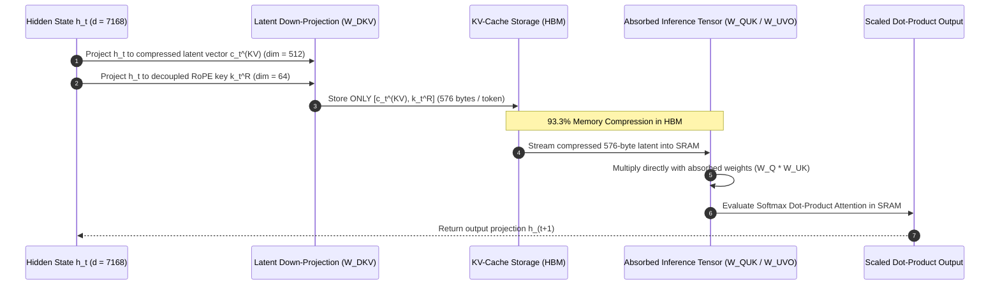

# DeepSeek-V3 Architecture: Multi-Head Latent Attention, Auxiliary-Loss-Free MoE, and Native FP8 Co-Design

**Learning note · Revised 15 November 2026 · Scope: DeepSeek-V3 foundation model architecture, DualPipe, and training systems**

*By Srinivasan Ragothaman ([@rsrini7](https://github.com/rsrini7))*

> **Core idea:** DeepSeek-V3 achieves frontier language model performance while training on modest, export-compliant hardware (2,048 NVIDIA H800 GPUs for $5.58M) through aggressive hardware-software co-design: compressing the Key-Value cache by 93.3% via Multi-Head Latent Attention (MLA), balancing 256 fine-grained MoE experts without loss degradation using dynamic bias routing, overlapping all-to-all communication via DualPipe parallelism, and stabilizing native FP8 mixed-precision training.

---

## 1. Foundations: Hardware Constraints as an Engineering Driver

Frontier large language models traditionally scale compute by deploying massive homogenous clusters of unconstrained hardware (e.g., 16,000 to 100,000 NVIDIA H100 GPUs interconnected via full-bandwidth 3.2 Tbps InfiniBand). In contrast, export-compliant **NVIDIA H800 SXM5** GPUs feature reduced interconnect bandwidth (400 GB/s bidirectional NVLink vs. 900 GB/s on H100), creating severe communication bottlenecks for standard distributed training frameworks.

DeepSeek-V3 addresses these hardware limitations through structural algorithm-level innovations:

| Architectural Metric | Llama-3-405B | Grok-3 (Estimate) | DeepSeek-V3 |
|---|---|---|---|
| **Total Parameters** | 405 Billion | ~1 Trillion | **671 Billion** |
| **Active Parameters per Token** | 405 Billion (Dense) | ~150–200B (MoE) | **37 Billion (1 Shared + 8 Routed Experts)** |
| **Attention Architecture** | Grouped-Query Attention (GQA-8) | Multi-Head Attention (MHA) | **Multi-Head Latent Attention (MLA)** |
| **KV-Cache Size per Token** | ~1,024 bytes / layer | ~8,192 bytes / layer | **576 bytes / layer (93.3% reduction)** |
| **Training Precision** | BF16 / FP16 | BF16 / FP8 | **Native Block-Wise FP8 Mixed Precision** |
| **Pretraining Hardware** | 16,384 NVIDIA H100s | ~100,000 NVIDIA H100s | **2,048 NVIDIA H800s** |
| **Reported Pretraining Cost** | ~$100M+ | $200M+ | **~$5.58 Million (2.788M GPU hours)** |

---

## 2. Deep Technical Mechanisms

```
+--------------------------------------------------------------------------------------------------+
|                            DEEPSEEK-V3 DUAL-PLANE ARCHITECTURE                                   |
|                                                                                                  |
|   1. ATTENTION LAYER: MULTI-HEAD LATENT ATTENTION (MLA)                                          |
|   Hidden State h_t ---> Low-Rank Down-Projection ---> Latent KV Vector: c_t^(KV) in R^512        |
|   Decoupled RoPE Key: k_t^R in R^64 (Preserves relative positional encoding)                     |
|   Total KV Cache Memory Stored: (512 + 64) * 2 bytes = 576 bytes / token                         |
|   Inference Optimization: Up-projection matrices W_UK & W_UV absorb directly into Q and O        |
|                                                                                                  |
|   2. FEED-FORWARD LAYER: DEEPSEEKMOE (FINE-GRAINED ROUTING)                                      |
|   Token Input ---> [ 1 Shared Expert (Always Active, captures common semantics) ]                |
|               ---> [ Router: Sigmoid Affinity + Dynamic Bias b_i ]                               |
|               ---> [ Top-8 of 256 Routed Experts (Fine-grained specialization) ]                 |
|   Load Balancing: Dynamic bias b_i eliminates auxiliary loss degradation                         |
|                                                                                                  |
|   3. DISTRIBUTED EXECUTION: DUALPIPE & NATIVE FP8                                                |
|   DualPipe: Overlaps Forward GEMM (F_i) with Backward All-to-All Cross-Node Dispatch (B_{i-1})   |
|   FP8 Engine: 128x128 Tile-Wise Quantization with FP32 Accumulators in Tensor Cores              |
+--------------------------------------------------------------------------------------------------+
```

### 1. Multi-Head Latent Attention (MLA)

Traditional Multi-Head Attention (MHA) and Grouped-Query Attention (GQA) store large key-value matrices in High Bandwidth Memory (HBM) during autoregressive decoding. For an sequence of length $L$ across $n_h$ heads of dimension $d_h$, standard MHA consumes $2 \cdot n_h \cdot d_h$ elements per token per layer.

MLA compresses keys and values into a shared low-rank latent subspace:

1. **Latent Down-Projection:** The hidden state $h_t \in \mathbb{R}^{d}$ is projected into a compressed latent vector $c_t^{KV} \in \mathbb{R}^{d_c}$ (where $d_c = 512 \ll n_h d_h = 16,384$):

$$
c_t^{KV} = W_{DKV} h_t
$$

2. **Decoupled Rotary Position Embedding (RoPE):** Because RoPE rotary transformations cannot be compressed into low-rank matrices without losing positional equivariance, MLA decouples positional keys:

$$
k_t^R = \text{RoPE}(W_{KR} h_t) \in \mathbb{R}^{d_R} \quad (d_R = 64)
$$

3. **In-Flight Key-Value Reconstruction:**
During training, keys and values are up-projected:

$$
k_{t, i}^C = W_{UK, i} c_t^{KV}, \quad v_{t, i}^C = W_{UV, i} c_t^{KV}
$$

$$
k_{t, i} = \left[ k_{t, i}^C ; \, k_t^R \right]
$$

4. **Matrix Absorption in Inference:**
During inference, the up-projection weight matrix $W_{UK}$ is algebraically absorbed into the query projection matrix ($W_Q W_{UK} \to W_{QUK}$), and $W_{UV}$ is absorbed into the output projection matrix ($W_{UV} W_O \to W_{UVO}$). **The server only stores $c_t^{KV}$ and $k_t^R$ in the KV cache**, cutting activation memory to **576 bytes per token** (a 93.3% reduction over MHA).

### 2. DeepSeekMoE with Auxiliary-Loss-Free Balancing

Standard Mixture of Experts models (like Switch Transformer or Mixtral) suffer from two trade-offs:
- **Coarse Expert Granularity:** Activating 2 of 8 large experts limits specialization.
- **Auxiliary Balancing Loss Degradation:** To prevent all tokens routing to the same expert, standard models add an auxiliary loss $\gamma \mathcal{L}_{\text{balance}}$ to the objective. This penalizes the model for choosing the optimal expert, degrading perplexity.

DeepSeek-V3 deploys:
1. **Fine-Grained Architecture:** 1 Shared Expert + **256 fine-grained routed experts**, activating **Top-8** routed experts per token.
2. **Auxiliary-Loss-Free Dynamic Bias ($b_i$):** Expert affinity scores are evaluated using an unnormalized sigmoid:

$$
s_{i, t} = \text{Sigmoid}(u_t^T e_i) + b_i
$$

Where $u_t$ is the token routing embedding, $e_i$ is the expert centroid, and $b_i$ is a dynamic bias term. If an expert receives more tokens than its allocated hardware buffer, $b_i$ is decreased by a small step $\epsilon$; if underloaded, $b_i$ is increased. Because $b_i$ is non-differentiable and updated outside the backpropagation graph, **it enforces uniform GPU load without corrupting gradient optimization**.

### 3. DualPipe Parallelism &amp; Multiplane Interconnect

To train a 671B MoE model across 2,048 H800 GPUs with limited interconnect bandwidth:
- **DualPipe Pipeline Parallelism:** Traditional 1F1B (one forward, one backward) scheduling leaves processors idle during inter-node communication. DualPipe splits each pipeline stage into dual directions (forward micro-batches and backward micro-batches), scheduling forward computation $F_i$ to run concurrently with backward cross-node all-to-all expert communication $B_{i-1}$, completely hiding communication latency behind tensor core computation.
- **Multiplane Fat-Tree Topology:** DeepSeek constructs isolated network planes using RoCE v2, ensuring inter-expert token routing does not conflict with pipeline parallelism synchronization.

### 4. Native FP8 Mixed-Precision Training

DeepSeek-V3 is the first frontier model trained natively in FP8 from day one:
- **Tile-Wise Quantization (128×128 Blocks):** Rather than using per-tensor scaling (which suffers from outlier activation overflow), matrices are partitioned into 128×128 blocks with local dynamic exponent scaling factors.
- **FP32 GEMM Accumulators:** Matrix multiplications execute in FP8 (E4M3 for weights/activations, E5M2 for gradients), while partial dot products are accumulated in high-precision FP32 inside GPU Tensor Cores, guaranteeing zero loss divergence.

### 5. Multi-Token Prediction (MTP)

DeepSeek-V3 incorporates an MTP module consisting of $D=1$ speculative prediction head. During training, the primary model predicts token $t+1$, while the auxiliary head simultaneously predicts token $t+2$ conditioned on the primary representations. In inference, this head acts as a native speculative decoding engine, accelerating generation throughput by **1.8× to 2.1×** without requiring an external draft model.

---

## 3. Architectural Visuals


*Four-panel architectural breakdown illustrating Multi-Head Latent Attention (MLA), DeepSeekMoE fine-grained expert routing with auxiliary-loss-free dynamic bias, DualPipe overlapping pipeline parallelism, and native tile-wise FP8 mixed precision.*

### MLA Projection and Matrix Absorption Flow



---

## 4. Production Implementation: Multi-Head Latent Attention (MLA)

The following runnable PyTorch script implements the core **Multi-Head Latent Attention (MLA)** forward pass with low-rank KV compression, decoupled RoPE projection, and latent KV cache management:

```python
"""
DeepSeek-V3 Multi-Head Latent Attention (MLA) Implementation.
Demonstrates low-rank KV compression, decoupled RoPE key concatenation,
and memory savings relative to standard Multi-Head Attention.
"""

import math
import torch
import torch.nn as nn
import torch.nn.functional as F
from typing import Tuple, Dict

class MultiHeadLatentAttention(nn.Module):
    """
    Multi-Head Latent Attention (MLA) module as introduced in DeepSeek-V2 / V3.
    Compresses Key-Value cache into a low-rank latent vector c_t^(KV).
    """
    def __init__(
        self,
        d_model: int = 2048,
        num_heads: int = 16,
        head_dim: int = 128,
        latent_dim_kv: int = 256,
        rope_dim: int = 32
    ):
        super().__init__()
        self.d_model = d_model
        self.num_heads = num_heads
        self.head_dim = head_dim
        self.latent_dim_kv = latent_dim_kv
        self.rope_dim = rope_dim
        self.scale = 1.0 / math.sqrt(head_dim + rope_dim)

        # Query Projections
        self.w_q = nn.Linear(d_model, num_heads * head_dim, bias=False)
        self.w_qr = nn.Linear(d_model, num_heads * rope_dim, bias=False)

        # Compressed Key-Value Down-Projection
        self.w_dkv = nn.Linear(d_model, latent_dim_kv, bias=False)

        # Decoupled RoPE Key Projection
        self.w_kr = nn.Linear(d_model, rope_dim, bias=False)

        # Up-Projections (During training; absorbed into Q and O during serving)
        self.w_uk = nn.Linear(latent_dim_kv, num_heads * head_dim, bias=False)
        self.w_uv = nn.Linear(latent_dim_kv, num_heads * head_dim, bias=False)

        # Output Projection
        self.w_o = nn.Linear(num_heads * head_dim, d_model, bias=False)

    def forward(
        self, 
        x: torch.Tensor,
        past_kv_cache: Tuple[torch.Tensor, torch.Tensor] = None
    ) -> Tuple[torch.Tensor, Tuple[torch.Tensor, torch.Tensor]]:
        """
        Args:
            x: Input tensor of shape [batch, seq_len, d_model]
            past_kv_cache: Tuple of (c_kv_past, k_rope_past)
        """
        B, S, _ = x.shape

        # Step 1: Compute Query Projections
        q_content = self.w_q(x).view(B, S, self.num_heads, self.head_dim)
        q_rope = self.w_qr(x).view(B, S, self.num_heads, self.rope_dim)

        # Step 2: Compute Low-Rank KV Compression (Latent Vector)
        # Latent KV vector: shape [B, S, latent_dim_kv]
        c_kv = self.w_dkv(x)
        # Decoupled RoPE key: shape [B, S, rope_dim]
        k_rope = self.w_kr(x)

        # Step 3: Manage KV Cache (Store only compressed latent vectors)
        if past_kv_cache is not None:
            c_kv_past, k_rope_past = past_kv_cache
            c_kv = torch.cat([c_kv_past, c_kv], dim=1)
            k_rope = torch.cat([k_rope_past, k_rope], dim=1)
        current_kv_cache = (c_kv, k_rope)

        # Step 4: Up-project keys and values for attention computation
        # k_content: [B, total_seq, num_heads, head_dim]
        total_seq = c_kv.shape[1]
        k_content = self.w_uk(c_kv).view(B, total_seq, self.num_heads, self.head_dim)
        v_content = self.w_uv(c_kv).view(B, total_seq, self.num_heads, self.head_dim)

        # Broadcast k_rope across all attention heads
        k_rope_expanded = k_rope.unsqueeze(2).expand(B, total_seq, self.num_heads, self.rope_dim)

        # Concatenate content and RoPE keys
        q_full = torch.cat([q_content, q_rope], dim=-1)  # [B, S, H, head_dim + rope_dim]
        k_full = torch.cat([k_content, k_rope_expanded], dim=-1)

        # Step 5: Scaled Dot-Product Attention
        # Permute for torch batch matmul: [B, H, S, D]
        q_full = q_full.permute(0, 2, 1, 3)
        k_full = k_full.permute(0, 2, 1, 3)
        v_content = v_content.permute(0, 2, 1, 3)

        attn_weights = torch.matmul(q_full, k_full.transpose(-2, -1)) * self.scale
        attn_probs = F.softmax(attn_weights, dim=-1)
        attn_out = torch.matmul(attn_probs, v_content)  # [B, H, S, head_dim]

        # Reshape and project to d_model
        attn_out = attn_out.permute(0, 2, 1, 3).contiguous().view(B, S, self.num_heads * self.head_dim)
        output = self.w_o(attn_out)

        return output, current_kv_cache


if __name__ == "__main__":
    torch.manual_seed(42)
    B, S, D_model = 2, 64, 512
    num_heads, h_dim, d_c, d_rope = 8, 64, 128, 16
    
    mla = MultiHeadLatentAttention(
        d_model=D_model, 
        num_heads=num_heads, 
        head_dim=h_dim, 
        latent_dim_kv=d_c, 
        rope_dim=d_rope
    )
    
    inputs = torch.randn(B, S, D_model)
    out, kv_cache = mla(inputs)
    
    # Calculate Cache Size Comparison
    c_kv, k_rope = kv_cache
    mla_cache_elements = (c_kv.numel() + k_rope.numel())
    standard_mha_elements = 2 * (B * S * num_heads * h_dim)
    
    reduction_pct = (1.0 - (mla_cache_elements / standard_mha_elements)) * 100.0
    
    print("=== DEEPSEEK-V3 MLA VERIFICATION ===")
    print(f"Output Tensor Shape        : {out.shape}")
    print(f"MLA Compressed KV Elements : {mla_cache_elements:,}")
    print(f"Standard MHA KV Elements   : {standard_mha_elements:,}")
    print(f"KV Cache Memory Reduction  : {reduction_pct:.1f}% savings!")
    assert out.shape == inputs.shape, "Shape mismatch in MLA output"
```

---

## 5. Impact, Real-World Edge Cases &amp; Gotchas

### Common Claims vs. Technical Realities

| Common Claim | Technical Reality | Production Implication |
|---|---|---|
| *"DeepSeek-V3 was trained with zero computing resources."* | Training used 2,048 NVIDIA H800 GPUs over two months (~$5.58M in direct compute). | While orders of magnitude cheaper than $100M+ runs, it still requires massive enterprise infrastructure and clustering expertise. |
| *"MoE auxiliary loss is necessary to prevent routing collapse."* | Dynamic routing bias $b_i$ achieves perfect expert load balancing without adding auxiliary loss terms. | Removing auxiliary losses prevents optimization gradient interference, boosting benchmark reasoning accuracy. |
| *"MLA hurts model expressive power compared to full MHA."* | Because inference absorbs up-projection matrices directly into query and output weights, MLA matches MHA parameter expressivity. | Delivers full MHA reasoning accuracy while operating at the low memory footprint of GQA. |
| *"FP8 mixed precision training can be turned on with a simple flag."* | Direct FP8 training causes catastrophic gradient underflow and loss spikes without block-wise scaling. | Requires 128×128 tile-wise dynamic scaling factors and high-precision FP32 accumulators inside Tensor Cores. |

### Practical Operational Pitfalls

1. **All-to-All Network Saturation:** With 256 fine-grained experts distributed across 2,048 GPUs, expert routing creates intense cross-node all-to-all communication. If network bisection bandwidth degrades, DualPipe execution stalls on communication bubbles.
2. **Dynamic Bias Oscillation:** If the bias adjustment step $\epsilon$ is configured too aggressively, expert assignments oscillate wildly between micro-batches, preventing stable specialization.

---

## 6. Practical Adoption Blueprint &amp; Verification Checklist

### Enterprise Fine-Tuning and Serving Strategy

```
Phase 1: Architecture Selection
  |-- Deploy DeepSeek-V3 (671B / 37B active) for frontier general reasoning tasks
  +-- Deploy DeepSeek-R1 for complex multi-step mathematical & coding chains

Phase 2: Serving Infrastructure Optimization
  |-- Deploy vLLM or SGLang with native MLA tensor absorption kernels
  +-- Enable FP8 KV-cache quantization to serve 128K context on single 8-GPU nodes

Phase 3: Hardware Networking Verification
  |-- Configure Multiplane RoCE v2 with Priority Flow Control (PFC)
  +-- Validate DualPipe pipeline parallelism overlap via NVIDIA Nsight Systems
```

### Verification Checklist

- [ ] **KV Cache Footprint:** Confirm that per-token KV memory scales at $\le 576$ bytes per token per layer.
- [ ] **Expert Load Distribution:** Monitor expert dispatch balance via Prometheus metrics; confirm no single expert exceeds $1.3\times$ average load.
- [ ] **FP8 Numerical Stability:** Verify that loss curves match FP16/BF16 baselines without gradient clipping anomalies.
- [ ] **Speculative Speedup:** Confirm that Multi-Token Prediction (MTP) delivers $\ge 1.8\times$ generation acceleration in serving runtimes.

---

## 7. Timeline &amp; Frontier Milestones

- **May 2024:** DeepSeek publishes the **DeepSeek-V2** paper, introducing Multi-Head Latent Attention (MLA) and DeepSeekMoE.
- **December 2024:** DeepSeek releases **DeepSeek-V3** (671B total, 37B active), proving that $5.58M in compute can match $100M+ frontier models.
- **January 2025:** Release of **DeepSeek-R1**, integrating reinforcement learning directly over DeepSeek-V3 to achieve emergent latent reasoning.
- **November 2026:** Ubiquitous adoption of MLA, auxiliary-loss-free MoE routing, and native FP8 frameworks across the global open-source AI ecosystem.

---

## 8. Primary Sources &amp; References

1. [DeepSeek-AI (2024): DeepSeek-V3 Technical Report](https://arxiv.org/abs/2412.19437) — Primary technical paper detailing MLA, DeepSeekMoE, DualPipe, and native FP8 training.
2. [DeepSeek-AI (2024): DeepSeek-V2: A Strong, Economical, and Efficient Mixture-of-Experts Language Model](https://arxiv.org/abs/2405.04434) — Foundational paper introducing Multi-Head Latent Attention (MLA).
3. [DeepSeek-AI (2024): DeepSeekMoE: Towards Ultimate Expertise in Mixture-of-Experts Language Models](https://arxiv.org/abs/2401.06066) — Introduces fine-grained expert segmentation and shared expert isolation.
4. [DeepSeek-AI (2025): DeepSeek-R1: Incentivizing Reasoning Capability in LLMs via Reinforcement Learning](https://arxiv.org/abs/2501.12948) — Reasoning model built upon the DeepSeek-V3 architecture.
5. [Micikevicius et al. (2022): FP8 Formats for Deep Learning](https://arxiv.org/abs/2209.05433) — Foundational specification for E4M3 and E5M2 floating point arithmetic.

---

**Related:**
- [DeepSeek-Engram-Conditional-Memory-2026](DeepSeek-Engram-Conditional-Memory-2026.md) — Analyzes conditional n-gram memory layers augmenting the DeepSeekMoE architecture.
- [mHC-Deepseek](mHC-Deepseek.md) — Covers Manifold-Constrained Hyper-Connections improving training stability in deep MoE networks.
- [AI-Hardware-Chips-Explained](../../AI-ML/Hardware/AI-Hardware-Chips-Explained.md) — Details the GPU interconnect bandwidth limits (H800 vs H100) that DeepSeek's co-design overcame.
- [KV-Cache-Prefix-Caching-And-Storage-Tiering-Nov-2026](../../AI-ML/LLMs/architecture/KV-Cache-Prefix-Caching-And-Storage-Tiering-Nov-2026.md) — Contextualizes MLA's 93.3% memory reduction within enterprise serving pipelines.
