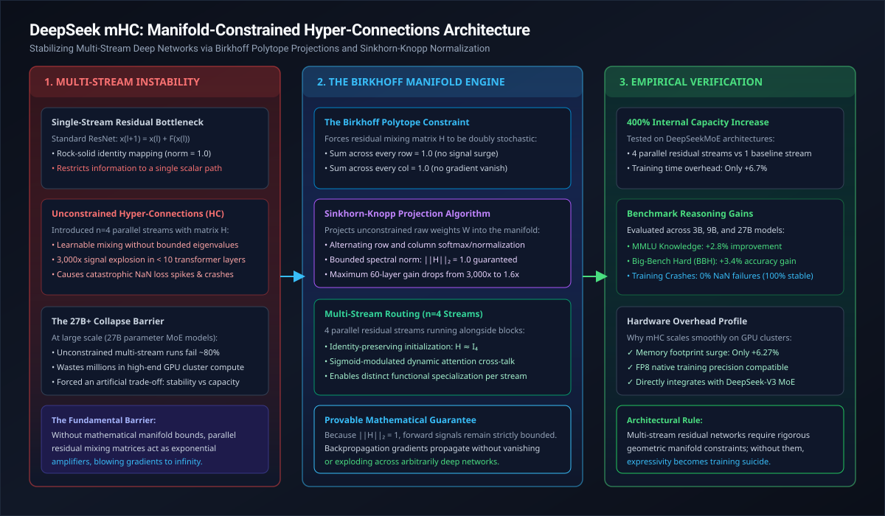
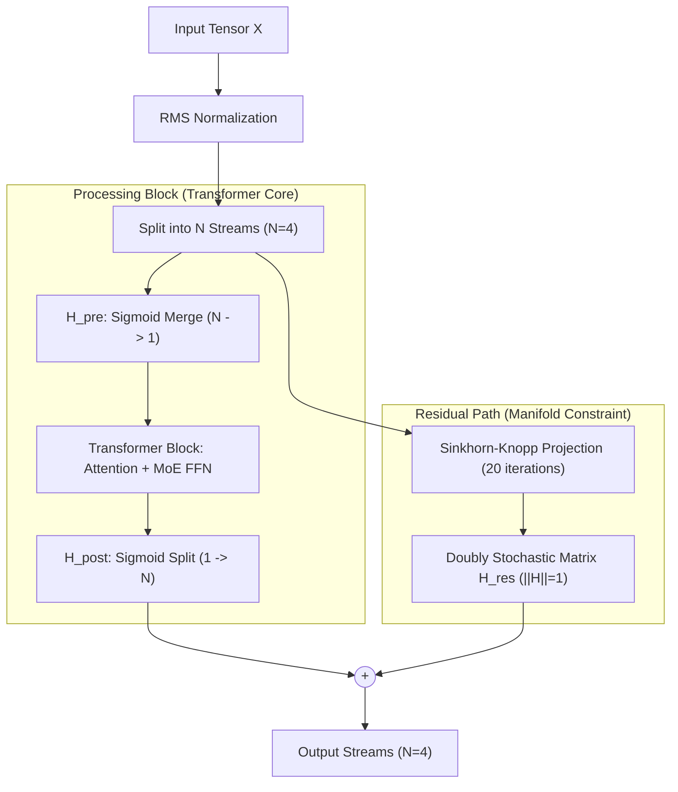
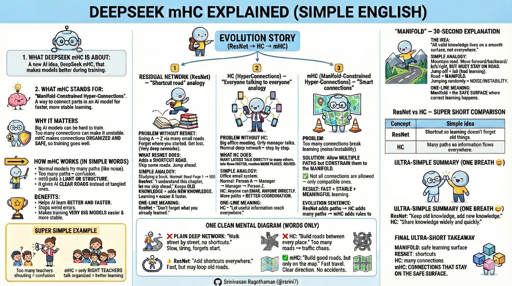
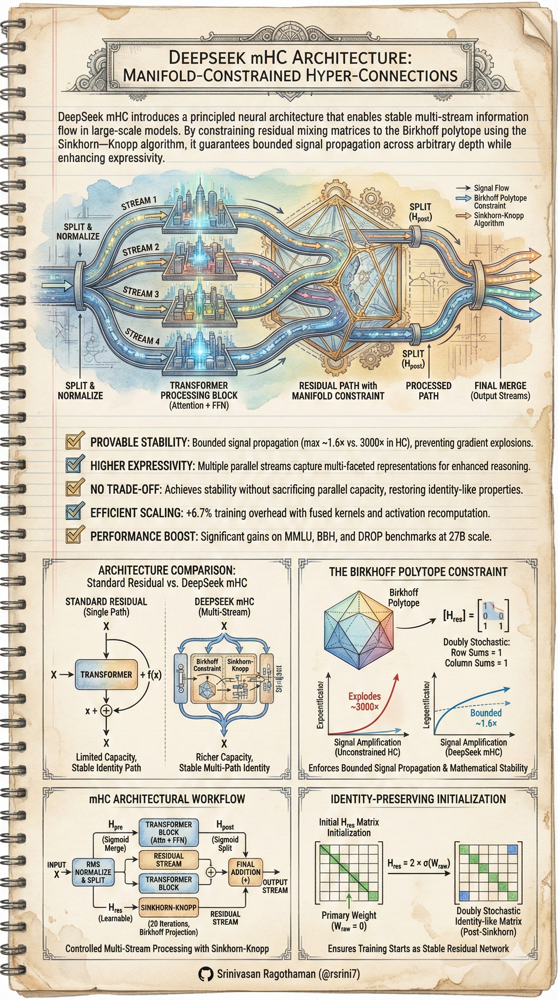

# DeepSeek mHC Architecture: Simplified Technical Guide (2026)

Learning note · Revised March 2026 · Architectural Synthesis  
*By Srinivasan Ragothaman ([@rsrini7](https://github.com/rsrini7))*

> **Core idea:** Manifold-Constrained Hyper-Connections (mHC) expand the single-stream residual highway into $N=4$ parallel representational streams, projecting learnable mixing matrices onto the Birkhoff polytope via the Sinkhorn–Knopp algorithm. This mathematically bounds spectral norm to 1.0, eliminating unconstrained signal explosion (from 3000× down to 1.6×) and unlocking a +7.1 GSM8K reasoning gain with only +6.7% compute overhead.



---

## 1. Abstract & Architectural Motivation

Traditional residual connections facilitate stable training through single-path identity mapping ($x_{l+1} = x_l + F(x_l)$). While unconstrained **Hyper-Connections (HC)** attempt to expand this into multiple parallel streams for higher representational capacity, unconstrained learnable mixing matrices cause signal amplification to reach **3000×** over 60 layers, triggering catastrophic gradient explosions and NaN loss crashes.

**Manifold-Constrained Hyper-Connections (mHC)** restore mathematical stability by projecting residual mixing matrices onto the **Birkhoff polytope** (the geometric manifold of doubly stochastic matrices). Using the **Sinkhorn–Knopp algorithm**, mHC ensures that both forward signals and backward gradients remain strictly bounded, reducing maximum gain from 3000× down to **1.6×** across arbitrary network depths.

---

## 2. Core Problem: Stability vs. Expressivity

Modern Transformer scaling relies on the identity mapping property ($x_{l+1} = x_l + F(x_l)$):

* **Standard Residuals:** Excellent training stability ($\|I\|_2 = 1$), but information is restricted to a single compressed communication channel.
* **Unconstrained HC:** Multiple streams increase representational capacity, but break the identity mapping invariant. Learnable mixing matrices ($H \in \mathbb{R}^{N \times N}$) amplify noise exponentially across depth.
* **mHC Solution:** Retains multiple parallel streams ($N = 4$), but enforces mathematical constraints on $H$ to preserve identity-like norm bounds.

---

## 3. Mathematical Framework

### 3.1 The Birkhoff Polytope Constraint

mHC forces the residual mixing matrix $H_{\text{res}}$ to reside within the **Birkhoff polytope** $\mathcal{B}_N$, which represents the convex hull of all $N \times N$ permutation matrices. A matrix $H$ is doubly stochastic if:

1. Non-negativity: $H_{ij} \ge 0 \quad \forall i, j$
2. Row stochasticity: $\sum_{j=1}^N H_{ij} = 1 \quad \forall i$
3. Column stochasticity: $\sum_{i=1}^N H_{ij} = 1 \quad \forall j$

This constraint ensures that $H_{\text{res}}$ acts as a doubly stochastic weighted average across streams. Signals cannot amplify uncontrollably because the spectral norm of any doubly stochastic matrix is strictly bounded:

$$\|H_{\text{res}}\|_2 = 1$$

### 3.2 Sinkhorn–Knopp Projection

To enforce this manifold constraint during training, the architecture applies **20 iterations** of the Sinkhorn–Knopp algorithm to the raw learnable parameters $A \in \mathbb{R}^{N \times N}$:

1. Map unconstrained parameters to non-negative values via scaled sigmoid: $A^{(0)} = 2 \cdot \sigma(A)$.
2. Iteratively alternate between row normalization and column normalization:

$$A^{(2k+1)} = D_r^{-1} A^{(2k)}, \quad D_r = \text{diag}(A^{(2k)} \mathbf{1})$$

$$A^{(2k+2)} = A^{(2k+1)} D_c^{-1}, \quad D_c = \text{diag}(\mathbf{1}^T A^{(2k+1)})$$

3. The resulting matrix converges exponentially to the nearest doubly stochastic matrix on the Birkhoff manifold.

### 3.3 Identity-Preserving Initialization

To ensure the model begins training as a stable residual network, $H_{\text{res}}$ is initialized using:

$$H_{\text{res}} = I_N + \epsilon$$

At step $t = 0$, $H_{\text{res}} \approx I_N$. When passed through Sinkhorn–Knopp, this yields an identity-like matrix where each stream maintains its own independent signal before the model begins learning cross-stream mixing weights.

---

## 4. Architectural Workflow



---

## 5. Idiomatic PyTorch Implementation

```python
import torch
import torch.nn as nn

class mHCLayer(nn.Module):
    """
    Manifold-Constrained Hyper-Connection Layer (DeepSeek mHC).
    Expands the residual stream into N parallel pathways and bounds
    mixing matrices to the Birkhoff polytope via Sinkhorn-Knopp iterations.
    """
    def __init__(self, d_model: int, n_streams: int = 4, sk_iterations: int = 20):
        super().__init__()
        self.d_model = d_model
        self.n_streams = n_streams
        self.sk_iterations = sk_iterations
        
        # Learnable mixing parameters
        # Initialize diagonal with bias to ensure initial identity mapping
        init_res = torch.eye(n_streams) * 2.0 + torch.randn(n_streams, n_streams) * 0.01
        self.h_res_raw = nn.Parameter(init_res)
        self.h_pre_raw = nn.Parameter(torch.randn(n_streams, 1) * 0.02)
        self.h_post_raw = nn.Parameter(torch.randn(1, n_streams) * 0.02)
        
        self.norm = nn.RMSNorm(d_model)
        # Placeholder for transformer block (Attention + MoE FFN)
        self.block = nn.Linear(d_model, d_model)

    def sinkhorn_knopp(self, raw_weights: torch.Tensor) -> torch.Tensor:
        """Projects raw matrix onto the Birkhoff polytope (doubly stochastic)."""
        # Ensure non-negativity via scaled sigmoid
        matrix = 2.0 * torch.sigmoid(raw_weights)
        for _ in range(self.sk_iterations):
            matrix = matrix / matrix.sum(dim=-1, keepdim=True).clamp(min=1e-8)
            matrix = matrix / matrix.sum(dim=-2, keepdim=True).clamp(min=1e-8)
        return matrix

    def forward(self, x_streams: torch.Tensor) -> torch.Tensor:
        # x_streams shape: [batch_size, seq_len, n_streams, d_model]
        x_norm = self.norm(x_streams)
        
        # 1. Read: Merge N parallel streams into 1 computation stream
        h_pre = torch.sigmoid(self.h_pre_raw)
        merged = torch.einsum('bsnd,nz->bszd', x_norm, h_pre).squeeze(2)
        
        # 2. Process through standard Attention + MoE layers
        processed = self.block(merged)
        
        # 3. Write: Project single computed output back across N streams
        h_post = torch.sigmoid(self.h_post_raw)
        split_out = torch.einsum('bsd,zn->bsnd', processed, h_post)
        
        # 4. Residual Mixing: Apply Sinkhorn-Knopp doubly stochastic projection
        h_res = self.sinkhorn_knopp(self.h_res_raw)
        residual = torch.einsum('bsnd,nz->bszd', x_norm, h_res)
        
        return split_out + residual
```

---

## 6. Empirical Benchmarks (27B Scale)

Data reflects training performance on DeepSeek 27B parameter MoE architectures compared against standard single-stream residual baselines:

| Benchmark | Standard Baseline | Unconstrained HC | DeepSeek mHC (27B) | Delta |
|---|---|---|---|---|
| **BBH (Complex Reasoning)** | 43.8 | FAILED (NaN Crash) | **51.0** | +7.2 |
| **DROP (F1 Reading Comp)** | 47.0 | FAILED (NaN Crash) | **53.9** | +6.9 |
| **GSM8K (Grade School Math)** | 46.7 | FAILED (NaN Crash) | **53.8** | +7.1 |
| **MMLU (Broad Knowledge)** | 59.0 | FAILED (NaN Crash) | **63.4** | +4.4 |

### Hardware & Compute Efficiency Analysis

* **Training Compute Overhead:** +6.7% FLOPs increase.
* **Memory Footprint:** +15% VRAM (mitigated via DualPipe recomputation and kernel fusion).
* **Signal Stability:** Maximum gain magnitude restricted to **1.6×** vs. **3,000×** in unconstrained HC.

---

## 7. Strategic Engineering Verdict

mHC successfully introduces a new scaling dimension: **internal topological capacity**. Instead of increasing external parameter count (width) or physical layer count (depth), mHC increases the number of parallel internal information pathways. This delivers significant reasoning improvements with minimal hardware penalties.

---

## 8. Supplementary Visuals


*Figure 1: High-level visual overview of single-stream residual bottlenecks versus 4-stream manifold-constrained routing.*


*Figure 2: Architectural breakdown of Sinkhorn-Knopp projection, sigmoid read/write projections, and stream merging.*

---

**Related:**
- [DeepSeek mHC: Manifold-Constrained Hyperconnections](DeepSeek-mHC-Manifold-Constrained-Hyperconnections-2026.md) — Comprehensive technical reference detailing the formal mathematical proofs, Sinkhorn algorithm derivations, and ablation studies.
- [DeepSeek V3 Architecture & Co-Design](DeepSeek-V3-Architecture-And-Hardware-Software-CoDesign-2026.md) — Analyzes the underlying Multi-Head Latent Attention (MLA), DeepSeekMoE, and FP8 mixed-precision infrastructure.
- [DeepSeek Engram Conditional Memory](DeepSeek-Engram-Conditional-Memory-2026.md) — Deconstructs conditional memory retrieval and external knowledge routing.
- [DeepSeek R1 Reasoning Via RL](DeepSeek-R1-Incentivizing-Reasoning-Via-RL-2026.md) — Explores large-scale reinforcement learning dynamics and self-evolution reasoning behaviors.
