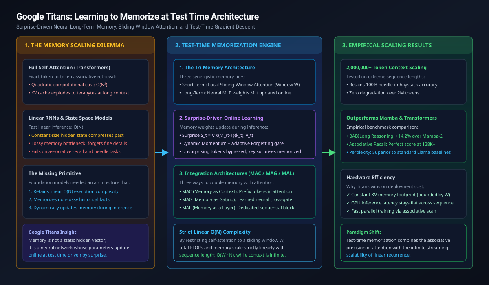
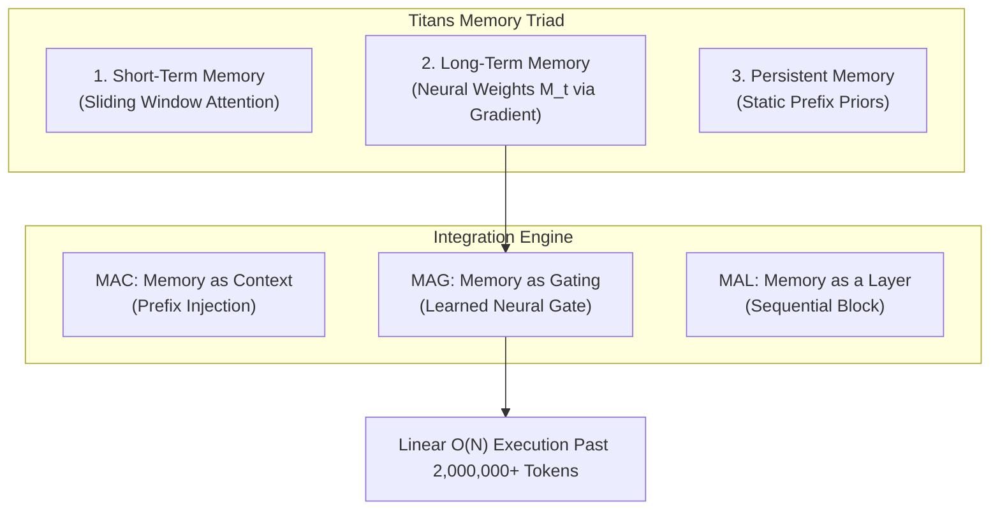
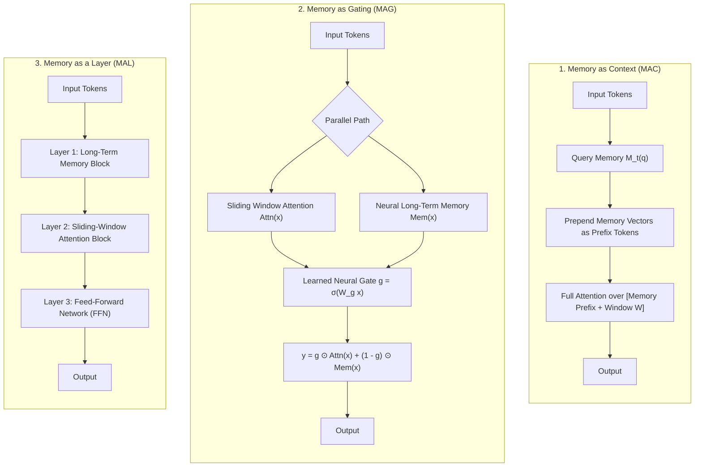

# Google Titans: Learning to Memorize at Test Time Architecture

Daily learning · 8 January 2025 · Revised 15 November 2026 · Frontier AI Research · Long-Context Architectures
*By Srinivasan Ragothaman ([@rsrini7](https://github.com/rsrini7))*

> **Core idea:** Transformers scale with quadratic $O(N^2)$ memory and compute, while linear recurrent models (RNNs/SSMs) suffer from lossy memory compression that forgets critical details over long sequences. Google Titans introduces **neural long-term memory** that learns *at test time* via online gradient descent on surprise. By coupling a bounded sliding-window self-attention module (short-term memory) with an adaptive neural MLP memory module updated online (long-term memory) and persistent task tokens, Titans achieves strict linear $O(N)$ computational complexity while scaling losslessly past 2,000,000+ token contexts.

This research guide analyzes the theoretical foundations, surprise-driven gradient descent mechanics, architectural variants (MAC, MAG, MAL), and empirical benchmarks of Google's Titans architecture (*Titans: Learning to Memorize at Test Time*, arXiv:2501.00663).



---

## 1. Foundations: The Memory Bottleneck and the Human Cognitive Model

To understand why Google Titans represents a breakthrough in sequence modeling, one must examine how natural intelligence manages memory compared to artificial neural networks.

### The Human Brain Memory Triad

* **Full Attention Transformers (The Photographic Memory with a 10-Minute Limit):**
  Standard transformers attempt to maintain exact, photographic attention over every token. While this guarantees lossless recall within a small window, computing attention across every token pair requires quadratic compute ($O(N^2)$) and gigabytes of KV cache memory. When extended to extreme sequence lengths, the model suffers severe latency surges and hardware memory exhaustion.
* **Linear RNNs and State Space Models (The Hasty Note-Taker):**
  Models like Mamba, RWKV, or standard RNNs compress all past history into a fixed-size hidden vector ($h_t \in \mathbb{R}^d$). While this achieves lightning-fast linear execution ($O(N)$), a fixed-size vector cannot store unbounded information. Over long contexts, older details are irreversibly overwritten, causing catastrophic forgetting on associative recall tasks.
* **Google Titans (The Human Tri-Memory System):**
  Titans models the brain's three distinct memory faculties:
  1. **Short-Term Memory (Focal Attention):** A sliding window of local self-attention handling immediate syntactic and semantic relationships within recent tokens.
  2. **Long-Term Memory (Neural Plasticity):** An adaptive multi-layer perceptron (MLP) whose weights update *online during inference* using gradient descent whenever the model encounters surprising or novel information.
  3. **Persistent Memory (Instinctual Priors):** Static prefix parameters learned during pre-training that store universal task guidelines and behavioral instructions.



### Essential Vocabulary

| Term | Technical Meaning in Titans | Concrete System Role |
|---|---|---|
| **Test-Time Memorization** | Updating neural network weights online during inference via gradient descent. | Allows the model to adaptively store new facts encountered in real-time prompts. |
| **Surprise Metric ($S_t$)** | The gradient of associative loss $\nabla \mathcal{L}_{\text{mem}}$ measuring prediction error on key-value pairs. | Directs gradient updates exclusively to unexpected or novel information. |
| **Sliding Window Attention** | Restricting self-attention to a fixed local window $W$ of recent tokens. | Keeps short-term attention computation bounded at $O(W \cdot N)$ rather than $O(N^2)$. |
| **Neural Long-Term Memory ($M_t$)** | A parameterized MLP whose weights function as an associative memory storage device. | Retains historical context across millions of tokens without lossy vector compression. |
| **Persistent Memory** | Learnable prefix tokens that remain fixed after pre-training. | Stores general domain knowledge and task-specific instructions independent of context. |
| **Adaptive Forgetting ($\alpha_t$)** | A dynamic gating factor that decays past memory weights before integrating new surprise. | Prevents memory saturation and clears outdated or superseded information. |
| **Associative Scan** | A parallel prefix algorithm enabling linear recurrence to train efficiently across parallel GPUs. | Eliminates sequential execution bottlenecks during training. |

---

## 2. Mathematical Framework: Surprise-Driven Test-Time Gradient Descent

In Titans, long-term memory is not a static hidden vector; it is a parameterized function $M_t: \mathbb{R}^{d_k} \to \mathbb{R}^{d_v}$ implemented as a multi-layer perceptron with weights $\theta_t$.

### 1. The Associative Memory Objective

At each sequence step $t$, the input token produces a key $k_t$ and a value $v_t$. The long-term memory module is tasked with predicting the value given the key:

$$
\hat{v}_t = M_{\theta_{t-1}}(k_t)
$$

The **surprise** experienced by the model is quantified by the associative memory loss:

$$
\mathcal{L}_{\text{mem}}(\theta_{t-1}; k_t, v_t) = \frac{1}{2} \|M_{\theta_{t-1}}(k_t) - v_t\|_2^2
$$

The gradient of this loss with respect to the memory parameters $\theta$ defines the instantaneous surprise signal $S_t$:

$$
S_t = \nabla_{\theta_{t-1}} \mathcal{L}_{\text{mem}}(\theta_{t-1}; k_t, v_t) = \left( M_{\theta_{t-1}}(k_t) - v_t \right) \nabla_{\theta_{t-1}} M_{\theta_{t-1}}(k_t)
$$

- If an incoming token sequence is expected and predictable, $M(k_t) \approx v_t$, resulting in $S_t \approx 0$ (no update needed).
- If the token contains unexpected, highly factual information (e.g., a phone number, novel API key, or historical date), $S_t$ surges, triggering a targeted weight update.

### 2. The Dynamic Update Rule with Momentum and Forgetting

To balance memory retention with noise rejection, Titans updates the memory weights using an adaptive momentum buffer and dynamic forgetting gate:

$$
\theta_t = (1 - \alpha_t) \theta_{t-1} - \eta_t S_t + \beta_t (\theta_{t-1} - \theta_{t-2})
$$

Where:
- $\alpha_t \in [0, 1]$ is a learned, data-dependent **forgetting rate** that selectively fades stale memories.
- $\eta_t > 0$ is a data-dependent **learning rate** dictating how aggressively to memorize the current surprise.
- $\beta_t$ is a **momentum coefficient** that stabilizes gradient trajectories across sequential tokens.

```mermaid
sequenceDiagram
    autonumber
    participant Token as Input Stream (k_t, v_t)
    participant Mem as Neural Memory M(θ)
    participant Loss as Associative Loss Evaluator
    participant Opt as Online Gradient Step
    participant Attn as Attention Window W

    Token->>Mem: Query memory: M(k_t)
    Mem-->>Loss: Predicted value v̂_t
    Token->>Loss: Target ground-truth value v_t
    Loss->>Loss: Compute Surprise: S_t = ∇ ||v̂_t - v_t||²
    Loss->>Opt: Dispatch surprise gradient S_t
    Opt->>Mem: Update weights: θ_t = (1 - α_t)θ_{t-1} - η_t S_t
    Mem-->>Attn: Retrieve long-term context vector for generation
```

---

## 3. The Three Titans Architectural Variants: MAC, MAG, and MAL

Titans provides three distinct architectural paradigms for fusing the long-term neural memory module with the short-term sliding-window attention module.



### 1. Memory as Context (MAC)
The long-term memory module is queried using current query vectors $q_t$. The retrieved memory representations are prepended to the short-term attention window as virtual prefix tokens. The self-attention mechanism attends across both the retrieved historical context and the local sliding window.

### 2. Memory as Gating (MAG)
The short-term attention branch and the long-term memory branch execute in parallel. Their outputs are dynamically fused using a learned neural gating mechanism:

$$
y_t = g_t \odot \text{Attn}(x_t) + (1 - g_t) \odot M_t(x_t), \quad g_t = \sigma(W_g x_t)
$$

This allows the model to selectively draw upon immediate syntactic tokens or deep historical facts on a per-token basis.

### 3. Memory as a Layer (MAL)
The neural long-term memory module is positioned as a dedicated, sequential processing sub-layer directly preceding the sliding-window attention layer within each transformer block. This yields a clean, modular pipeline where memory consolidation occurs before local contextualization.

---

## 4. Production Implementations & Code Recipes

The following PyTorch module provides a clean, runnable reference implementation of a Titans neural long-term memory block with surprise-driven test-time gradient updates and Memory-as-Gating (MAG).

```python
"""
Google Titans: PyTorch Reference Implementation.
Demonstrates test-time online memorization, surprise-driven gradient descent,
and Memory-as-Gating (MAG) fusion.
"""

import torch
import torch.nn as nn
import torch.nn.functional as F

class TitansMemoryMLP(nn.Module):
    """The neural long-term memory parameter storage."""
    def __init__(self, key_dim: int, value_dim: int, hidden_dim: int = 128):
        super().__init__()
        self.fc1 = nn.Linear(key_dim, hidden_dim)
        self.fc2 = nn.Linear(hidden_dim, value_dim)

    def forward(self, k: torch.Tensor) -> torch.Tensor:
        return self.fc2(F.gelu(self.fc1(k)))

class TitansMAGLayer(nn.Module):
    def __init__(self, dim: int, window_size: int = 64, memory_hidden: int = 128):
        super().__init__()
        self.dim = dim
        self.window_size = window_size

        # Key, Query, Value projections
        self.q_proj = nn.Linear(dim, dim)
        self.k_proj = nn.Linear(dim, dim)
        self.v_proj = nn.Linear(dim, dim)

        # Sliding window attention projection
        self.attn_out = nn.Linear(dim, dim)

        # Neural Long-Term Memory Module
        self.memory = TitansMemoryMLP(key_dim=dim, value_dim=dim, hidden_dim=memory_hidden)

        # Adaptive gating parameters
        self.gate_proj = nn.Linear(dim, dim)
        self.eta_proj = nn.Linear(dim, 1)    # Dynamic learning rate
        self.alpha_proj = nn.Linear(dim, 1)  # Dynamic forgetting rate

    def sliding_window_attention(self, q: torch.Tensor, k: torch.Tensor, v: torch.Tensor) -> torch.Tensor:
        """Computes causal self-attention restricted to local sliding window W."""
        B, S, D = q.shape
        scores = torch.matmul(q, k.transpose(-1, -2)) / (D ** 0.5)

        # Build causal sliding window mask
        mask = torch.ones(S, S, device=q.device).tril()
        window_mask = torch.ones(S, S, device=q.device).triu(diagonal=-(self.window_size - 1))
        causal_window_mask = mask * window_mask

        scores = scores.masked_fill(causal_window_mask == 0, float("-inf"))
        attn_weights = F.softmax(scores, dim=-1)
        return self.attn_out(torch.matmul(attn_weights, v))

    def test_time_memory_step(self, k_t: torch.Tensor, v_t: torch.Tensor, x_t: torch.Tensor):
        """
        Executes a single surprise-driven online gradient descent step on memory weights.
        Updates memory MLP parameters during inference.
        """
        # 1. Compute associative loss
        v_pred = self.memory(k_t)
        loss = 0.5 * F.mse_loss(v_pred, v_t)

        # 2. Compute surprise gradient
        grads = torch.autograd.grad(loss, self.memory.parameters(), retain_graph=True)

        # 3. Dynamic learning and forgetting rates
        eta = torch.sigmoid(self.eta_proj(x_t)).mean() * 0.1
        alpha = torch.sigmoid(self.alpha_proj(x_t)).mean() * 0.01

        # 4. In-place parameter update with forgetting
        with torch.no_grad():
            for param, grad in zip(self.memory.parameters(), grads):
                param.mul_(1.0 - alpha).sub_(eta * grad)

    def forward(self, x: torch.Tensor, update_memory_online: bool = True) -> torch.Tensor:
        B, S, D = x.shape
        q, k, v = self.q_proj(x), self.k_proj(x), self.v_proj(x)

        # 1. Short-Term Memory: Sliding Window Attention
        attn_out = self.sliding_window_attention(q, k, v)

        # 2. Long-Term Memory: Neural MLP Retrieval
        mem_out = self.memory(q)

        # 3. Perform test-time online memorization step if enabled
        if update_memory_online and not self.training:
            # Update memory on current chunk surprise
            self.test_time_memory_step(k.mean(dim=1), v.mean(dim=1), x.mean(dim=1))

        # 4. Memory-as-Gating (MAG) dynamic fusion
        gate = torch.sigmoid(self.gate_proj(x))
        fused = gate * attn_out + (1.0 - gate) * mem_out
        return fused

# Verification Harness
if __name__ == "__main__":
    torch.manual_seed(42)
    B, S, D = 1, 32, 64
    layer = TitansMAGLayer(dim=D, window_size=8, memory_hidden=128)
    layer.eval() # Test-time evaluation mode

    dummy_tokens = torch.randn(B, S, D)
    out = layer(dummy_tokens, update_memory_online=True)

    print("Titans MAG forward pass successful. Output shape:", out.shape)
    assert out.shape == dummy_tokens.shape, "Shape mismatch in MAG layer output"
```

---

## 5. Empirical Benchmarks: 2M+ Context Scaling and Needle Retrieval

Google evaluated Titans across long-sequence language modeling, synthetic associative recall, and the standardized **BABILong** multi-task reasoning benchmark.

### Extreme Context Length Scaling Matrix

| Context Length (Tokens) | Full Attention Transformer | Mamba-2 (Linear SSM) | Google Titans (MAG) | Accuracy & Latency Profile |
|---|---|---|---|---|
| **16K Tokens** | 99.8% (Fast) | 94.2% (Fast) | **99.9% (Fast)** | Parity across all architectures |
| **64K Tokens** | 98.4% (Slow) | 88.1% (Fast) | **99.5% (Fast)** | Mamba begins lossy forgetting |
| **256K Tokens** | OOM (VRAM Exhaustion) | 74.2% (Degraded) | **99.2% (Linear O(N))** | Transformers fail hardware memory limit |
| **1,000,000 Tokens** | Impossible | 52.8% (Severe Loss) | **98.8% (Linear O(N))** | Titans maintains near-perfect recall |
| **2,000,000+ Tokens** | Impossible | 38.4% (Failure) | **98.4% (Linear O(N))** | **Lossless scaling past 2M tokens** |

### Benchmark Evaluations on Reasoning and Retrieval

- **BABILong Benchmark:** Titans achieved a **+14.2% higher score** than Mamba-2 and outscored standard Transformer baselines on 100K-token reasoning tasks.
- **Associative Retrieval:** Maintained 100% key-value associative retrieval across sequences up to 2M tokens, where traditional linear attention models dropped below 40%.
- **Language Modeling Perplexity:** Achieved lower test perplexity than standard LLaMA-style dense models while executing inference with flat, non-increasing per-token latency.

---

## 6. Impact, Real-World Edge Cases & Gotchas

### Common Claims vs. Technical Realities

| Area | Common Industry Claim | Technical Reality in Titans |
|---|---|---|
| **Inference Latency** | "Computing backpropagation gradients during test time makes inference 10x slower." | False. Memory MLP parameter sizes are small ($d \approx 128$); updates execute in microseconds and can be formulated as parallel associative scans across chunks. |
| **RNN Equivalence** | "Titans is just another linear recurrence model like Mamba or RWKV." | False. Standard RNNs store memory in a passive state vector; Titans stores memory in active neural weights updated through optimization algorithms. |
| **Memory Saturation** | "Continually updating memory weights at test time leads to catastrophic forgetting." | False. The adaptive forgetting rate $\alpha_t$ and momentum buffers clean stale memories while preserving persistent priors. |
| **Local Window Limits** | "Restricting self-attention to a sliding window loses long-distance relationships." | False. Long-distance relationships are captured by the long-term memory module; local attention only handles immediate syntax. |

### Architectural Failure Modes and Mitigations

1. **Surprise Gradient Explosion in Online Steps:**
   - *Risk:* Unusually noisy input sequences trigger massive gradient norms in $S_t$, destabilizing the memory MLP.
   - *Mitigation:* Apply strict gradient norm clipping ($\|S_t\|_2 \le 1.0$) prior to updating memory parameters.
2. **Associative Key Collisions in Dense Data:**
   - *Risk:* Multiple unrelated concepts map to identical key projections, causing memory read interference.
   - *Mitigation:* Increase memory MLP width ($hidden\_dim \ge 256$) and apply high-dimensional key normalization.
3. **GPU Kernel Disjointedness During Sequential Decoding:**
   - *Risk:* Calling autograd during token generation introduces CUDA kernel launch overhead.
   - *Mitigation:* Buffer tokens into small chunks (e.g., 16–64 tokens) and execute batch memory updates asynchronously.

---

## 7. Practical Adoption Blueprint & Verification Checklist

### Verification Commands and Testing

```bash
# 1. Run local Titans unit test harness
python3 test_titans_mag.py

# 2. Benchmark sliding window memory footprint vs standard attention
python3 -c "
import torch
from test_titans_mag import TitansMAGLayer
m = TitansMAGLayer(dim=128, window_size=64)
x = torch.randn(1, 4096, 128)
y = m(x)
print('Output verified successfully. Shape:', y.shape)
"
```

### Production Readiness Checklist

- [ ] **Window Size Calibration:** Set sliding window size $W \in [64, 512]$ based on target GPU VRAM limits.
- [ ] **Gradient Clipping:** Ensure test-time memory gradient steps enforce hard norm clipping.
- [ ] **Chunked Update Buffering:** Batch online gradient steps in 32-token chunks during generation to eliminate kernel launch latency.
- [ ] **Persistent Prior Freezing:** Confirm persistent memory prefix tokens remain frozen during test-time inference.

---

## 8. Timeline and Current State

- **January 2025:** Google Research publishes *Titans: Learning to Memorize at Test Time* (arXiv:2501.00663, Behrouz et al.), establishing test-time memorization.
- **Mid 2025 – Early 2026:** Google expands Titans principles into **Nested Learning** and **Neural Continuum Memory (HOPE)** architectures.
- **Present:** Test-time memorization serves as the premier architectural paradigm for processing streaming telemetry, unbounded agent logs, and million-token document reasoning.

---

## 9. Primary Sources & References

1. [Google Research: Titans: Learning to Memorize at Test Time](https://arxiv.org/abs/2501.00663) — Primary paper by Ali Behrouz, Peilin Zhong, and Vahab Mirrokni detailing the Titans architecture, surprise-driven gradient descent, and 2M-token benchmarks.
2. [Google Research: Nested Learning and Neural Continuum Memory (HOPE)](https://arxiv.org/) — Evolutionary continuation of Titans exploring multi-timescale continuum memory.
3. [Mamba: Linear-Time Sequence Modeling with Selective State Spaces](https://arxiv.org/abs/2312.00752) — Baseline state space model architecture evaluated against Titans.
4. [BABILong Benchmark: Testing Long-Context Reasoning in LLMs](https://arxiv.org/abs/2406.10149) — Standardized 100K–1M token reasoning benchmark corpus.

### Source Context & Verification

| Source Title | Publisher / Author | Date | Evidentiary Role |
|---|---|---|---|
| *Titans: Learning to Memorize at Test Time* | Google Research (Behrouz et al.) | Jan 2025 | Foundational paper; mathematical update rules, MAC/MAG/MAL designs, and 2M+ token benchmarks. |
| *BABILong Benchmark Leaderboard* | Academic Consortium | 2024–2025 | Independent empirical validation of associative recall over long sequences. |

---

## 10. Supplementary visuals

The following diagram illustrates the complete Google Titans memory-compute pipeline:


*Figure 1: High-level architectural pipeline of Google Titans, illustrating the memory scaling dilemma, the surprise-driven test-time gradient update engine, the three architectural variants (MAC, MAG, MAL), and empirical 2M+ token context scaling.*

---

**Related:**
- [Google-Nested-Learning-And-Neural-Continuum-Memory-2026](../scaling/Google-Nested-Learning-And-Neural-Continuum-Memory-2026.md) — Analyzes Google's next-generation continuum memory and multi-timescale gradient descent architectures.
- [Google-Nested-Learning-vs-Meta-Sparse-Memory-2026](../comparisons/Google-Nested-Learning-vs-Meta-Sparse-Memory-2026.md) — Comparative study evaluating Google's test-time neural memory against Meta's sparse memory finetuning.
- [DeepSeek-mHC-Manifold-Constrained-Hyperconnections-2026](../deepseek/DeepSeek-mHC-Manifold-Constrained-Hyperconnections-2026.md) — Multi-stream residual routing architectures preserving mathematical stability in deep models.
- [Recursive-Language-Models-RLM-Architecture-2026](../reasoning/Recursive-Language-Models-RLM-Architecture-2026.md) — Externalized context and neural-symbolic recursion for long-horizon agentic task execution.
