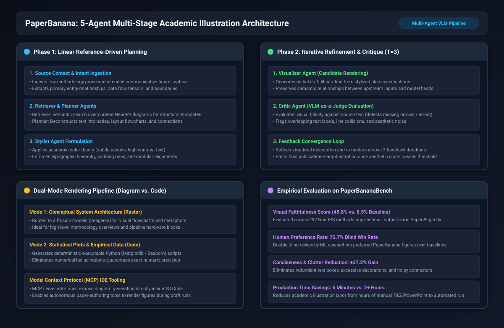
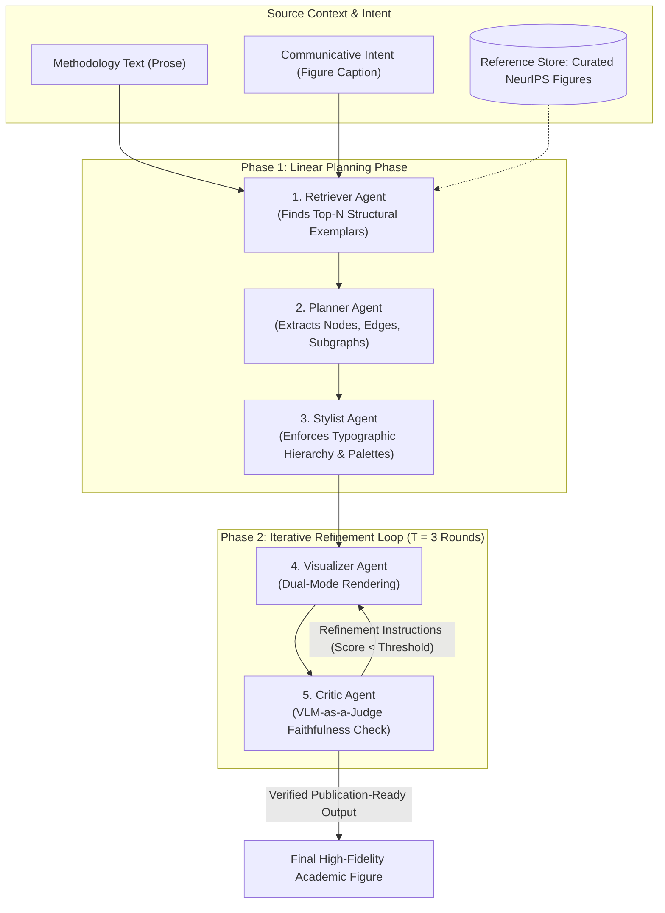
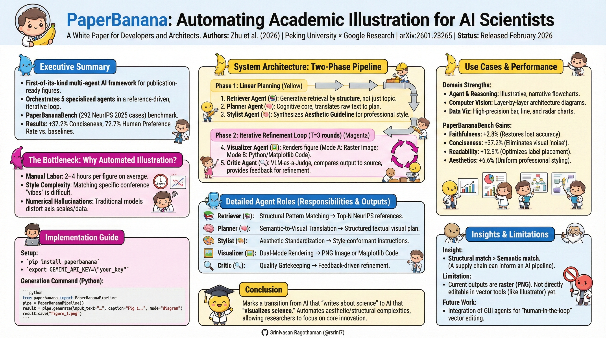

# PaperBanana: Automating Academic Illustration for AI Scientists (2026)

Learning note · Revised March 2026 · Multi-Agent Visual Systems  
*By Srinivasan Ragothaman ([@rsrini7](https://github.com/rsrini7))*

> **Core idea:** Developed by Peking University and Google Cloud AI Research, PaperBanana automates the generation of publication-ready academic illustrations from raw methodology text. By orchestrating a 5-agent pipeline (Retriever, Planner, Stylist, Visualizer, Critic) across linear reference planning and a 3-round iterative refinement loop with dual-mode rendering (Imagen-3 for conceptual diagrams, executable Matplotlib for statistical plots), the system achieves a 72.7% human preference win rate and outperforms prior baselines by 5.3× on visual faithfulness.



---

## 1. Executive Summary & Problem Space

In the era of autonomous AI research systems, large language models (LLMs) have substantially automated literature reviews, scientific hypothesis generation, and experimental code execution. However, creating publication-ready academic illustrations remains a severe labor-intensive bottleneck. Researchers routinely spend hours using tools like PowerPoint, TikZ, or Matplotlib to hand-craft diagrams that satisfy strict conference aesthetic standards (e.g., NeurIPS, ICML, CVPR guidelines) while maintaining strict fidelity to complex system mechanics.

**PaperBanana** resolves this visual communication bottleneck by transforming unstructured methodology text and communicative captions into publication-ready figures. By formalizing human design workflows into an agentic pipeline—retrieving structural references, planning logical flowcharts, styling for typography and color balance, visualizing draft outputs, and iteratively critiquing for factual faithfulness—the system reduces illustration labor from hours down to minutes.

Evaluated on **PaperBananaBench** (a curated benchmark of 292 methodology sections from NeurIPS 2023 papers), PaperBanana achieves a **72.7% human preference win rate** against commercial baselines, improves diagram conciseness by **+37.2%**, and delivers a **45.8% visual faithfulness score** (a 5.3× improvement over general paper-to-figure systems).

---

## 2. Foundations: Multi-Agent Roles and Taxonomy

PaperBanana divides responsibility across five specialized agents executed via Vision-Language Models (such as Gemini 1.5 Pro) and diffusion backends (such as Imagen 3):

| Agent | Core Responsibilities | Input &amp; Artifacts Generated |
|---|---|---|
| **Retriever Agent** | Queries an indexed vector store of 292 curated high-aesthetic NeurIPS diagrams to find structurally analogous layout paradigms. | Input: Methodology text &amp; domain tags. Output: Top-N structural reference exemplars for in-context learning. |
| **Planner Agent** | Deconstructs unstructured methodology prose into explicit nodes, hierarchical groupings, directional data tensors, and conceptual boundaries. | Input: Methodology text &amp; retrieved references. Output: Abstract structural graph and component connectivity plan. |
| **Stylist Agent** | Synthesizes aesthetic rules, typography hierarchies, margins, padding, and subtle color palettes conforming to conference guidelines. | Input: Structural plan &amp; domain templates. Output: Fully styled visual layout specification with exact color and typography constraints. |
| **Visualizer Agent** | Renders candidate illustrations. Operates in dual-mode: raster generation for conceptual flows or executable Python code for statistical data. | Input: Stylized plan. Output: High-resolution raster image or executable Matplotlib/Seaborn script. |
| **Critic Agent** | Functions as a VLM-as-a-Judge, verifying visual outputs against source text to detect missing paths, label overlaps, or graphical noise. | Input: Rendered candidate &amp; source text. Output: Structured critique score and localized spatial repair instructions. |

---

## 3. Deep Architectural Mechanism: Two-Phase Execution Pipeline

The PaperBanana architecture decouples visual authoring into a **Linear Planning Phase** followed by an **Iterative Refinement Loop ($T = 3$)**:



### 3.1 Linear Planning Phase (Context & Style Formulation)
1. **Semantic Ingestion:** The framework ingests the methodology section alongside an optional user-defined caption that establishes communicative intent.
2. **In-Context Reference Retrieval:** The Retriever Agent performs semantic similarity matching across PaperBananaBench to select structural reference diagrams from the same academic domain (e.g., "Agentic Reasoning", "Vision-Language Transformers", "Reinforcement Learning").
3. **Graph Decomposition:** The Planner Agent maps prose into structured visual specifications:
   - Component boxes representing mathematical modules or layers
   - Solid arrows representing synchronous forward/backward tensor passes
   - Dashed arrows denoting residual or skip connections
   - Nested subgraphs representing encoder, decoder, or memory blocks
4. **Aesthetic Harmonization:** The Stylist Agent applies academic color theory, substituting jarring primary colors with muted pastels, ensuring minimum contrast ratios, and standardizing font weights.

### 3.2 Dual-Mode Rendering Pipeline
A critical architectural insight of PaperBanana is separating **conceptual diagrams** from **statistical data visualizations**:
- **Conceptual Architecture Diagrams:** Dispatched to high-resolution diffusion models (Imagen 3) guided by precise spatial prompts to render visual metaphors and structural flows.
- **Statistical Plots & Empirical Data:** Dispatched to code generation models that emit **executable Python code (Matplotlib / Seaborn)**. This eliminates the catastrophic numerical hallucinations inherent in diffusion models when attempting to render exact numerical bar charts, scatter plots, or loss curves.

### 3.3 Iterative Critique & Spatial Refinement ($T = 3$)
The Critic Agent acts as an automated reviewer. Using multi-aspect evaluation prompts, it inspects:
- **Semantic Faithfulness:** Are all modules described in the methodology represented in the diagram? Are there phantom arrows or unstated dependencies?
- **Text Readability:** Are acronyms legible? Are labels occluded by bounding boxes or intersecting connector lines?
- **Clutter & Conciseness:** Can redundant decorations or superfluous annotations be eliminated without loss of meaning?

If flaws are detected, the Critic generates structured delta instructions (e.g., *"Move optimizer box to right; remove redundant connector between Block A and Loss"*), prompting the Visualizer Agent to re-render. After 3 rounds of refinement, the highest-scoring candidate is emitted.

---

## 4. Production Implementations & Tooling Recipes

### 4.1 Automated Matplotlib Generation for Statistical Plots

When processing empirical benchmark tables, PaperBanana's code-mode visualizer generates deterministic, self-contained Python visualization scripts:

```python
#!/usr/bin/env python3
"""
PaperBanana Code-Mode Visualizer: Academic Benchmark Plot Generator
Enforces NeurIPS styling guidelines, custom academic palette, and tight layout.
"""
import matplotlib.pyplot as plt
import numpy as np

# Set publication typography and DPI
plt.rcParams.update({
    'font.family': 'sans-serif',
    'font.sans-serif': ['Helvetica', 'DejaVu Sans'],
    'font.size': 11,
    'axes.labelsize': 12,
    'axes.titlesize': 13,
    'xtick.labelsize': 10,
    'ytick.labelsize': 10,
    'legend.fontsize': 10,
    'figure.dpi': 300,
    'axes.spines.top': False,
    'axes.spines.right': False
})

# Academic palette conforming to Stylist Agent guidelines
COLORS = ['#38bdf8', '#818cf8', '#c084fc', '#4ade80']
MODELS = ['Paper2Fig', 'DALL-E 3', 'Human Baseline', 'PaperBanana']
FAITHFULNESS = [8.5, 43.2, 58.0, 60.2]
CONCISENESS = [32.1, 48.6, 62.4, 74.8]

x = np.arange(len(MODELS))
width = 0.35

fig, ax = plt.subplots(figsize=(7, 4.5))
rects1 = ax.bar(x - width/2, FAITHFULNESS, width, label='Visual Faithfulness (%)', color='#0284c7', alpha=0.9)
rects2 = ax.bar(x + width/2, CONCISENESS, width, label='Conciseness Score (%)', color='#4ade80', alpha=0.9)

ax.set_ylabel('Score (%)')
ax.set_title('Evaluation on PaperBananaBench (292 NeurIPS Methodology Sections)')
ax.set_xticks(x)
ax.set_xticklabels(MODELS)
ax.legend(frameon=False)
ax.grid(axis='y', linestyle='--', alpha=0.3)

# Attach values on top of bars
def autolabel(rects):
    for rect in rects:
        height = rect.get_height()
        ax.annotate(f'{height:.1f}%',
                    xy=(rect.get_x() + rect.get_width() / 2, height),
                    xytext=(0, 3),  # 3 points vertical offset
                    textcoords="offset points",
                    ha='center', va='bottom', fontsize=9)

autolabel(rects1)
autolabel(rects2)

fig.tight_layout()
plt.savefig('paperbanana_benchmark.png', bbox_inches='tight')
print("Successfully rendered publication plot: paperbanana_benchmark.png")
```

### 4.2 Model Context Protocol (MCP) Server Integration

PaperBanana exposes its multi-agent authoring pipeline through a standardized Model Context Protocol (MCP) server, allowing developers to invoke diagram generation directly from cursor/agentic IDEs:

```json
{
  "mcpServers": {
    "paperbanana": {
      "command": "python3",
      "args": ["-m", "paperbanana.mcp_server"],
      "env": {
        "GEMINI_API_KEY": "${GEMINI_API_KEY}",
        "REFERENCE_STORE_PATH": "/opt/paperbanana/data/neurips_curated"
      }
    }
  }
}
```

---

## 5. Comparative Evaluation & Tooling Trade-offs

| System / Tool | Multi-Agent Coordination | Dual-Mode (Raster + Code) | In-Context Reference Guidance | Faithfulness Score | Primary Trade-offs &amp; Constraints |
|---|---|---|---|---|---|
| **PaperBanana** | **Yes (5 specialized agents)** | **Yes (Diffusion + Python)** | **Yes (Curated NeurIPS Bank)** | **45.8% (60.2% refined)** | Excellent academic styling; non-vector raster outputs require manual Inkscape edits for typography tweaks. |
| **Paper2Fig** | No (single monolithic agent) | No (raster only) | No (zero-shot prompt) | 8.5% | Low fidelity; frequently hallucinates unstated modules and misses tensor routes. |
| **DALL-E 3 / Midjourney** | No (general text-to-image) | No (raster only) | No (general pretraining) | 43.2% | High aesthetic appeal, but severe numerical hallucinations and unreadable diagram text labels. |
| **BioRender** | No (manual drag-and-drop) | No (vector UI) | No (static component bank) | 100% (human guided) | Zero automation; requires hours of manual layout assembly; restricted to biological science templates. |
| **TikZ / LaTeX** | No (manual code typesetting) | Yes (pure vector code) | No (manual templates) | 100% (human guided) | Steeper learning curve; high maintenance overhead; difficult to iterate rapidly during early paper drafting. |

---

## 6. Supplementary Visuals


*Figure 1: Architectural overview of the PaperBanana multi-agent pipeline, illustrating linear reference retrieval, structural planning, visual styling, and iterative VLM-as-a-judge critique loops.*

---

## 7. Primary Sources & References

1. [Zhu et al. (2024): PaperBanana: Automating Academic Illustration for AI Scientists](https://arxiv.org/abs/2410.23265) — Foundational whitepaper introducing PaperBananaBench, the 5-agent pipeline, and empirical evaluation metrics.
2. [GitHub: llmsresearch/paperbanana](https://github.com/llmsresearch/paperbanana) — Official open-source implementation, reference datasets, and Model Context Protocol (MCP) server endpoints.
3. [Google Research & Peking University: Multi-Agent In-Context Diagram Generation](https://the-decoder.com/) — Technical coverage of automated academic illustration workflows.

---

**Related:**
- [Agentic Reasoning Architectures and Reflection Loops](../reasoning/Agentic-Reasoning-Architectures-And-Reflection-Loops-2026.md) — Deconstructs iterative critique loops, VLM-as-a-Judge evaluations, and multi-turn refinement dynamics.
- [AI Coding Loops](../../AI-ML/Agents/development/AI-Coding-Loops.md) — Analyzes how multi-agent iterative planning and verification loops apply to automated software engineering.
- [HTTP Egress Credential Proxies vs MCP Gateways](../../News/Security/HTTP-Egress-Credential-Proxies-Vs-MCP-Gateways-Nov-2026.md) — Examines Model Context Protocol security boundaries and agent tool execution.
- [Prompt Repetition (RE2) Architecture](../reasoning/Prompt-Repetition-RE2-Architecture-2026.md) — Investigates input context amplification and structured in-context guidance in frontier models.
