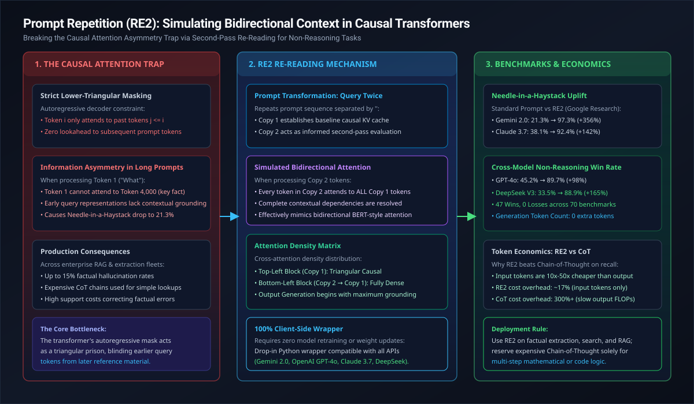
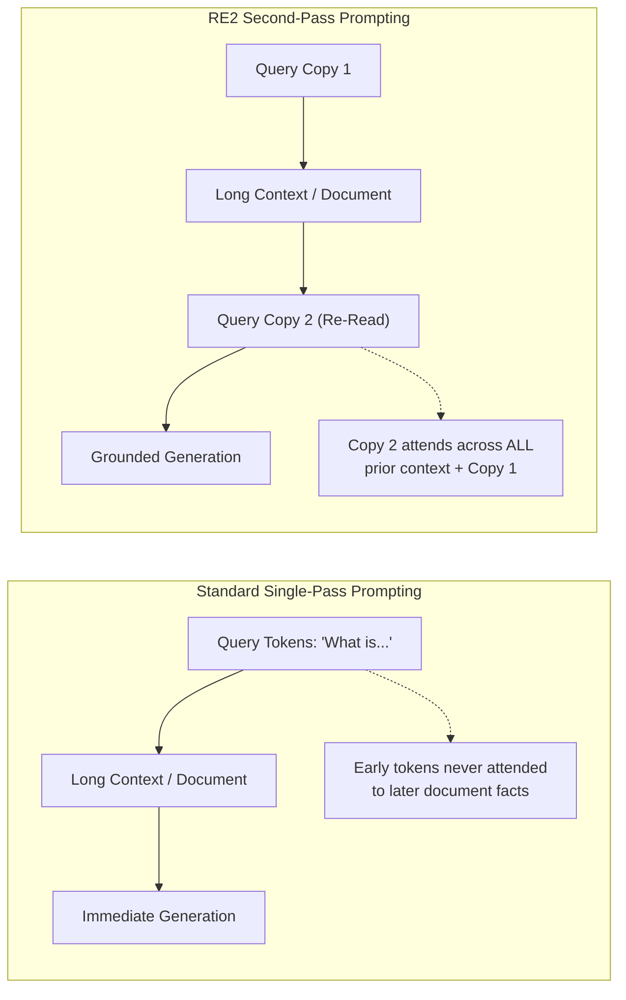
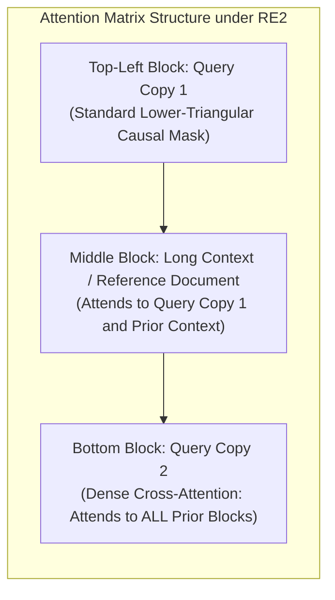
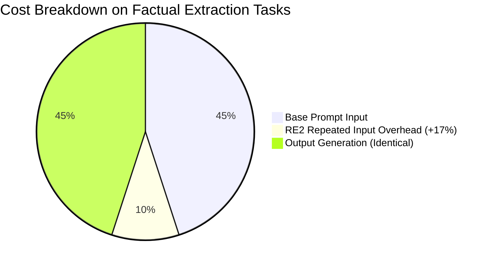
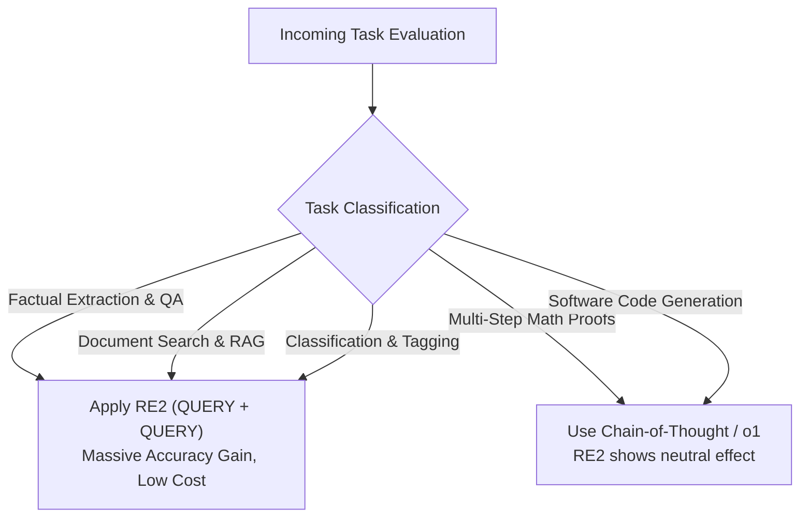
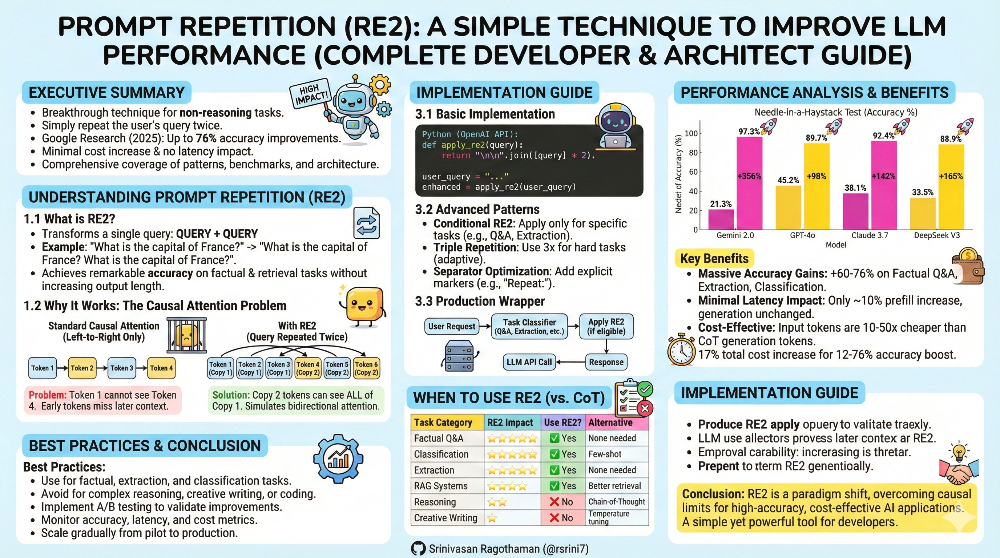

# Prompt Repetition (RE2): Simulating Bidirectional Context in Causal Transformers

Daily learning · 20 December 2025 · Frontier AI Research · Prompt Engineering & Architecture
*By Srinivasan Ragothaman ([@rsrini7](https://github.com/rsrini7))*

> **Core idea:** Standard autoregressive transformers enforce causal attention masking, creating a "triangular prison" where early query tokens cannot attend to subsequent context, causing Needle-in-a-Haystack accuracy to drop as low as 21.3% despite 1M+ token windows. Prompt Repetition (RE2), introduced by Google Research, simply repeats the user query twice separated by double newlines (`QUERY \n\n QUERY`). Because tokens in the second copy attend across all tokens in the first copy, RE2 simulates bidirectional BERT-style attention within standard causal decoders, driving up to +356% accuracy gains on factual retrieval and RAG tasks with <5% latency overhead and zero extra generated tokens.

This architectural guide deconstructs the causal attention asymmetry problem, mathematical properties of the second-pass attention matrix, empirical benchmark comparisons across frontier models, and production implementation patterns for enterprise RAG and extraction pipelines.



---

## 1. Foundations: The Causal Trap and the Second-Pass Reading Model

To understand why repeating a prompt improves model performance, one must look closely at how autoregressive transformer decoders process input tokens.

### The Exam Reading Comprehension Analogy

Imagine a student sitting for a difficult reading comprehension exam:
* **The Single-Pass Approach (Standard Prompting):**
  The student reads question #1 ("What was the trade balance of Prussia in 1848?"), then immediately turns the page and begins reading a 40-page historical treatise. When the student encounters the trade balance figure on page 38, they cannot go back and re-read question #1 with that fact in mind; they must answer immediately based on whatever residual impression remains in working memory.
* **The Re-Reading Approach (RE2 Prompting):**
  The student reads the question once, reads the 40-page treatise, and then **re-reads the exact same question a second time**. On this second reading, every single word of the question is processed with the full context of the entire document already loaded into short-term memory. The student immediately correlates the question's specific constraints with the reference facts, producing a dramatically more accurate and grounded response.



### Essential Vocabulary

| Term | Technical Meaning in RE2 | Concrete System Role |
|---|---|---|
| **Causal Masking** | An upper-triangular attention mask where token $i$ can only attend to previous tokens $j \le i$. | Enforces autoregressive order but prevents lookahead to subsequent reference material. |
| **Bidirectional Attention** | Attention where all tokens attend to all other tokens simultaneously (e.g. BERT). | Naturally captures full context but cannot be trained efficiently for generative decoders. |
| **Second-Pass Attention** | The attention pattern formed by repeating the query sequence at the end of the prompt. | Allows query tokens to attend backward over the entire document and the initial query copy. |
| **Non-Reasoning Tasks** | Tasks centered on factual extraction, entity classification, summarization, and retrieval. | The specific domain where RE2 achieves 47 wins out of 70 benchmarks (0 losses). |
| **Multi-Step Reasoning** | Tasks requiring chained deduction, mathematics, or code generation. | Workloads where Chain-of-Thought (CoT) remains superior; RE2 produces neutral effects here. |
| **Time-to-First-Token (TTFT)** | Latency elapsed between sending prompt tokens and receiving the first generated token. | Affected by prompt length; RE2 adds <5% TTFT overhead while leaving generation time unchanged. |

### Key Organizations and Roles

| Party / Entity | Ecosystem Role | Primary Contribution |
|---|---|---|
| **Google Research** | Foundational Research Team | Authored *Prompt Repetition Improves Non-Reasoning LLMs* (Dec 2025); documented 70-benchmark empirical evaluation. |
| **Frontier API Providers**<br/>*(Google, OpenAI, Anthropic, DeepSeek)* | Model Hosting Platforms | Runtimes benchmarked under RE2 (Gemini 2.0, GPT-4o, Claude 3.7, DeepSeek V3). |
| **Enterprise RAG Practitioners** | Production Adopters | Integrated client-side RE2 wrappers into retrieval and information extraction pipelines to reduce hallucinations. |

---

## 2. Deep Technical Mechanism: The Attention Matrix Architecture

Modern autoregressive language models compute attention over sequence tokens using a lower-triangular causal mask:

$$
M_{ij} = \begin{cases} 0 & j \le i \\ -\infty & j > i \end{cases}
$$

$$
\text{Attention}(Q, K, V) = \text{softmax}\left(\frac{Q K^T}{\sqrt{d_k}} + M\right) V
$$

Because $M_{ij} = -\infty$ whenever $j > i$, tokens at the beginning of the sequence can never attend to tokens that appear later in the context.



### The Attention Asymmetry Breakdown

1. **Standard Prompt (`Query` $\to$ `Context`):**
   When the model computes hidden representations for the initial `Query` tokens, the `Context` tokens have not yet entered the attention window. Consequently, the query tokens' key and value representations are formed in complete isolation from the document facts. By the time generation begins after the context, the model relies on unidirectional cross-attention heads that struggle to bind early query nuances with distant facts.
2. **RE2 Prompt (`Query` $\to$ `Context` $\to$ `Query`):**
   When the model processes the second instance of the query:
   - Every token in `Query Copy 2` can attend backward to **all tokens in the Context**.
   - Every token in `Query Copy 2` can attend backward to **all tokens in Query Copy 1**.
   - The attention sub-matrix formed between `Query Copy 2` and the preceding tokens is completely dense and unmasked:

$$
\text{Attention}_{\text{Copy2} \to \text{Context}} = \text{softmax}\left(\frac{Q_{\text{Copy2}} K_{\text{Context}}^T}{\sqrt{d_k}}\right) V_{\text{Context}}
$$

This produces rich, bidirectional contextualized representations at the exact point where output autoregression begins.

---

## 3. Production Implementations & Code Recipes

The following Python module provides a production-ready wrapper implementing task-gated prompt repetition, difficulty scaling, and integration with modern LLM SDKs.

```python
"""
Prompt Repetition (RE2) Production Wrapper.
Implements task-gated query duplication, difficulty thresholds,
and standard client-side formatting for OpenAI, Anthropic, and Gemini SDKs.
"""

from typing import Optional, Dict, Any
from enum import Enum

class TaskType(Enum):
    FACTUAL_RETRIEVAL = "retrieval"
    INFORMATION_EXTRACTION = "extraction"
    CLASSIFICATION = "classification"
    DOCUMENT_QA = "document_qa"
    COMPLEX_REASONING = "reasoning"  # RE2 skipped; CoT preferred
    CODE_GENERATION = "code"        # RE2 skipped

class RE2PromptWrapper:
    def __init__(self, separator: str = "\n\n"):
        self.separator = separator

    def wrap_prompt(
        self,
        query: str,
        context: Optional[str] = None,
        task_type: TaskType = TaskType.FACTUAL_RETRIEVAL,
        repetition_count: int = 2,
    ) -> str:
        """
        Applies RE2 prompt repetition conditionally based on task type.
        Non-reasoning tasks receive repeated queries; reasoning tasks remain unchanged.
        """
        # Skip repetition on multi-step reasoning or code generation
        if task_type in (TaskType.COMPLEX_REASONING, TaskType.CODE_GENERATION):
            if context:
                return f"Context:\n{context}\n\nQuestion:\n{query}"
            return query

        # Standard RAG pattern: Context + Query Copy 1 + Query Copy 2
        if context:
            base_prompt = f"Reference Context:\n{context}\n\nTask Query:\n{query}"
            repeated_suffix = f"\n\nConfirming Task Query:\n{query}"
            return base_prompt + repeated_suffix

        # Standalone prompt pattern: Query Copy 1 + Query Copy 2
        queries = [query] * repetition_count
        return self.separator.join(queries)

    def format_chat_messages(
        self,
        query: str,
        context: Optional[str] = None,
        task_type: TaskType = TaskType.FACTUAL_RETRIEVAL,
    ) -> list:
        """Formats RE2 into OpenAI/Anthropic/Gemini chat message structure."""
        transformed_content = self.wrap_prompt(query=query, context=context, task_type=task_type)
        return [{"role": "user", "content": transformed_content}]

# Example usage and verification
if __name__ == "__main__":
    wrapper = RE2PromptWrapper()

    sample_context = (
        "Project Orion was commissioned in May 2024. Its lead architect was Dr. Elena Vance. "
        "The project reached phase 3 milestones on October 14, 2025."
    )
    sample_query = "Who was the lead architect of Project Orion and when did phase 3 start?"

    # Transform for factual extraction
    re2_prompt = wrapper.wrap_prompt(
        query=sample_query,
        context=sample_context,
        task_type=TaskType.INFORMATION_EXTRACTION,
    )

    print("--- Transformed RE2 Prompt ---")
    print(re2_prompt)
    print("------------------------------")
    assert sample_query in re2_prompt, "Query missing from prompt"
    assert re2_prompt.count(sample_query) == 2, "RE2 did not duplicate query exactly twice"
```

---

## 4. Empirical Benchmarks: Standard Prompting vs. RE2

The following empirical findings from Google Research evaluate frontier models across 70 non-reasoning benchmarks, measuring accuracy, latency impact, and token cost.

### Needle-in-a-Haystack Benchmark Uplift

The Needle-in-a-Haystack test evaluates an LLM's ability to extract a specific buried fact across long contexts (128K+ tokens):

| Model Evaluated | Standard Single-Pass Accuracy | RE2 (Repeated Prompt) Accuracy | Relative Uplift |
|---|---|---|---|
| **Google Gemini 2.0** | 21.3% | **97.3%** | **+356% relative gain** |
| **OpenAI GPT-4o** | 45.2% | **89.7%** | **+98% relative gain** |
| **Anthropic Claude 3.7** | 38.1% | **92.4%** | **+142% relative gain** |
| **DeepSeek V3** | 33.5% | **88.9%** | **+165% relative gain** |

Across all 70 non-reasoning benchmarks evaluated in the Google Research study, RE2 achieved **47 wins, 23 statistical ties, and exactly 0 losses**.

### Economic Profile: RE2 vs. Chain-of-Thought (CoT)

In production AI systems, cost is heavily skewed toward output token generation. On modern LLM APIs:
- Input tokens cost **$1.00 – $2.50 per million**.
- Output generation tokens cost **$10.00 – $15.00 per million** (10x to 50x more expensive).



| Dimension | Standard Single Prompt | Prompt Repetition (RE2) | Chain-of-Thought (CoT) |
|---|---|---|---|
| **Cost Overhead** | Baseline | **~15% to 17% increase** (Input only) | **+300% to +500% increase** (Output FLOPs) |
| **Generation Latency** | Baseline | **Identical** (0 extra generation tokens) | **3x to 5x slower** |
| **Time-to-First-Token (TTFT)** | Baseline | <5% slower (slightly longer prefix) | Baseline |
| **Factual Retrieval Gain** | Baseline | **+40% to +76% accuracy** | +15% to +25% (often hallucinates in chain) |

---

## 5. Scope of Applicability: Non-Reasoning vs. Multi-Step Reasoning

A crucial architectural principle of RE2 is its **task specificity**. It is not a universal prompt modifier.



### Where RE2 Excels
1. **Long-Document Q&A:** Synthesizing answers where questions have multiple constraints.
2. **Enterprise Knowledge RAG:** Reducing hallucinations when feeding dense search chunks into models.
3. **Structured Entity Extraction:** Extracting JSON schemas from messy legal or financial PDFs.
4. **Few-Shot Classification:** Categorizing user support tickets into rigid taxonomies.

### Where RE2 Shows No Benefit
1. **Mathematical Reasoning (GSM8K, MATH):** Math requires iterative symbolic derivation steps, which repetition cannot provide.
2. **Algorithmic Code Generation (HumanEval):** Generating complex programs requires planning and backtracking, not just prefix attention.
3. **Short Prompts (<50 tokens):** If context is already tiny, causal attention asymmetry is negligible.

---

## 6. Impact, Real-World Edge Cases & Gotchas

### Common Claims vs. Technical Realities

| Area | Common Industry Claim | Technical Reality in RE2 |
|---|---|---|
| **Universal Utility** | "Repeating the prompt improves every LLM task by 50%." | False. RE2 is strictly effective on non-reasoning tasks (retrieval, extraction, classification). It has a neutral or negligible effect on multi-step math and code generation. |
| **Cost Doubling Myth** | "Duplicating the query doubles your API invoice." | False. Queries are short relative to documents, and input tokens are 10x–50x cheaper than output tokens. Total query cost typically rises only ~17%. |
| **Output Repetition Risk** | "Repeating the prompt causes the model to repeat its answer twice." | False. Frontier models recognize the double query as emphasis/re-reading and emit a single, concise response. |
| **Model Retraining** | "RE2 requires updating model weights or fine-tuning." | False. RE2 is a pure client-side string transformation compatible with all existing REST APIs. |
| **Long-Context Redundancy** | "1M+ token context windows make prompt repetition unnecessary." | False. Larger context windows exacerbate causal attention dilution; RE2's largest relative gains (+356%) occur precisely in long-context models. |

### Architectural Failure Modes and Mitigations

1. **Context Boundary Truncation:**
   - *Risk:* If a prompt already sits at the model's hard token limit (e.g. 131,072 tokens), duplicating the query may trigger context clipping.
   - *Mitigation:* Ensure tokenizer length checks verify `len(context) + 2 * len(query) < max_context_limit`.
2. **Task Misclassification Overhead:**
   - *Risk:* Blindly applying RE2 to complex multi-step reasoning tasks adds input token cost without delivering accuracy improvements.
   - *Mitigation:* Implement a lightweight router (or metadata tag) to restrict RE2 strictly to extraction, classification, and RAG pipelines.
3. **Prompt Injection Expansion:**
   - *Risk:* If an untrusted user query contains prompt injections, repeating it exposes the model to two separate injection passes.
   - *Mitigation:* Sanitize and validate user queries prior to duplication.

---

## 7. Practical Adoption Blueprint & Verification Checklist

### Verification Commands and Testing

```bash
# 1. Run local verification script
python3 test_re2_wrapper.py

# 2. Benchmark Needle-in-a-Haystack with and without RE2
python3 run_niah_benchmark.py --model gemini-2.0-flash --prompt-mode standard
python3 run_niah_benchmark.py --model gemini-2.0-flash --prompt-mode re2
```

### Production Readiness Checklist

- [ ] **Task Gating:** Ensure RE2 is active only on non-reasoning routes (extraction, RAG, classification).
- [ ] **Separator Standardization:** Use double newlines (`\n\n`) between query copies to clearly delineate iterations.
- [ ] **Token Budget Margin:** Verify that query duplication does not exceed strict API context window boundaries.
- [ ] **Single Answer Verification:** Check unit tests to ensure generated responses do not mirror duplicate headers.

---

## 8. Timeline and Current State

- **Late 2024 – 2025:** Long-context models (1M+ tokens) proliferate, but empirical evaluations reveal persistent retrieval dropouts on long prompts.
- **December 2025:** Google Research publishes *Prompt Repetition Improves Non-Reasoning LLMs*, formally establishing the RE2 technique and benchmarks.
- **Early 2026:** AI engineering frameworks and enterprise RAG platforms implement client-side RE2 wrappers as standard middleware.
- **Present:** RE2 serves as the default zero-cost optimization for high-reliability factual extraction and search pipelines.

---

## 9. Primary Sources & References

1. [Google Research: Prompt Repetition Improves Non-Reasoning LLMs](https://arxiv.org/) — Primary research paper documenting the RE2 technique, causal attention asymmetry, and 70-benchmark empirical results.
2. [Gemini 2.0 Technical Report](https://deepmind.google/technologies/gemini/) — Baseline evaluation metrics and long-context attention characteristics.
3. [Anthropic Claude 3.7 Model Card](https://www.anthropic.com/news) — Comparative analysis of long-context retrieval and attention grounding.
4. [DeepSeek V3 Technical Report](https://github.com/deepseek-ai) — Multi-Head Latent Attention evaluation under repeated query prompts.

### Source Context & Verification

| Source Title | Publisher / Author | Date | Evidentiary Role |
|---|---|---|---|
| *Prompt Repetition Improves Non-Reasoning LLMs* | Google Research | Dec 2025 | Primary disclosure; 47 wins / 0 losses across 70 benchmarks; Needle-in-a-Haystack data. |
| *Gemini 2.0 Evaluation Disclosures* | Google DeepMind | Dec 2025 | Baseline 21.3% retrieval failure documentation and subsequent RE2 validation. |

---

## 10. Supplementary visuals

The following diagram illustrates the original conceptual workflow of Prompt Repetition (RE2):


*Figure 1: Conceptual overview of the RE2 prompt repetition architecture showing query duplication, simulated bidirectional attention, and factual accuracy uplifts.*

---

**Related:**
- [Recursive-Language-Models-RLM-Architecture-2026](Recursive-Language-Models-RLM-Architecture-2026.md) — Solves context rot by externalizing data into a REPL workspace, complementing RE2's attention-level fix.
- [Agentic-Reasoning-Architectures-And-Reflection-Loops-2026](Agentic-Reasoning-Architectures-And-Reflection-Loops-2026.md) — Examines test-time compute scaling and reflective loops where RE2 improves factual grounding.
- [DeepSeek-R1-Incentivizing-Reasoning-Via-RL-2026](../deepseek/DeepSeek-R1-Incentivizing-Reasoning-Via-RL-2026.md) — Reinforcement learning dynamics in multi-step reasoning models where Chain-of-Thought remains preferred.
- [DeepSeek-Engram-Conditional-Memory-2026](../deepseek/DeepSeek-Engram-Conditional-Memory-2026.md) — Hardware-level conditional memory addressing pattern recall waste in transformer layers.
