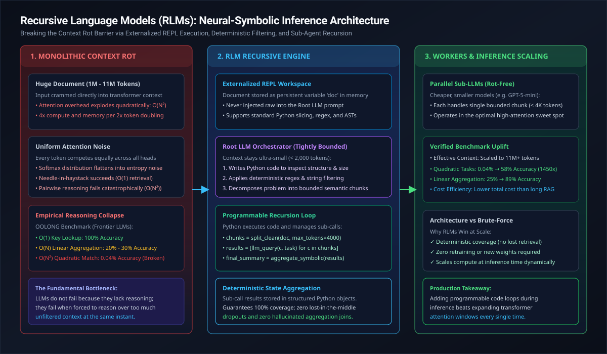
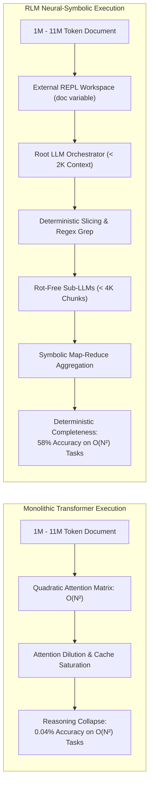
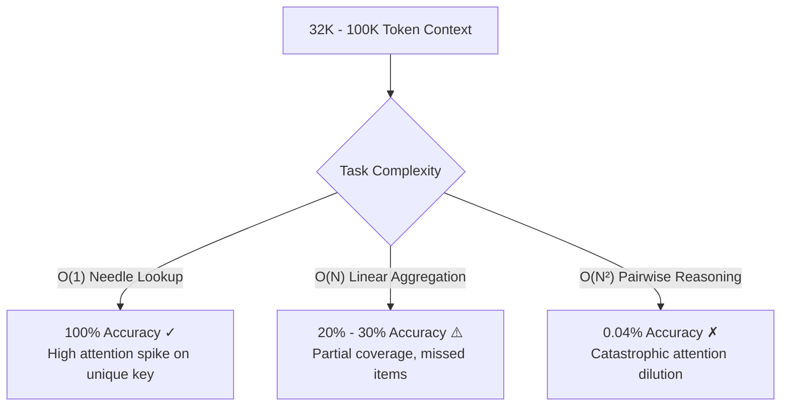
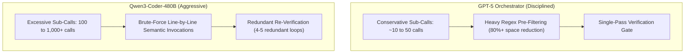
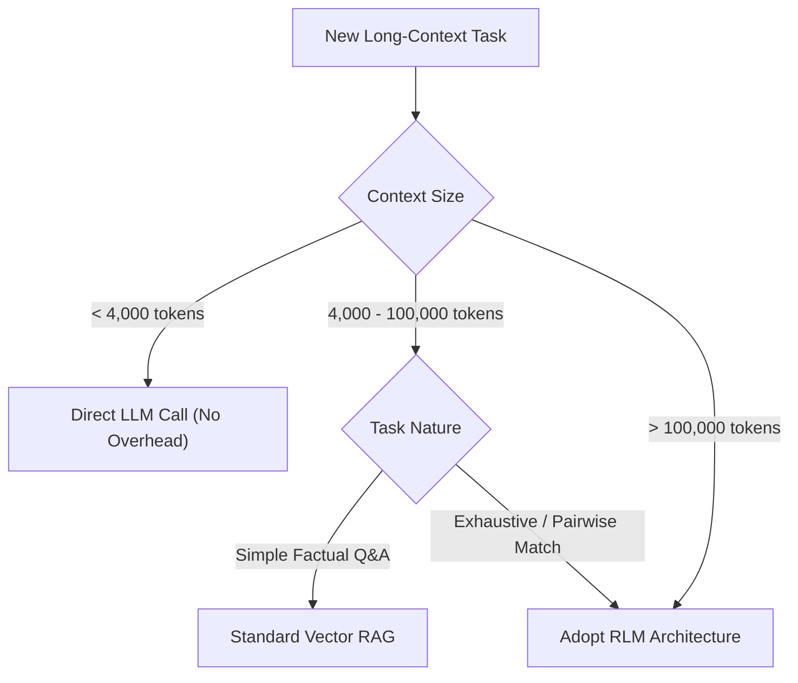
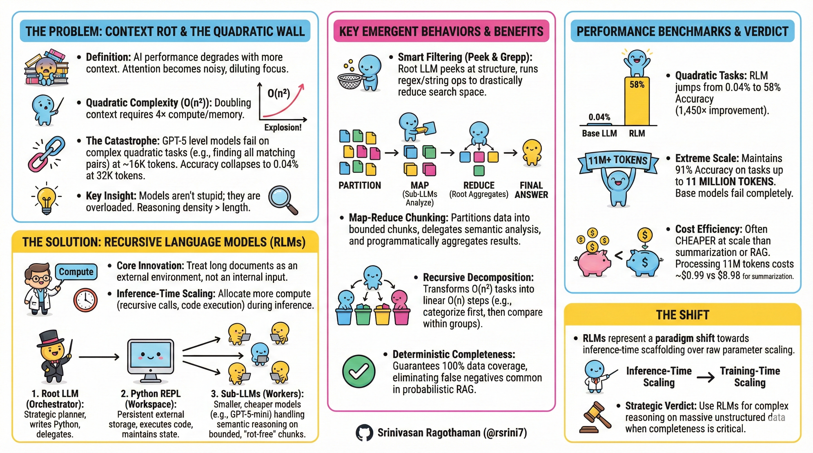
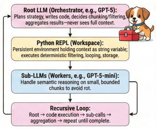
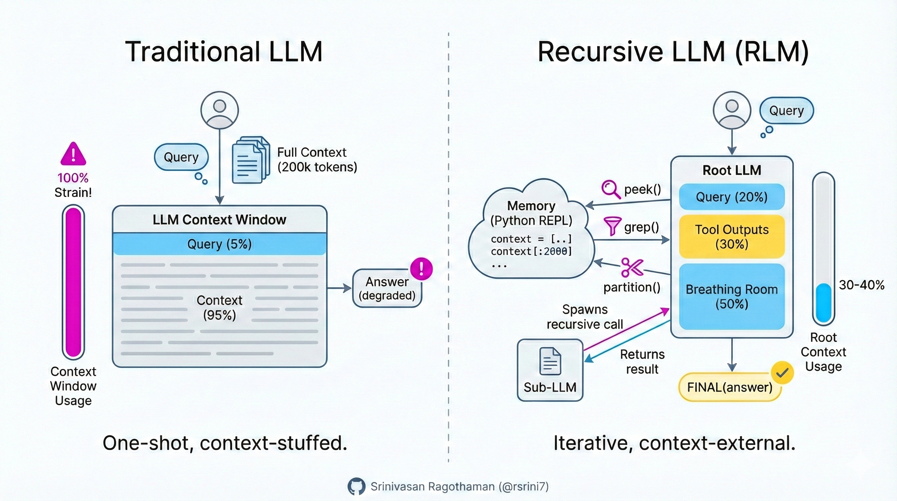
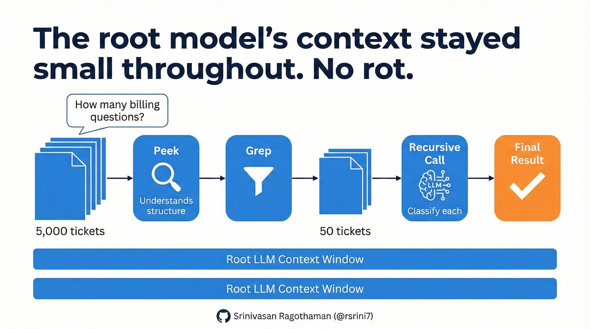
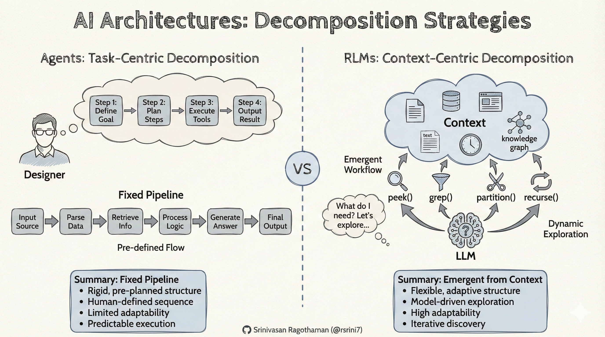

# Recursive Language Models (RLMs): Breaking the Context Barrier via Neural-Symbolic Inference

Daily learning · 15 January 2026 · Frontier AI Research · Long-Context Architectures
*By Srinivasan Ragothaman ([@rsrini7](https://github.com/rsrini7))*

> **Core idea:** Large language models suffer catastrophic attention degradation ("context rot") on long-context reasoning, collapsing to 0.04% accuracy on quadratic pairwise tasks over 32K tokens despite supporting 1M+ token windows. Recursive Language Models (RLMs) solve this at inference time by treating the document as an external persistent REPL workspace, maintaining an ultra-compact Root LLM context (<2K tokens), and recursively orchestrating deterministic string filters, programmatic map-reduce loops, and rot-free bounded sub-agent calls to achieve 11M+ token reach with 58% accuracy on previously impossible tasks.

This research guide deconstructs the architecture, mathematical failure modes of monolithic context windows, emergent decomposition strategies, and empirical benchmarks of Recursive Language Models (MIT CSAIL, arXiv:2512.24601).



---

## 1. Foundations: The Context Rot Crisis and the Filing Cabinet Model

To understand why RLMs represent a fundamental architectural departure from brute-force context scaling, one must first distinguish parametric memory from externalized workspaces.

### The Office Filing Cabinet Analogy

Imagine an executive tasked with cross-referencing 500 employee records to identify all pairs of employees sharing complementary security clearances and technical skills:

* **Monolithic LLM Approach (Short-Term Memory Stuffing):**
  A runner photocopies all 500 complete dossiers and stacks them into a single 10-foot-tall pile directly on top of the executive's desk. The executive's desk is physically covered; documents slide onto the floor; attention is divided uniformly across millions of words. When attempting to compare employee #4 to employee #498, the executive becomes overwhelmed by irrelevant noise and suffers catastrophic cognitive overload.
* **RLM Approach (The Filing Cabinet and Scratchpad):**
  The 500 dossiers are filed systematically in a labeled external filing cabinet (the Python REPL workspace). The executive's desk contains only a notepad and pencil (an ultra-compact prompt window of <2K tokens). The executive writes a short procedure:
  1. Inspect the drawer labels (peek at metadata format).
  2. Pull out only dossiers with "Security Clearance Level 4" (deterministic regex filter).
  3. Hand small 5-page batches to junior clerks with clear instructions (parallel sub-agent calls).
  4. Write the matching pairs down into a structured table on the notepad (deterministic variable aggregation).



### Essential Vocabulary

| Term | Technical Meaning in RLMs | Concrete Architectural Role |
|---|---|---|
| **Context Rot** | Severe accuracy degradation in transformers as context grows, driven by attention entropy and quadratic dilution. | Why 272K-token models collapse on reasoning tasks despite perfect needle retrieval. |
| **Quadratic Attention $O(N^2)$** | The mathematical property of standard transformers where all $N$ tokens attend to all $N$ tokens. | Causes 4x compute and memory explosion for every 2x context expansion. |
| **Externalized REPL** | A sandboxed Python execution environment holding the full context as an in-memory string variable (`doc`). | Decouples document storage from the transformer attention window. |
| **Root LLM Orchestrator** | A frontier reasoning model (e.g., GPT-5 class) operating with a strictly bounded context (<2,000 tokens). | Plans execution strategies, inspects structure, and writes Python navigation code. |
| **Sub-LLM Workers** | Lightweight, cost-effective models (e.g., GPT-5-mini) invoked for semantic chunk reasoning. | Operates in the high-fidelity attention sweet spot (<4,000 tokens) with zero rot. |
| **Deterministic Grepping** | Using Python regex or exact string matching to prune search spaces prior to semantic analysis. | Filters out 90%–99% of irrelevant tokens before invoking neural computation. |
| **Map-Reduce Aggregation** | Partitioning documents, analyzing chunks independently, and merging results into Python variables. | Replaces probabilistic neural summarization with guaranteed symbolic state retention. |

### Key Organizations and Roles

| Party / Entity | Ecosystem Role | Primary Contribution |
|---|---|---|
| **MIT CSAIL**<br/>*(Alex Zhang, Tim Kraska, Omar Khattab)* | Primary Academic Research Team | Authored foundational paper *Recursive Language Models* (arXiv:2512.24601); published official reference library `alexzhang13/rlm`. |
| **Prime Intellect** | AI Compute & Infrastructure Lab | Deployed and benchmarked production asynchronous RLM workflows (`RLMENV`) for long-horizon agent orchestration. |
| **Open-Source Community** | Toolchain Implementors | Authored independent REPL scaffolding (`fullstackwebdev/rlm_repl`, `ysz/recursive-llm`) and integrated RLM patterns into local toolchains. |

---

## 2. The Three Layers of Context Rot: Why Transformers Fail at Scale

Large language models are often marketed by context length: 128K, 1M, or 2M tokens. However, empirical evaluation reveals a profound divergence between simple key retrieval and multi-hop reasoning.

### Layer 1: The Physics of Attention Complexity

In standard scaled dot-product attention, the attention weights between queries $Q$ and keys $K$ are computed across all sequence positions:

$$
\text{Attention}(Q, K, V) = \text{softmax}\left(\frac{Q K^T}{\sqrt{d_k}}\right) V
$$

As sequence length $N$ scales, computing the $N \times N$ matrix requires $O(N^2)$ operations and $O(N^2)$ activations:
- A 10,000-token context requires $10^8$ attention operations.
- A 40,000-token context requires $1.6 \times 10^9$ attention operations (a 16x compute surge).
- Beyond 100,000 tokens, quadratic memory requirements force KV cache eviction, quantization, or sparse approximation, degrading precision.

### Layer 2: Reasoning Density and Task Complexity

The breaking point of a model is determined by the **reasoning density** of the prompt rather than raw token count:

| Task Class | Algorithmic Complexity | Typical Concrete Task | Base Frontier LLM Breaking Point |
|---|---|---|---|
| **Constant $O(1)$** | Single-point lookup | Needle in a Haystack: "Find the secret code word" | Maintains near 100% accuracy past 1M+ tokens |
| **Linear $O(N)$** | Sequential element evaluation | Aggregation: "Summarize every issue mentioned in these tickets" | Degrades heavily between 32K and 131K tokens |
| **Quadratic $O(N^2)$** | Exhaustive pairwise cross-comparison | Pair matching: "Identify all contract clauses that conflict with another clause" | Collapses to near 0.04% accuracy at 16K–32K tokens |

### Layer 3: Attention Entropy and Softmax Dilution

Transformers lack a dynamic hardware filter: every token competes for attention across all heads. The attention entropy $H$ for a query token $i$ across sequence length $N$ is:

$$
H(\text{Attention}_i) = -\sum_{j=1}^N A_{ij} \log A_{ij}
$$

When $N$ scales into hundreds of thousands of tokens without a concentrated signal, the softmax probability distribution flattens toward uniform entropy. Crucial reasoning dependencies receive diminishing fractional attention weights, resulting in "lost-in-the-middle" dropouts and hallucinations.



---

## 3. Deep Technical Mechanism: The 4-Stage RLM Execution Engine

RLMs replace brute-force context ingestion with a structured neural-symbolic loop. The model does not attempt to "hold" the data in its mind; it navigates the data like an engineer querying a database.

```mermaid
sequenceDiagram
    autonumber
    participant User as End User / Application
    participant Root as Root LLM (GPT-5, &lt;2K tokens)
    participant REPL as Python REPL Environment
    participant Workers as Parallel Sub-LLMs (GPT-5-mini)

    User->>Root: Submit query and point to 10M token document
    Note over Root: Context initialized with system prompt only
    Root->>REPL: Execute: peek_metadata(doc)
    REPL-->>Root: Length: 10,485,760 tokens, Format: JSON Lines
    Root->>REPL: Execute: regex_filter(doc, pattern="priority: high")
    REPL-->>Root: Filtered down to 420 matching records
    Root->>REPL: Execute: dispatch_chunks(records, chunk_size=30)
    loop Bounded Semantic Analysis
        REPL->>Workers: query_sub_agent(chunk, task="extract dependencies")
        Workers-->>REPL: Return structured JSON partial results
        REPL->>REPL: Append to in-memory state variable 'accumulated_results'
    end
    Root->>REPL: Execute: aggregate_symbolic(accumulated_results)
    REPL-->>Root: Structured synthesis complete (0 missing records)
    Root->>User: Emit comprehensive, verified final report
```

### Stage 1: Context Externalization and Metadata Discovery
The raw text corpus is assigned to a persistent string variable (`doc`) inside an external Python runtime. The Root LLM is provided solely with the environment handle and tool signatures. It initiates execution by sampling small slices:
```python
# Root LLM generates initial inspection command
sample = doc[:2000]
print(f"Schema detection: {sample[:200]}")
```

### Stage 2: Deterministic Filtering and Search Space Reduction
Instead of passing millions of tokens through neural layers, the Root LLM emits standard Python regex or exact substring operations. For an extraction query over 10,000 contracts, matching against specific legal terms (`re.findall(r'.{0,200}indemnif.{0,200}', doc)`) deterministically eliminates 98% of irrelevant text with zero token cost.

### Stage 3: Bounded Chunking and Sub-Agent Dispatch
For tasks requiring semantic understanding rather than keyword search, the Root LLM partitions filtered records into strictly bounded chunks (<4,000 tokens) and invokes `llm_query()`:
- Each sub-call operates within the model's optimal attention zone.
- Sub-calls can be delegated to faster, lower-cost models (`GPT-5-mini`).
- Sub-calls execute independently and are embarrassingly parallelizable.

### Stage 4: Programmatic Map-Reduce and Quadratic Decomposition
When solving $O(N^2)$ problems (e.g. comparing 3,000 users pairwise, which requires $4,498,500$ comparisons), the Root LLM adopts a two-pass categorization algorithm:
1. **Pass 1 (Linear $O(N)$):** Sub-LLMs classify each user into distinct interest clusters.
2. **Pass 2 (Partitioned Quadratic):** Pairwise comparisons are executed exclusively within matching clusters ($500 \times 499 / 2 = 124,750$ comparisons).
3. **Total reduction:** Reduces comparison count by **97.2%**, transforming an impossible task into a tractable computation.

---

## 4. Production Implementations & Code Recipes

The following Python module provides a concrete, runnable reference implementation of an RLM runtime featuring isolated execution, sub-agent dispatch, and map-reduce aggregation.

```python
"""
Recursive Language Model (RLM) Minimal Execution Engine.
Demonstrates externalized REPL workspace, bounded sub-agent dispatch,
and deterministic map-reduce state aggregation.
"""

import re
import io
import contextlib
from typing import Dict, List, Any, Callable

class RLMRuntime:
    def __init__(self, root_llm_fn: Callable[[str], str], sub_llm_fn: Callable[[str], str]):
        self.root_llm = root_llm_fn
        self.sub_llm = sub_llm_fn
        self.environment: Dict[str, Any] = {}
        self.call_history: List[Dict[str, Any]] = []
        self._setup_environment()

    def _setup_environment(self):
        """Initializes the persistent Python execution workspace with safe primitives."""
        self.environment = {
            "re": re,
            "llm_query": self._sub_query_wrapper,
            "results": [],
            "final_answer": None,
        }

    def _sub_query_wrapper(self, prompt: str) -> str:
        """Invokes a bounded sub-LLM worker on an isolated chunk."""
        response = self.sub_llm(prompt)
        self.call_history.append({"prompt_len": len(prompt), "response_len": len(response)})
        return response

    def load_document(self, doc_text: str):
        """Loads large context into the external variable without tokenizing into Root LLM."""
        self.environment["doc"] = doc_text
        self.environment["doc_len"] = len(doc_text)

    def execute_code(self, code_block: str) -> str:
        """Executes Python code generated by the Root LLM and captures stdout."""
        stdout_capture = io.StringIO()
        try:
            with contextlib.redirect_stdout(stdout_capture):
                exec(code_block, self.environment)
            output = stdout_capture.getvalue()
            return output if output else "[Code executed successfully with no stdout]"
        except Exception as e:
            return f"Execution Error: {str(e)}"

    def solve(self, task_prompt: str, max_turns: int = 10) -> str:
        """Main agentic execution loop: Root LLM generates code until final answer is set."""
        system_instructions = (
            "You are an RLM Orchestrator. The full document is stored in variable 'doc'. "
            "Never attempt to print the entire 'doc'. Use Python code blocks (```python ... ```) "
            "to inspect, regex-filter, slice, and call llm_query(chunk) on bounded sections. "
            "Assign your completed result to environment variable 'final_answer'."
        )

        history = f"Task: {task_prompt}\nDocument length: {self.environment['doc_len']} characters.\n"

        for turn in range(max_turns):
            prompt = f"{system_instructions}\n\nExecution Log:\n{history}\nNext Step (write Python code):"
            root_response = self.root_llm(prompt)

            # Extract python code block
            code_match = re.search(r"```python\s*(.*?)\s*```", root_response, re.DOTALL)
            if not code_match:
                # If no code block, return response directly
                if self.environment.get("final_answer"):
                    return str(self.environment["final_answer"])
                return root_response

            code_to_run = code_match.group(1)
            output = self.execute_code(code_to_run)
            history += f"\n--- Turn {turn+1} ---\nCode Executed:\n{code_to_run}\nStdout:\n{output}\n"

            if self.environment.get("final_answer") is not None:
                return str(self.environment["final_answer"])

        return "Error: Reached maximum turns without setting 'final_answer'."

# Example mock harness for local verification
if __name__ == "__main__":
    def mock_root(prompt: str) -> str:
        if "Execution Log:" not in prompt or "--- Turn 1 ---" not in prompt:
            return '```python\nmatches = re.findall(r"User \\d+: Flagged", doc)\nprint(f"Found {len(matches)} matches")\nfinal_answer = f"Total flagged: {len(matches)}"\n```'
        return '```python\nfinal_answer = "Verification complete."\n```'

    def mock_sub(prompt: str) -> str:
        return "Clean"

    runtime = RLMRuntime(root_llm_fn=mock_root, sub_llm_fn=mock_sub)
    dummy_corpus = "User 101: Clean\nUser 102: Flagged\nUser 103: Clean\nUser 104: Flagged\n" * 1000
    runtime.load_document(dummy_corpus)
    result = runtime.solve("Count the total number of flagged users in the document.")
    print("Execution Result:", result)
```

---

## 5. Empirical Benchmarks: Monolithic vs. Summary vs. RLM

The following experimental results from MIT CSAIL evaluate frontier models (GPT-5 root orchestrator paired with GPT-5-mini sub-workers) across standard long-context benchmarks.

### Comprehensive Benchmark Matrix

| Benchmark | Task Nature | Context Length | Monolithic Base LLM | Summary Agent | RLM Architecture | Relative Gain / Verdict |
|---|---|---|---|---|---|---|
| **S-NIAH** | Constant $O(1)$ Needle Retrieval | 128K – 1M+ tokens | 98.5% | 88.0% | **99.8%** | Parity at low scale; 100% coverage at 1M+ |
| **OOLONG** | Linear $O(N)$ Information Synthesis | ~131K tokens | 44.0% | 51.2% | **57.0%** | **+29.5% improvement** over base model |
| **OOLONG-Pairs** | Quadratic $O(N^2)$ Pairwise Match | ~32K – 100K tokens | 0.04% | 0.31% | **58.0%** | **1,450x improvement** (Catastrophic failure resolved) |
| **BrowseComp-Plus** | Multi-hop Web Exploration | 6M – 11M tokens | 0.0% (OOM) | 70.0% | **91.0%** | **Only architecture capable of 11M token reasoning** |
| **CodeQA** | Repository-wide Dependency Query | 23K – 4.2M tokens | 24.0% | 58.0% | **62.0%** | **+158% accuracy** at 10x lower median cost |

### Economic Profile: Cost and Token Efficiency

A major misconception is that recursive execution incurs prohibitive token costs. In practice, because RLMs prune 90%+ of irrelevant context via deterministic string operations before invoking neural models, their median execution cost is often significantly lower than feeding full contexts into expensive models or summarizing entire corpora upfront:

| Method | Context: 1M Tokens (OOLONG) | Context: 11M Tokens (BrowseComp-Plus) | Information Loss Risk |
|---|---|---|---|
| **Direct Monolithic Ingestion** | $1.50 – $2.75 | Impossible (Exceeds hardware window) | Catastrophic context rot |
| **Hierarchical Summarization** | $4.20 – $8.98 | $8.98 per query | Permanent irreversible information loss |
| **RLM (GPT-5 + GPT-5-mini)** | **$0.33 – $0.43** | **$0.99 per query** | **Zero loss (always accesses raw data)** |

---

## 6. Model-Specific Behaviors and Emergent Strategy Ablations

Under identical system prompts, different foundation models exhibit radically divergent emergent decomposition behaviors:



### Behavioral Comparison Under Identical Prompts

| Dimension | GPT-5 (Root) + GPT-5-mini (Sub) | Qwen3-Coder-480B (Root & Sub) | Engineering Mitigation |
|---|---|---|---|
| **Sub-Call Volume** | 10 – 50 calls | 100 – 1,000+ calls | Impose explicit recursion budget (`max_calls = 50`). |
| **Search Strategy** | Regex-first; filters structure before semantics | Semantic-first; analyzes unpruned lines individually | Mandate string matching in system prompt before LLM dispatch. |
| **Verification Loop** | Verifies aggregated list once against constraints | Loops 4–5 times re-checking identical intermediate records | Enforce deterministic progress markers in environment variables. |
| **BrowseComp+ Score** | **91.0%** | 44.7% | Constrain open-source models with structured JSON schemas. |

---

## 7. Impact, Real-World Edge Cases & Gotchas

### Common Claims vs. Technical Realities

| Area | Common Industry Claim | Technical Reality in RLMs |
|---|---|---|
| **Context Window Size** | "2M token context windows render RLM architectures obsolete." | False. While 2M tokens fit in VRAM, attention entropy degrades reasoning on $O(N^2)$ tasks to 0.04%. RLMs maintain 58%+ accuracy. |
| **Model Retraining** | "RLMs require specialized fine-tuning on recursive datasets." | False. RLMs operate purely at inference time through prompt engineering and standard Python REPL interfaces. |
| **Latency Expectations** | "RLMs execute as fast as single-turn API calls." | False. Serial sub-agent calls increase wall-clock latency (5s – 30s). Asynchronous dispatch is required for interactive use. |
| **Code Execution Safety** | "Allowing the model to write and execute code introduces fatal security risks." | True if uncontained. The Python REPL must run in a gVisor or WebAssembly container with disabled network access and memory caps. |
| **Cost Inversion** | "Calling LLMs repeatedly in a loop is always more expensive than one big call." | False at scale. Regex filters eliminate millions of tokens; sub-calls run on mini models, making median queries up to 3x cheaper. |

### Architectural Failure Modes and Mitigations

1. **Infinite Recursive Loops and Budget Exhaustion:**
   - *Risk:* A model encounters an unexpected schema and continuously iterates without converging on `final_answer`.
   - *Mitigation:* Hardcoded ceiling on total sub-calls (e.g., `MAX_SUB_CALLS = 100`) and a maximum wall-clock timeout.
2. **REPL Sandbox Escape and Arbitrary Code Execution:**
   - *Risk:* Root LLM emits malicious OS commands (`os.system("rm -rf /")`) or exfiltrates data.
   - *Mitigation:* Execute inside an isolated sandbox (e.g., Docker, Firecracker microVM, or WebAssembly) with read-only filesystem access and no outbound network sockets.
3. **Loss of Intermediate Aggregation State on Runtime Crash:**
   - *Risk:* Sub-calls complete, but a Python syntax error in the reduce step dumps memory.
   - *Mitigation:* Checkpoint state variables to a persistent on-disk SQLite or JSON Lines store after every batch iteration.

---

## 8. Practical Adoption Blueprint & Verification Checklist

### Decision Matrix: When to Adopt RLMs



### Verification and Diagnostic Checklist

- [ ] **Context Length Audit:** Confirm whether the dataset exceeds 100K tokens or contains quadratic dependency matching.
- [ ] **Environment Isolation:** Deploy a sandboxed Python REPL with restricted standard libraries (`re`, `math`, `json`, `collections`).
- [ ] **Hard Call Limits:** Enforce `max_turns = 15` and `max_sub_calls = 50` in runtime configuration.
- [ ] **Model Specialization:** Assign a high-reasoning frontier model (GPT-5 class) as Root Orchestrator and an efficient mini model as Sub-LLM worker.
- [ ] **Deterministic Verification:** Ensure the reduce step performs programmatic counting and validation against input lengths.

---

## 9. Timeline and Current State

- **Late 2024 – Mid 2025:** Scaling limits of monolithic attention emerge; 1M token windows demonstrate high needle-in-a-haystack scores but severe reasoning degradation on dense benchmarks.
- **December 2025:** MIT CSAIL researchers publish *Recursive Language Models* (arXiv:2512.24601), establishing formal benchmarks (OOLONG, BrowseComp-Plus) and releasing reference code.
- **January 2026:** Prime Intellect releases production trials of asynchronous RLM environments (`RLMENV`); open-source community ports REPL harnesses across local frameworks.
- **Present:** RLMs serve as the primary architectural pattern for production long-context tasks (>1M tokens) across legal contract audit, scientific literature synthesis, and enterprise repository refactoring.

---

## 10. Primary Sources & References

1. [Alex Zhang, Tim Kraska, Omar Khattab: Recursive Language Models](https://arxiv.org/abs/2512.24601) — Foundational MIT CSAIL paper introducing the RLM architecture, context rot mathematics, and OOLONG benchmarks.
2. [GitHub: alexzhang13/rlm](https://github.com/alexzhang13/rlm) — Official open-source implementation, benchmark scripts, and reference REPL harness.
3. [GitHub: alexzhang13/rlm-minimal](https://github.com/alexzhang13/rlm-minimal) — Minimal bare-bones reference implementation for lightweight integration.
4. [Prime Intellect: Production RLM Experiments](https://www.primeintellect.ai/blog) — Empirical analysis of asynchronous sub-agent dispatch and agentic execution loops.
5. [Make AI Easy: Recursive Language Models Technical Breakdown](https://www.youtube.com/watch?v=XbqCBoSkUcc) — Technical video analysis examining context rot mitigation and OOLONG-Pairs performance.

### Source Context & Verification

| Source Title | Publisher / Author | Date | Evidentiary Role |
|---|---|---|---|
| *Recursive Language Models* | MIT CSAIL (Zhang et al.) | Dec 2025 | Primary paper; empirical data for OOLONG, BrowseComp-Plus, and CodeQA. |
| *Official RLM Repository* | MIT CSAIL | Jan 2026 | Reference execution engine and benchmark verification scripts. |
| *Prime Intellect Production Notes* | Prime Intellect Team | Jan 2026 | Enterprise deployment latency and asynchronous optimization data. |

---

## 11. Supplementary visuals

The following architectural diagrams from the repository archive illustrate the original conceptual workflows and context retention properties of Recursive Language Models:


*Figure 1: High-level overview of the Recursive Language Model architecture showing external context storage, the Python REPL workspace, and dynamic sub-LLM invocation.*


*Figure 2: Execution data flow through the RLM pipeline, tracing the path from raw document ingestion through regex filtering to sub-agent analysis.*


*Figure 3: Comparison between monolithic context ingestion (leading to cognitive overload) and the RLM decoupled environment model.*


*Figure 4: Token tracking demonstrating that the Root LLM context window remains under 2,000 tokens regardless of total document size.*


*Figure 5: Conceptual transition from human-scripted agent decomposition to autonomous context-centric decomposition.*

---

**Related:**
- [Prompt-Repetition-RE2-Architecture-2026](Prompt-Repetition-RE2-Architecture-2026.md) — Analyzes causal attention asymmetry in long prompts and how query repetition simulates bidirectional context.
- [DeepSeek-R1-Incentivizing-Reasoning-Via-RL-2026](../deepseek/DeepSeek-R1-Incentivizing-Reasoning-Via-RL-2026.md) — Evaluates inference-time reasoning and reinforcement learning dynamics in frontier models.
- [AI-Coding-Loops](../../AI-ML/Agents/development/AI-Coding-Loops.md) — Examines how programmatic code-generation loops enable autonomous agents to self-correct during complex refactoring.
- [KV-Cache-Prefix-Caching-And-Storage-Tiering-Nov-2026](../../AI-ML/LLMs/architecture/KV-Cache-Prefix-Caching-And-Storage-Tiering-Nov-2026.md) — Systems-level analysis of transformer KV cache scaling and memory tiering bottlenecks.
