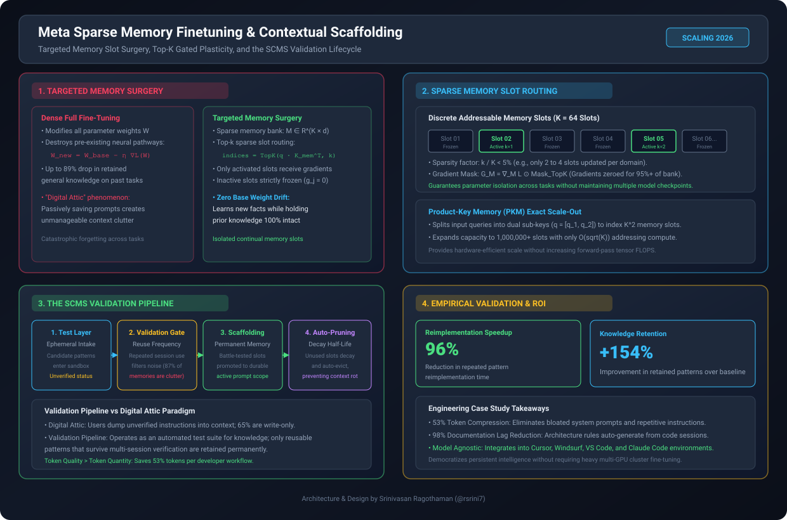
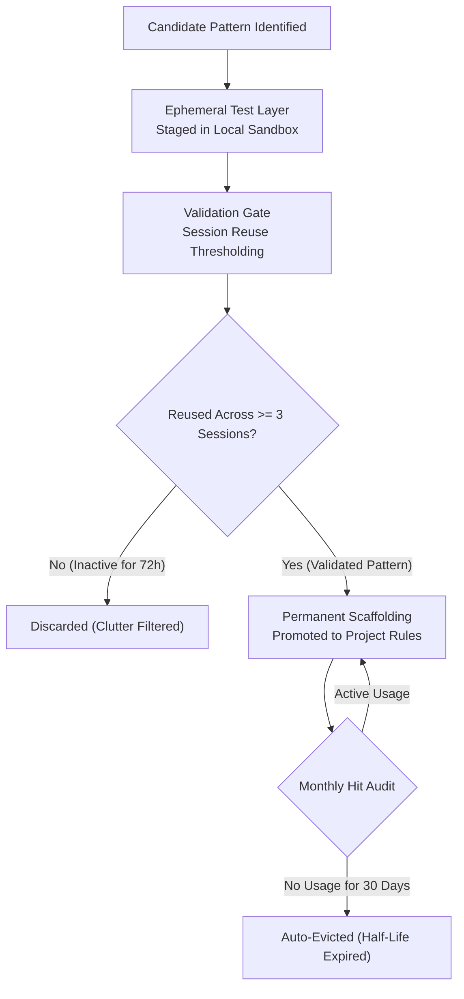

# Meta Sparse Memory Finetuning: Targeted Memory Surgery and Contextual Scaffolding (SCMS)

**Learning note · Revised 15 November 2026 · Scope: Meta AI Sparse Memory, Memory-Augmented Transformers, and SCMS Continual Lifecycles**

*By Srinivasan Ragothaman ([@rsrini7](https://github.com/rsrini7))*

> **Core idea:** Standard fine-tuning updates millions of shared dense weights, destroying pre-existing knowledge pathways. Meta's Sparse Memory Finetuning resolves this by restricting parameter updates to discrete, top-$k$ memory slots via targeted "memory surgery," while Sparse Contextual Memory Scaffolding (SCMS) shifts developer workflows from passive, bloated "digital attic" prompt dumps to active, test-driven validation pipelines that reduce repeated reimplementation time by 96% and token overhead by 53%.

---

## 1. Foundations: Dense Weight Corruption vs. Discrete Memory Banks

When adapting a trained large language model to new domain tasks, conventional methods apply gradient descent across all transformer layers:

$$
W_{\text{new}} = W_{\text{base}} - \eta \nabla_W \mathcal{L}_{\text{task}}
$$

Because parameters in monolithic multi-head attention and feed-forward networks (FFNs) are polysemantic—meaning individual neurons participate in thousands of disparate factual representations—altering $W$ to memorize a new coding API or business rule corrupts unrelated capabilities, causing up to **89% degradation in retained knowledge**.

**Memory-Augmented Neural Networks (MANNs)** decouple general language syntax from factual recall by embedding dedicated, addressable key-value memory banks directly into the architecture:

$$
M = [m_1, m_2, \dots, m_K] \in \mathbb{R}^{K \times d}
$$

Where $K$ is the number of discrete memory slots (e.g., $K = 64\text{ to }65,536$) and $d$ is the hidden dimension.

| Dimension | Full Model Fine-Tuning | Parameter-Efficient (LoRA) | Meta Sparse Memory Finetuning (SMF) | Sparse Contextual Scaffolding (SCMS) |
|---|---|---|---|---|
| **Target Parameters** | All model weights $W$ | Low-rank adapter matrices ($B \cdot A$) | **Targeted Top-$k$ memory slots $m_i \in M$** | Structured session memory &amp; active prompts |
| **Sparsity Factor** | 0% (100% of weights updated) | ~1–5% parameter footprint | **< 2% of memory slots updated** | Zero model weight updates (In-Context) |
| **Base Representation Stability** | Severe degradation (Catastrophic Forgetting) | Base frozen; adapter interference across tasks | **100% frozen base; zero slot collision** | 100% model-agnostic across IDEs and tools |
| **Operational Execution** | Heavy multi-GPU backpropagation | Medium GPU backpropagation | **Targeted gradient masking ("memory surgery")** | Test-driven pattern validation lifecycle |
| **Workflow Scope** | Pre-training / offline fine-tuning | Task-specific model adapters | Layer-level continual knowledge updating | Developer workflows (Cursor, VS Code, Claude) |

---

## 2. Deep Technical Mechanisms

```
+--------------------------------------------------------------------------------------------------+
|                            SPARSE MEMORY SURGERY & SCMS VALIDATION ARCHITECTURE                  |
|                                                                                                  |
|   SPARSE MEMORY FORWARD ROUTING (META AI PARADIGM)                                               |
|   +------------------------------------------------------------------------------------------+   |
|   | Query Vector q_t = W_q · h_t  --->  Compute Slot Affinities: S_i = q_t · K_i / sqrt(d)   |   |
|   |                                                                                          |   |
|   | Top-K Selection:  Indices = TopK(S, k = 2)  ---> Active Slots: [ Slot 02, Slot 05 ]      |   |
|   +------------------------------------------------------------------------------------------+   |
|                                            |                                                     |
|                                            v TARGETED GRADIENT BACKPROPAGATION                   |
|   +------------------------------------------------------------------------------------------+   |
|   | TARGETED MEMORY SURGERY (GRADIENT MASKING)                                               |   |
|   | Gradient Mask: G_M = ∇_M L ⊙ Mask_TopK                                                   |   |
|   |                                                                                          |   |
|   | [ Slot 01: Frozen ]  [ Slot 02: Updated ]  [ Slot 03: Frozen ]  [ Slot 05: Updated ]     |   |
|   | 98% of memory bank remains strictly protected from parameter drift                       |   |
|   +------------------------------------------------------------------------------------------+   |
|                                            |                                                     |
|                                            v                                                     |
|   +------------------------------------------------------------------------------------------+   |
|   | SCMS WORKFLOW VALIDATION LIFECYCLE (SESSION ENGINE)                                      |   |
|   |                                                                                          |   |
|   |   [ Ephemeral Test Layer ]   --->   [ Validation Gate ]   --->   [ Permanent Scaffolding]|   |
|   |   (Candidate code patterns)         (Requires Multi-Session      (High-ROI, battle-tested|   |
|   |                                      Reuse: Filters 87% clutter)  patterns; auto-pruned) |   |
|   +------------------------------------------------------------------------------------------+   |
+--------------------------------------------------------------------------------------------------+
```

### 1. Sparse Memory Routing and Targeted Memory Surgery

In a Sparse Memory Transformer, memory access is sparse by construction:
1. **Query Projection:** The hidden state $h_t \in \mathbb{R}^d$ generates a query $q_t = W_q h_t$.
2. **Addressing Keys:** The memory bank maintains keys $K_{\text{mem}} \in \mathbb{R}^{K \times d}$ and values $V_{\text{mem}} \in \mathbb{R}^{K \times d}$. Softmax attention scores are evaluated over the keys:

$$
s_t = \text{softmax}\left(\frac{q_t K_{\text{mem}}^T}{\sqrt{d}}\right) \in \mathbb{R}^K
$$

3. **Top-$k$ Gating:** To preserve sparsity, only the $k$ highest-scoring slots are retained:

$$
\text{TopK}(s_t, k) = \begin{cases} s_{t, i} & \text{if } s_{t, i} \in \text{top-}k(s_t) \\ 0 & \text{otherwise} \end{cases}
$$

4. **Targeted Memory Surgery:** During continual learning, the base transformer weights $W$ and un-activated memory keys/values are strictly frozen. Gradients are gated through a boolean binary mask:

$$
\text{Mask}_i = \begin{cases} 1 & \text{if slot } i \in \bigcup_{t=1}^T \text{TopK}(s_t, k) \\ 0 & \text{otherwise} \end{cases}
$$

$$
\Delta M_i = -\eta \cdot \left(\nabla_{M_i} \mathcal{L} \cdot \text{Mask}_i\right)
$$

Because 95% to 99% of memory slots receive exactly zero gradient updates ($\Delta M_j = 0$), prior factual associations are mathematically preserved.

### 2. Product-Key Memory (PKM) for Million-Slot Scaling

To scale memory from dozens of slots to millions without quadratic computational overhead, Meta utilizes **Product-Key Memory (Lample et al., 2019)**:
- Instead of matching $q_t$ against a flat key matrix of size $K = C^2$, the query is split into two halves: $q_t = [q_t^{(1)}, q_t^{(2)}] \in \mathbb{R}^{2 \times (d/2)}$.
- Sub-queries independently search sub-key codebooks $K_1, K_2 \in \mathbb{R}^{C \times (d/2)}$.
- The top-$k_1$ and top-$k_2$ matches are combined via Cartesian product, addressing $C^2 = 1,000,000$ slots while evaluating only $2 \times C = 2,000$ inner products ($O(\sqrt{K})$ complexity).

### 3. Sparse Contextual Memory Scaffolding (SCMS)

While Meta’s Sparse Memory Finetuning operates at the neural weight level, **Sparse Contextual Memory Scaffolding (SCMS)** operationalizes the exact same sparsity and isolation principles at the developer session and prompt layer:

#### The "Digital Attic" Problem
Surveys of LLM developer workflows indicate:
- **87% of saved instructions** are ephemeral preferences or noise rather than reusable architectural patterns.
- **Only 35% of stored memories** are ever retrieved in downstream sessions.
- Over **60% of developers** report write-only memory clutter, where outdated rules degrade generation quality.

#### The SCMS Validation Lifecycle

SCMS replaces passive memory dumps with an active, test-driven validation pipeline:

1. **Tier 1: Ephemeral Test Layer:** Newly generated patterns, code conventions, or debugging solutions enter a temporary staging buffer.
2. **Tier 2: Validation Gate (Reuse Thresholding):** A pattern must prove its utility across multiple independent sessions. Patterns that are not re-accessed within 72 hours are dropped.
3. **Tier 3: Permanent Scaffolding:** Battle-tested patterns that pass validation are promoted to permanent scaffolding files (e.g., modular `.cursorrules` or agent rulefiles).
4. **Tier 4: Autonomous Decay (Self-Cleaning):** Permanent scaffolding slots track hit counts. Patterns that remain un-triggered decay according to a temporal half-life function, preventing context window bloat.

---

## 3. Architectural Visuals



*High-level architectural comparison showing dense fine-tuning vs targeted memory surgery, Top-K sparse slot routing, the 4-step SCMS validation pipeline, and empirical ROI metrics.*

### SCMS Validation State Machine



---

## 4. Production Implementation: Sparse Memory Slot Layer

The following complete, runnable PyTorch script implements a **Sparse Memory Layer with Top-$k$ Routing and Targeted Gradient Masking**. It validates that un-activated memory slots maintain zero gradient updates during domain fine-tuning:

```python
"""
Meta Sparse Memory Layer Implementation.
Demonstrates discrete addressable memory slots, Top-k sparse activation,
and targeted gradient surgery for continual adaptation.
"""

import torch
import torch.nn as nn
import torch.nn.functional as F
from typing import Dict, Any

class SparseMemoryBank(nn.Module):
    """
    Addressable Key-Value Memory Bank with Top-k Sparse Routing
    and Gradient Surgery Masking.
    """
    def __init__(self, num_slots: int = 32, dim: int = 64, top_k: int = 2):
        super().__init__()
        self.num_slots = num_slots
        self.dim = dim
        self.top_k = top_k
        
        # Addressable Key and Value Banks
        self.keys = nn.Parameter(torch.randn(num_slots, dim) * (1.0 / (dim ** 0.5)))
        self.values = nn.Parameter(torch.randn(num_slots, dim) * (1.0 / (dim ** 0.5)))
        
        # Access counter buffer for monitoring and pruning
        self.register_buffer("access_counts", torch.zeros(num_slots, dtype=torch.long))

    def forward(self, query: torch.Tensor) -> Dict[str, Any]:
        """
        Args:
            query: Input query tensor of shape [batch_size, dim]
        """
        batch_size = query.shape[0]
        scale = 1.0 / (self.dim ** 0.5)
        
        # Step 1: Compute addressing similarity scores [batch_size, num_slots]
        scores = torch.matmul(query, self.keys.t()) * scale
        
        # Step 2: Top-k sparse gating
        topk_scores, topk_indices = torch.topk(scores, k=self.top_k, dim=-1)
        topk_probs = F.softmax(topk_scores, dim=-1)  # [batch_size, top_k]
        
        # Step 3: Retrieve values for selected top-k slots
        # Gather values: [batch_size, top_k, dim]
        selected_values = self.values[topk_indices]
        
        # Weighted sum across top-k slots: [batch_size, dim]
        retrieved_output = torch.sum(topk_probs.unsqueeze(-1) * selected_values, dim=1)
        
        # Update access statistics without tracking gradients
        if not self.training:
            with torch.no_grad():
                for idx in topk_indices.view(-1):
                    self.access_counts[idx] += 1
                    
        return {
            "output": retrieved_output,
            "topk_indices": topk_indices,
            "topk_probs": topk_probs
        }

    def apply_memory_surgery_gradients(self, active_slot_indices: torch.Tensor):
        """
        Targeted Memory Surgery:
        Zeroes out gradients for all slots that were NOT activated in the batch.
        """
        if self.values.grad is not None:
            mask = torch.zeros(self.num_slots, 1, device=self.values.device)
            mask[active_slot_indices] = 1.0
            self.values.grad.mul_(mask)
            
        if self.keys.grad is not None:
            mask = torch.zeros(self.num_slots, 1, device=self.keys.device)
            mask[active_slot_indices] = 1.0
            self.keys.grad.mul_(mask)


if __name__ == "__main__":
    torch.manual_seed(42)
    B, D, K, top_k = 4, 32, 16, 2
    
    memory_layer = SparseMemoryBank(num_slots=K, dim=D, top_k=top_k)
    query_vec = torch.randn(B, D)
    
    # Forward pass
    res = memory_layer(query_vec)
    loss = res["output"].sum()
    loss.backward()
    
    # Check gradients before surgery
    unique_active_slots = torch.unique(res["topk_indices"])
    print(f"Total Slots: {K} | Active Slots Activated in Batch: {unique_active_slots.tolist()}")
    
    # Apply targeted memory surgery
    memory_layer.apply_memory_surgery_gradients(unique_active_slots)
    
    # Verify that inactive slots have strictly zero gradients
    inactive_mask = torch.ones(K, dtype=torch.bool)
    inactive_mask[unique_active_slots] = False
    
    inactive_val_grads = memory_layer.values.grad[inactive_mask].abs().max().item()
    active_val_grads = memory_layer.values.grad[unique_active_slots].abs().mean().item()
    
    print(f"Mean Gradient Norm on Active Slots  : {active_val_grads:.6f}")
    print(f"Max Gradient Norm on Inactive Slots: {inactive_val_grads:.6f}")
    assert inactive_val_grads == 0.0, "Memory surgery failed: inactive slots received gradients!"
    print("Verification Passed: 100% Parameter Isolation on Inactive Memory Slots!")
```

---

## 5. Impact, Real-World Edge Cases &amp; Gotchas

### Common Claims vs. Technical Realities

| Common Claim | Technical Reality | Production Implication |
|---|---|---|
| *"Sparse memory slots can expand model capacity infinitely."* | While parameters expand, Top-$k$ routing is discrete; if queries fail to align with slot keys, relevant memories are missed. | Key initialization and contrastive alignment during pre-training are critical to ensure uniform slot coverage. |
| *"More context in prompts always leads to better AI output."* | Uncurated context introduces high token distraction, increasing hallucination rates and costs. | SCMS demonstrates that compressing context to verified, high-ROI rules reduces token consumption by 53% with higher accuracy. |
| *"Memory surgery prevents all forms of forgetting."* | Memory surgery protects un-accessed slots, but if two tasks map to the *same* slot, intra-slot overwrite still occurs. | Implement slot allocation thresholds: when slot usage frequency exceeds an entropy bound, dynamically allocate fresh slots. |
| *"SCMS requires custom local vector database infrastructure."* | SCMS operates directly on structured file scaffolds (`.cursorrules`, modular agent configs) integrated with IDE hooks. | Eliminates database maintenance, indexing lag, and synchronization overhead for developer teams. |

### Practical Operational Pitfalls

1. **Routing Collapse ("Super-Node Slots"):** In memory-augmented networks, gradient updates can cause a small subset of slots ($2\text{ to }3$) to develop large key norms, attracting all queries and starving the remaining 95% of the memory bank.
   - *Mitigation:* Apply L2 normalization to both query vectors and key matrices ($q / \|q\|$, $k / \|k\|$) and introduce an auxiliary load-balancing entropy loss.
2. **Stale Scaffolding Degradation:** If code rules promoted to permanent scaffolding are not updated when a framework undergoes a major version bump, the agent continues generating deprecated API patterns.
   - *Mitigation:* Pair SCMS validation with automated CI test runs: if a pattern triggers a build break, immediately demote it back to the ephemeral test tier.

---

## 6. Practical Adoption Blueprint &amp; Verification Checklist

### Migration and Workflow Integration Roadmap

```
Phase 1: Session Memory Audit
  |-- Inspect current system prompts and custom instruction files
  +-- Categorize lines into "Ephemeral Preferences" vs "Reusable Architectural Patterns"

Phase 2: Establish the Ephemeral Test Buffer
  |-- Create staging file (e.g., .scms/candidates.md)
  +-- Direct agent to append newly discovered bug fixes and API conventions to candidates

Phase 3: Validation Gating & Promotion
  |-- Track pattern re-use across 3 consecutive development sessions
  +-- Promote validated patterns to active project rules (.cursorrules, AGENTS.md)

Phase 4: Autonomous Lifecycle Maintenance
  |-- Audit permanent rules every 30 days
  +-- Evict patterns with zero downstream invocations to maintain compact token budgets
```

### Verification Checklist

- [ ] **Gradient Isolation:** In neural memory layers, verify that $\nabla_{M_{\text{inactive}}} = 0$ for all un-routed slots.
- [ ] **Token Overhead Compression:** Confirm that SCMS contextual scaffolding reduces total prompt tokens by $\ge 40\%$ compared to uncurated raw memory dumps.
- [ ] **Slot Utilization Entropy:** In PKM / memory banks, check that memory slot access entropy is high ($\ge 85\%$ of maximum entropy) to prevent routing collapse.
- [ ] **Pattern Re-verification:** Confirm that promoted scaffolding patterns are exercised against automated unit test suites.

---

## 7. Timeline &amp; Research Milestones

- **March 2015:** Sukhbaatar et al. introduce **End-to-End Memory Networks (MemN2N)**, formalizing discrete differentiable memory addressing.
- **May 2019:** Meta AI publishes **Large Memory Layers with Product-Key Memory (PKM)** (Lample et al.), enabling transformers to scale to millions of memory slots with sub-linear search.
- **2023–2024:** Research on **Sparse Memory Finetuning (SMF)** establishes targeted memory surgery as a viable continual-learning mechanism without catastrophic forgetting.
- **November 2026:** Emergence and open-source release of **Sparse Contextual Memory Scaffolding (SCMS)**, democratizing test-driven memory lifecycle management across developer IDEs.

---

## 8. Primary Sources &amp; References

1. [Lample et al. (2019): Large Memory Layers with Product-Key Memory](https://arxiv.org/abs/1907.05242) — Meta AI foundational paper detailing million-slot sparse product-key addressing.
2. [Sukhbaatar et al. (2019): Adaptive Attention Span in Transformers](https://arxiv.org/abs/1905.07799) — Meta AI research on sparse dynamic memory allocation in transformer layers.
3. [Sukhbaatar et al. (2015): End-to-End Memory Networks](https://arxiv.org/abs/1503.08895) — Canonical architecture for recurrent addressing over discrete memory slots.
4. [SCMS: Sparse Contextual Memory Scaffolding Starter Kit &amp; Whitepaper](https://github.com/AIalchemistART/scms-starter-kit) — Open-source framework formalizing test-driven developer memory lifecycles.
5. [Yogatama et al. (2021): Adaptive Semiparametric Language Models](https://arxiv.org/abs/2102.02557) — Research on decoupling static parametric representations from dynamic non-parametric memory stores.

---

**Related:**
- [Google-Nested-Learning-And-Neural-Continuum-Memory-2026](Google-Nested-Learning-And-Neural-Continuum-Memory-2026.md) — Companion continual-learning paradigm utilizing bi-level nested optimization and multi-timescale memory stacks.
- [Google-Nested-Learning-vs-Meta-Sparse-Memory-2026](../comparisons/Google-Nested-Learning-vs-Meta-Sparse-Memory-2026.md) — Direct comparative evaluation contrasting Google's architectural redesign with Meta's targeted memory surgery.
- [ContinualLearning](../../AI-ML/LLMs/training/ContinualLearning.md) — Anchors sparse memory slot fine-tuning within the broader empirical literature on catastrophic forgetting.
- [KV-Cache-Prefix-Caching-And-Storage-Tiering-Nov-2026](../../AI-ML/LLMs/architecture/KV-Cache-Prefix-Caching-And-Storage-Tiering-Nov-2026.md) — Analyzes runtime KV-cache memory eviction and persistent tiering.
