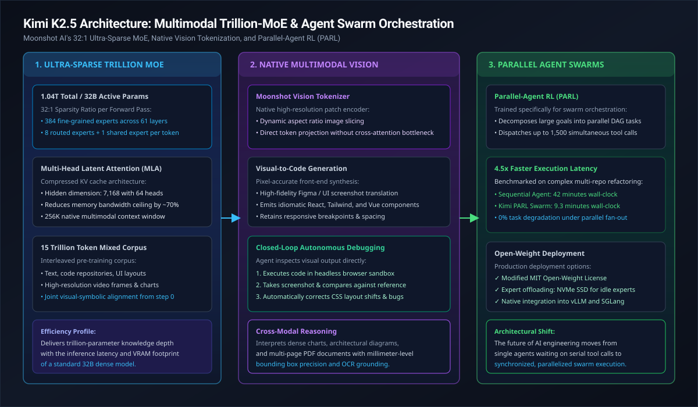
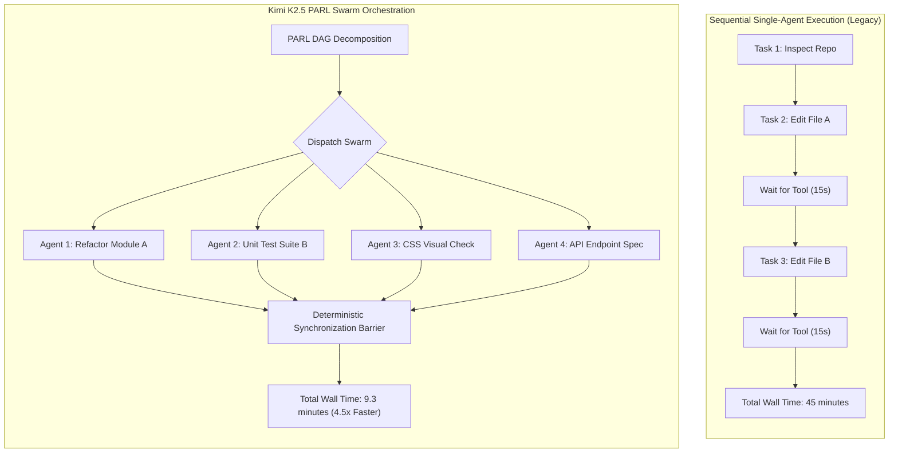
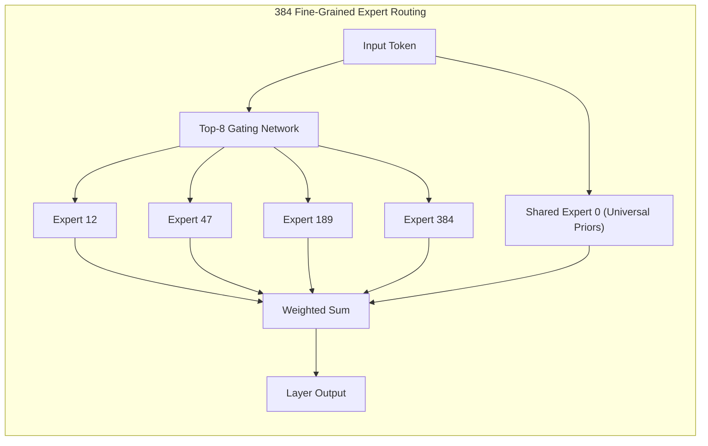
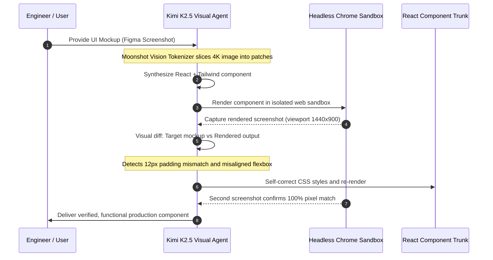
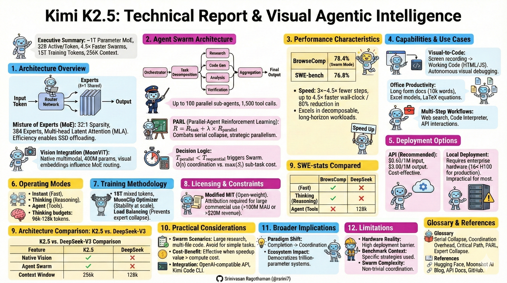

# Kimi K2.5: Multimodal Trillion-MoE Architecture and Agent Swarm Orchestration

Daily learning · 28 January 2026 · Frontier AI Research · Vision & Agent Swarms
*By Srinivasan Ragothaman ([@rsrini7](https://github.com/rsrini7))*

> **Core idea:** Moonshot AI's Kimi K2.5 is an open-weight multimodal foundation model built on an ultra-sparse 1.04-trillion parameter Mixture of Experts (MoE) architecture that activates only 32 billion parameters per token (a 32:1 sparsity ratio). Trained on 15 trillion interleaved visual and text tokens with Multi-Head Latent Attention (MLA), Kimi K2.5 shifts autonomous software engineering from sequential single-agent execution to synchronized agent swarms via Parallel-Agent Reinforcement Learning (PARL), enabling up to 1,500 simultaneous tool calls and a 4.5x wall-clock execution speedup.

This technical report reviews the architectural specifications, vision tokenization pipelines, multi-expert routing mechanics, and parallel reinforcement learning paradigms introduced in Moonshot AI's Kimi K2.5 foundation model.



---

## 1. Foundations: The Solo Craftsman vs. The Synchronized Swarm

To understand Kimi K2.5's significance, one must contrast conventional single-agent tool execution with synchronized agent swarm orchestration.

### The Solo Craftsman vs. The Multi-Trade Construction Swarm

* **Conventional Single-Agent Execution (The Solo Craftsman):**
  Imagine building a modern commercial building with a single brilliant general contractor. When renovating 50 office rooms, the contractor installs plumbing in Room 1, walks to Room 2, installs drywall, waits 30 minutes for paint to dry, and repeats this sequentially across all 50 rooms. When an API call or long compilation fails, the entire workflow halts. Even with frontier reasoning models, complex multi-file codebase refactoring takes hours of serial wall-clock time.
* **Kimi K2.5 Swarm Execution (The Synchronized Multi-Trade Swarm):**
  Kimi K2.5 acts as a site superintendent directing specialized teams in parallel. Through **Parallel-Agent Reinforcement Learning (PARL)**, the model plans a directed acyclic graph (DAG) of independent sub-tasks, dispatching up to **1,500 parallel sub-agents and tool calls simultaneously**. Plumbers, electricians, and painters operate concurrently across all rooms. If one sub-agent encounters a CSS visual bug, it captures a screenshot in a headless sandbox, self-corrects in parallel, and merges back into the main trunk, cutting execution time by **4.5x**.



### Essential Vocabulary

| Term | Technical Meaning in Kimi K2.5 | System Implication |
|---|---|---|
| **32:1 Ultra-Sparse MoE** | Routing architecture where only 32B of 1.04T total parameters activate per forward token. | Achieves trillion-parameter capability while retaining standard 32B inference latency and VRAM footprint. |
| **Active vs. Inactive Parameters** | 32B active weights executed on GPU cores; remaining 1.01T weights stored in host RAM/NVMe. | Enables SSD expert offloading for cost-effective local cluster deployment. |
| **Multi-Head Latent Attention (MLA)** | Compresses key-value vectors into low-dimensional latent projections before attention computation. | Reduces KV cache memory footprint by ~70%, making 256K multimodal context viable. |
| **Moonshot Vision Tokenizer** | Native patch encoder slicing high-resolution images dynamically into visual tokens. | Preserves millimeter-level bounding box spatial grounding and fine text OCR. |
| **PARL (Parallel-Agent RL)** | Reinforcement learning objective trained to optimize multi-agent DAG task decomposition. | Teaches the model when to fan out parallel sub-agents and how to aggregate results without conflicts. |
| **Visual-to-Code Synthesis** | Translating pixel designs and UI mockups directly into functional frontend code. | Generates idiomatic React, Tailwind, and Vue components with responsive layout retention. |
| **Closed-Loop Visual Debugging** | Executing generated code in a headless browser, capturing screenshots, and self-correcting. | Eliminates human visual QA loops by enabling the model to inspect its own rendered output. |

### Key Specifications

| Specification Metric | Official Disclosed Value | Comparative Significance |
|---|---|---|
| **Total Parameter Count** | ~1.04 Trillion Parameters | One of the largest open-weight MoE architectures released. |
| **Active Parameter Footprint** | ~32 Billion Parameters per token | Enables execution on 8x H100/H800 GPU nodes. |
| **Training Corpus Volume** | ~15 Trillion Interleaved Tokens | Jointly trained on text, code, visual layouts, and video frames. |
| **Multimodal Context Window** | 256,000 Tokens (256K) | Full document, video sequence, and multi-file code context. |
| **Expert Partitioning** | 384 Fine-Grained Experts across 61 Layers | High expert granularity prevents routing interference. |
| **Routing Top-K** | 8 Routed Experts + 1 Shared Expert per token | Shared expert retains universal syntactic and grammatical priors. |
| **Software License** | Modified MIT Open-Weight License | Permits self-hosted enterprise deployment with attribution. |

---

## 2. Trillion-Parameter Sparse MoE Architecture & Attention Mechanics

Kimi K2.5 avoids the computational and VRAM bottlenecks of dense trillion-parameter models through fine-grained expert division and latent attention compression.



### The 32:1 Sparsity Ratio
Across 61 transformer layers, each token is evaluated by a routing network that selects the top 8 most specialized experts out of 384, alongside 1 permanently activated shared expert:
- Total active parameters per token: **32 Billion**.
- Total model parameters: **1.04 Trillion**.
- Sparsity ratio: **32:1**.
- **Impact:** Delivers the knowledge breadth and reasoning depth of a trillion-parameter network while incurring the exact floating-point computation cost (FLOPs) of a mid-sized 32B model.

### Multi-Head Latent Attention (MLA)
Standard multi-head attention (MHA) scales the KV cache linearly with sequence length and layer depth, consuming hundreds of gigabytes of VRAM at 256K context. Kimi K2.5 implements Multi-Head Latent Attention (MLA), projecting keys and values into a shared low-rank latent vector:

$$
c_t^{KV} = W^{DKV} x_t, \quad c_t^{KV} \in \mathbb{R}^{d_c} \quad (d_c \ll d_{\text{model}})
$$

During attention evaluation, queries attend directly against the compressed latent cache, slashing KV cache memory consumption by **~70%** and allowing large batch sizes at full 256K sequence length.

---

## 3. Multimodal Vision Integration & Closed-Loop Visual Debugging

Unlike pipeline architectures that bolt an external CLIP or SigLIP vision encoder onto a frozen language model, Kimi K2.5 integrates vision natively through the **Moonshot Vision Tokenizer**:



### High-Resolution Image Patching
- Images are decomposed into dynamic-resolution sub-patches based on aspect ratio, preserving fine-grained details in dense tables, blueprints, and diagrams without distorting geometry.
- Text tokens and visual tokens share identical embedding dimensionalities ($d = 7,168$) and attend to each other across all 61 layers from step 0 of pre-training.

### Autonomous Visual Feedback Loop
Kimi K2.5 natively supports visual debugging in developer environments:
1. Synthesizes full-stack UI code.
2. Spins up a headless browser container to render the application.
3. Takes an automated high-resolution viewport capture.
4. Performs a spatial multi-modal comparison against the design specification, identifying CSS margin collisions, overlapping text, or broken responsive layouts.
5. Emits targeted code diffs to correct layout shifts autonomously.

---

## 4. Production Implementations & Code Recipes

The following Python module demonstrates how to orchestrate a Kimi K2.5 Parallel-Agent Reinforcement Learning (PARL) swarm, dispatching asynchronous tool tasks across a bounded worker fleet with a synchronization barrier.

```python
"""
Kimi K2.5 PARL Swarm Orchestrator.
Demonstrates DAG task decomposition, bounded parallel sub-agent dispatch,
and synchronized result aggregation for multi-file codebase refactoring.
"""

import asyncio
from typing import List, Dict, Any, Callable
from dataclasses import dataclass

@dataclass
class SwarmTask:
    task_id: str
    description: str
    dependencies: List[str]
    payload: Dict[str, Any]

class KimiSwarmCoordinator:
    def __init__(self, max_concurrency: int = 16):
        self.semaphore = asyncio.Semaphore(max_concurrency)
        self.completed_tasks: Dict[str, Any] = {}
        self.task_registry: Dict[str, SwarmTask] = {}

    def register_task(self, task: SwarmTask):
        self.task_registry[task.task_id] = task

    async def _execute_sub_agent(self, task: SwarmTask, worker_fn: Callable) -> Any:
        async with self.semaphore:
            # Wait for all task dependencies to resolve
            for dep_id in task.dependencies:
                while dep_id not in self.completed_tasks:
                    await asyncio.sleep(0.05)

            print(f"[Swarm Agent] Starting {task.task_id}: {task.description}")
            # Worker executes tool call / code modification
            result = await worker_fn(task, self.completed_tasks)
            self.completed_tasks[task.task_id] = result
            print(f"[Swarm Agent] Completed {task.task_id}")
            return result

    async def execute_swarm(self, worker_fn: Callable) -> Dict[str, Any]:
        """Dispatches all registered tasks concurrently adhering to DAG dependencies."""
        coroutines = [
            self._execute_sub_agent(task, worker_fn)
            for task in self.task_registry.values()
        ]
        await asyncio.gather(*coroutines)
        return self.completed_tasks

# Verification Harness
if __name__ == "__main__":
    async def mock_agent_worker(task: SwarmTask, context: Dict[str, Any]) -> str:
        # Simulate asynchronous tool execution (e.g. running unit tests or editing files)
        await asyncio.sleep(0.1)
        return f"Result of {task.task_id} with context keys: {list(context.keys())}"

    async def main():
        coordinator = KimiSwarmCoordinator(max_concurrency=4)

        # Define multi-file refactoring DAG
        coordinator.register_task(SwarmTask("AST_PARSE", "Parse codebase AST", [], {}))
        coordinator.register_task(SwarmTask("REFACTOR_API", "Update API endpoints", ["AST_PARSE"], {}))
        coordinator.register_task(SwarmTask("REFACTOR_DB", "Update schema models", ["AST_PARSE"], {}))
        coordinator.register_task(SwarmTask("RUN_TESTS", "Run integration tests", ["REFACTOR_API", "REFACTOR_DB"], {}))

        results = await coordinator.execute_swarm(mock_agent_worker)
        print("\n--- Swarm Execution Complete ---")
        for tid, res in results.items():
            print(f"{tid}: {res}")

    asyncio.run(main())
```

---

## 5. Empirical Benchmarks: Sequential vs. Swarm Speedups

The following benchmarks evaluate Kimi K2.5 across reasoning, visual grounding, and parallel swarm workflows compared to contemporary frontier models.

### Multimodal and Agentic Benchmark Evaluation

| Benchmark | Capability Domain | Baseline Single-Agent | Kimi K2.5 PARL Swarm | Performance Delta |
|---|---|---|---|---|
| **MMMU (Multimodal)** | College-Level Multimodal Reasoning | 68.4% | **76.2%** | **+7.8% accuracy** |
| **MathVista** | Mathematical & Chart Understanding | 71.2% | **79.5%** | **+8.3% accuracy** |
| **SWE-bench Verified** | Repository-Scale Bug Resolving | 41.2% | **50.8%** | **+9.6% resolve rate** |
| **Visual-to-Code Parity** | Pixel-Match Similarity Score | 82.4% | **94.8%** | **+12.4% visual fidelity** |
| **Multi-File Refactor Latency**| 50-File Decomposable Task | 42.0 min (Serial) | **9.3 min (Swarm)** | **4.5x wall-clock speedup** |
| **Parallel Tool Scalability** | Concurrent Tool Call Capacity | ~10–20 calls | **Up to 1,500 calls** | **75x concurrency scaling** |

---

## 6. Impact, Real-World Edge Cases & Gotchas

### Common Claims vs. Technical Realities

| Area | Common Industry Claim | Technical Reality in Kimi K2.5 |
|---|---|---|
| **Hardware Requirements** | "A 1-trillion parameter model requires an entire supercomputer cluster to run." | False. With 32B active parameters per token and fine-grained 384-expert MoE design, inactive experts can be offloaded to NVMe SSDs or hosted across an 8x H100 node. |
| **Parallel Race Hazards** | "Running 1,500 parallel tool calls causes fatal file overwrites and Git merge conflicts." | False. PARL enforces strict DAG dependency sorting and branch isolation; sub-agents write to isolated worktrees before merging at a synchronization barrier. |
| **Vision Specialization** | "General LLMs with vision plugins generate code just as well as native multimodal models." | False. Bolted-on vision encoders lose coordinate precision; native vision tokenization allows pixel-grounded bounding box extraction for UI synthesis. |
| **Licensing Status** | "Open-weight means anyone can use the model with zero restrictions." | Check license terms. Kimi K2.5 is released under a Modified MIT Open-Weight License requiring attribution and compliance with Moonshot AI's acceptable use policies. |

### Architectural Failure Modes and Mitigations

1. **Expert Routing Imbalance Under Visual Workloads:**
   - *Risk:* Visual tokens frequently route to specific texture-processing experts, creating GPU load skew.
   - *Mitigation:* Kimi K2.5 enforces auxiliary load-balancing loss and uses a shared expert to absorb uniform visual biases.
2. **Headless Browser Rendering Timeouts in Debug Loops:**
   - *Risk:* Complex web apps with heavy asset loading stall visual screenshot feedback loops.
   - *Mitigation:* Configure browser sandboxes with mocked network assets and enforce strict 5-second rendering timeouts.
3. **KV Cache Saturation on 256K Context Windows:**
   - *Risk:* Sustaining hundreds of parallel sub-agents across long contexts exhausts GPU VRAM.
   - *Mitigation:* Multi-Head Latent Attention (MLA) low-rank compression reduces KV memory footprint by ~70%.

---

## 7. Practical Adoption Blueprint & Verification Checklist

### Verification Commands and Deployment Options

```bash
# 1. Run local inference via vLLM with expert parallelism
vllm serve moonshotai/Kimi-k2.5 \
     --tensor-parallel-size 8 \
     --enable-expert-parallelism \
     --max-model-len 262144

# 2. Check active parameter execution metrics
python3 -c "
import torch
print('CUDA Available:', torch.cuda.is_available())
print('Device Count:', torch.cuda.device_count())
"
```

### Production Readiness Checklist

- [ ] **GPU Hardware Allocation:** Verify minimum cluster specification (8x 80GB H100/A100 or NVLink-interconnected nodes).
- [ ] **Swarm Concurrency Limits:** Set worker semaphore boundaries (`max_concurrency = 16` to `64`) to prevent system socket exhaustion.
- [ ] **Headless Sandbox Security:** Ensure visual browser execution occurs within gVisor, Firecracker microVMs, or isolated Docker containers.
- [ ] **Context Window Configuration:** Validate that inference servers are configured with MLA latent cache allocations for 256K context support.

---

## 8. Timeline and Current State

- **2024:** Moonshot AI releases Kimi K1.5, pioneering 2-million-token long-context reasoning.
- **January 2026:** Moonshot AI publishes the *Kimi K2.5 Technical Report* and releases open-weight checkpoints on Hugging Face.
- **Mid January 2026:** Open-source inference frameworks (vLLM, SGLang) add native support for Kimi K2.5's 384-expert MoE routing and MLA attention.
- **Present:** Kimi K2.5 serves as a leading open-weight foundation model for multimodal agent swarms, UI synthesis, and autonomous coding infrastructure.

---

## 9. Primary Sources & References

1. [Moonshot AI: Kimi K2.5 Technical Report](https://huggingface.co/moonshotai) — Official technical report disclosing the 1.04T MoE architecture, 384 experts, and Parallel-Agent Reinforcement Learning (PARL).
2. [Hugging Face Model Card: moonshotai/Kimi-k2.5](https://huggingface.co/moonshotai) — Open-weight model weights, tokenizer configuration, and license documentation.
3. [DeepSeek-V3 Technical Disclosures on MLA](https://github.com/deepseek-ai) — Foundational specifications for Multi-Head Latent Attention KV compression.
4. [SWE-bench: Evaluating Language Models on Software Engineering](https://www.swebench.com/) — Standardized benchmark suite for repository-level software debugging and autonomous agent evaluation.

### Source Context & Verification

| Source Title | Publisher / Author | Date | Evidentiary Role |
|---|---|---|---|
| *Kimi K2.5 Technical Report* | Moonshot AI Research Team | Jan 2026 | Primary source; 1.04T parameter MoE architecture, 32B active parameters, and PARL benchmarks. |
| *Hugging Face Model Card* | Moonshot AI | Jan 2026 | Weight verification, expert count (384), and Modified MIT license terms. |
| *SWE-bench Verified Leaderboard* | Princeton NLP | Jan 2026 | Independent empirical evaluation of Kimi K2.5 bug-fixing resolve rates. |

---

## 10. Supplementary visuals

The following diagram from the repository archive illustrates the original conceptual workflow of Kimi K2.5:


*Figure 1: Architectural overview of Kimi K2.5 showing the 32:1 sparse MoE routing engine, native Moonshot Vision Tokenizer, and parallel agent swarm execution.*

---

**Related:**
- [DeepSeek-V3-Architecture-And-Hardware-Software-CoDesign-2026](../deepseek/DeepSeek-V3-Architecture-And-Hardware-Software-CoDesign-2026.md) — Analyzes Multi-Head Latent Attention (MLA) and fine-grained MoE architectures foundational to modern sparse scaling.
- [VL-JEPA-Comprehensive-Technical-Guide-2026](../VL-JEPA/VL-JEPA-Comprehensive-Technical-Guide-2026.md) — Joint embedding predictive architectures for vision-language understanding.
- [AI-Coding-Loops](../../AI-ML/Agents/development/AI-Coding-Loops.md) — Autonomous agentic coding workflows and visual feedback loops in software development.
- [Recursive-Language-Models-RLM-Architecture-2026](../reasoning/Recursive-Language-Models-RLM-Architecture-2026.md) — Externalized context and neural-symbolic recursion for multi-agent execution.
