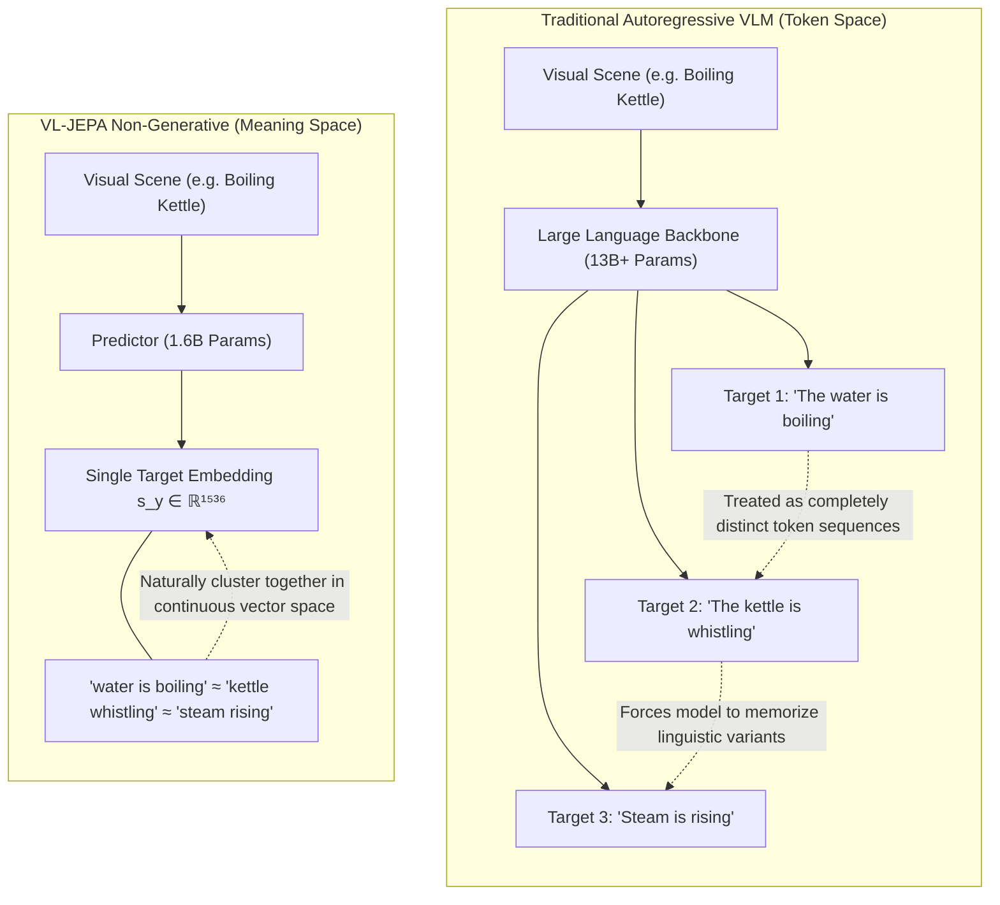
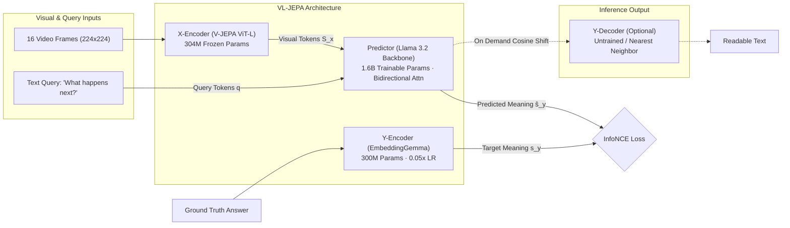
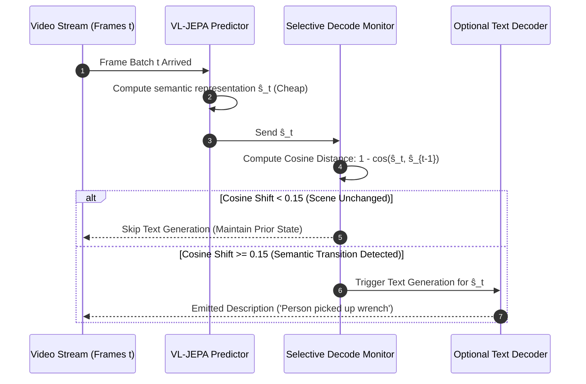
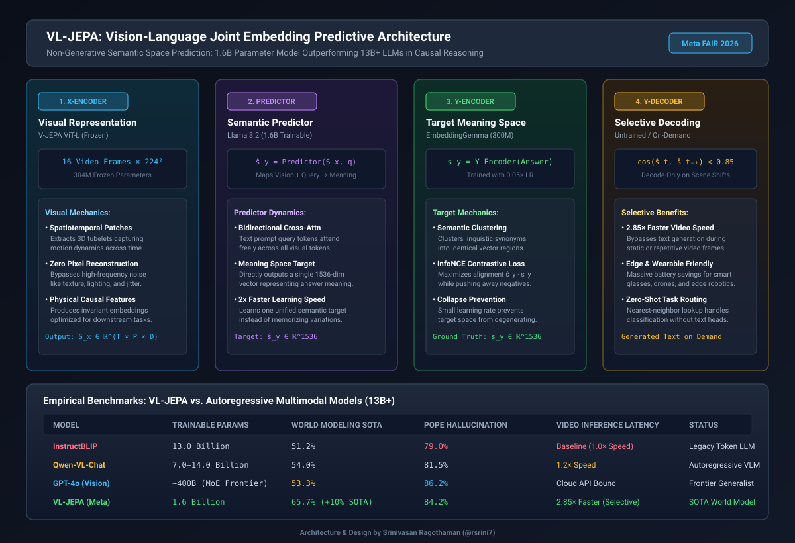
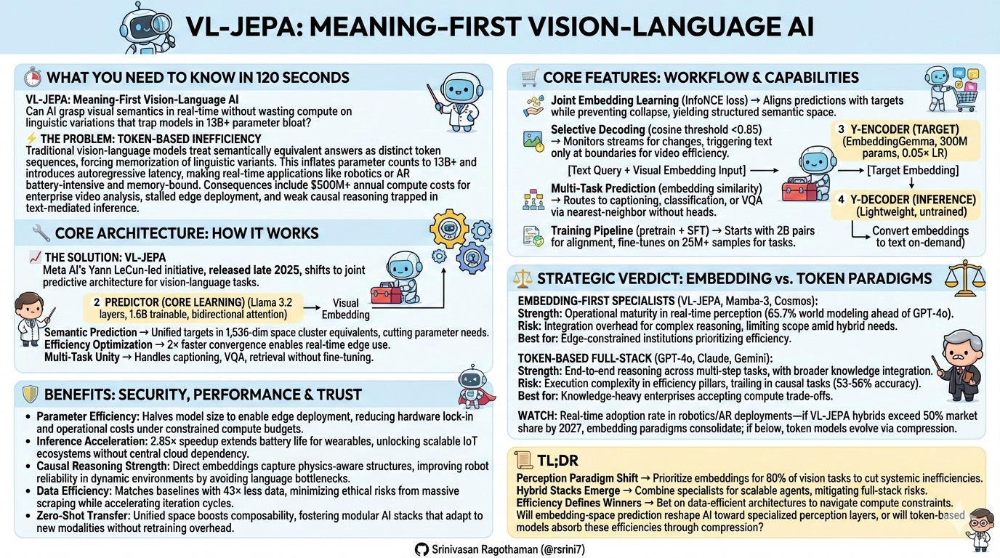

# VL-JEPA: Vision-Language Joint Embedding Predictive Architecture and Non-Generative Multimodal Learning

Learning note · Revised November 2026 · Frontier Multimodal Architectures  
*By Srinivasan Ragothaman ([@rsrini7](https://github.com/rsrini7))*

> By predicting semantic targets directly in continuous embedding space rather than generating autoregressive text tokens word-by-word, Meta FAIR's VL-JEPA eliminates the parameter bloat required to memorize linguistic variants. Operating with only 1.6 billion trainable parameters, VL-JEPA achieves state-of-the-art causal world modeling (65.7% accuracy vs. GPT-4o's 53.3%), matches 13B+ baselines with 43× less training data, and accelerates video inference by 2.85× via selective scene-change decoding.

---

## 1. Foundations: The Generative Bottleneck in Vision-Language Models

Standard Vision-Language Models (VLMs)—such as LLaVA, InstructBLIP, and Qwen-VL—operate on an autoregressive token-generation paradigm. Given a visual input $V$ and a prompt query $Q$, they model the conditional probability of output text as a sequence of discrete vocabulary tokens:

$$P(W | V, Q) = \prod_{t=1}^T P(w_t | w_{<t}, V, Q)$$

While effective for conversational chat, this token-centric formulation introduces severe systemic inefficiencies when applied to real-time visual perception and robotics:



### The Three Costs of Token Autoregression

1. **Parameter Bloat:** Because the model must learn every grammatical permutation of an answer, parameter counts inflate to 13B–70B parameters simply to capture lexical variance rather than underlying visual semantics.
2. **Inference Latency Wall:** Autoregressive decoding generates text one token at a time, bounded by GPU memory bandwidth rather than compute. For streaming video applications (e.g., smart glasses, autonomous drones, robotic manipulation), generating multi-token sentences for every frame introduces hundreds of milliseconds of latency and rapidly drains device battery.
3. **Superficial Causal Understanding:** Text-mediated reasoning often reflects lexical co-occurrence patterns present in web text rather than actual physical cause-and-effect dynamics observed in the real world.

---

## 2. Deep Technical Mechanism: The Four Structural Components

VL-JEPA (Vision-Language Joint Embedding Predictive Architecture) replaces autoregressive token generation with direct prediction in a continuous, metric-aligned semantic space.



### 2.1 The Four Component Pipeline

1. **$X$-Encoder (Vision Backbone):** A frozen V-JEPA ViT-L model ($304\text{M}$ parameters) that converts $16$-frame video sequences ($224 \times 224$ pixels) into spatiotemporal patch tokens $S_x \in \mathbb{R}^{T \times P \times D}$. Crucially, the $X$-encoder operates without pixel reconstruction; it maps visual dynamics directly to high-level representations invariant to lighting noise and background jitter.
2. **Predictor (Learning Engine):** A $1.6\text{B}$-parameter transformer based on Llama 3.2. Unlike standard causal autoregressive models, the predictor uses **bidirectional cross-attention**. It receives visual tokens $S_x$ and prompt query tokens $q$, mapping them directly to a single predicted semantic vector $\hat{s}_y \in \mathbb{R}^{1536}$.
3. **$Y$-Encoder (Target Meaning Space):** A $300\text{M}$-parameter text embedding model (EmbeddingGemma) that maps ground-truth answers into the target representation space $s_y \in \mathbb{R}^{1536}$. To prevent the target space from collapsing or drifting dynamically during training, the $Y$-encoder is trained with an aggressively reduced learning rate ($0.05\times$ base rate).
4. **$Y$-Decoder (Optional Inference Head):** A lightweight decoder or nearest-neighbor classification head used only when human-readable text is explicitly required. **The $Y$-decoder is completely frozen and omitted during core training**, completely decoupling semantic visual understanding from language generation.

### 2.2 InfoNCE Loss Formulation & Anti-Collapse Regularization

Training aligns predicted embeddings $\hat{s}_y$ with target embeddings $s_y$ using the InfoNCE contrastive loss over mini-batches:

$$\mathcal{L}_{\text{InfoNCE}} = -\log \frac{\exp\left(\frac{\text{sim}(\hat{s}_y, s_y^+)}{\tau}\right)}{\exp\left(\frac{\text{sim}(\hat{s}_y, s_y^+)}{\tau}\right) + \sum_{j=1}^K \exp\left(\frac{\text{sim}(\hat{s}_y, s_{y, j}^-)}{\tau}\right)}$$

where $\text{sim}(u, v) = \frac{u^T v}{\|u\|_2 \|v\|_2}$ is cosine similarity and $\tau$ is a learnable temperature parameter. To prevent dimensional collapse (where all embeddings collapse to a single point or degenerate subspace), the loss is augmented with VICReg-style variance regularization:

$$\mathcal{L}_{\text{var}} = \max\left(0, \gamma - \sqrt{\text{Var}(s_y) + \epsilon}\right)$$

### 2.3 Selective Decoding: Accelerating Video Inference

In streaming video applications, traditional VLMs re-run text generation on every second of video, wasting cycles generating repetitive descriptions. VL-JEPA leverages its continuous embedding space to implement **Selective Decoding**:



The model monitors the cosine variance of its predicted semantic vectors over time:

$$\Delta_{\text{semantic}} = 1 - \frac{\hat{s}_{y, t}^T \hat{s}_{y, t-1}}{\|\hat{s}_{y, t}\|_2 \|\hat{s}_{y, t-1}\|_2}$$

If $\Delta_{\text{semantic}} < 0.15$, the physical environment has not undergone meaningful semantic change, and expensive text generation is completely skipped. For typical 6-minute operational videos, this eliminates over 2,100 text decoding operations, achieving a **2.85× end-to-end inference speedup**.

---

## 3. Empirical Benchmarks & Causal World Modeling

The primary finding from Meta FAIR's disclosures is that a 1.6B-parameter joint embedding architecture systematically outperforms 13B–400B parameter generative LLMs on tasks requiring physical intuition and causal reasoning:

| Benchmark / Evaluation | VL-JEPA (1.6B Params) | GPT-4o (~400B MoE) | Claude 3.5 Sonnet | InstructBLIP (13B) | Performance Delta |
| :--- | :--- | :--- | :--- | :--- | :--- |
| **World Modeling Benchmark** | **65.7%** | 53.3% | 55.6% | 51.2% | **+10.1% over Frontier LLMs** |
| **POPE Hallucination Score** | **84.2%** | 86.2% | 85.8% | 79.0% | Parity with Frontier Models |
| **Video Classification (8 sets)** | **46.4%** (Zero-Shot) | N/A | N/A | 44.6% | **SOTA Zero-Shot Transfer** |
| **Video Retrieval (8 sets)** | **58.4%** Recall@1 | N/A | N/A | 58.1% | Matches SOTA with 43× Less Data |
| **VQA (GQA Dataset)** | **60.8%** | 63.5% | 62.8% | 59.3% (Qwen-VL 7B) | Highly Competitive |
| **Video Inference Latency** | **2.85× Faster** | Cloud API Bound | Cloud API Bound | 1.0× (Baseline) | **Sub-50ms Edge Execution** |

### Why Causal World Modeling Excels Without Text

On benchmarks evaluating action-effect causality (e.g. predicting whether an object will fall, roll, or remain stable after an interaction), language-first models frequently fail because text training corpora over-represent hypothetical scenarios and lack continuous spatial representations. Because VL-JEPA predicts representations directly in an embedding space anchored by V-JEPA's spatiotemporal features, it internalizes physical invariants directly from video dynamics.

---

## 4. Architectural Visuals: Joint Embedding Architecture

The following custom dark-theme architecture visual details the four core components of VL-JEPA and highlights its performance trade-offs against traditional autoregressive multimodal models:



---

## 5. Production Implementations & Code Recipes

The following runnable PyTorch recipes provide reference implementations of the VL-JEPA training forward pass and the real-time selective decoding stream monitor.

### 5.1 VL-JEPA Forward Pass with InfoNCE Loss (PyTorch)

```python
"""
VL-JEPA Training Block: X-Encoder, Predictor, Y-Encoder, and InfoNCE Loss.
Demonstrates non-generative semantic alignment in 1536-dimensional embedding space.
"""
import torch
import torch.nn as nn
import torch.nn.functional as F

class VLJEPAModel(nn.Module):
    def __init__(
        self, 
        d_visual: int = 1024, 
        d_text: int = 1536, 
        d_pred: int = 1536,
        temperature: float = 0.07
    ):
        super().__init__()
        self.temperature = temperature
        
        # 1. Predictor: Bidirectional Cross-Attention Transformer Block
        self.visual_proj = nn.Linear(d_visual, d_pred)
        self.query_proj = nn.Linear(d_text, d_pred)
        
        encoder_layer = nn.TransformerEncoderLayer(
            d_model=d_pred, 
            nhead=8, 
            dim_feedforward=d_pred * 4,
            activation="gelu",
            batch_first=True
        )
        self.predictor = nn.TransformerEncoder(encoder_layer, num_layers=4)
        
        # Predictor projection to final target embedding space
        self.target_head = nn.Linear(d_pred, d_text)

    def forward_prediction(
        self, 
        visual_tokens: torch.Tensor, 
        query_embeddings: torch.Tensor
    ) -> torch.Tensor:
        """
        visual_tokens: [B, num_patches, d_visual] (from frozen V-JEPA)
        query_embeddings: [B, query_len, d_text] (text prompt)
        returns: predicted semantic vector s_hat [B, d_text]
        """
        # Project into shared predictor dimension
        v_proj = self.visual_proj(visual_tokens)       # [B, num_patches, d_pred]
        q_proj = self.query_proj(query_embeddings)     # [B, query_len, d_pred]
        
        # Concatenate tokens for bidirectional reasoning
        joint_tokens = torch.cat([v_proj, q_proj], dim=1)
        pred_features = self.predictor(joint_tokens)   # [B, total_len, d_pred]
        
        # Pool across sequence and project to target space
        pooled = pred_features.mean(dim=1)             # [B, d_pred]
        s_hat = F.normalize(self.target_head(pooled), p=2, dim=-1) # [B, d_text]
        return s_hat

    def compute_infonce_loss(
        self, 
        s_hat: torch.Tensor, 
        s_target: torch.Tensor
    ) -> torch.Tensor:
        """
        s_hat: [B, d_text] (predicted representations)
        s_target: [B, d_text] (ground truth representations from Y-Encoder)
        """
        # Cosine similarity matrix: [B, B]
        sim_matrix = torch.matmul(s_hat, s_target.T) / self.temperature
        labels = torch.arange(s_hat.size(0), device=s_hat.device)
        
        # Symmetric InfoNCE loss
        loss_pred_to_target = F.cross_entropy(sim_matrix, labels)
        loss_target_to_pred = F.cross_entropy(sim_matrix.T, labels)
        return 0.5 * (loss_pred_to_target + loss_target_to_pred)
```

### 5.2 Real-Time Selective Decoding Stream Monitor (Python)

```python
"""
Real-Time Selective Decoding Stream Monitor
Monitors cosine variance across continuous frame representations;
triggers expensive language generation only upon semantic state transitions.
"""
import numpy as np
from typing import Callable, Optional

class SelectiveDecodeMonitor:
    def __init__(self, change_threshold: float = 0.15):
        self.threshold = change_threshold
        self.last_embedding: Optional[np.ndarray] = None
        self.total_frames_processed = 0
        self.decoding_triggers = 0

    def process_frame_embedding(
        self, 
        current_embedding: np.ndarray, 
        decode_callback: Callable[[np.ndarray], str]
    ) -> Optional[str]:
        """
        current_embedding: 1D normalized vector [1536] from VL-JEPA predictor
        decode_callback: Function executing text generation when triggered
        """
        self.total_frames_processed += 1
        
        # First frame always triggers generation
        if self.last_embedding is None:
            self.last_embedding = current_embedding
            self.decoding_triggers += 1
            return decode_callback(current_embedding)
            
        # Compute cosine distance
        cosine_sim = np.dot(self.last_embedding, current_embedding)
        cosine_dist = 1.0 - float(cosine_sim)
        
        # Trigger decoding only if semantic distance exceeds threshold
        if cosine_dist >= self.threshold:
            self.last_embedding = current_embedding
            self.decoding_triggers += 1
            return decode_callback(current_embedding)
            
        # Skip generation to conserve compute and battery
        return None

    @property
    def compute_reduction_ratio(self) -> float:
        if self.total_frames_processed == 0:
            return 1.0
        return self.total_frames_processed / max(1, self.decoding_triggers)
```

---

## 6. Common Claims vs. Technical Realities

| Common Claim | Technical Reality | Systems Engineering Implication |
| :--- | :--- | :--- |
| **"VL-JEPA is a complete replacement for multimodal models like GPT-4o."** | VL-JEPA is not designed for conversational reasoning, open-ended storytelling, or multi-step symbolic planning. It is purpose-built for visual perception, physical causality, and real-time classification. | Deploy VL-JEPA as the real-time sensory perception layer on edge devices; route complex multi-hop queries to an upstream cloud LLM. |
| **"Non-generative models cannot output text."** | VL-JEPA outputs vectors in a semantic space aligned with language embeddings. A lightweight frozen decoder or nearest-neighbor index can convert these vectors into human-readable text on demand. | Decoupling semantic reasoning from token generation allows the model to think in continuous concepts and generate text only when necessary. |
| **"World modeling requires hundreds of billions of parameters."** | Frontier LLMs require hundreds of billions of parameters partly because they must model the entire internet text corpus. For grounded physical cause-and-effect, a 1.6B parameter model trained in joint embedding space outperforms 400B token models. | Specialized world models running on 8 GB edge hardware can deliver higher physical reliability than multi-terabyte cloud endpoints. |

---

## 7. Practical Adoption Blueprint & Verification Checklist

To deploy joint embedding predictive models for edge robotics and video monitoring, engineering teams should follow these implementation standards:

### 7.1 Deployment Guidelines

- **Hardware Memory Budget:** A 1.6B parameter FP16/BF16 model consumes approximately $3.2\text{ GB}$ of VRAM. Combined with the frozen $304\text{M}$ V-JEPA encoder ($0.6\text{ GB}$) and intermediate KV-activations, the entire inference pipeline fits comfortably within standard $8\text{ GB}$ edge accelerators (such as NVIDIA Jetson Orin Nano / AGX).
- **Target Embedding Anchor:** When fine-tuning, never allow the $Y$-encoder weights to update at the standard learning rate. Updating the target text encoder too quickly causes the embedding coordinate system to rotate dynamically, leading to catastrophic representation collapse. Maintain $\text{LR}_{Y} \le 0.05 \times \text{LR}_{\text{Predictor}}$.
- **Selective Decoding Threshold Calibration:** Profile your specific video domain to calibrate $\tau_{\text{scene}}$. For stationary security cameras, set $\tau_{\text{scene}} = 0.20$ to suppress background foliage motion. For egocentric smart glasses, set $\tau_{\text{scene}} = 0.12$ to remain sensitive to rapid head turns and gaze targets.

---

## 8. Primary Sources & References

### Foundational Papers & Research Disclosures
1. [Meta FAIR: VL-JEPA — Vision-Language Joint Embedding Predictive Architecture](https://arxiv.org/abs/2512.10942) — Meta FAIR Research Team (December 2025). The primary disclosure formalizing non-generative vision-language joint embeddings, selective decoding, and 65.7% world modeling SOTA.
2. [Yann LeCun: A Path Towards Autonomous Machine Intelligence](https://openreview.net/forum?id=BZ5a1r-kVsf) — Foundational architectural paper proposing Joint Embedding Predictive Architectures (JEPA) and world models over generative token loops.
3. [V-JEPA: Revisiting Feature Prediction for Learning Visual Representations from Video](https://arxiv.org/abs/2404.08471) — Bardes et al. (Meta FAIR 2024). Establishes the frozen visual backbone processing spatiotemporal video tubelets without pixel reconstruction.
4. [I-JEPA: Self-Supervised Learning from Images with a Joint-Embedding Predictive Architecture](https://arxiv.org/abs/2301.08243) — Assran et al. (ICCV 2023). Proves that abstract feature prediction outperforms pixel-level masked autoencoding (MAE).

### Companion Guides & Architectural Documents
5. [JEPA Models Technical Overview](../VL-JEPA/JEPA-Models-VL-JEPA-I-JEPA-V-JEPA-Nvidia-Cosmos.pdf) — Architectural slides comparing VL-JEPA, I-JEPA, V-JEPA, and NVIDIA Cosmos world models.
6. [VL-JEPA Comprehensive Technical Guide](../VL-JEPA/VL-JEPA-Comprehensive-Technical-Guide.md) — Detailed technical reference covering hyperparameter schedules, VICReg regularization, and multi-task routing.

---

## 9. Supplementary visuals

The following visual documentation preserves the foundational architecture diagram illustrating the interaction between the visual encoder, multimodal predictor, and target semantic embedding spaces:



*Figure 1: High-level architectural overview illustrating the four-component pipeline connecting spatiotemporal video frames and text prompt queries to continuous meaning-space predictions.*

---

**Related:**
- [LLM-VLA-VLM-VL-JEPA-MAMBA3-DIFFUSION](../comparisons/LLM-VLA-VLM-VL-JEPA-MAMBA3-DIFFUSION.md) — Comprehensive comparative analysis contrasting VL-JEPA with Mamba-3, Diffusion policies, and dual-system Vision-Language-Action (VLA) architectures.
- [Multimodal-RAG](../../AI-ML/RAG/Multimodal-RAG.md) — Explores how continuous joint embedding spaces optimize multimodal retrieval pipelines and vector similarity indexing.
- [Beyond-SoftMax-Attention](../../AI-ML/LLMs/attention/Beyond-SoftMax-Attention.md) — Analyzes subquadratic attention mechanisms and linear state models that parallel VL-JEPA's search for inference efficiency.
- [Inside-A-Neuron-Architecture-And-Mechanics-2026](../../AI-ML/LLMs/attention/Inside-A-Neuron-Architecture-And-Mechanics-2026.md) — Details the mathematical foundations of vector inner products and non-linear activations underlying transformer representations.
- [AI-Periodic-Table](../../AI-ML/LLMs/economy/AI-Periodic-Table.md) — Catalogs the foundational primitives and multimodal composition patterns across modern AI systems.
