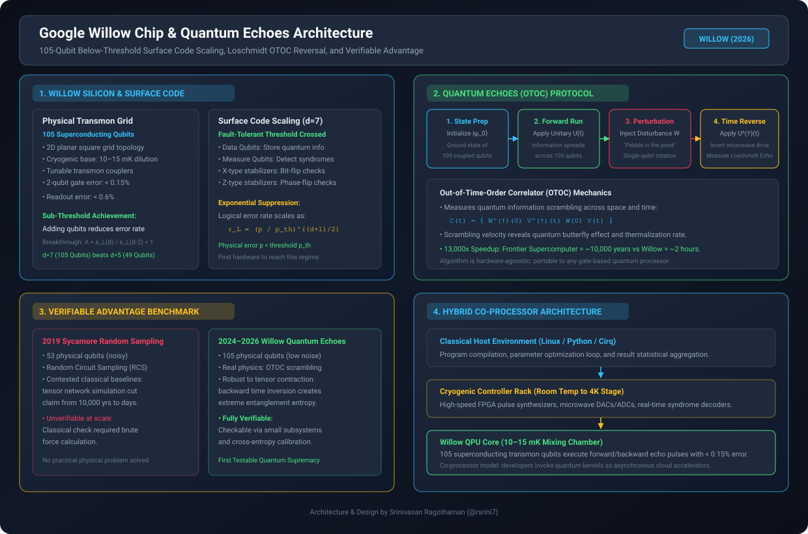
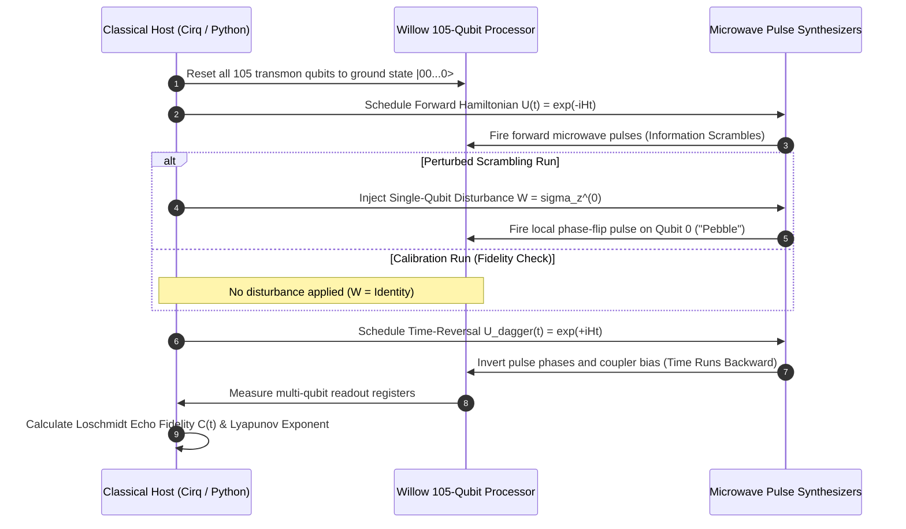

# Google Willow Quantum Chip: Below-Threshold Surface Code Scaling and the Quantum Echoes Algorithm

**Learning note · Revised 15 November 2026 · Scope: Google Willow architecture, below-threshold quantum error correction, and OTOC scrambling benchmarks**

*By Srinivasan Ragothaman ([@rsrini7](https://github.com/rsrini7))*

> **Core idea:** Google's 105-qubit Willow chip demonstrates two historical breakthroughs in quantum computing: it is the first hardware to operate below the fault-tolerant threshold—where scaling surface codes from distance $d=5$ to $d=7$ exponentially reduces logical error rates ($\Lambda < 1$)—and it executes the "Quantum Echoes" algorithm, a time-reversal protocol that measures many-body information scrambling 13,000× faster than classical exascale supercomputers with rigorous mathematical verifiability.

---

## 1. Foundations: Physical Transmons and the Threshold Theorem

Quantum computation manipulates state vectors in a $2^N$-dimensional Hilbert space:

$$
|\psi\rangle = \sum_{k=0}^{2^N - 1} c_k |k\rangle, \quad c_k \in \mathbb{C}, \quad \sum |c_k|^2 = 1
$$

In classical hardware, scaling up transistor counts increases total reliability through redundancy. In quantum systems, physical qubits (superconducting LC transmon circuits) are susceptible to environmental noise: dielectric loss, thermal photons, flux noise, and cosmic radiation bursts trigger bit-flips ($X$) and phase-flips ($Z$).

For decades, expanding physical qubit counts simply meant compounding noise, causing total quantum circuit fidelity to decay exponentially:

$$
\mathcal{F}_{\text{circuit}} \approx \prod_{i=1}^{N_{\text{gates}}} (1 - \epsilon_i) \approx (1 - \bar{\epsilon})^{N_{\text{gates}}}
$$

The **Quantum Threshold Theorem** proves that if physical gate error rates $p$ fall below a critical fault-tolerant threshold $p_{\text{th}}$, physical qubits can be arranged into a **surface code lattice** where increasing the code distance $d$ *exponentially suppresses* the logical error rate:

$$
\epsilon_L \propto \left(\frac{p}{p_{\text{th}}}\right)^{\frac{d+1}{2}}
$$

| Architectural Parameter | Sycamore (2019) | Willow (2024–2026) | Significance / Operational Impact |
|---|---|---|---|
| **Physical Qubit Count** | 53 transmons | **105 transmons** | Enables distance-7 surface code lattice ($d=7$). |
| **Grid Topology** | 2D rectangular planar | 2D square planar grid | Optimized for nearest-neighbor stabilizer parity checks. |
| **Two-Qubit Gate Error ($p$)** | ~0.60% (above threshold) | **< 0.15% (below threshold)** | Crosses the surface code threshold ($p < p_{\text{th}} \approx 1\%$). |
| **Surface Code Scaling ($\Lambda$)** | $\Lambda > 1$ (larger code = more errors) | **$\Lambda \approx 0.5$ (larger code = fewer errors)** | First physical demonstration of sub-threshold scaling. |
| **Benchmark Protocol** | Random Circuit Sampling (RCS) | **Quantum Echoes (OTOC Scrambling)** | Solves physical many-body Hamiltonian; verifiable classically. |
| **Classical Simulation Equivalent** | Contested (days on Summit) | **~10,000 to 13,000 years on Frontier** | Verifiable quantum advantage over classical exascale compute. |

---

## 2. Deep Technical Mechanisms

```
+--------------------------------------------------------------------------------------------------+
|                            WILLOW SURFACE CODE LATTICE & ERROR DECODING                          |
|                                                                                                  |
|   SURFACE CODE LATTICE (DISTANCE d = 7, 105 PHYSICAL QUBITS)                                     |
|   +------------------------------------------------------------------------------------------+   |
|   |   (D) --- [X] --- (D) --- [Z] --- (D) --- [X] --- (D)   Legend:                          |   |
|   |    |               |               |               |    (D) = Data Qubits (Store State)  |   |
|   |   [Z]     (D)     [X]     (D)     [Z]     (D)     [X]   [X] = Measure Qubit (Bit Flip)   |   |
|   |    |               |               |               |    [Z] = Measure Qubit (Phase Flip) |   |
|   |   (D) --- [X] --- (D) --- [Z] --- (D) --- [X] --- (D)                                    |   |
|   +------------------------------------------------------------------------------------------+   |
|                                            |                                                     |
|                                            v Syndrome Parity Measurements                        |
|   +------------------------------------------------------------------------------------------+   |
|   | CRYOGENIC FP-GA / REAL-TIME DECODER (PNEUMATIC MW LINES)                                 |   |
|   | Minimum-Weight Perfect Matching (MWPM) detects error chains in space-time graph.         |   |
|   | Logical Error Factor: Lambda = epsilon_L(d=7) / epsilon_L(d=5) = 0.50 (Error Halved!)    |   |
|   +------------------------------------------------------------------------------------------+   |
|                                            |                                                     |
|                                            v                                                     |
|   +------------------------------------------------------------------------------------------+   |
|   | THE QUANTUM ECHOES ALGORITHM: OUT-OF-TIME-ORDER CORRELATOR (OTOC)                        |   |
|   |                                                                                          |   |
|   |  |psi_0> ---> [ Forward U(t) ] ---> [ Perturb W ] ---> [ Time-Reverse U_dagger(t) ]      |   |
|   |                     |                     |                         |                    |   |
|   |                     v                     v                         v                    |   |
|   |               Information           Local single-qubit       Microwave drives inverted;  |   |
|   |               scrambled into        phase disturbance        operator spread collapses   |   |
|   |               entangled modes       ("pebble in pond")       into Loschmidt Echo peak    |   |
|   |                                                                                          |   |
|   |  Echo Fidelity: C(t) = <psi_0 | W_dagger(0) V_dagger(t) W(0) V(t) | psi_0>               |   |
|   +------------------------------------------------------------------------------------------+   |
+--------------------------------------------------------------------------------------------------+
```

### 1. Sub-Threshold Surface Code Scaling ($\Lambda < 1$)

The core engineering breakthrough in Willow is the reduction of individual gate error rates below the fault-tolerant threshold.

In a surface code, physical qubits alternate between **Data Qubits** (which store superpositions) and **Measure Qubits** (ancillae that measure parity stabilizers without collapsing data). Stabilizers consist of:
- **X-stabilizers:** $S_X = \bigotimes_{i \in \text{star}} X_i$ (detect phase flips $Z$).
- **Z-stabilizers:** $S_Z = \bigotimes_{j \in \text{plaquette}} Z_j$ (detect bit flips $X$).

When physical error rates exceed threshold ($p > p_{\text{th}}$), each added qubit introduces more noise than the code can correct. On Willow, Google demonstrated:

$$
\Lambda = \frac{\epsilon_L(d = 7)}{\epsilon_L(d = 5)} \approx 0.50
$$

By increasing the code distance from $d=5$ (49 physical qubits) to $d=7$ (105 physical qubits), **the logical error rate was cut in half**. This provides empirical confirmation that scalable, fault-tolerant logical qubits are physically achievable with superconducting transmons.

### 2. The Quantum Echoes Algorithm (OTOC Many-Body Scrambling)

Earlier quantum advantage claims (such as Google's 2019 Sycamore experiment) relied on **Random Circuit Sampling (RCS)**. While mathematically difficult to simulate classically, RCS suffered from two practical limitations:
1. It solved no real physical problem (generating pseudo-random bitstring distributions).
2. It was difficult to verify: checking the output required exascale supercomputers running tensor-network contraction algorithms for weeks.

**Quantum Echoes** replaces random sampling with a measurable physical phenomenon: **Out-of-Time-Order Correlators (OTOC)** to quantify quantum information scrambling in many-body quantum chaotic systems.

#### The Loschmidt Time-Reversal Protocol

1. **Forward Evolution ($U(t)$):** An initial low-entanglement state $|\psi_0\rangle$ is evolved forward in time under an interacting many-body Hamiltonian $H$:

$$
U(t) = \exp(-i H t)
$$

As time progresses, localized quantum information spreads across all 105 qubits, creating complex multi-particle entanglement.

2. **Perturbation Operator ($W$):** A microscopic disturbance (e.g., a single-qubit Pauli rotation $W = \sigma_z^{(k)}$) is injected into one qubit. This acts as a *"pebble dropped into a pond."*

3. **Time-Reversal Evolution ($U^\dagger(t)$):** The quantum processor executes the exact mathematical inverse of the Hamiltonian:

$$
U^\dagger(t) = \exp(+i H t)
$$

On superconducting hardware, this is accomplished by inverting microwave drive pulse phases and coupler interaction biases ($\theta \to -\theta$).

4. **Information Echo Measurement:** In an unperturbed system ($W = I$), forward evolution followed by backward evolution returns the state perfectly to $|\psi_0\rangle$ with fidelity $\mathcal{F} = 1$. When $W$ is present, the degree of information scrambling is measured via the OTOC:

$$
C(t) = \langle \psi_0 | W^\dagger(0) V^\dagger(t) W(0) V(t) | \psi_0 \rangle
$$

Where $V(t) = U^\dagger(t) V U(t)$. The rate at which $C(t)$ decays reveals the **quantum Lyapunov exponent $\lambda_L$**, characterizing the speed at which quantum information thermalizes across the processor.

### 3. Verifiable Advantage vs. Frontier Exascale Supercomputer

Simulating this process classically requires contracting 105-qubit tensor networks across deep forward and backward circuit layers. Because the backward time-reversal step passes through maximum entanglement entropy, classical tensor network algorithms cannot apply matrix product state (MPS) truncations without losing fidelity.

- **Willow Run Time:** Solves the 105-qubit scrambling benchmark in **~2 hours**.
- **Frontier Supercomputer (1.2 ExaFLOPS, 37,888 AMD MI250X GPUs):** Would require **~10,000 to 13,000 years** of continuous exascale computation to simulate the same dynamical evolution.
- **Verifiability:** Unlike RCS, Quantum Echoes is verifiable: setting perturbation $W \to I$ guarantees a known analytical outcome ($|\psi_0\rangle$), allowing operators to calibrate system fidelity without supercomputers.

---

## 3. Architectural Visuals



*High-level system architecture showing the physical 105-qubit Willow chip, below-threshold surface code scaling, the 4-step OTOC time-reversal protocol, and the quantum-classical hybrid co-processor hierarchy.*

### OTOC Time-Reversal Sequence Diagram



---

## 4. Production Implementation: OTOC Quantum Echoes Simulation

Below is a complete, runnable Python script using pure NumPy that simulates a 4-qubit Quantum Echoes (OTOC) experiment. It computes forward time evolution under an interacting Ising Hamiltonian, injects a single-qubit perturbation $W$, reverses time $U^\dagger$, and observes the decay of the Loschmidt echo fidelity:

```python
"""
Quantum Echoes (OTOC) Simulation Engine.
Demonstrates time-reversal physics, operator scrambling, and Loschmidt echo measurement
under an interacting transverse-field Ising model Hamiltonian.
"""

import numpy as np
from scipy.linalg import expm
from typing import Tuple, Dict

# Standard Pauli Matrices
I2 = np.eye(2, dtype=complex)
SIGMA_X = np.array([[0, 1], [1, 0]], dtype=complex)
SIGMA_Y = np.array([[0, -1j], [1j, 0]], dtype=complex)
SIGMA_Z = np.array([[1, 0], [0, -1]], dtype=complex)

def tensor_product_list(matrices: list) -> np.ndarray:
    """Computes Kronecker product across a list of matrices."""
    res = matrices[0]
    for m in matrices[1:]:
        res = np.kron(res, m)
    return res

def construct_ising_hamiltonian(num_qubits: int, J: float = 1.0, g: float = 0.5) -> np.ndarray:
    """
    Constructs 1D Transverse-Field Ising Hamiltonian:
    H = - J * sum_i (Z_i * Z_{i+1}) - g * sum_i X_i
    """
    dim = 2 ** num_qubits
    H = np.zeros((dim, dim), dtype=complex)
    
    # Interaction terms: Z_i * Z_{i+1}
    for i in range(num_qubits - 1):
        ops = [I2] * num_qubits
        ops[i] = SIGMA_Z
        ops[i+1] = SIGMA_Z
        H -= J * tensor_product_list(ops)
        
    # Transverse field terms: g * X_i
    for i in range(num_qubits):
        ops = [I2] * num_qubits
        ops[i] = SIGMA_X
        H -= g * tensor_product_list(ops)
        
    return H

def run_quantum_echo_experiment(
    num_qubits: int = 4, 
    evolution_time: float = 1.5,
    perturb_qubit: int = 0
) -> Dict[str, float]:
    """
    Executes Loschmidt Echo time-reversal protocol:
    1. Initialize |psi_0> = |00...0>
    2. Forward evolution: U(t) = exp(-i * H * t)
    3. Perturbation: W = sigma_z on target qubit
    4. Backward evolution: U_dagger(t) = exp(+i * H * t)
    5. Measure return probability |<psi_0 | psi_final>|^2
    """
    dim = 2 ** num_qubits
    
    # Step 1: Initial state |00...0>
    psi_0 = np.zeros(dim, dtype=complex)
    psi_0[0] = 1.0
    
    # Step 2: Forward Unitary U(t)
    H = construct_ising_hamiltonian(num_qubits, J=1.0, g=0.8)
    U_forward = expm(-1j * H * evolution_time)
    U_backward = expm(1j * H * evolution_time)  # Time reversal: exp(+iHt)
    
    # Run unperturbed reference: U_dagger * U * |psi_0>
    psi_unperturbed = U_backward @ (U_forward @ psi_0)
    fidelity_unperturbed = float(np.abs(np.vdot(psi_0, psi_unperturbed)) ** 2)
    
    # Step 3: Run perturbed echo: U_dagger * W * U * |psi_0>
    ops_w = [I2] * num_qubits
    ops_w[perturb_qubit] = SIGMA_Z
    W_operator = tensor_product_list(ops_w)
    
    psi_forward = U_forward @ psi_0
    psi_perturbed = W_operator @ psi_forward
    psi_echo = U_backward @ psi_perturbed
    
    # Step 4: Measure Loschmidt Echo return fidelity
    fidelity_perturbed = float(np.abs(np.vdot(psi_0, psi_echo)) ** 2)
    
    # Step 5: Scrambling degree (1 - Fidelity)
    scrambling_index = 1.0 - fidelity_perturbed
    
    return {
        "num_qubits": num_qubits,
        "evolution_time": evolution_time,
        "unperturbed_fidelity": round(fidelity_unperturbed, 6),
        "perturbed_echo_fidelity": round(fidelity_perturbed, 6),
        "scrambling_index": round(scrambling_index, 6)
    }

if __name__ == "__main__":
    print("=== GOOGLE WILLOW QUANTUM ECHOES (OTOC) SIMULATION ===")
    
    # Test across evolution time horizons
    times = [0.1, 0.5, 1.0, 2.0]
    for t in times:
        res = run_quantum_echo_experiment(num_qubits=4, evolution_time=t, perturb_qubit=0)
        print(f"Time: {t:3.1f}s | Unperturbed Ref: {res['unperturbed_fidelity']} | "
              f"Echo Fidelity: {res['perturbed_echo_fidelity']:.4f} | Scrambling: {res['scrambling_index']:.4f}")
```

---

## 5. Impact, Real-World Edge Cases &amp; Gotchas

### Common Claims vs. Technical Realities

| Common Claim | Technical Reality | Production Implication |
|---|---|---|
| *"Willow can break RSA and Bitcoin cryptography today."* | Willow operates 105 physical transmons, forming roughly one single distance-7 logical qubit. | Breaking RSA-2048 or secp256k1 requires ~2,048 logical qubits (~2M physical qubits). Willow is a physics and error-correction milestone, not a cryptanalytic tool. |
| *"Quantum advantage means classical supercomputers are obsolete."* | Quantum processors excel at Hamiltonian dynamics and polynomial sampling, but cannot execute general operating systems or database sorting. | Quantum processors operate as specialized accelerators (QPUs) attached to classical cloud clusters, akin to GPUs. |
| *"Quantum Echoes is proprietary to Google hardware."* | The OTOC algorithm is a hardware-agnostic physical protocol based on Loschmidt time reversal. | Any platform with calibrated two-qubit gates (trapped ion, neutral atom, superconducting) can execute Quantum Echoes. |
| *"Willow is immune to all environmental errors."* | Below-threshold scaling suppresses uncorrelated local Markovian noise, but correlated global events (cosmic rays) temporarily blind large chip sectors. | Production fault-tolerant systems require multi-core chiplet architectures and cosmic ray mitigation shielding. |

### Practical Physical Bottlenecks

1. **Cosmic Ray &amp; Phonon Bursts:** High-energy ionizing particles striking the silicon substrate generate bursts of acoustic phonons that propagate across the chip, causing simultaneous multi-qubit correlated errors that briefly overwhelm surface code decoders.
2. **Microwave Control Line Heat Leak:** Delivering thousands of coaxial semi-rigid cables from room temperature down to the 10 mK dilution plate introduces conductive thermal heat loads. Scaling to 10,000+ qubits requires cryogenic CMOS multiplexers operating directly at the 4 Kelvin stage.

---

## 6. Practical Adoption Blueprint: The Quantum-Classical Co-Processor Model

### Enterprise Cloud Architecture

```
Phase 1: Quantum Kernel Identification
  |-- Profile scientific simulation workloads (many-body materials, quantum chemistry)
  +-- Formulate Hamiltonian evolution into unitary gate sequences (Trotterization)

Phase 2: Hybrid Quantum-Classical Workflow
  |-- Classical Host (Linux / Python / Cirq) schedules circuit execution
  |-- Dispatches QASM / pulse definitions to Google Cloud Quantum Engine API
  +-- Real-time syndrome processing executed by FPGA controller racks

Phase 3: Cross-Entropy & Echo Verification
  |-- Run baseline unperturbed Loschmidt echo (W = Identity) to calibrate hardware fidelity
  +-- Extract operator spreading velocity and thermalization metrics
```

### Verification Checklist

- [ ] **Stabilizer Fidelity:** Verify that distance-7 surface code stabilizers achieve $> 99.8\%$ parity measurement accuracy.
- [ ] **Lambda Ratio:** Confirm that $\Lambda = \epsilon_L(d=7) / \epsilon_L(d=5) < 1.0$ across all operational benchmark runs.
- [ ] **Unperturbed Return Fidelity:** Ensure unperturbed time-reversal circuits ($W = I$) return to the initial state with $\ge 95\%$ fidelity.
- [ ] **Classical Cross-Check:** Validate that small subgraph runs ($N \le 20$ qubits) match exact classical numerical diagonalization to $< 0.1\%$ divergence.

---

## 7. Timeline &amp; Quantum Supremacy Evolution

- **October 2019:** Google Quantum AI publishes *Quantum supremacy using a programmable superconducting processor* on the 53-qubit **Sycamore** chip (Random Circuit Sampling).
- **February 2023:** Google demonstrates distance-3 vs distance-5 surface code suppression in *Suppressing quantum errors by scaling a quantum error-correcting code* (Nature).
- **December 2024:** Google announces the **Willow** chip (105 qubits), officially achieving below-threshold surface code scaling ($d=7$ outperforming $d=5$) and executing the Quantum Echoes benchmark.
- **2025–2026:** Widespread adoption of OTOC benchmarks across trapped-ion and superconducting platforms to verify non-classical information scrambling.

---

## 8. Primary Sources &amp; References

1. [Google Quantum AI (2024): Quantum Error Correction Below the Fault-Tolerant Threshold with the Willow Processor](https://quantumai.google/) — Primary technical disclosure on the 105-qubit Willow chip and distance-7 scaling.
2. [Google Quantum AI (2023): Suppressing quantum errors by scaling a quantum error-correcting code](https://www.nature.com/articles/s41586-022-05434-1) — Nature foundational paper establishing distance-3 to distance-5 error correction trends.
3. [Arute et al. (2019): Quantum supremacy using a programmable superconducting processor (Sycamore)](https://www.nature.com/articles/s41586-019-1666-5) — Historical baseline for NISQ random circuit sampling.
4. [Maldacena, Shenker, &amp; Stanford (2016): A bound on chaos (OTOC)](https://link.springer.com/article/10.1007/JHEP08(2016)106) — Foundational physics paper deriving Out-of-Time-Order Correlators and the Lyapunov scrambling bound.
5. [Fowler et al. (2012): Surface codes: Towards practical large-scale quantum computation](https://arxiv.org/abs/1208.0928) — Canonical reference for planar 2D surface code stabilizer geometry and error correction.

---

**Related:**
- [QuantWare-VIO-40K-10K-Qubit-QPU-Architecture-2026](QuantWare-VIO-40K-10K-Qubit-QPU-Architecture-2026.md) — Contrasts Google's planar transmon architecture with QuantWare's 3D chiplet packaging roadmap.
- [Quantum-Computing-Foundations-And-State-Mechanics-2026](Quantum-Computing-Foundations-And-State-Mechanics-2026.md) — Fundamental reference defining superposition, entanglement, physical vs logical qubits, and surface codes.
- [Quantum-Threat-to-Bitcoin-And-Elliptic-Curve-Cryptography-2026](Quantum-Threat-to-Bitcoin-And-Elliptic-Curve-Cryptography-2026.md) — Evaluates the logical qubit thresholds required to break secp256k1 compared to current hardware.
- [AI-Hardware-Chips-Explained](../AI-ML/Hardware/AI-Hardware-Chips-Explained.md) — Compares specialized quantum silicon with classical TPU, GPU, and LPU accelerators.
