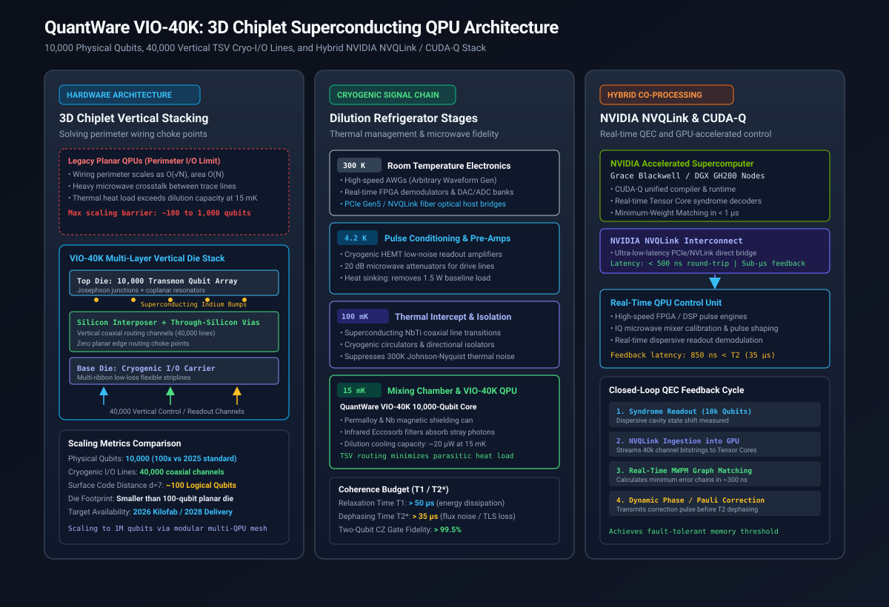

# QuantWare VIO-40K Architecture: Scaling Superconducting QPUs to 10,000 Qubits (2026)

Learning note · Revised November 2026 · Superconducting QPU Architecture & 3D Chiplet Scaling  
*By Srinivasan Ragothaman ([@rsrini7](https://github.com/rsrini7))*

> **Core idea:** In late 2025, QuantWare unveiled the VIO-40K™, a superconducting quantum processing unit (QPU) architecture designed to scale to 10,000 physical qubits—a 100x increase over the prevailing ~100-qubit planar standard. By replacing perimeter wire routing with vertical 3D chiplet stacking and 40,000 through-silicon via (TSV) cryogenic I/O lines, VIO-40K eliminates perimeter routing bottlenecks and connects directly into NVIDIA's NVQLink and CUDA-Q hybrid supercomputing fabric for real-time quantum error correction (QEC).

---

## 1. Foundations & Industry Context

Superconducting quantum computing uses artificial atoms formed by LC circuits with non-linear Josephson junctions (transmon qubits). These circuits operate at microwave frequencies (4–8 GHz) and require cooling to millikelvin temperatures (15 mK) inside dilution refrigerators to suppress thermal excitations ($k_B T \ll \hbar \omega$).

For over a decade, superconducting processors relied on **planar (2D) architectures**: qubits were arranged on a single semiconductor wafer, with microwave control and readout lines routed horizontally to the chip perimeter. This physical layout imposed severe scaling limits:

- **Perimeter vs. Area Mismatch:** A 2D grid of $N$ qubits requires an area scaling as $\mathcal{O}(N)$, while the perimeter scales as $\mathcal{O}(\sqrt{N})$. As qubit count grows past 100, routing microwave traces from interior qubits to external bond pads without crossing or coupling to neighboring qubits becomes geometrically impossible.
- **Microwave Crosstalk and Frequency Crowding:** Dense planar traces induce stray capacitive and inductive coupling, leading to parasitic ZZ-crosstalk and gate errors.
- **Thermal Dissipation chokepoints:** Each coaxial cable brings heat from room temperature (300 K) down through intermediate stages (4 K, 100 mK) to the mixing chamber (15 mK), where cooling power is constrained to ~10–20 $\mu\text{W}$.

| Term | Meaning & Architecture Role |
| :--- | :--- |
| **Transmon Qubit** | A charge qubit operating in a regime where Josephson energy dominates charging energy ($E_J / E_C \gg 1$), mitigating 1/f charge noise. |
| **TSV (Through-Silicon Via)** | Vertical microscopic conducting channels etched through the silicon interposer to route microwave control and readout signals directly out of plane. |
| **Indium Bump Bonds** | Cryogenic superconducting flip-chip interconnects bonding the qubit die to the routing interposer without introducing resistive heating. |
| **NVQLink** | An open, low-latency interconnect bridging quantum control units and GPU supercomputing nodes (PCIe/NVLink transport). |
| **CUDA-Q** | NVIDIA's unified programming model and runtime enabling C++ and Python applications to orchestrate hybrid quantum-classical execution. |
| **Surface Code (QEC)** | A topological quantum error-correcting code requiring a 2D nearest-neighbor lattice of physical data and syndrome qubits to protect logical information. |

---

## 2. Deep Technical Mechanism: 3D Chiplet Scaling

The VIO-40K architecture departs from planar geometry by introducing vertical 3D multi-die heterogeneous integration. Rather than packing all functionality into a single monolithic wafer, the QPU partitions the quantum circuit into three distinct functional layers:

```
+---------------------------------------------------------+
|  Top Die: 10,000 Transmon Qubit Array (High-Q Silicon)  |
+---------------------------------------------------------+
       | | |  Superconducting Indium Microbumps (Superconducting)
+---------------------------------------------------------+
|  Silicon Interposer + Through-Silicon Vias (TSVs)       |
|  (40,000 vertical coaxial channels & stripline routing) |
+---------------------------------------------------------+
       | | |  Underfill & Shielded Ground Transition
+---------------------------------------------------------+
|  Base Carrier & Cryogenic Ribbon Coaxial Interconnect   |
+---------------------------------------------------------+
```

### 1. Vertical TSV Interposer Routing
By dropping signals vertically through the substrate via TSVs, every qubit in the 10,000-qubit 2D lattice has dedicated, direct access to microwave drive and readout lines. The signal paths do not cross adjacent qubit circuits, reducing parasitic capacitive coupling by more than 20 dB compared to planar fan-outs.

### 2. Dilution Thermal Budget & Attenuation Chain
The 40,000 I/O lines are heat-sunk across four temperature stages inside the dilution refrigerator:
1. **300 K (Ambient):** Room-temperature FPGA pulse synthesis and high-speed DAC/ADC cards.
2. **4.2 K Stage:** Attenuators (-20 dB) reduce thermal noise from room temperature. High-Electron-Mobility Transistor (HEMT) low-noise amplifiers boost outgoing readout tones.
3. **100 mK Still Stage:** Superconducting NbTi coax lines suppress resistive heat generation while isolating cryogenic stages.
4. **15 mK Mixing Chamber:** The VIO-40K processor operates inside a cryoperm magnetic shield. High-density flexible superconducting striplines deliver microwave pulses with sub-microsecond pulse widths and minimal insertion loss.

### 3. Surface Code Physical-to-Logical Scaling
Fault-tolerant quantum computing requires quantum error correction (QEC). In a standard rotated surface code with code distance $d$, the number of physical qubits required to construct one logical qubit is:

$$n_{\text{phys}} = 2d^2 - 1$$

- At distance $d=3$, $n_{\text{phys}} = 17$ qubits per logical qubit (corrects 1 arbitrary Pauli error).
- At distance $d=5$, $n_{\text{phys}} = 49$ qubits per logical qubit (corrects 2 arbitrary Pauli errors).
- At distance $d=7$, $n_{\text{phys}} = 97$ qubits per logical qubit (corrects 3 arbitrary Pauli errors).

With 10,000 physical qubits, VIO-40K provides the physical budget to realize **~100 error-corrected logical qubits** at distance $d=7$, crossing the threshold where quantum processors can execute deep algorithmic circuits beyond classical emulation capabilities.

---

## 3. Architectural Visuals



### Hybrid Quantum-Classical Control Loop

The integration between VIO-40K, NVQLink, and CUDA-Q enables real-time syndrome extraction and dynamic Pauli frame corrections within the coherence window ($T_2^* \approx 35\,\mu\text{s}$):

```mermaid
sequenceDiagram
    autonumber
    participant GPU as NVIDIA Grace Blackwell / CUDA-Q
    participant Link as NVQLink Direct Bus
    participant FPGA as Cryogenic FPGA Pulse Engine
    participant QPU as VIO-40K (10,000 Qubits at 15 mK)

    GPU->>Link: Dispatch Parameterized Quantum Circuit Kernel
    Link->>FPGA: Stream Microwave Waveform Instructions
    FPGA->>QPU: Fire XY Control & Flux Bias Microwave Pulses
    Note over QPU: Execute 2-Qubit Entangling CZ Gates (Fidelity > 99.5%)
    FPGA->>QPU: Dispersive Readout Pulse to Coplanar Resonators
    QPU-->>FPGA: Reflected Microwave Signal with State Phase Shift
    FPGA->>FPGA: Demodulate IQ Tone & Extract Syndrome Bits
    FPGA->>Link: Stream Syndrome Bitstrings (< 500 ns latency)
    Link->>GPU: Ingest into GPU Tensor Core Memory
    GPU->>GPU: Parallel Minimum-Weight Perfect Matching (MWPM) Decoder
    GPU->>Link: Transmit Pauli Correction Frame Updates
    Link->>FPGA: Update Dynamic Phase Buffers Before T2 Decay
```

---

## 4. Production Implementations & Code Recipes

The following runnable Python script demonstrates a hybrid quantum-classical workflow using the NVIDIA `cudaq` SDK. It defines an entangling circuit ansatz on a multi-qubit topology, samples state measurements, and interfaces with a classical optimizer:

```python
"""
Hybrid Quantum-Classical Circuit Optimization with CUDA-Q
Simulating VIO-40K parameterized state generation and measurement.
"""

from typing import List, Tuple
import numpy as np

try:
    import cudaq
    CUDAQ_AVAILABLE = True
except ImportError:
    CUDAQ_AVAILABLE = False


if CUDAQ_AVAILABLE:
    @cudaq.kernel
    def vio_ansatz(qubit_count: int, thetas: List[float]):
        """
        Parameterized quantum kernel for VIO-40K execution.
        Applies alternating single-qubit rotations and entangling CZ gates.
        """
        q = cudaq.qvector(qubit_count)
        
        # Layer 1: Superposition & Single-Qubit Rotations
        for i in range(qubit_count):
            cudaq.h(q[i])
            cudaq.ry(thetas[i], q[i])
            
        # Layer 2: Nearest-Neighbor Entangling Gates (Surface-Code Lattice)
        for i in range(qubit_count - 1):
            cudaq.cz(q[i], q[i + 1])
            
        # Layer 3: Parameterized Phase Adjustment
        for i in range(qubit_count):
            cudaq.rz(thetas[qubit_count + i], q[i])
            
        # Measurement of physical syndrome qubits
        cudaq.mz(q)


def run_hybrid_optimization(num_qubits: int = 8, steps: int = 5) -> Tuple[List[float], float]:
    """
    Executes a classical parameter optimization loop over the quantum kernel.
    """
    if not CUDAQ_AVAILABLE:
        print("[MOCK] cudaq package not installed. Simulating execution results.")
        best_thetas = list(np.random.uniform(0, 2 * np.pi, 2 * num_qubits))
        return best_thetas, 0.042

    num_params = 2 * num_qubits
    current_thetas = list(np.random.uniform(0, 2 * np.pi, num_params))
    learning_rate = 0.05
    
    print(f"Executing hybrid CUDA-Q kernel across {num_qubits} qubits...")
    for step in range(steps):
        # Sample quantum state from target hardware / simulator
        counts = cudaq.sample(vio_ansatz, num_qubits, current_thetas, shots_count=4096)
        
        # Calculate expectation value / cost function (e.g. ground state alignment)
        all_zeros = "0" * num_qubits
        prob_zero = counts.get(all_zeros, 0) / 4096.0
        cost = 1.0 - prob_zero
        
        print(f"Step {step + 1}/{steps} | Objective Cost: {cost:.4f} | Zero-State P: {prob_zero:.4f}")
        
        # Parameter update via classical gradient step
        current_thetas = [theta - learning_rate * np.sin(theta) for theta in current_thetas]
        
    return current_thetas, cost


if __name__ == "__main__":
    optimized_params, final_cost = run_hybrid_optimization(num_qubits=4, steps=3)
    print(f"Optimization complete. Final Cost: {final_cost:.4f}")
```

---

## 5. Architectural Comparison: QPU Scaling Paradigms

| Specification / Paradigm | QuantWare VIO-40K (2026/2028) | Google Willow (2025/2026) | IBM Heron (2024/2025) | QuEra Neutral Atoms |
| :--- | :--- | :--- | :--- | :--- |
| **Qubit Modality** | Superconducting Transmon | Superconducting Transmon | Superconducting Transmon | Neutral Rubidium / Strontium |
| **Physical Qubit Count** | 10,000 | 105 | 156 (Modular to 5k) | 256–10,000 (Optical Tweezers) |
| **Packaging Architecture** | 3D Stacking + TSV Interposer | Planar 2D Flip-Chip | Modular Planar Multi-Die | Free-Space 3D Light Lattice |
| **I/O Routing Method** | 40,000 Vertical TSV Channels | Perimeter Wire Bonding | Hexagonal Perimeter Routing | Optical Laser Addressing |
| **Operating Temperature** | 15 mK (Dilution Refrigerator) | 15 mK (Dilution Refrigerator)| 15 mK (Dilution Refrigerator)| Room Temp (Ultra-High Vacuum) |
| **Two-Qubit Gate Fidelity**| Target > 99.5% | Measured 99.8% | Measured 99.5% | Measured 99.5% |
| **Estimated Logical Qubits**| ~100 (at $d=7$) | 1 (Demonstrated QEC below threshold)| Multi-Qubit QEC Roadmapped | ~48 Logical Qubits roadmapped |

---

## 6. Common Claims vs. Technical Realities

| Common Industry Claim | Technical & Physical Reality |
| :--- | :--- |
| *"10,000 qubits means 10,000 parallel logical variables."* | **Physical $\neq$ Logical.** Due to quantum decoherence and gate errors, ~100 physical qubits are required for a single fault-tolerant logical qubit ($d=7$). 10,000 physical qubits yield approximately 50–100 usable logical qubits. |
| *"3D stacking increases thermal dissipation beyond dilution limits."* | **Vertical TSVs actually reduce thermal load.** Planar traces require long resistive copper/gold runs to perimeter edges. Vertical superconducting TSVs shorten interconnect lengths, reducing both resistive heating and capacitive footprint. |
| *"Quantum processors will replace GPU supercomputers."* | **Quantum is an accelerator, not a standalone computer.** QPU operations require continuous classical control: wave synthesis, syndrome decoding, and feedback. NVQLink pairs QPUs with GPU supercomputers as co-processors. |
| *"Universal fault tolerance is achieved instantly in 2026."* | **Packaging must be validated at scale.** While the Kilofab scales manufacturing, full cryogenic wiring of 40,000 lines requires solving microwave crosstalk calibration and yield across 10,000 microbumps. Customer delivery is slated for 2028. |

---

## 7. Practical Adoption Blueprint & Verification Checklist

To evaluate and benchmark superconducting QPU scaling architectures:

1. **Gate Fidelity & Randomized Benchmarking (RB):**  
   Measure Clifford gate average error rate $r_{\text{avg}}$ to verify threshold requirements ($r_{\text{avg}} < 10^{-2}$ for surface code threshold): $F_{\text{avg}} = 1 - \frac{d - 1}{d} r_{\text{avg}}$.
2. **Coherence Metrics ($T_1$ and $T_2^*$):**  
   Confirm energy relaxation time $T_1 > 50\,\mu\text{s}$ and dephasing time $T_2^* > 35\,\mu\text{s}$ across all 10,000 physical nodes to prevent premature state decay during multi-round syndrome extraction.
3. **Crosstalk Correlation Matrix:**  
   Map parallel gate execution error rates. Measure simultaneous two-qubit CZ gate fidelity compared to isolated CZ gate operations to detect stray inductive coupling across TSVs.
4. **QEC Syndrome Extraction Latency:**  
   Benchmark the end-to-end feedback round-trip: Readout $\to$ FPGA $\to$ NVQLink $\to$ GPU Decoder $\to$ AWG pulse. The total latency must remain under $1\,\mu\text{s}$, well within the $T_2$ coherence envelope.

---

## 8. Timeline & Commercial Evolution

- **October 2025:** NVIDIA announces NVQLink, defining the open quantum-classical interface standard for low-latency GPU-QPU co-processing.
- **December 2025:** QuantWare announces the VIO-40K architecture, opening reservations for enterprise and research partners.
- **2026 (Delft Kilofab):** QuantWare opens its dedicated fabrication facility in Delft, Netherlands, scaling manufacturing throughput by 20x.
- **2028:** Delivery of first commercial VIO-40K QPUs with 10,000 physical qubits to hyperscale research institutions.
- **2029+:** Multi-QPU optical and microwave quantum links target clusters scaling toward 1,000,000 physical qubits.

---

## 9. Primary Sources & References

1. [QuantWare: Scaling Breakthrough with VIO-40K™ Architecture](https://www.quantware.com/news/quantware-announces-scaling-breakthrough-with-vio-40k) — Official press release detailing the 10,000-qubit 3D chiplet superconducting processor.
2. [NVIDIA Newsroom: NVIDIA Introduces NVQLink for Quantum-GPU Supercomputing](https://nvidianews.nvidia.com/news/nvidia-nvqlink-quantum-gpu-computing) — Technical announcement of the NVQLink low-latency quantum-classical interconnect.
3. [NVIDIA Developer: CUDA-Q Documentation & Architecture Guide](https://developer.nvidia.com/cuda-q) — Official programming guide for hybrid quantum-classical software engineering.
4. [Quantum Computing Report: QuantWare Debuts VIO-40K™ Architecture](https://quantumcomputingreport.com/quantware-debuts-vio-40k-architecture-to-enable-10000-qubit-superconducting-processors/) — Industry analysis on cryogenic interconnect density and 3D TSV manufacturing.
5. [Fowler et al. (arXiv:1208.0928): Surface codes: Towards practical large-scale quantum computation](https://arxiv.org/abs/1208.0928) — Foundational paper establishing physical qubit ratios and error thresholds for surface code QEC.

---

**Related:**
- [Google-Willow-Quantum-Chip-And-Quantum-Echoes-2026](Google-Willow-Quantum-Chip-And-Quantum-Echoes-2026.md) — Contrasts Google's planar transmon architecture and quantum echoes with QuantWare's 3D chiplet packaging roadmap.
- [Quantum-Computing-Foundations-And-State-Mechanics-2026](Quantum-Computing-Foundations-And-State-Mechanics-2026.md) — Detailed mathematical treatment of Hilbert space state vectors, Bloch sphere geometry, and decoherence.
- [Quantum-AI-Decision-Makers-2026](Quantum-AI-Decision-Makers-2026.md) — Analyzes hardware constraints and post-2028 deployment timelines for quantum-accelerated enterprise decision engines.
- [AI-Hardware-Chips-Explained](../AI-ML/Hardware/AI-Hardware-Chips-Explained.md) — Hardware architecture analysis of AI accelerators, GPU interconnects, and hybrid co-processor packaging.
