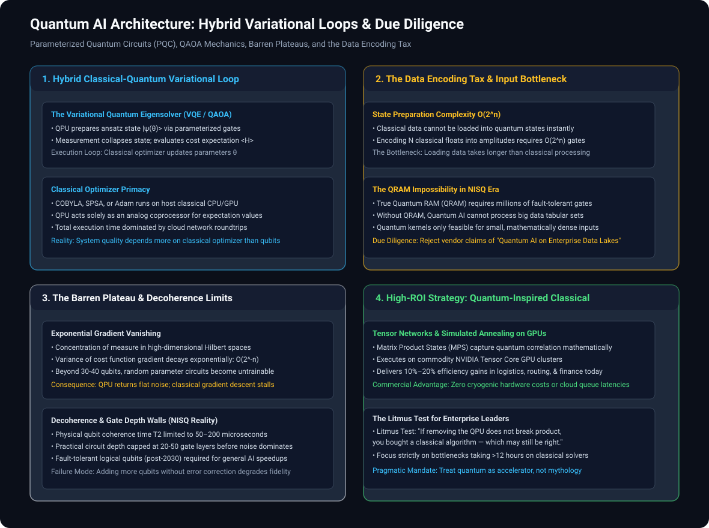
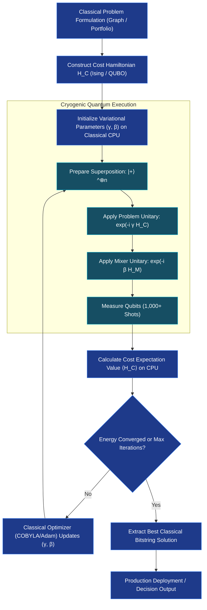
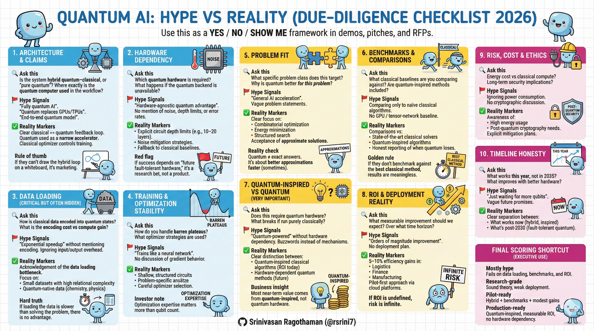

# Quantum AI & Optimization Architecture: Executive Due Diligence and Systems Reality

`Learning note · Revised November 2026 · Quantum Computing & Applied Mathematics`  
*By Srinivasan Ragothaman ([@rsrini7](https://github.com/rsrini7))*

> Quantum AI is not a drop-in replacement for classical deep learning. In the Noisy Intermediate-Scale Quantum (NISQ) era, quantum computing functions exclusively within hybrid quantum-classical loops, where quantum processors act as narrow analog coprocessors for high-complexity combinatorial and molecular energy landscapes. For enterprise leaders, navigating quantum investments requires distinguishing empirical optimization advantages from the severe hardware bottlenecks of the data encoding tax and barren plateaus.

---

## 1. Foundations: Classical Bits vs. Quantum Mechanics

Evaluating quantum computing in enterprise architecture requires moving past superficial metaphors. Quantum processors do not compute "faster" than classical GPUs; they leverage quantum superposition and interference to bias probability amplitudes toward global optimal solutions in non-convex mathematical spaces.

```
+----------------------------------------------------------------------------------------------------+
|                                    QUANTUM COMPUTING TAXONOMY                                      |
+----------------------------------------------------------------------------------------------------+
|  CLASSICAL COMPUTE (Bit)                               QUANTUM COMPUTE (Qubit)                     |
|  - Discrete deterministic states: 0 or 1               - Superposition: |ψ⟩ = α|0⟩ + β|1⟩          |
|  - Linear state exploration: 2^n states require 2^n steps- Exponential state space: 2^n amplitudes |
|  - Room-temperature silicon CMOS                       - Cryogenic dilution refrigerators (15 mK)  |
|  - Negligible data input/output transfer latency       - Severe "Data Encoding Tax" (No QRAM)      |
|  - Deterministic arithmetic & matrix multiply          - Probabilistic sampling via wave collapse  |
+----------------------------------------------------------------------------------------------------+
```

### Essential Technical Terms & Architectural Roles

| Component / Term | Mathematical / Physical Foundation | Practical Enterprise Reality |
| :--- | :--- | :--- |
| **NISQ Era** | Noisy Intermediate-Scale Quantum (50–1,000 physical qubits without fault tolerance) | Quantum circuits are limited to 20–50 gate layers before environmental decoherence corrupts execution. |
| **Logical vs. Physical Qubit** | Error-corrected quantum state synthesized from hundreds of physical qubits | True fault-tolerant general-purpose quantum computing requires millions of physical qubits (post-2030). |
| **Data Encoding Tax** | Algorithmic overhead required to map classical floating-point numbers into quantum amplitudes | Mapping an enterprise SQL table into quantum state costs $O(2^n)$ gates, destroying any quantum speedup. |
| **QRAM (Quantum RAM)** | Theoretical hardware architecture capable of querying classical data in quantum superposition | Physical implementations do not exist in the NISQ era; limits quantum AI strictly to mathematically generated inputs. |
| **Barren Plateau** | Geometric phenomenon where cost function gradients vanish exponentially: $\text{Var}[\partial_\theta C] \in O(2^{-n})$ | Naive parameterized quantum circuits become untrainable for $n > 30$ qubits; classical optimizers stall. |
| **VQE / QAOA** | Variational Quantum Eigensolver / Quantum Approximate Optimization Algorithm | Leading hybrid algorithms where the QPU computes state energies while a classical optimizer updates circuit parameters. |
| **Quantum-Inspired (QIC)** | Classical tensor networks (Matrix Product States) and simulated annealing running on GPUs | Delivers immediate 10%–20% operational efficiency gains on existing cloud hardware without quantum processors. |

---

## 2. Deep Technical Mechanisms: Hybrid Loops, Encoding, and Plateaus

### 2.1 The Hybrid Variational Optimization Architecture

In the NISQ era, pure stand-alone quantum computing is physically impossible. All viable systems partition execution into a tightly coupled **hybrid quantum-classical loop**:

```
THE HYBRID VARIATIONAL LOOP (VQE / QAOA PIPELINE)
+-----------------------------------------------------------------------------------+
| CLASSICAL HOST (CPU / GPU Server)                                                 |
|   1. Initialize parameter vector: θ = (γ, β)                                      |
|   2. Dispatch parameter update to QPU cloud API via gRPC/REST                     |
+-----------------------------------------------------------------------------------+
                                         │
                                         ▼ (Parameter payload)
+-----------------------------------------------------------------------------------+
| QUANTUM PROCESSOR (QPU - Cryogenic Environment)                                   |
|   3. State Initialization: Apply Hadamard gates: |+⟩^⊗n                           |
|   4. Parameterized Ansatz: e^(-i γ H_C) e^(-i β H_M)                              |
|   5. Measurement: Collapse wave function across 1,000–10,000 shots                |
+-----------------------------------------------------------------------------------+
                                         │
                                         ▼ (Sampled Bitstrings & Expectation Value)
+-----------------------------------------------------------------------------------+
| CLASSICAL OPTIMIZER (COBYLA / SPSA / Adam)                                        |
|   6. Calculate cost expectation: ⟨H_C⟩ = ⟨ψ(θ)| H_C |ψ(θ)⟩                        |
|   7. Compute gradient: ∇_θ ⟨H_C⟩ via parameter-shift rule                         |
|   8. Update parameters θ_next = θ - η ∇_θ ⟨H_C⟩                                   |
|   9. Convergence check: If not converged, repeat loop                             |
+-----------------------------------------------------------------------------------+
```

The system's execution latency is dominated by classical network round trips, shot aggregation, and classical optimizer convergence rather than quantum gate execution.

---

### 2.2 The Data Encoding Tax: Why Quantum AI Cannot Process "Big Data"

A common vendor claim is that quantum AI will process massive enterprise data lakes (e.g., millions of customer transaction rows). Mathematically, this violates quantum mechanics:

1. **Amplitude Encoding**: Mapping an $N$-dimensional classical vector $\vec{x} = (x_0, x_1, \dots, x_{N-1})$ into the amplitudes of an $n$-qubit quantum state:

$$
|\psi_x\rangle = \sum_{i=0}^{N-1} x_i |i\rangle \quad \text{where} \quad n = \lceil \log_2 N \rceil
$$

2. **Exponential State Preparation**: To synthesize the unitary transformation $U_x$ that prepares $|\psi_x\rangle$ from $|0\rangle^{\otimes n}$ requires $\mathcal{O}(2^n) = \mathcal{O}(N)$ quantum gates.
3. **The Complexity Inversion**: Preparing the quantum state requires more computational operations than solving the problem classically on a GPU. Unless data is generated synthetically via an analytical Hamiltonian (as in molecular chemistry or combinatorial graph graphs), quantum machine learning on classical datasets exhibits negative return on investment.

---

### 2.3 Barren Plateaus: Gradient Disappearance in Quantum Hilbert Spaces

Parameterized Quantum Circuits (PQCs) initialized with random rotation gates $\theta$ suffer from the **Barren Plateau phenomenon** (McClean et al., 2018):

$$\text{Var}_{\theta} \left[ \frac{\partial \langle H \rangle}{\partial \theta_k} \right] \in \mathcal{O}\left( \frac{1}{2^n} \right)$$

As the number of qubits $n$ increases, the probability distribution over quantum states concentrates exponentially around the mean (Haar measure concentration). For a 40-qubit circuit, the variance of the gradient is on the order of $2^{-40} \approx 10^{-12}$. 

Classical gradient descent optimizers cannot distinguish between signal and statistical sampling noise, causing training to stall completely. Overcoming barren plateaus requires highly structured, problem-specific ansatz designs (e.g., shallow alternating QAOA layers) rather than generic deep neural ansatzes.

---

## 3. Architectural Visuals: Hybrid Systems & Due Diligence

The diagram below maps the four operational quadrants of quantum AI—hybrid variational pipelines, the data encoding tax, barren plateau constraints, and high-ROI quantum-inspired classical alternatives:



---

### Hybrid Optimization Flowchart



---

## 4. Production Implementations & Code Recipes

### 4.1 Hybrid QAOA Implementation for Max-Cut Combinatorial Optimization

This production Python recipe demonstrates a hybrid classical-quantum optimization loop using Qiskit. The classical optimizer iteratively updates parameters to solve a graph partitioning problem:

```python
import numpy as np
from qiskit import QuantumCircuit
from qiskit.primitives import StatevectorEstimator
from qiskit.quantum_info import SparsePauliOp
from scipy.optimize import minimize

class HybridQAOASolver:
    def __init__(self, edges: list[tuple[int, int]], num_nodes: int, p_layers: int = 1):
        self.edges = edges
        self.num_nodes = num_nodes
        self.p = p_layers
        self.hamiltonian = self._build_cost_hamiltonian()
        self.estimator = StatevectorEstimator()

    def _build_cost_hamiltonian(self) -> SparsePauliOp:
        """Constructs Ising Cost Hamiltonian for Max-Cut: H_C = 0.5 * sum_{(u,v)} (I - Z_u Z_v)"""
        pauli_list = []
        for u, v in self.edges:
            # Build Pauli Z string with Z at indices u and v
            z_string = ["I"] * self.num_nodes
            z_string[u] = "Z"
            z_string[v] = "Z"
            pauli_list.append(("".join(z_string), 0.5))
        return SparsePauliOp.from_list(pauli_list)

    def create_qaoa_circuit(self, gamma: float, beta: float) -> QuantumCircuit:
        qc = QuantumCircuit(self.num_nodes)
        
        # Step 1: Initial state |+>^n via Hadamard gates
        qc.h(range(self.num_nodes))

        # Step 2: Problem Unitary exp(-i * gamma * H_C)
        for u, v in self.edges:
            qc.rzz(2 * gamma * 0.5, u, v)

        # Step 3: Mixer Unitary exp(-i * beta * H_M) where H_M = sum(X_i)
        for i in range(self.num_nodes):
            qc.rx(2 * beta, i)

        return qc

    def cost_function(self, params: np.ndarray) -> float:
        gamma, beta = params[0], params[1]
        circuit = self.create_qaoa_circuit(gamma, beta)
        
        # Evaluate expectation value <H_C> on quantum simulator
        job = self.estimator.run([(circuit, self.hamiltonian)])
        result = job.result()[0]
        energy = result.data.evs
        
        # Max-Cut minimizes -<H_C>
        return -float(energy)

    def solve(self) -> dict:
        initial_params = np.array([0.5, 0.5])
        print("Starting classical COBYLA optimizer loop...")
        
        # Classical optimizer runs on host CPU
        opt_res = minimize(
            self.cost_function,
            initial_params,
            method="COBYLA",
            options={"maxiter": 40, "disp": False}
        )
        
        optimal_gamma, optimal_beta = opt_res.x[0], opt_res.x[1]
        print(f"Optimization converged. Optimal γ: {optimal_gamma:.4f}, β: {optimal_beta:.4f}")
        return {
            "optimal_energy": -opt_res.fun,
            "gamma": optimal_gamma,
            "beta": optimal_beta,
            "iterations": opt_res.nfev
        }

if __name__ == "__main__":
    # Define a 4-node ring graph with a cross edge
    nodes = 4
    graph_edges = [(0, 1), (1, 2), (2, 3), (3, 0), (0, 2)]
    
    solver = HybridQAOASolver(graph_edges, nodes, p_layers=1)
    results = solver.solve()
    print(f"Max-Cut Approximation Expectation Value: {results['optimal_energy']:.4f}")
```

---

## 5. Academically Accepted Quantum AI Taxonomy

| Paradigm | Architectural Mechanism | 2026 Commercial Reality | Hype Signal to Reject |
| :--- | :--- | :--- | :--- |
| **Quantum-Inspired Classical (QIC)** | Tensor Networks (MPS, PEPS) and simulated annealing running on GPU clusters | **Highest ROI Today.** Yields 10%–20% operational efficiency gains in routing and portfolio allocation on existing hardware. | Vendors rebranding standard classical heuristics as "proprietary quantum algorithms" without disclosures. |
| **Quantum Kernel Methods** | Maps non-linear data into high-dimensional Hilbert spaces using quantum circuits; evaluated with classical SVMs | Strongest theoretical framework for advantage on small, mathematically dense datasets. | Applying quantum kernels to massive unstructured data lakes or web-scale text corpora. |
| **Variational Algorithms (VQE / QAOA)** | Hybrid loop: Parameterized quantum circuits evaluated on QPU; parameter gradient optimization on classical host | Production workhorse for molecular energy simulation and narrow combinatorial graph problems. | Vendors claiming "instant exponential speedup" while ignoring classical optimizer convergence latency. |
| **Pure End-to-End Quantum AI** | Full neural network training and inference executed entirely on fault-tolerant quantum processors | **Does Not Exist.** Hardware decoherence and the lack of physical QRAM make this impossible prior to post-2030 fault tolerance. | Marketing claims of "100% Quantum Deep Learning" in production today. |

---

## 6. Common Claims vs. Technical Realities

| # | Common Industry Claim | Technical Reality & Benchmark Fact | Architectural Guidance |
| :-: | :--- | :--- | :--- |
| **1** | *"Quantum computers will replace classical GPUs for training neural networks."* | **False.** GPUs excel at dense 16-bit/8-bit matrix arithmetic at massive scales. Quantum computers cannot perform continuous floating-point tensor multiplication; they sample probabilistic state spaces. | Retain GPUs for deep learning; investigate quantum exclusively for combinatorial graph optimization and chemistry. |
| **2** | *"Quantum computers offer exponential speedup for all computational problems."* | **False.** Quantum algorithms offer exponential speedups only for narrow mathematical structures (e.g., Shor's factoring algorithm). For general NP-hard optimization, algorithms like QAOA offer at best polynomial or constant-factor improvements. | Reject vendor claims of "instant polynomial-to-exponential conversion" of NP-hard problems. |
| **3** | *"Adding more physical qubits automatically increases computational power."* | **False.** Without quantum error correction, adding physical qubits increases crosstalk noise and decreases coherence time $T_2$. Circuit fidelity degrades exponentially as gate depth expands. | Evaluate systems by **Quantum Volume** and two-qubit gate fidelity ($>99.9\%$), not raw physical qubit count. |
| **4** | *"Enterprises must rewrite their machine learning pipelines for quantum today."* | **Unwarranted.** Less than 1% of enterprise workloads benefit from quantum acceleration today. Rushing to port production ML creates technical debt and cloud vendor lock-in. | Conduct narrow proof-of-concept pilots on optimization bottlenecks running $>12$ hours on classical solvers. |
| **5** | *"If a vendor demonstrates a quantum algorithm, the quantum computer did the heavy lifting."* | **Often False.** Many commercial demonstrations offload 95% of compute to classical GPU pre-processing, utilizing the QPU merely as a noisy random number generator. | Apply the due-diligence litmus test: *"If removing the quantum processor does not break the output, you bought a classical system."* |

---

## 7. Practical Adoption Blueprint: The Due Diligence Runbook

```
+----------------------------------------------------------------------------------------------------+
|                                  EXECUTIVE DUE DILIGENCE BLUEPRINT                                 |
+----------------------------------------------------------------------------------------------------+
|  1. IDENTIFY THE BOTTLENECK:                                                                       |
|     - Candidate problem must have >12 hours classical execution time on modern HPC clusters.       |
|     - Must be combinatorial (vehicle routing, portfolio rebalancing) or molecular simulation.      |
|                                                                                                    |
|  2. ESTABLISH A RIGOROUS CLASSICAL BASELINE:                                                       |
|     - Benchmark problem against Gurobi, CPLEX, or GPU tensor network packages (Tensorly, CuQuantum)|
|     - Do not compare quantum pilots against naive brute-force baselines.                           |
|                                                                                                    |
|  3. PILOT VIA CLOUD QUANTUM PLATFORMS:                                                             |
|     - Access quantum hardware through managed cloud APIs (AWS Braket, Azure Quantum, IBM Quantum). |
|     - Avoid proprietary long-term hardware on-premises leasing contracts.                          |
|                                                                                                    |
|  4. THE LITMUS TEST:                                                                               |
|     - Measure whether hybrid quantum-classical pipeline beats the classical solver on time or cost.|
|     - Verify that the classical data encoding overhead does not erase the computational advantage. |
+----------------------------------------------------------------------------------------------------+
```

---

## 8. Technology Roadmap & Historical Milestones

```
2018 ────────────────────── 2021 ────────────────────── 2024 ────────────────────── 2030+
 │                           │                           │                           │
 ├── John Preskill: NISQ     ├── IBM Eagle (127 Qubits)  ├── IBM Heron / Willow      └── Fault-Tolerant Era
 │   • Coined NISQ era       • Explores noise boundaries • Sub-threshold error rates • Millions of physical qubits
 │   • Barren plateaus proven• Cloud QPU proliferation   • 1,000+ gate circuit depth • Scalable logical qubits
 │                                                       • National Quantum Missions • Practical Quantum AI
 │
 ├── Farhi et al.: QAOA      ├── Quantinuum H1           ├── Hybrid Workflows GA
     • Combinatorial ansatz      • Trapped-ion fidelity      • Qiskit Runtime & Braket
     • PQC foundation            • Logical qubit previews    • Tensor Network baselines
```

---

## 9. Primary Sources & References

1. [Farhi, Goldstone, Gutmann (2014): A Quantum Approximate Optimization Algorithm (arXiv:1411.4028)](https://arxiv.org/abs/1411.4028) — Foundational paper introducing QAOA, alternating cost/mixer Hamiltonians, and variational quantum optimization.
2. [McClean et al. (2018): Barren Plateaus in Quantum Neural Network Training Landscapes (Nature Communications)](https://doi.org/10.1038/s41467-018-07090-4) — Seminal paper proving that randomly initialized parameterized quantum circuits suffer from exponential gradient vanishing.
3. [John Preskill (2018): Quantum Computing in the NISQ era and beyond (Quantum)](https://doi.org/10.22331/q-2018-08-06-79) — Landmark survey defining the limits, capabilities, and realistic horizons of Noisy Intermediate-Scale Quantum hardware.
4. [Biamonte et al. (2017): Quantum Machine Learning (Nature)](https://doi.org/10.1038/nature23474) — Academic review evaluating theoretical quantum speedups, input/output encoding bottlenecks, and quantum kernel models.
5. [IBM Quantum Development Roadmap (2025–2026)](https://www.ibm.com/quantum/roadmap) — Technical roadmap detailing physical qubit scaling, modular multi-chip processors, and transition milestones toward fault tolerance.

---

## 10. Supplementary visuals

The following legacy technical visuals provide due diligence criteria and executive hype-filtering frameworks:


*Figure 1: Executive due diligence framework for evaluating commercial quantum computing claims.*


*Figure 2: Architectural positioning of quantum accelerators within enterprise technology stacks.*

---

**Related:**
- [Quantum-Computing-Foundations-And-State-Mechanics-2026](Quantum-Computing-Foundations-And-State-Mechanics-2026.md) — Comprehensive mathematical foundations covering qubit state vectors, Bloch spheres, decoherence, and tensor product spaces.
- [Google-Willow-Quantum-Chip-And-Quantum-Echoes-2026](Google-Willow-Quantum-Chip-And-Quantum-Echoes-2026.md) — Architectural evaluation of Google's 105-qubit Willow chip, real-time error suppression, and the quantum echoes benchmark.
- [Quantum-Threat-to-Bitcoin-And-Elliptic-Curve-Cryptography-2026](Quantum-Threat-to-Bitcoin-And-Elliptic-Curve-Cryptography-2026.md) — Analyzes Shor's algorithm, resource estimates for breaking 256-bit elliptic curves, and post-quantum migration timelines.
- [AI-Hardware-Chips-Explained](../AI-ML/Hardware/AI-Hardware-Chips-Explained.md) — Technical comparison of classical GPUs, TPUs, and specialized neural accelerators versus quantum QPUs.
- [AI-in-Next-18-Months](../AI-ML/LLMs/economy/AI-in-Next-18-Months.md) — Executive forecast framing the realistic adoption horizon for classical vs hybrid quantum systems.
