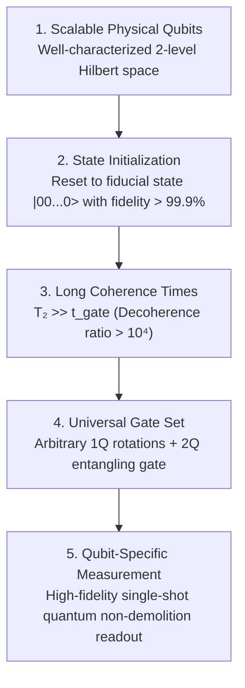
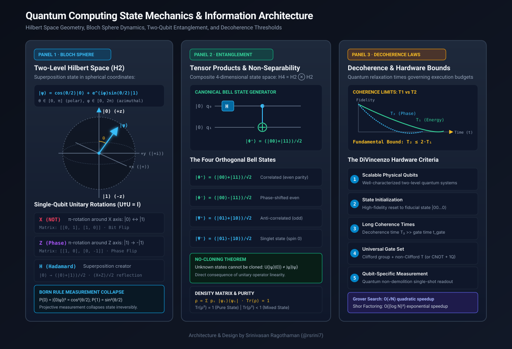
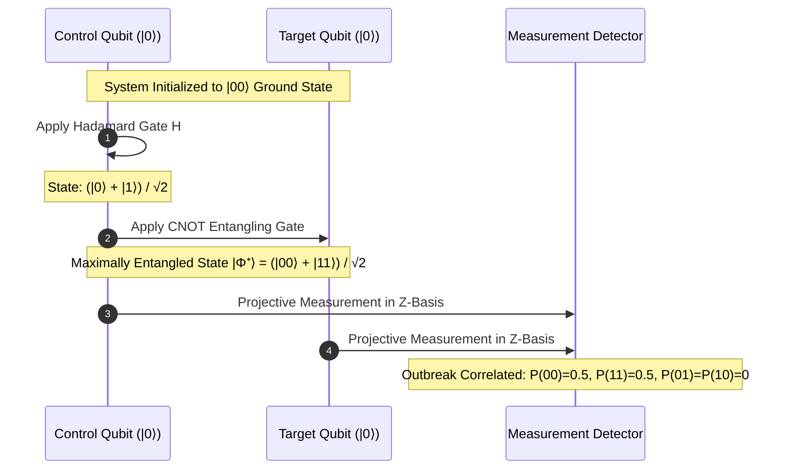

# Quantum Computing Foundations and State Mechanics: From Hilbert Space to Physical Realization

Daily learning · March 2026

*By Srinivasan Ragothaman ([@rsrini7](https://github.com/rsrini7))*

> Demystifies quantum information science from colloquial metaphors into mathematically rigorous state mechanics—formalizing two-level Hilbert spaces, Bloch sphere geometry, single and multi-qubit unitary operators, Bell-state entanglement, physical decoherence dynamics ($T_1, T_2$), and the DiVincenzo hardware criteria required for fault-tolerant computation.

---

## 1. Foundations: Two-Level Hilbert Spaces and Dirac Formalism

Classical computation operates on deterministic binary states within the discrete set $\Sigma = \{0, 1\}$. In contrast, quantum computation formulates information inside a complex projective Hilbert space $\mathcal{H}_2 \cong \mathbb{C}^2$. The fundamental carrier of quantum information—the **qubit** (quantum bit)—is a normalized state vector within this vector space.

### The Qubit State Vector

A single qubit state $|\psi\rangle$ is expressed as a linear superposition of orthonormal computational basis kets $\{|0\rangle, |1\rangle\}$:

$$
|\psi\rangle = \alpha |0\rangle + \beta |1\rangle = \begin{bmatrix} \alpha \\ \beta \end{bmatrix}, \quad \alpha, \beta \in \mathbb{C}
$$

Conservation of probability dictates that the state vector must have unit Euclidean norm according to the normalization condition:

$$
\langle\psi|\psi\rangle = |\alpha|^2 + |\beta|^2 = 1
$$

Here, $\alpha$ and $\beta$ represent complex probability amplitudes. The quantity $|\alpha|^2$ represents the probability of observing the basis state $|0\rangle$, while $|\beta|^2$ represents the probability of observing $|1\rangle$ upon measurement.

### The Bloch Sphere Geometric Representation

Because a global phase factor $e^{i\gamma}$ has no observable physical consequences ($|\psi'\rangle = e^{i\gamma}|\psi\rangle$ generates identical expectation values for all Hermitian observables), a general pure qubit state requires only two real parameters. By parametrizing the complex amplitudes via spherical coordinates:

$$
\alpha = \cos\left(\frac{\theta}{2}\right), \quad \beta = e^{i\phi}\sin\left(\frac{\theta}{2}\right)
$$

The state vector maps directly onto the surface of a unit three-dimensional sphere known as the **Bloch sphere**:

$$
|\psi\rangle = \cos\left(\frac{\theta}{2}\right)|0\rangle + e^{i\phi}\sin\left(\frac{\theta}{2}\right)|1\rangle
$$

Where:
- $\theta \in [0, \pi]$ represents the polar angle from the $+z$ axis.
- $\phi \in [0, 2\pi)$ represents the azimuthal angle on the $x\text{-}y$ plane.

```
                    |0⟩  (+z: θ=0)
                     ▲
                     │     • |ψ⟩ = cos(θ/2)|0⟩ + e^(iφ)sin(θ/2)|1⟩
                     │    /
                     │   /  θ (polar angle)
                     │  /
                     │ /
      -y ────────────┼────────────► +y (|+i⟩: θ=π/2, φ=π/2)
                    /│\
                   / │ \   φ (azimuthal angle)
                  /  │  \
              +x ◄   │   \
          (|+⟩)      │
                     ▼
                    |1⟩  (-z: θ=π)
```

| Bloch Coordinate Position | Angles $(\theta, \phi)$ | State Vector $|\psi\rangle$ | Physical Description |
| :--- | :--- | :--- | :--- |
| **North Pole $(+z)$** | $\theta = 0, \phi = 0$ | $|0\rangle = \begin{bmatrix}1 \\ 0\end{bmatrix}$ | Classical zero state |
| **South Pole $(-z)$** | $\theta = \pi, \phi = 0$ | $|1\rangle = \begin{bmatrix}0 \\ 1\end{bmatrix}$ | Classical one state |
| **Positive $x$-axis $(+x)$** | $\theta = \pi/2, \phi = 0$ | $|+\rangle = \frac{1}{\sqrt{2}}(|0\rangle + |1\rangle)$ | Equal superposition, zero phase |
| **Negative $x$-axis $(-x)$** | $\theta = \pi/2, \phi = \pi$ | $|-\rangle = \frac{1}{\sqrt{2}}(|0\rangle - |1\rangle)$ | Equal superposition, $\pi$ phase |
| **Positive $y$-axis $(+y)$** | $\theta = \pi/2, \phi = \pi/2$ | $|+i\rangle = \frac{1}{\sqrt{2}}(|0\rangle + i|1\rangle)$ | Complex superposition, $\pi/2$ phase |
| **Negative $y$-axis $(-y)$** | $\theta = \pi/2, \phi = 3\pi/2$ | $|-i\rangle = \frac{1}{\sqrt{2}}(|0\rangle - i|1\rangle)$ | Complex superposition, $3\pi/2$ phase |

### Density Matrix Formalism & State Purity

When a quantum system is coupled to an uncontrolled thermal environment or exists as part of an entangled ensemble, its state cannot be described by a single state vector $|\psi\rangle$. Such statistical mixtures require the **density operator** $\rho$:

$$
\rho = \sum_{i} p_i |\psi_i\rangle\langle\psi_i|, \quad p_i \ge 0, \quad \sum_i p_i = 1
$$

The density matrix satisfies two non-negotiable physical postulates:
1. **Unit Trace**: $\text{Tr}(\rho) = 1$ (total probability equals 1).
2. **Positive Semi-Definite**: $\rho \ge 0$ (all eigenvalues $\lambda_k \ge 0$).

The scalar quantity $\gamma = \text{Tr}(\rho^2)$ defines state **purity**:
- **Pure States**: $\text{Tr}(\rho^2) = 1$. The state lies strictly on the surface of the Bloch sphere ($|\vec{r}| = 1$).
- **Mixed States**: $\text{Tr}(\rho^2) < 1$. The state vector contracts into the interior of the Bloch sphere ($|\vec{r}| < 1$). For a maximally mixed single-qubit state, $\rho = \frac{1}{2}I$ and $\text{Tr}(\rho^2) = \frac{1}{2}$, lying at the origin $(0, 0, 0)$.

---

## 2. Deep Technical Mechanisms: Unitary Gates and Operator Algebra

All reversible temporal evolution in closed quantum systems is governed by the Schrödinger equation, which enforces that time evolution operators must be **unitary**:

$$
U^\dagger U = U U^\dagger = I
$$

Unitary operators preserve inner products, vector lengths, and probability normalization: $\langle U\psi|U\psi\rangle = \langle\psi|U^\dagger U|\psi\rangle = \langle\psi|\psi\rangle = 1$. On the Bloch sphere, every single-qubit unitary operation corresponds to a rigid geometric rotation of the state vector around a specified rotation axis.

### Single-Qubit Generators: Pauli Matrices and Clifford Gates

The three Hermitian, unitary Pauli matrices form the infinitesimal generators for all rotations in $\mathrm{SU}(2)$:

$$
\sigma_x = X = \begin{bmatrix} 0 & 1 \\ 1 & 0 \end{bmatrix}, \quad \sigma_y = Y = \begin{bmatrix} 0 & -i \\ i & 0 \end{bmatrix}, \quad \sigma_z = Z = \begin{bmatrix} 1 & 0 \\ 0 & -1 \end{bmatrix}
$$

1. **Pauli-$X$ (Bit-Flip)**: Performs a $\pi$-rotation around the $x$-axis. It inverts computational basis states: $X|0\rangle = |1\rangle, X|1\rangle = |0\rangle$.
2. **Pauli-$Z$ (Phase-Flip)**: Performs a $\pi$-rotation around the $z$-axis. It flips the relative sign of $|1\rangle$: $Z|0\rangle = |0\rangle, Z|1\rangle = -|1\rangle$.
3. **Hadamard Gate ($H$)**: Creates balanced superposition by reflecting across the diagonal $(x+z)/\sqrt{2}$ axis:
$$
H = \frac{1}{\sqrt{2}}\begin{bmatrix} 1 & 1 \\ 1 & -1 \end{bmatrix}, \quad H|0\rangle = |+\rangle = \frac{|0\rangle + |1\rangle}{\sqrt{2}}, \quad H|1\rangle = |-\rangle = \frac{|0\rangle - |1\rangle}{\sqrt{2}}
$$
4. **Phase Gate ($S$) and $T$ Gate**: Non-inverting phase rotations around $z$:
$$
S = \begin{bmatrix} 1 & 0 \\ 0 & i \end{bmatrix} = Z^{1/2}, \quad T = \begin{bmatrix} 1 & 0 \\ 0 & e^{i\pi/4} \end{bmatrix} = Z^{1/4}
$$

> [!IMPORTANT]
> The **Gottesman-Knill Theorem** proves that quantum circuits restricted to the **Clifford group** (generated by $H$, $S$, and $\text{CNOT}$) can be simulated in polynomial time on a classical computer. Achieving universal quantum computation requires at least one non-Clifford gate, typically the $T$-gate ($\pi/8$ rotation).

### Two-Qubit Tensor Product Spaces & Entanglement

When combining multiple quantum systems, their composite state space is the **tensor product** (Kronecker product) of their individual Hilbert spaces:

$$
\mathcal{H}_{AB} = \mathcal{H}_A \otimes \mathcal{H}_B \cong \mathbb{C}^2 \otimes \mathbb{C}^2 = \mathbb{C}^4
$$

The standard computational basis for a 2-qubit register consists of four orthonormal basis vectors:

$$
|00\rangle = \begin{bmatrix} 1 \\ 0 \\ 0 \\ 0 \end{bmatrix}, \quad |01\rangle = \begin{bmatrix} 0 \\ 1 \\ 0 \\ 0 \end{bmatrix}, \quad |10\rangle = \begin{bmatrix} 0 \\ 0 \\ 1 \\ 0 \end{bmatrix}, \quad |11\rangle = \begin{bmatrix} 0 \\ 0 \\ 0 \\ 1 \end{bmatrix}
$$

A composite state $|\psi_{AB}\rangle$ is **separable** (product state) if and only if there exist single-qubit states $|\psi_A\rangle$ and $|\psi_B\rangle$ such that:

$$
|\psi_{AB}\rangle = |\psi_A\rangle \otimes |\psi_B\rangle
$$

If no such decomposition exists, the state is **entangled**. Entangled states possess non-local correlations that cannot be expressed by independent marginal probability distributions.

### Controlled-NOT ($\text{CNOT}$) & The Bell Basis

The canonical two-qubit entangling gate is the **Controlled-NOT ($\text{CNOT}$)** gate. It flips the target qubit if and only if the control qubit is $|1\rangle$:

$$
\text{CNOT} = |0\rangle\langle 0| \otimes I + |1\rangle\langle 1| \otimes X = \begin{bmatrix} 1 & 0 & 0 & 0 \\ 0 & 1 & 0 & 0 \\ 0 & 0 & 0 & 1 \\ 0 & 0 & 1 & 0 \end{bmatrix}
$$

When a Hadamard gate on a control qubit is followed by a $\text{CNOT}$ gate targeting a second qubit initialized to $|0\rangle$, the circuit prepares the maximally entangled **Bell state** $|\Phi^+\rangle$:

$$
|00\rangle \xrightarrow{H \otimes I} \frac{|0\rangle + |1\rangle}{\sqrt{2}} \otimes |0\rangle = \frac{|00\rangle + |10\rangle}{\sqrt{2}} \xrightarrow{\text{CNOT}} \frac{|00\rangle + |11\rangle}{\sqrt{2}} = |\Phi^+\rangle
$$

The four maximally entangled **Bell basis states** span $\mathbb{C}^4$:

$$
|\Phi^\pm\rangle = \frac{|00\rangle \pm |11\rangle}{\sqrt{2}}, \quad |\Psi^\pm\rangle = \frac{|01\rangle \pm |10\rangle}{\sqrt{2}}
$$

For the state $|\Phi^+\rangle$, measuring the first qubit yields $0$ with probability $0.5$ (collapsing the register instantaneously to $|00\rangle$) or $1$ with probability $0.5$ (collapsing to $|11\rangle$). The outcome of the second measurement is $100\%$ correlated with the first, regardless of spatial separation.

### The No-Cloning Theorem

A foundational law of quantum mechanics is that **an unknown quantum state cannot be replicated perfectly**.

**Proof by Linear Unitarity:**
Suppose there exists a unitary cloning machine $U$ that copies an arbitrary state $|\psi\rangle$ onto a blank target state $|0\rangle$:

$$
U(|\psi\rangle |0\rangle) = |\psi\rangle |\psi\rangle
$$

Now consider two distinct, non-orthogonal quantum states $|\psi\rangle$ and $|\phi\rangle$ with $0 < |\langle\phi|\psi\rangle| < 1$. Applying the cloner to each:

$$
U(|\psi\rangle |0\rangle) = |\psi\rangle |\psi\rangle, \quad U(|\phi\rangle |0\rangle) = |\phi\rangle |\phi\rangle
$$

Taking the inner product of both sides:

$$
\langle\phi| \langle 0| U^\dagger U |\psi\rangle |0\rangle = (\langle\phi|\langle\phi|)(|\psi\rangle|\psi\rangle)
$$

Because $U$ is unitary ($U^\dagger U = I$) and $\langle 0|0\rangle = 1$:

$$
\langle\phi|\psi\rangle = (\langle\phi|\psi\rangle)^2
$$

This equation has only two solutions: $\langle\phi|\psi\rangle = 0$ (the states are orthogonal) or $\langle\phi|\psi\rangle = 1$ (the states are identical). Therefore, no general unitary transformation can clone an arbitrary, unknown quantum state. This theorem prevents classical data duplication, protects quantum key distribution (BB84), and necessitates quantum error correction codes (e.g. surface codes) that distribute error syndromes across entangled ancillas without directly observing or cloning the data qubits.

---

## 3. Physical Decoherence and the DiVincenzo Hardware Criteria

Qubits are open quantum systems constantly subject to parasitic coupling with thermal, electromagnetic, and vibrational environments. This coupling induces **decoherence**—the irreversible decay of quantum superposition and entanglement into classical statistical mixtures.

```
Longitudinal Relaxation (T1)           Transverse Dephasing (T2)
Energy Dissipation to Environment       Phase Randomization (No Energy Loss)

|1⟩ (Excited)                           |+⟩ = (|0⟩+|1⟩)/√2
 │                                       │
 │ Energy decay                          │ Phase precession
 │ at rate Γ₁ = 1/T₁                     │ fluctuations Δφ
 ▼                                       ▼
|0⟩ (Ground State)                      Mixed State ρ = 1/2 I
```

### Coherence Times: $T_1$ vs $T_2$

Two distinct timescales characterize quantum noise:

1. **Longitudinal Relaxation Time ($T_1$)**:
   The timescale over which an excited state $|1\rangle$ dissipates energy to the thermal bath and decays into the ground state $|0\rangle$. The population decay follows: $P_{|1\rangle}(t) = e^{-t / T_1}$.
2. **Transverse Dephasing Time ($T_2$)**:
   The timescale over which the relative phase $\phi$ between $|0\rangle$ and $|1\rangle$ randomizes due to low-frequency magnetic fluctuations, flux noise, or charge instability. The off-diagonal coherence elements of the density matrix decay as: $\rho_{01}(t) = \rho_{01}(0) e^{-t / T_2}$.

The fundamental physical relation connecting relaxation and pure dephasing ($T_\phi$) is:

$$
\frac{1}{T_2} = \frac{1}{2T_1} + \frac{1}{T_\phi} \implies T_2 \le 2T_1
$$

In practical superconducting circuits, high-frequency charge noise typically causes $T_2 \ll T_1$. A quantum algorithm's maximum circuit depth is strictly bounded by the number of gate operations that can execute before $t \approx T_2$:

$$
\text{Maximum Circuit Depth} \approx \frac{T_2}{t_{\text{gate}}}
$$

### The Five DiVincenzo Criteria for Physical Implementations

In 2000, David DiVincenzo formulated the five necessary conditions that any physical quantum hardware must satisfy to achieve scalable computation:



| Criterion | Physical Requirement | Failure Mode if Violated |
| :--- | :--- | :--- |
| **1. Well-Characterized Qubits** | Identified Hamiltonian, two distinct computational energy eigenstates separated from leak states ($|2\rangle, |3\rangle$). | Leakage out of computational subspace destroys error correction cycles. |
| **2. High-Fidelity Initialization** | Ability to rapidly cool or reset qubits to $|00\dots0\rangle$ in $< 1\ \mu\text{s}$. | Impurities in initial state contaminate computation before execution begins. |
| **3. Coherence Ratio $\frac{T_2}{t_{\text{gate}}} > 10^4$** | Gate execution time ($t_{\text{gate}}$) must be orders of magnitude faster than dephasing ($T_2$). | Accumulation of phase noise exceeds fault-tolerance threshold ($\approx 1\%$). |
| **4. Universal Gate Library** | Single-qubit rotations ($\mathrm{SU}(2)$) + one entangling gate ($\text{CNOT}$ or $\text{CZ}$) + one non-Clifford gate ($T$). | Inability to span arbitrary unitary transformations across $\mathcal{H}_{2^n}$. |
| **5. High-Fidelity Readout** | Single-shot, projective, quantum non-demolition (QND) measurement ($F_{\text{readout}} > 99\%$). | False state classification during syndrome extraction in surface codes. |

---

## 4. Architectural Visuals: Bloch Coordinates & Bell State Circuits

The architectural diagram below unifies the three core pillars: Panel 1 illustrates the Bloch sphere geometry and single-qubit rotation gates; Panel 2 details the two-qubit Hilbert space and Bell-state generation circuit; Panel 3 maps the physical decoherence curves ($T_1, T_2$) against the DiVincenzo criteria.



### Bell State Generation & Entanglement Verification Flow

To verify physical entanglement in the laboratory, an experimenter executes state preparation followed by measurement across rotated measurement bases (demonstrating violation of Bell's inequality, such as the CHSH inequality $S \le 2$ classical vs $S = 2\sqrt{2}$ quantum):



---

## 5. Executable Python Recipe: Minimal State Vector Quantum Simulator

The following standalone Python implementation constructs a pure NumPy quantum state vector simulator. It models single-qubit gates, tensor-product compositions, multi-qubit gates ($\text{CNOT}$), density matrix calculations, state purity, and Born-rule projective measurement.

```python
"""
Minimal State Vector Quantum Simulator
Demonstrates Hilbert space state vectors, unitary gate operations,
tensor-product entanglement, density matrices, and measurement collapse.

Author: Srinivasan Ragothaman (@rsrini7)
"""

import numpy as np


class QuantumCircuit:
    def __init__(self, num_qubits: int):
        self.n = num_qubits
        self.dim = 1 << num_qubits
        # Initialize register to |00...0>
        self.state = np.zeros(self.dim, dtype=np.complex128)
        self.state[0] = 1.0 + 0.0j

        # Fundamental single-qubit gates
        self.I = np.array([[1, 0], [0, 1]], dtype=np.complex128)
        self.X = np.array([[0, 1], [1, 0]], dtype=np.complex128)
        self.Y = np.array([[0, -1j], [1j, 0]], dtype=np.complex128)
        self.Z = np.array([[1, 0], [0, -1]], dtype=np.complex128)
        self.H = np.array([[1, 1], [1, -1]], dtype=np.complex128) / np.sqrt(2.0)
        self.S = np.array([[1, 0], [0, 1j]], dtype=np.complex128)
        self.T = np.array([[1, 0], [0, np.exp(1j * np.pi / 4.0)]], dtype=np.complex128)

    def _apply_single_qubit_gate(self, gate: np.ndarray, target: int):
        """Applies a 2x2 unitary gate to target qubit via full Kronecker product."""
        op = np.array([[1.0]], dtype=np.complex128)
        for i in range(self.n):
            if i == target:
                op = np.kron(op, gate)
            else:
                op = np.kron(op, self.I)
        self.state = op @ self.state

    def h(self, target: int):
        self._apply_single_qubit_gate(self.H, target)

    def x(self, target: int):
        self._apply_single_qubit_gate(self.X, target)

    def z(self, target: int):
        self._apply_single_qubit_gate(self.Z, target)

    def cnot(self, control: int, target: int):
        """Applies a CNOT gate with arbitrary control and target indices."""
        proj0 = np.array([[1, 0], [0, 0]], dtype=np.complex128)
        proj1 = np.array([[0, 0], [0, 1]], dtype=np.complex128)

        # Term 1: Control is |0> -> Target unmodified (Identity)
        term0 = np.array([[1.0]], dtype=np.complex128)
        for i in range(self.n):
            if i == control:
                term0 = np.kron(term0, proj0)
            else:
                term0 = np.kron(term0, self.I)

        # Term 2: Control is |1> -> Target flipped (X gate)
        term1 = np.array([[1.0]], dtype=np.complex128)
        for i in range(self.n):
            if i == control:
                term1 = np.kron(term1, proj1)
            elif i == target:
                term1 = np.kron(term1, self.X)
            else:
                term1 = np.kron(term1, self.I)

        cnot_matrix = term0 + term1
        self.state = cnot_matrix @ self.state

    def density_matrix(self) -> np.ndarray:
        """Computes the density operator rho = |psi><psi|."""
        ket = self.state.reshape(-1, 1)
        bra = ket.conj().T
        return ket @ bra

    def purity(self) -> float:
        """Returns Tr(rho^2). For a pure state vector, purity is strictly 1.0."""
        rho = self.density_matrix()
        return float(np.real(np.trace(rho @ rho)))

    def probabilities(self) -> np.ndarray:
        """Computes Born rule probabilities P(x) = |<x|psi>|^2."""
        return np.abs(self.state) ** 2

    def measure_all(self, shots: int = 1000) -> dict:
        """Samples classical outcomes according to the Born rule probability distribution."""
        probs = self.probabilities()
        outcomes = np.random.choice(self.dim, size=shots, p=probs)
        counts = {}
        for outcome in outcomes:
            bitstring = format(outcome, f"0{self.n}b")
            counts[bitstring] = counts.get(bitstring, 0) + 1
        return counts


# --- Verification & Execution ---
if __name__ == "__main__":
    print("=== 1. Single Qubit Bloch Superposition ===")
    qc1 = QuantumCircuit(1)
    qc1.h(0)  # Prepare |+> = (|0> + |1>)/sqrt(2)
    print(f"State Vector: {qc1.state}")
    print(f"Born Probabilities (P0, P1): {qc1.probabilities()}")
    print(f"State Purity Tr(rho^2): {qc1.purity():.4f}")

    print("\n=== 2. Two-Qubit Bell State Preparation (|Phi+>) ===")
    qc2 = QuantumCircuit(2)
    qc2.h(0)        # Superposition on control
    qc2.cnot(0, 1)  # Entangle control with target
    print(f"Bell State Vector: {qc2.state}")
    
    # Verify non-zero amplitudes are exactly at |00> and |11>
    probs2 = qc2.probabilities()
    for idx, p in enumerate(probs2):
        print(f"Basis state |{format(idx, '02b')}>: Probability = {p:.4f}")

    print("\n=== 3. Projective Measurement (10,000 Shots) ===")
    results = qc2.measure_all(shots=10000)
    for bitstring, count in sorted(results.items()):
        print(f"Outcome '{bitstring}': {count} counts ({count / 100:.2f}%)")
    
    # Assert physical correctness: zero probability for |01> and |10>
    assert "01" not in results or results["01"] == 0, "Non-zero probability for |01> in Bell state!"
    assert "10" not in results or results["10"] == 0, "Non-zero probability for |10> in Bell state!"
    print("\nState mechanics and entanglement successfully verified.")
```

---

## 6. Impact, Real-World Edge Cases & Gotchas

### Common Claims vs. Technical Realities

| Common Industry Claim | Technical Reality | Empirical Mechanism |
| :--- | :--- | :--- |
| **"Qubits test all $2^N$ possibilities in parallel instantaneously."** | **False.** Superposition is a single state vector in a $2^N$-dimensional Hilbert space. When measured, the wavefunction collapses to **one** classical eigenvalue. | Quantum algorithms achieve speedup exclusively through **constructive interference** (amplifying correct answers) and **destructive interference** (canceling wrong answers). Without phase cancellation, sampling is equivalent to classical coin flips. |
| **"Quantum computers will replace classical CPUs for general software."** | **False.** Classical CPUs possess clock frequencies $\approx 4\text{–}5\ \text{GHz}$, while superconducting qubit gates operate at $\approx 10\text{–}50\ \text{MHz}$ (100× slower). | Quantum acceleration applies exclusively to narrow mathematical complexity classes ($\mathrm{BQP}$) where quantum algorithms offer polynomial (Grover $O(\sqrt{N})$) or super-polynomial (Shor $O((\log N)^3)$) advantage. Sequential scalar branching remains far faster on silicon CPUs. |
| **"Quantum entanglement allows instantaneous, faster-than-light communication."** | **False.** The **No-Communication Theorem** proves that local operations on one half of an entangled pair do not alter the marginal density matrix of the remote partner: $\rho_B = \text{Tr}_A(U_A \rho_{AB} U_A^\dagger) = \text{Tr}_A(\rho_{AB})$. | An observer measuring qubit $B$ observes a completely random 50/50 distribution. Extracting correlation requires transmitting measurement results across a classical channel bounded by the speed of light $c$. |
| **"Superposition is just classical probabilistic uncertainty."** | **False.** Classical probability distributions are non-negative real numbers that add linearly. Quantum amplitudes are complex numbers with phases ($e^{i\phi}$). | Two orthogonal classical probabilities cannot cancel to zero ($0.5 + 0.5 = 1.0$). Two quantum amplitudes with opposing phases cancel completely ($1/\sqrt{2} - 1/\sqrt{2} = 0$), enabling destructive wave interference. |
| **"Physical qubits alone determine computing power."** | **False.** Raw physical qubit counts are meaningless without two-qubit gate fidelities, connectivity graphs, and coherence times. | Surface-code error correction requires a threshold gate fidelity $> 99\%$. A chip with 1,000 qubits at $98\%$ fidelity cannot run fault-tolerant circuits; a chip with 100 qubits at $99.9\%$ fidelity can sustain logical qubits. |

---

## 7. Practical Verification & Diagnostic Checklist

When evaluating quantum computing claims, SDK libraries (Qiskit, Cirq, PennyLane), or experimental hardware reports, enforce the following checklist:

- [ ] **State Normalization**: Verify that $\sum_i |\alpha_i|^2 = 1.0 \pm 10^{-7}$ across all state vectors after each gate transform.
- [ ] **Unitarity Validation**: Confirm that candidate gate matrices satisfy $U^\dagger U = I$ within numerical precision before submitting to simulator runtimes.
- [ ] **Clifford vs Non-Clifford Gate Budget**: Check if the circuit contains non-Clifford gates ($T, T^\dagger$). If purely Clifford ($H, S, \text{CNOT}$), simulate on a classical tableau simulator (Stim) rather than consuming expensive state-vector memory or QPU credits.
- [ ] **Decoherence Budget ($\text{Depth} \times t_{\text{gate}} \ll T_2$)**: Calculate total circuit execution time $\tau = \sum_{\text{layers}} \max(t_{\text{gate}})$. Ensure $\tau \le 0.1 \times T_2$ to prevent phase noise from overwhelming algorithmic signals.
- [ ] **State Purity Verification**: Calculate $\text{Tr}(\rho^2)$. If $\text{Tr}(\rho^2) < 0.95$ during open-system Lindblad master equation modeling, include active quantum error correction or dynamical decoupling pulses (CPMG).

---

## 8. Timeline and Milestones

```
1981 ── Richard Feynman proposes quantum computing to simulate quantum physics
1982 ── Wootters and Zurek publish the No-Cloning Theorem
1985 ── David Deutsch defines the universal Quantum Turing Machine
1994 ── Peter Shor formulates polynomial-time integer factorization algorithm (O((log N)³))
1996 ── Lov Grover publishes fast quantum database search algorithm (O(√N))
2000 ── David DiVincenzo publishes the five physical criteria for scalable quantum hardware
2012 ── John Preskill coins the term "NISQ" (Noisy Intermediate-Scale Quantum)
2019 ── First physical demonstration of quantum supremacy on a 53-qubit superconducting processor
2024 ── Google Willow chip demonstrates exponential error suppression below the surface code threshold (d=7 > d=5)
2026 ── Multi-qubit fault-tolerant logical memory and 100+ logical qubit roadmaps achieve industrial verification
```

---

## 9. Primary Sources & References

1. [Nielsen, M. A., & Chuang, I. L.: Quantum Computation and Quantum Information](https://doi.org/10.1017/CBO9780511976667) — The definitive Cambridge University Press foundational textbook on Hilbert space mechanics, quantum circuits, and information theory.
2. [DiVincenzo, D. P. (2000): The Physical Implementation of Quantum Computation](https://arxiv.org/abs/quant-ph/0002077) — Foundational whitepaper formulating the five physical requirements for scalable quantum computing hardware.
3. [Preskill, J. (2018): Quantum Computing in the NISQ era and beyond](https://arxiv.org/abs/1801.00862) — Formulates the limits of noisy intermediate-scale quantum devices and the path toward fault-tolerant surface codes.
4. [Wootters, W. K., & Zurek, W. H. (1982): A Single Quantum Cannot be Cloned](https://doi.org/10.1038/299802a0) — Original Nature paper formalizing the No-Cloning Theorem.
5. [Google Quantum AI: Quantum Error Correction Below the Surface Code Threshold](https://nature.com/articles/s41586-024-08182-y) — Experimental demonstration of distance-7 logical qubit error suppression outperforming distance-5 on the Willow architecture.

---

**Related:**
- [Google-Willow-Quantum-Chip-And-Quantum-Echoes-2026](Google-Willow-Quantum-Chip-And-Quantum-Echoes-2026.md) — Analyzes the 105-qubit planar architecture, surface code scaling, and Loschmidt echo algorithms running on physical transmon hardware.
- [Quantum-Threat-to-Bitcoin-And-Elliptic-Curve-Cryptography-2026](Quantum-Threat-to-Bitcoin-And-Elliptic-Curve-Cryptography-2026.md) — Examines how Shor's and Grover's algorithm mechanics threaten ECDSA secp256k1 and SHA-256.
- [Quantum-AI-Decision-Makers(2026)](Quantum-AI-Decision-Makers-2026.md) — Strategic executive framework evaluating NISQ limitations, barren plateaus, and commercial quantum utility.
- [QuantWare-VIO-40K-10K-Qubit-QPU-Architecture-2026](QuantWare-VIO-40K-10K-Qubit-QPU-Architecture-2026.md) — High-density physical architecture scaling transmon qubits to 10,000 physical nodes in cryogenic dilution environments.
