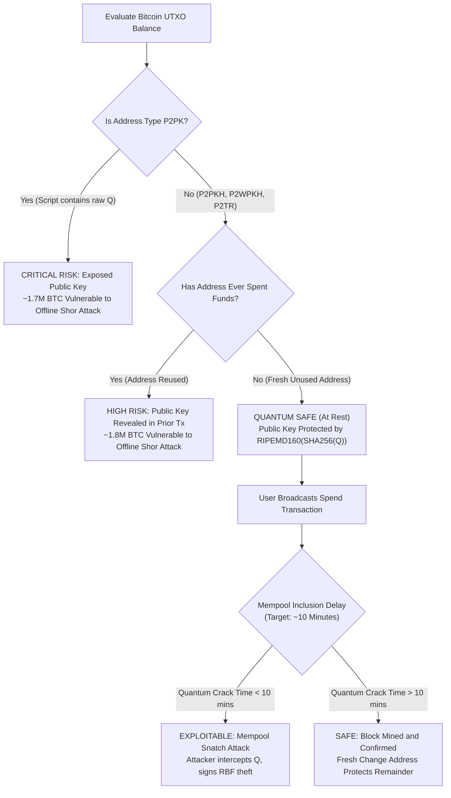

# Quantum Threat to Bitcoin: Shor's Algorithm, Grover's Speedup, and Elliptic Curve Vulnerabilities

**Learning note · Revised 15 November 2026 · Scope: Post-quantum cryptography, ECDSA secp256k1, SHA-256, and Bitcoin consensus migration**

*By Srinivasan Ragothaman ([@rsrini7](https://github.com/rsrini7))*

> **Core idea:** Quantum computing presents an asymmetric threat to Bitcoin: while SHA-256 Proof-of-Work remains effectively resilient against Grover's algorithm due to classical ASIC parallel throughput, Shor's algorithm fundamentally breaks ECDSA secp256k1 public-key cryptography in polynomial time. Approximately 3.5 million BTC residing in exposed public-key addresses (P2PK and reused P2PKH) face existential theft once fault-tolerant quantum systems reach ~2,048 error-corrected logical qubits (~2M to 4M physical qubits), necessitating a planned consensus soft fork toward lattice- or hash-based post-quantum signature schemes.

---

## 1. Foundations: Bitcoin's Dual Cryptographic Primitives

Bitcoin's security architecture relies on two distinct mathematical foundations:

1. **Asymmetric Public-Key Cryptography (ECDSA secp256k1):** Controls authorization of spending transactions. A user's private key is a 256-bit scalar integer $d \in [1, n-1]$. The public key is an elliptic curve point $Q = (x, y)$ computed via scalar point multiplication:

$$
Q = d \cdot G
$$

Where $G$ is the generator point on the curve defined over $\mathbb{F}_p$ by the Weierstrass equation:

$$
y^2 = x^3 + 7 \pmod p
$$

2. **Cryptographic Hash Functions (SHA-256 &amp; RIPEMD-160):** Enforces mining consensus (Proof-of-Work), constructs Merkle trees, and shields unspent transaction outputs (UTXOs) via address hashing:

$$
\text{Bitcoin Address} = \text{Base58Check}\Big(\text{RIPEMD160}\big(\text{SHA256}(Q)\big)\Big)
$$

| Cryptographic Primitive | Bitcoin Implementation | Primary Function | Quantum Attack Algorithm | Quantum Computational Complexity | Practical Vulnerability Status |
|---|---|---|---|---|---|
| **Elliptic Curve Signatures** | ECDSA secp256k1 (and Schnorr BIP-340) | UTXO authorization &amp; transaction signing | **Shor's Algorithm** (Discrete Logarithm) | $O((\log p)^3)$ (Polynomial Time) | **CRITICAL:** Total private key extraction from public key |
| **Cryptographic Hashing** | SHA-256 | Proof-of-Work mining &amp; block validation | **Grover's Algorithm** (Unstructured Search) | $O(\sqrt{N}) = 2^{128}$ (Quadratic Speedup) | **RESILIENT:** Classical ASIC hash rates exceed quantum throughput |
| **Address Encapsulation** | $\text{RIPEMD160}(\text{SHA256}(Q))$ | Shielding public key until spending | **Grover's Preimage Search** | $O(\sqrt{2^{160}}) = 2^{80}$ operations | **PROTECTED:** Preimage search remains computationally intractable |

---

## 2. Deep Technical Mechanisms

```
+--------------------------------------------------------------------------------------------------+
|                            QUANTUM THREAT LANDSCAPE: BITCOIN UTXO VULNERABILITY                  |
|                                                                                                  |
|   TRANSACTION MEMPOOL (BROADCAST PHASE)                                                          |
|   +------------------------------------------------------------------------------------------+   |
|   | User spends UTXO -> Broadcasts Raw Transaction containing Uncompressed Public Key Q     |   |
|   +------------------------------------------------------------------------------------------+   |
|                                            |                                                     |
|                                            v                                                     |
|                     [ Quantum Attacker Intercepts Mempool ]                                      |
|                                            |                                                     |
|                     Can Quantum Computer solve Discrete Log                                      |
|                     Q = d * G before block is mined (~10 mins)?                                  |
|                                           / \                                                    |
|                                   YES    /   \   NO                                              |
|                                         /     \                                                  |
|                                        v       v                                                 |
|      +-----------------------------------+   +---------------------------------------------+     |
|      | MEMPOOL RACE ATTACK (CRITICAL)    |   | Transaction Confirmed into Blockchain Block |     |
|      | Attacker computes private key d,  |   +---------------------------------------------+     |
|      | signs competing TX with higher fee|                          |                            |
|      | (RBF) -> Steals UTXO funds.       |                          v                            |
|      +-----------------------------------+        ON-CHAIN UTXO STORAGE STATE                    |
|                                                                     |                            |
|                                     +-------------------------------+-------------------------+  |
|                                     |                                                         |  |
|                                     v                                                         v  |
|                  +-----------------------------------+     +-----------------------------------+ |
|                  | EXPOSED PUBLIC KEYS (HIGH RISK)   |     | SHIELDED ADDRESSES (SAFE)         | |
|                  | - P2PK (Pay-to-Public-Key)        |     | - Fresh P2PKH (Address Hashed)    | |
|                  | - Reused P2PKH / P2WPKH addresses |     | - Fresh P2WPKH (Native SegWit)    | |
|                  | Attacker has UNLIMITED time       |     | - Taproot P2TR (Script Tree)      | |
|                  | to compute private key offline.   |     | Public key Q NEVER revealed       | |
|                  | Vulnerable: ~3.5 Million BTC      |     | until spent. Safe from Shor!      | |
|                  +-----------------------------------+     +-----------------------------------+ |
+--------------------------------------------------------------------------------------------------+
```

### 1. Shor's Algorithm against ECDSA secp256k1

Classical algorithms for the Elliptic Curve Discrete Logarithm Problem (ECDLP)—such as Pollard's rho algorithm—scale as $O(\sqrt{p}) \approx 2^{128}$ operations, making brute-force private key extraction impossible.

Peter Shor's quantum algorithm solves discrete logarithms in polynomial time by transforming ECDLP into an abelian hidden subgroup problem via the Quantum Fourier Transform (QFT):

1. Construct the quantum superposition state over integers $a, b \in [0, n-1]$:

$$
|\psi_0\rangle = \frac{1}{n} \sum_{a=0}^{n-1} \sum_{b=0}^{n-1} |a\rangle |b\rangle |a G + b Q\rangle
$$

2. Measure the third register. If the measured curve point is $R_0 = a_0 G + b_0 Q$, the first two registers collapse to points satisfying:

$$
a + b \cdot d \equiv a_0 + b_0 \cdot d \pmod n \implies a + b \cdot d \equiv c \pmod n
$$

3. Applying the 2D Quantum Fourier Transform to registers 1 and 2 reveals the periodicity $(d, 1)$, yielding the exact private key $d$:

$$
d \equiv -a \cdot b^{-1} \pmod n
$$

#### Qubit and Gate Requirements for Breaking secp256k1

Based on optimized modular arithmetic circuits for elliptic curve point addition (Roetteler et al., 2017; Gidney &amp; Ekerå, 2021):
- **Logical Qubits:** Solving a 256-bit elliptic curve requires approximately:

$$
N_{\text{logical}} \approx 2n + \lceil\log_2 n\rceil + 9 \approx 2 \times 256 + 8 + 9 = 533\text{ to }2,048\text{ logical qubits}
$$

- **Toffoli / T-Gate Depth:** Requires approximately $2.2 \times 10^9$ Toffoli gates.

### 2. Grover's Algorithm against SHA-256 Proof-of-Work

Grover's algorithm searches an unsorted database of size $N = 2^{256}$ in $O(\sqrt{N}) = 2^{128}$ evaluations. 

While theoretically reducing the security of SHA-256 from 256 bits to 128 bits, **Grover's algorithm poses zero practical threat to Bitcoin mining**:
- Grover's search requires sequential quantum circuit evaluation; it cannot be parallelized across independent machines without losing quantum speedup.
- Surface-code error-corrected quantum computers have projected clock rates of $10\text{ kHz}$ to $100\text{ kHz}$ (due to syndrome measurement cycle times).
- In contrast, the classical Bitcoin mining network evaluates over $600\text{ EH/s}$ ($6 \times 10^{20}\text{ hashes/sec}$) using massively parallel, energy-efficient ASIC hardware. A quantum computer running Grover's algorithm would be billions of times slower and more expensive than classical mining rigs.

### 3. The Address Exposure Vulnerability Map

The vulnerability of a specific Bitcoin UTXO depends entirely on whether its public key $Q$ has been exposed to the public blockchain:

```
Total Bitcoin In Circulation: 21,000,000 BTC
|
+---> Exposed Public Keys (~3,500,000 BTC / ~17% of supply) [CRITICALLY VULNERABLE]
|     |-- P2PK Outputs: ~1,700,000 BTC (Mined 2009-2010, includes ~1.1M Satoshi coins)
|     |-- Reused Address Outputs: ~1,800,000 BTC (Addresses spent from previously)
|     +-- Active Mempool Transactions: Transiently exposed during 10-minute block interval
|
+---> Shielded Addresses (~17,500,000 BTC / ~83% of supply) [SAFE UNTIL SPENT]
      |-- P2PKH (Pay-to-Public-Key-Hash): Address = RIPEMD160(SHA256(Q))
      |-- P2WPKH (Native SegWit Bech32): Address = RIPEMD160(SHA256(Q))
      +-- P2TR (Taproot): Public key is tweaked with script tree root
```

- **P2PK (Pay-to-Public-Key):** Used in Bitcoin's earliest software (versions 0.1 to 0.3). The locking script directly contains the raw uncompressed 65-byte public key: `scriptPubKey = <PubKey> OP_CHECKSIG`. An attacker with a quantum computer can read $Q$ directly from the UTXO set and derive $d$ offline at leisure.
- **Address Reuse:** In P2PKH (`1...`) and P2WPKH (`bc1q...`), the address is a double-hash. However, when a user spends *part* of an address's balance, the spending transaction reveals $Q$ in the `scriptSig` / `witness`. If the user continues holding funds on that same address, those remaining funds become permanently exposed to Shor's algorithm.

---

## 3. Architectural Visuals


*Four-panel architectural breakdown illustrating algorithm asymmetry (Shor vs Grover), the Bitcoin address exposure attack surface, physical versus logical qubit scaling requirements, and consensus soft-fork migration strategies.*

### Vulnerability Decision Tree



---

## 4. Production Implementation: Quantum Qubit Estimator &amp; UTXO Vulnerability Scanner

The following runnable Python script implements a **Quantum Resource Estimator** (calculating required physical qubits and T-gates under surface-code lattice surgery) and a **Bitcoin UTXO Vulnerability Classifier**:

```python
"""
Quantum Resource Estimator & Bitcoin UTXO Vulnerability Classifier.
Calculates physical qubit scaling under surface codes and audits address vulnerability.
"""

import math
from typing import Dict, Any

class QuantumResourceEstimator:
    """
    Estimates logical and physical qubit requirements to execute Shor's algorithm
    on elliptic curve discrete logarithm instances (secp256k1).
    """
    def __init__(self, key_bits: int = 256, physical_error_rate: float = 1e-3):
        self.n = key_bits
        self.p_err = physical_error_rate
        
    def calculate_logical_requirements(self) -> Dict[str, Any]:
        """Calculates logical qubits and Toffoli gates based on Roetteler et al."""
        # Logical qubits: 2n + ceil(log2(n)) + 9
        logical_qubits = 2 * self.n + math.ceil(math.log2(self.n)) + 9
        # Toffoli gates for modular elliptic curve point addition
        toffoli_gates = int(2.2e9)
        return {
            "key_size_bits": self.n,
            "logical_qubits": logical_qubits,
            "toffoli_gate_count": toffoli_gates
        }
        
    def calculate_physical_qubits(self, code_distance: int = 27) -> Dict[str, Any]:
        """
        Estimates physical qubits under rotated surface codes.
        Physical qubits per logical qubit = 2 * d^2.
        """
        logical_info = self.calculate_logical_requirements()
        n_logical = logical_info["logical_qubits"]
        
        # Rotated surface code overhead
        physical_per_logical = 2 * (code_distance ** 2)
        # Add routing and magic state distillation factory overhead (~30% additional)
        total_physical = int(n_logical * physical_per_logical * 1.3)
        
        return {
            "code_distance": code_distance,
            "physical_per_logical_qubit": physical_per_logical,
            "total_physical_qubits_required": total_physical,
            "estimated_runtime_hours": round(logical_info["toffoli_gate_count"] / (10000 * 3600), 2)
        }


def classify_utxo_quantum_vulnerability(script_type: str, has_spent_prior: bool) -> Dict[str, str]:
    """
    Classifies the quantum risk profile of a Bitcoin UTXO.
    """
    st = script_type.upper()
    if st == "P2PK":
        return {
            "risk_level": "CRITICAL",
            "threat": "Exposed Public Key (Shor's Algorithm)",
            "action": "Immediate migration to quantum-safe address required."
        }
    elif st in ["P2PKH", "P2WPKH", "P2TR"] and has_spent_prior:
        return {
            "risk_level": "HIGH",
            "threat": "Address Reuse (Public Key Exposed in Prior Witness)",
            "action": "Sweep remaining balance to fresh, un-reused address."
        }
    elif st in ["P2PKH", "P2WPKH", "P2TR"] and not has_spent_prior:
        return {
            "risk_level": "PROTECTED_AT_REST",
            "threat": "None at rest (Transient Mempool Risk during broadcast)",
            "action": "Use one-time address discipline; ensure quick confirmation."
        }
    else:
        return {
            "risk_level": "UNKNOWN",
            "threat": "Non-standard script",
            "action": "Analyze locking script bytecode."
        }


if __name__ == "__main__":
    estimator = QuantumResourceEstimator(key_bits=256, physical_error_rate=1e-3)
    resources = estimator.calculate_physical_qubits(code_distance=27)
    
    print("=== QUANTUM COMPUTING RESOURCE REQUIREMENTS (ECDSA secp256k1) ===")
    print(f"Key Size                  : {resources['code_distance']}-bit distance")
    print(f"Physical per Logical Qubit: {resources['physical_per_logical_qubit']:,}")
    print(f"Total Physical Qubits     : {resources['total_physical_qubits_required']:,}")
    print(f"Estimated Runtime         : {resources['estimated_runtime_hours']} hours (at 10 kHz clock)")
    
    print("\n=== BITCOIN UTXO QUANTUM VULNERABILITY AUDIT ===")
    test_cases = [
        ("P2PK", False),
        ("P2PKH", True),
        ("P2WPKH", False),
        ("P2TR", False)
    ]
    for script_type, reused in test_cases:
        res = classify_utxo_quantum_vulnerability(script_type, reused)
        print(f"Type: {script_type:<8} | Reused: {str(reused):<5} -> Level: {res['risk_level']:<18} | Threat: {res['threat']}")
```

---

## 5. Impact, Real-World Edge Cases &amp; Gotchas

### Common Claims vs. Technical Realities

| Common Claim | Technical Reality | Production Implication |
|---|---|---|
| *"A quantum computer will mine all remaining Bitcoins instantly."* | Grover's algorithm only achieves a quadratic speedup ($O(\sqrt{N})$), reducing SHA-256 to $2^{128}$ operations. | Classical ASIC clusters evaluating $6 \times 10^{20}\text{ hashes/sec}$ remain billions of times faster than projected quantum processors. |
| *"All 21M Bitcoins are instantly vulnerable to quantum theft."* | Only addresses with publicly exposed public keys (~3.5M BTC) are vulnerable offline. Shielded addresses (~17.5M BTC) are protected by hash preimages. | The vast majority of modern Bitcoin UTXOs are safe at rest as long as users adhere to address reuse prevention. |
| *"Bitcoin can never upgrade to post-quantum cryptography without a disastrous hard fork."* | Post-quantum signature schemes (e.g., Falcon, ML-DSA) can be integrated as a backwards-compatible **consensus soft fork** via Taproot leaf versions. | Old nodes will see new post-quantum spending scripts as `OP_TRUE` (anyone-can-spend), while upgraded nodes enforce strict lattice verification. |
| *"Quantum computers are already close to breaking Bitcoin in 2026."* | In 2026, leading quantum processors operate ~1,000 to 5,000 noisy physical qubits with gate error rates around $10^{-3}$. | A full break requires 2,000+ error-corrected logical qubits (~2M to 4M physical qubits), placing the practical horizon between **2032 and 2040+**. |

### The "Satoshi Coins" Governance Crisis

The most contentious challenge facing Bitcoin's quantum defense is not technical, but political:
- Approximately **1.1 million BTC** attributed to Satoshi Nakamoto reside in uncompressed P2PK outputs that have never moved since 2009.
- If a fault-tolerant quantum computer is built, an attacker could steal Satoshi's entire coin horde, dumping 5% of the total money supply onto markets and destabilizing the economy.
- *The Proposed Consensus Remedy:* A soft fork establishing a multi-year grace period. All active holders must migrate funds from P2PK outputs to post-quantum addresses. Upon reaching the deadline block height, remaining unmoved P2PK outputs are permanently frozen or burned, protecting the 21M hard cap.

---

## 6. Practical Adoption Blueprint: The Post-Quantum Soft Fork Roadmap

### Migration Phases

```
Phase 1: Standardization & Benchmarking (2026 - 2028)
  |-- Select primary post-quantum signature algorithm (NIST FIPS 204 ML-DSA or FIPS 206 Falcon)
  +-- Implement BIP proposal defining a new Taproot leaf script version (e.g., leaf version 0xc2)

Phase 2: Voluntary Soft-Fork Activation (2028 - 2030)
  |-- Miners signal activation via BIP-9 versionbits
  |-- Wallets deploy post-quantum address types (e.g., Bech32m with PQ witness programs)
  +-- Exchanges and custody providers mandate zero-address-reuse policies

Phase 3: Public Awareness & P2PK Migration Window (2030 - 2033)
  |-- Broadcast global warnings to migrate dormant P2PK and reused UTXOs
  +-- Provide automated coin-sweep utilities across major open-source wallet runtimes

Phase 4: Consensus Enforcement & Sunset (2033+)
  |-- Disable spending of legacy P2PK outputs lacking zero-knowledge quantum proofs
  +-- Enforce post-quantum signatures for all transactions broadcast to the mempool
```

### Post-Quantum Signature Scheme Comparison

| Scheme | Family | Public Key Size | Signature Size | Verification Speed | Primary Trade-Off |
|---|---|---|---|---|---|
| **Falcon-512 (FIPS 206)** | Lattice (NTRU) | 897 bytes | **666 bytes** | Extremely fast (~0.05 ms) | Requires constant-time double-precision floating-point math |
| **ML-DSA-44 (FIPS 204)** | Lattice (Module-LWE) | 1,312 bytes | 2,420 bytes | Very fast (~0.10 ms) | Signature size is ~38× larger than current 64-byte Schnorr signatures |
| **WOTS+ (Winternitz)** | Stateful Hash-Based | 64 bytes | 2,560 bytes | Fast (~0.20 ms) | One-time signature; key reuse completely invalidates security |

---

## 7. Timeline &amp; Quantum Cryptanalysis Evolution

- **1994:** Peter Shor publishes *Algorithms for Quantum Computation: Discrete Logarithms and Factoring*, proving polynomial-time attacks against asymmetric cryptography.
- **1996:** Lov Grover publishes *A fast quantum mechanical algorithm for database search*, establishing $O(\sqrt{N})$ quadratic speedup for hash inversion.
- **January 2009:** Satoshi Nakamoto launches Bitcoin utilizing ECDSA secp256k1 for transaction signatures and SHA-256 for Proof-of-Work.
- **November 2021:** Bitcoin activates **Taproot (BIP-340/341/342)**, introducing Schnorr signatures and a flexible Merkelized Alternative Script Tree (MAST) framework that enables modular leaf version upgrades.
- **August 2024:** The US National Institute of Standards and Technology (NIST) releases final Post-Quantum Cryptography standards: **FIPS 203 (ML-KEM)**, **FIPS 204 (ML-DSA)**, and **FIPS 205 (SLH-DSA)**.
- **November 2026:** Consensus coalesces around a 2030s Taproot-based soft-fork path for Bitcoin, mitigating existential quantum risks well before physical qubit scaling reaches fault tolerance.

---

## 8. Primary Sources &amp; References

1. [Shor (1994): Algorithms for Quantum Computation: Discrete Logarithms and Factoring](https://ieeexplore.ieee.org/document/365700) — Foundational paper introducing polynomial-time quantum algorithms for discrete logarithms.
2. [Grover (1996): A fast quantum mechanical algorithm for database search](https://dl.acm.org/doi/10.1145/237814.237866) — Introduces the $O(\sqrt{N})$ amplitude amplification algorithm.
3. [Roetteler et al. (2017): Quantum Resource Estimates for Computing Elliptic Curve Discrete Logarithms](https://arxiv.org/abs/1706.06752) — Establishes explicit logical qubit and Toffoli gate bounds for 256-bit elliptic curves.
4. [Gidney &amp; Ekerå (2021): How to factor 2048 bit RSA integers in 8 hours using 20 million noisy qubits](https://quantum-journal.org/papers/q-2021-04-15-433/) — Benchmark analysis of surface-code lattice surgery and physical qubit compilation.
5. [NIST (2024): FIPS 204: Module-Lattice-Based Digital Signature Standard (ML-DSA)](https://csrc.nist.gov/pubs/fips/204/final) — Official post-quantum digital signature standard.
6. [NIST (2024): FIPS 206: Stateless Hash-Based Digital Signature Standard (SLH-DSA)](https://csrc.nist.gov/pubs/fips/206/final) — Official hash-based post-quantum signature standard.
7. [Wu et al. (2023): Quantum attacks on Bitcoin, and how to protect against them](https://arxiv.org/abs/2306.08585) — Rigorous security evaluation of Bitcoin UTXO sets and transition strategies.

---

## 9. Supplementary Visuals

### Quantum Threat to Bitcoin Animation


*Figure 1: Visual representation of quantum mechanical superposition and Shor's algorithm decomposing the discrete logarithm problem underpinning Bitcoin's elliptic curve public keys.*

---

**Related:**
- [Quantum-Computing-Foundations-And-State-Mechanics-2026](Quantum-Computing-Foundations-And-State-Mechanics-2026.md) — Comprehensive reference defining superposition, entanglement, logical qubits, and fault tolerance.
- [blockchain-Hedera-Hashgraph](../Blockchain/development/blockchain-Hedera-Hashgraph.md) — Explores aBFT asynchronous consensus and post-quantum cryptographic resilience.
- [Crypto-Supercycle-and-Ethereum](../Blockchain/ethereum/Crypto-Supercycle-and-Ethereum.md) — Analyzes Ethereum's post-quantum roadmap and account abstraction migration.
- [Blockchain-by-2035](../Blockchain/reference/Blockchain-by-2035.md) — Evaluates the long-term geopolitical and cryptographic sustainability of distributed ledgers.
