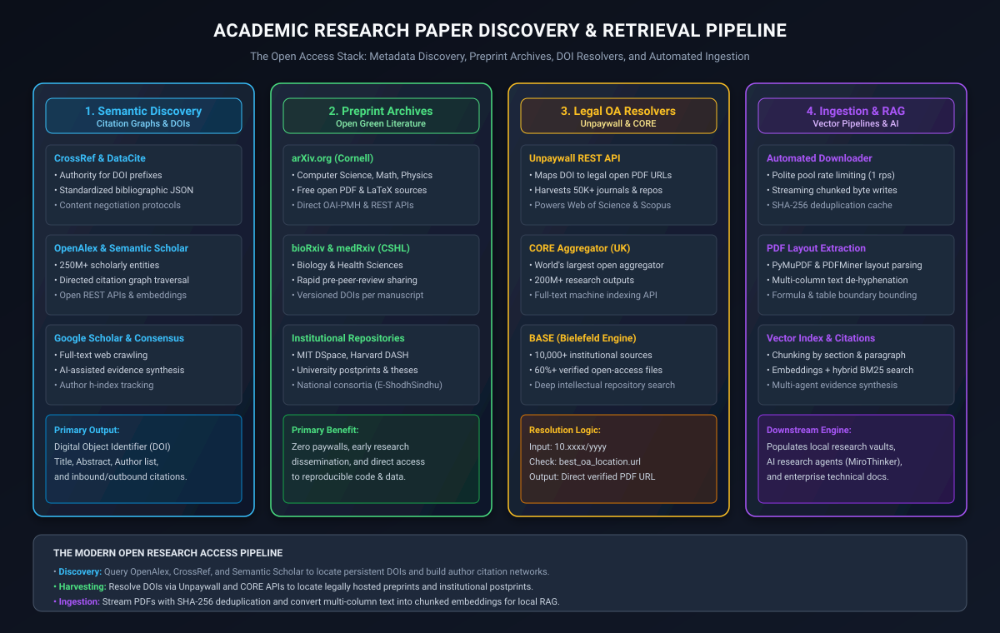
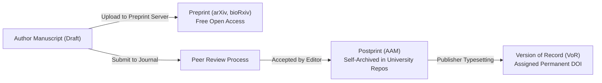
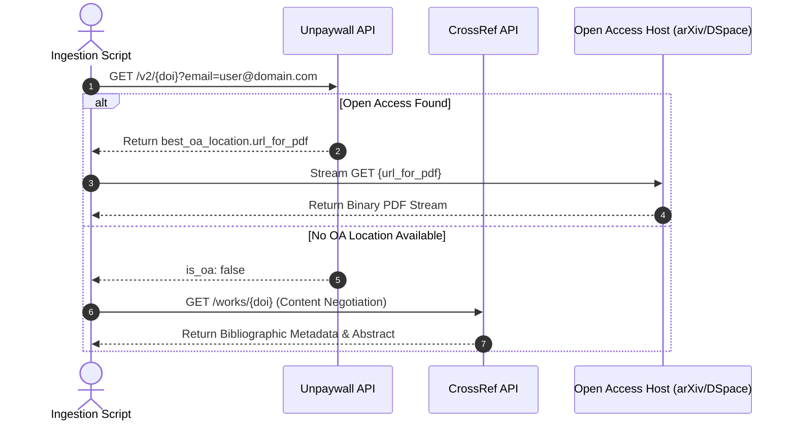
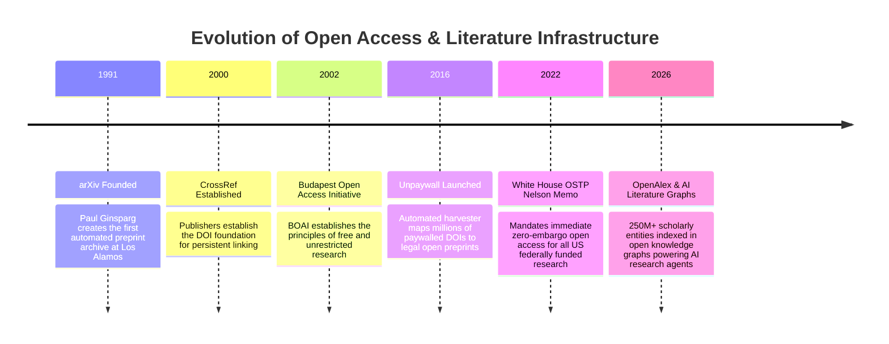

# Academic Research Paper Discovery and Retrieval: Open Access Infrastructure, DOI Resolvers, and Automated Pipelines

Learning note · Revised November 2026 · Scientific Literature Infrastructure &amp; Research Automation  
*By Srinivasan Ragothaman ([@rsrini7](https://github.com/rsrini7))*

> **Core idea:** Academic literature discovery has transitioned from manual browsing across publisher portals into an open, programmatic graph of preprint servers, persistent digital object identifiers (DOIs), and semantic open-access indexing APIs. Understanding the mechanics of CrossRef DOI resolution, preprint aggregation (arXiv, bioRxiv), open-access harvesting (Unpaywall, CORE, OpenAlex), and institutional repositories allows research engineers to build automated, reproducible paper ingestion and citation pipelines.


*Figure 1: Architectural overview of the modern research literature stack, from semantic discovery and preprint archives to legal open-access DOI resolution and automated RAG ingestion.*

---

## 1. Foundations: The Open Access Publishing Ecosystem

In scientific research, accessing primary literature has historically been impeded by subscription paywalls. Over the past three decades, the global scientific community established the **Open Access (OA)** movement—formalized by the 2002 Budapest Open Access Initiative (BOAI)—to guarantee unrestricted digital access to peer-reviewed research.

Understanding how to programmatically search, resolve, and download research papers requires understanding the three versions of an academic manuscript:

1. **Preprint:** The author's original manuscript before formal peer review, freely shared on public archives (e.g., arXiv, bioRxiv).
2. **Postprint (Author's Accepted Manuscript - AAM):** The peer-reviewed, accepted version incorporating reviewer revisions, but without publisher typesetting or pagination. Often legally self-archived in university institutional repositories.
3. **Version of Record (VoR):** The final published paper formatted by the commercial publisher, typically assigned a permanent Digital Object Identifier (DOI).



### The Four Open Access Models

- **Green OA (Self-Archiving):** Authors publish in a subscription journal but deposit a free copy of the preprint or postprint into an institutional repository (e.g., Harvard DASH, MIT DSpace) or subject archive (arXiv).
- **Gold OA (Publisher Open Access):** The final Version of Record is immediately and permanently free to everyone on the publisher's platform, typically financed via Article Processing Charges (APCs).
- **Hybrid OA:** Subscription journals where individual articles are made open access if the authors pay an APC.
- **Diamond / Platinum OA:** Journals that publish open-access articles with zero fees charged to both readers and authors, funded by academic institutions or societies.

### Discovery &amp; Access Infrastructure Matrix

| Platform / Tool | Focus Area &amp; Discipline | Access Model | API Availability | Key Architectural Role |
| :--- | :--- | :--- | :--- | :--- |
| **arXiv.org** | Computer Science, Physics, Math, AI | 100% Free Green OA | REST &amp; OAI-PMH | Authoritative preprint repository for machine learning and computing. |
| **bioRxiv / medRxiv** | Biology, Medicine, Life Sciences | 100% Free Green OA | REST API | Rapid dissemination of biological and medical preprints. |
| **OpenAlex** | All scholarly fields (250M+ entities) | 100% Free &amp; Open Source | High-speed REST API | Graph database mapping authors, papers, institutions, and citations. |
| **Semantic Scholar** | Computer science &amp; biomedicine | Free Open Access | REST &amp; Bulk Datasets | AI-driven citation graph extraction and semantic embeddings. |
| **CrossRef** | Digital Object Identifiers (DOIs) | Non-profit Infrastructure | REST &amp; Content Negotiation | Official registration agency converting DOIs to authoritative publisher URLs. |
| **Unpaywall** | Legal open-access full-text resolver | Free (Polite Pool) | REST API | Automatically maps any scholarly DOI to its legal open-access PDF URL. |
| **CORE** | Global institutional repository aggregator | Free &amp; Open Access | REST API | Aggregates full-text papers across thousands of university DSpace repositories. |
| **BASE** | Multi-disciplinary academic search | Free (60%+ Open Access) | OAI-PMH &amp; REST | Bielefeld University engine harvesting 10,000+ institutional repositories. |
| **Consensus / Scispace** | Evidence synthesis &amp; research QA | Commercial / Freemium | Proprietary | AI-assisted search summarizing consensus across peer-reviewed papers. |

---

## 2. Deep Technical Mechanisms

### 2.1 The DOI Resolution Protocol &amp; Content Negotiation

Every formal scholarly article is assigned a **Digital Object Identifier (DOI)** managed by the International DOI Foundation (IDF) via the Handle.Net system. A DOI consists of a directory indicator, a registrant prefix, and an item suffix:

$$\text{DOI Structure: } \underbrace{10.1145}_{\text{Prefix (Publisher)}} / \underbrace{3290605.3300244}_{\text{Suffix (Article)}}$$

When a browser resolves `https://doi.org/10.1145/3290605.3300244`:
1. The DOI proxy server queries the Handle registry for the prefix `10.1145`.
2. The Handle server returns the registered URL maintained by the publisher (e.g., ACM Digital Library).
3. The DOI proxy issues an **HTTP 302 Found** redirect pointing the browser to the publisher's landing page.

#### Content Negotiation (Machine-Readable Bibliographic Metadata)
Rather than scraping HTML from publisher paywalls, automated tools can request structured metadata directly from the DOI resolver using HTTP Content Negotiation:

```bash
curl -LH "Accept: application/vnd.citationstyles.csl+json" https://doi.org/10.1145/3290605.3300244
```

The server intercepts the `Accept` header and returns standardized JSON containing authors, title, publication date, journal name, and licensed links, bypassing HTML scraping completely.

### 2.2 Legal Open-Access Harvesting via Unpaywall

When a paper is hosted behind a commercial paywall, commercial publishers prohibit direct unauthorized scraping. However, under Green OA policies, the authors often upload a legal preprint to an institutional repository or preprint server.

**Unpaywall** operates an automated harvesting engine that monitors over 50,000 journals and repositories:
1. It queries CrossRef to ingest newly registered DOIs.
2. It crawls institutional repositories (using the OAI-PMH protocol) and preprint servers to identify matching titles and hashes.
3. When queried with a DOI (`https://api.unpaywall.org/v2/{doi}?email={user@domain}`), Unpaywall returns a JSON payload with `is_oa: true` and the direct URL to the legal PDF:

```json
{
  "doi": "10.1038/nature12373",
  "is_oa": true,
  "best_oa_location": {
    "url_for_pdf": "https://dash.harvard.edu/bitstream/handle/1/12345/paper.pdf",
    "version": "acceptedVersion",
    "license": "cc-by"
  }
}
```



### 2.3 The arXiv API and OAI-PMH Harvesting

arXiv provides a standardized, rate-limited REST API returning Atom/XML syndication feeds. Engineers can search across subject categories (`cs.AI`, `cs.LG`, `cs.CV`, `math.ST`), authors, or titles:

```
http://export.arxiv.org/api/query?search_query=cat:cs.AI+AND+all:transformer&start=0&max_results=10
```

The resulting Atom feed contains the unique arXiv identifier (e.g., `2401.12345`), version history (`v1`, `v2`), title, abstract, and direct PDF download endpoints (`http://arxiv.org/pdf/2401.12345.pdf`).

For bulk synchronization of millions of manuscripts, arXiv supports the **Open Archives Initiative Protocol for Metadata Harvesting (OAI-PMH)** via `http://export.arxiv.org/oai2`, allowing incremental harvesting based on publication datestamps.

---

## 3. Production Implementations & Code Recipes

### Automated Academic Paper Ingestion Pipeline (Python)

The following runnable Python script implements a production-grade research pipeline:
1. Queries the **arXiv API** to search and retrieve computer science preprints.
2. Resolves arbitrary **DOIs via Unpaywall** to locate legal open-access full-text PDFs.
3. Fetches structured bibliographic citations via **CrossRef Content Negotiation**.
4. Downloads PDF streams with chunked writing, polite pool rate-limiting, and SHA-256 deduplication.

```python
"""
Academic Research Paper Discovery & Retrieval Pipeline.
Demonstrates CrossRef Content Negotiation, Unpaywall OA resolution,
and automated arXiv PDF stream downloading.
"""

from typing import Optional, Dict, Any, List
import hashlib
import os
import time
import urllib.parse
import xml.etree.ElementTree as ET
import requests

USER_AGENT_EMAIL = "research-engineer@example.com"
HEADERS = {
    "User-Agent": f"AcademicResearchIngestor/1.0 (mailto:{USER_AGENT_EMAIL})"
}


# ==========================================
# 1. DOI METADATA & UNPAYWALL RESOLUTION
# ==========================================


def fetch_doi_metadata(doi: str) -> Optional[Dict[str, Any]]:
    """Fetches standardized CSL-JSON citation metadata via CrossRef Content Negotiation."""
    clean_doi = doi.strip().replace("https://doi.org/", "")
    url = f"https://doi.org/{urllib.parse.quote(clean_doi)}"
    req_headers = {
        **HEADERS,
        "Accept": "application/vnd.citationstyles.csl+json",
    }

    try:
        response = requests.get(url, headers=req_headers, timeout=10)
        if response.status_code == 200:
            return response.json()
        print(f"[WARN] CrossRef returned status {response.status_code} for DOI: {doi}")
    except requests.RequestException as exc:
        print(f"[ERROR] Failed to fetch metadata for DOI {doi}: {exc}")
    return None


def resolve_open_access_pdf(doi: str) -> Optional[str]:
    """Queries Unpaywall REST API to locate a legal, verified open-access PDF download URL."""
    clean_doi = doi.strip().replace("https://doi.org/", "")
    url = f"https://api.unpaywall.org/v2/{urllib.parse.quote(clean_doi)}"
    params = {"email": USER_AGENT_EMAIL}

    try:
        response = requests.get(
            url, params=params, headers=HEADERS, timeout=10
        )
        if response.status_code == 200:
            data = response.json()
            if data.get("is_oa") and data.get("best_oa_location"):
                pdf_url = data["best_oa_location"].get("url_for_pdf")
                if pdf_url:
                    return pdf_url
        print(f"[INFO] No open-access PDF found on Unpaywall for DOI: {doi}")
    except requests.RequestException as exc:
        print(f"[ERROR] Unpaywall query failed for DOI {doi}: {exc}")
    return None


# ==========================================
# 2. ARXIV SEARCH & HARVESTING
# ==========================================


def search_arxiv(
    query: str, max_results: int = 5
) -> List[Dict[str, str]]:
    """Searches arXiv via Atom REST API and parses manuscript metadata and PDF links."""
    base_url = "http://export.arxiv.org/api/query"
    params = {
        "search_query": query,
        "start": 0,
        "max_results": max_results,
        "sortBy": "submittedDate",
        "sortOrder": "descending",
    }

    results = []
    try:
        response = requests.get(
            base_url, params=params, headers=HEADERS, timeout=15
        )
        if response.status_code != 200:
            return results

        root = ET.fromstring(response.content)
        # Atom XML namespace
        ns = {"atom": "http://www.w3.org/2005/Atom"}

        for entry in root.findall("atom:entry", ns):
            title = entry.find("atom:title", ns)
            summary = entry.find("atom:summary", ns)
            id_url = entry.find("atom:id", ns)

            pdf_url = None
            for link in entry.findall("atom:link", ns):
                if link.attrib.get("title") == "pdf":
                    pdf_url = link.attrib.get("href")
                    break

            if id_url is not None and title is not None:
                results.append(
                    {
                        "id": id_url.text.strip(),
                        "title": " ".join(title.text.strip().split()),
                        "abstract": " ".join(summary.text.strip().split())
                        if summary is not None
                        else "",
                        "pdf_url": pdf_url or "",
                    }
                )
    except Exception as exc:
        print(f"[ERROR] Failed to query arXiv API: {exc}")
    return results


# ==========================================
# 3. STREAMING PDF DOWNLOADER WITH DEDUPLICATION
# ==========================================


def download_pdf(pdf_url: str, output_dir: str = "./papers") -> Optional[str]:
    """Streams a PDF file with chunked writes and SHA-256 integrity validation."""
    os.makedirs(output_dir, exist_ok=True)
    file_hash = hashlib.sha256(pdf_url.encode("utf-8")).hexdigest()[:12]
    target_path = os.path.join(output_dir, f"paper_{file_hash}.pdf")

    if os.path.exists(target_path):
        print(f"[CACHE] Paper already downloaded: {target_path}")
        return target_path

    try:
        print(f"[DOWNLOAD] Streaming PDF from: {pdf_url}")
        with requests.get(
            pdf_url, headers=HEADERS, stream=True, timeout=20
        ) as res:
            res.raise_for_status()
            content_type = res.headers.get("Content-Type", "")
            if "pdf" not in content_type.lower() and not pdf_url.endswith(
                ".pdf"
            ):
                print(
                    f"[WARN] Non-PDF content type received ({content_type}); aborting."
                )
                return None

            with open(target_path, "wb") as f:
                for chunk in res.iter_content(chunk_size=16384):
                    if chunk:
                        f.write(chunk)

        print(f"[SUCCESS] Saved to: {target_path}")
        return target_path
    except requests.RequestException as exc:
        print(f"[ERROR] Download failed: {exc}")
        if os.path.exists(target_path):
            os.remove(target_path)
    return None


if __name__ == "__main__":
    print("--- 1. Querying arXiv for Vision-Language Joint Embeddings ---")
    arxiv_papers = search_arxiv("cat:cs.AI AND all:joint-embedding", max_results=2)
    for p in arxiv_papers:
        print(f"Title: {p['title']}")
        print(f"PDF Link: {p['pdf_url']}")
        if p["pdf_url"]:
            download_pdf(p["pdf_url"])
            time.sleep(1)  # Polite rate limit

    print("\n--- 2. Resolving Open-Access PDF via DOI and Unpaywall ---")
    sample_doi = "10.1038/nature12373"
    meta = fetch_doi_metadata(sample_doi)
    if meta:
        print(f"Title: {meta.get('title')}")
        print(f"Publisher: {meta.get('publisher')}")

    oa_pdf = resolve_open_access_pdf(sample_doi)
    if oa_pdf:
        print(f"Legal OA PDF Found: {oa_pdf}")
        download_pdf(oa_pdf)
```

---

## 4. Impact, Real-World Edge Cases & Gotchas

### 4.1 Engineering Constraints & Failure Modes

1. **Polite Pool Compliance & Rate Limiting:** Both CrossRef and Unpaywall provide prioritized, high-reliability service tiers ("Polite Pools") for clients that provide a valid contact email in the `User-Agent` or query parameters. Clients making unauthenticated requests with generic user-agents (e.g., `python-requests/2.x`) face aggressive throttling (`HTTP 429 Too Many Requests`) and IP bans.
2. **Two-Column PDF Layout Parsing Traps:** Academic PDFs format text in two vertical columns. Naive text extraction scripts read horizontally across the page, interleaving paragraphs from column 1 and column 2 into gibberish. Use specialized layout-aware parsers (such as `PyMuPDF`, `Grobid`, or `Nougat`) to preserve linear reading order and extract LaTeX mathematical equations accurately.
3. **Publisher Embargo Periods:** Green Open Access policies often include publisher-mandated embargo periods of 6 to 24 months before authors may legally release postprints in university repositories. During this window, Unpaywall may report `is_oa: false`, requiring fallback to earlier preprints on arXiv.

### 4.2 Common Claims vs. Technical Realities

| Common Claim | Technical Reality | Systems Engineering Implication |
| :--- | :--- | :--- |
| **"All papers indexed on Google Scholar are legally free to download."** | Google Scholar indexes paywalled publishers alongside institutional preprints. It displays links to PDFs when crawled, but does not verify copyright licensing or open-access legality. | Use verified APIs (Unpaywall, CORE, arXiv) when building commercial or automated ingestion pipelines. |
| **"arXiv preprints are identical to the published journal articles."** | Preprints are shared before peer review. While core ideas remain consistent, proof corrections, empirical numbers, and supplementary appendices often change in the final Version of Record. | In production RAG systems, flag documents as `preprint` or `peer-reviewed` in metadata to inform model confidence scores. |
| **"Resolving a DOI URL always returns the paper's PDF."** | By design, DOIs resolve via Handle.Net HTTP 302 redirects to publisher *landing pages* (HTML abstracts), not raw binary PDFs. | Use CrossRef Content Negotiation to obtain JSON metadata or Unpaywall to locate the direct `url_for_pdf`. |
| **"Institutional repositories only host student theses."** | Repositories like MIT DSpace and Harvard DASH host hundreds of thousands of peer-reviewed faculty postprints funded under federal open-access mandates. | Include institutional repository endpoints (via CORE or BASE) to access papers locked behind journal paywalls. |

---

## 5. Practical Adoption Blueprint & Verification Checklist

### 5.1 Pipeline Blueprint for AI Research & Enterprise Teams

```
Step 1: Ingestion & Discovery
  ├── Given a topic/query ──> Search OpenAlex / Semantic Scholar API for top-cited papers
  └── Given a specific DOI ──> Fetch CSL-JSON metadata via CrossRef Content Negotiation

Step 2: Legal Full-Text Resolution
  ├── Query Unpaywall API for 'best_oa_location.url_for_pdf'
  ├── If not found, check arXiv OAI-PMH repository using title/author fuzzy match
  └── If not found, check CORE API for institutional university postprints

Step 3: Document Processing & Caching
  ├── Stream PDF binary with SHA-256 file hashing to avoid duplicate downloads
  ├── Parse PDF with layout-aware extraction (Grobid or PyMuPDF)
  └── Convert text into structured Markdown with section headings and KaTeX math

Step 4: Vector Indexing & RAG
  └── Chunk by semantic sections, generate vector embeddings, and store in vector database
```

### 5.2 Verification Checklist

- [ ] **Polite Pool Headers Configured:** Ensure all HTTP requests include a valid `User-Agent` containing a domain or contact email (`mailto:ops@company.com`).
- [ ] **Rate Limiting Enforced:** Restrict request rates to a maximum of 1 request per second for arXiv and 3 requests per second for Unpaywall to prevent automated IP throttling.
- [ ] **MIME-Type Validation:** Verify that downloaded streams contain `Content-Type: application/pdf` before saving files to disk.
- [ ] **Layout-Aware PDF Extraction:** Confirm that multi-column PDFs are parsed without sentence interleaving or paragraph truncation.
- [ ] **License Metadata Preservation:** Retain the paper's open-access license (`CC-BY`, `CC-BY-NC`, `arXiv License`) in the document's metadata store for copyright audit compliance.

---

## 6. Timeline and Evolution of Open Scientific Literature



- **1991 — arXiv Founded:** Paul Ginsparg establishes the `xxx.lanl.gov` (later `arXiv.org`) preprint server at Los Alamos National Laboratory, revolutionizing scientific communication in physics and mathematics.
- **2000 — CrossRef Founded:** Non-profit coalition of academic publishers adopts the Handle.Net architecture to standardize Digital Object Identifiers (DOIs) across scientific literature.
- **2002 — Budapest Open Access Initiative (BOAI):** Defines the foundational distinction between Green Open Access (self-archiving) and Gold Open Access (publisher journals).
- **2016 — Unpaywall Launched:** Impactstory launches Unpaywall, building the first global automated crawler indexing over 50,000 legal repositories and institutional repositories.
- **2022 — White House OSTP Nelson Memo:** The US Office of Science and Technology Policy directs all federal agencies to eliminate the 12-month publication embargo, ensuring taxpayer-funded research is publicly accessible immediately upon publication.
- **2024–2026 — Open Scholarly Graphs & AI Research Agents:** OpenAlex and Semantic Scholar democratize access to the global citation graph, enabling autonomous research agents (e.g., MiroThinker, PaperBanana) to explore literature, synthesize findings, and discover cross-disciplinary connections.

---

## 7. Primary Sources & References

### Standards & Official Infrastructure APIs

1. [Budapest Open Access Initiative (BOAI)](https://www.budapestopenaccessinitiative.org/read/) — The foundational 2002 international manifesto establishing open access principles and Green/Gold archiving strategies.
2. [CrossRef REST API Documentation](https://www.crossref.org/documentation/retrieve-metadata/rest-api/) — Official documentation for querying scholarly metadata and executing content negotiation via HTTP headers.
3. [arXiv API User Manual & Guidance](https://arxiv.org/help/api/index) — Cornell University. Comprehensive guide for querying arXiv preprints, Atom syndication schemas, and OAI-PMH harvesting.
4. [Unpaywall REST API Reference](https://unpaywall.org/products/api) — OurResearch. Technical specifications for querying the open-access database of 50M+ scholarly manuscripts.
5. [OpenAlex: An Open Platform for Scholarly Metadata](https://openalex.org/) — Priem et al. (2022). Comprehensive documentation for the open-source scholarly knowledge graph indexing 250M+ works.
6. [International DOI Foundation (IDF): DOI Handbook](https://www.doi.org/doi_handbook/TOC.html) — Technical standards governing Handle resolution, prefix allocation, and metadata schemas.

### Companion Research & System Guides

7. [MiroThinker-1.5-Research-Agent-Architecture-2026](../Papers/vision/MiroThinker-1.5-Research-Agent-Architecture-2026.md) — Demonstrates how autonomous AI research agents leverage scholarly search and retrieval tools to solve complex scientific questions.
8. [PaperBanana-Automating-Academic-Illustration-for-AI-Scientists-2026](../Papers/meta/PaperBanana-Automating-Academic-Illustration-for-AI-Scientists-2026.md) — Architecture of multi-agent systems analyzing research papers to generate academic figures and diagrams.

---

## 8. Supplementary Visuals

The following visual documentation preserves the high-level research literature pipeline illustrating the progression from discovery to automated local vectorization:


*Figure 2: Complete four-stage workflow mapping semantic graph discovery, preprint repositories, legal open-access resolvers, and automated RAG document ingestion.*

---

**Related:**
- [Java-AI-Roadmap](../Content/LinkedIn/Java-AI-Roadmap.md) — Connects academic research retrieval to enterprise AI service architectures and foundation model roadmaps.
- [MiroThinker-1.5-Research-Agent-Architecture-2026](../Papers/vision/MiroThinker-1.5-Research-Agent-Architecture-2026.md) — Architecture of autonomous multi-agent systems executing scientific discovery over scholarly literature.
- [PaperBanana-Automating-Academic-Illustration-for-AI-Scientists-2026](../Papers/meta/PaperBanana-Automating-Academic-Illustration-for-AI-Scientists-2026.md) — Multi-agent frameworks synthesizing academic papers into verified diagrams and visual artifacts.
- [Multimodal-RAG](../AI-ML/RAG/Multimodal-RAG.md) — Examines embedding retrieval, vector indexing, and chunking strategies for multi-column academic PDF ingestion.