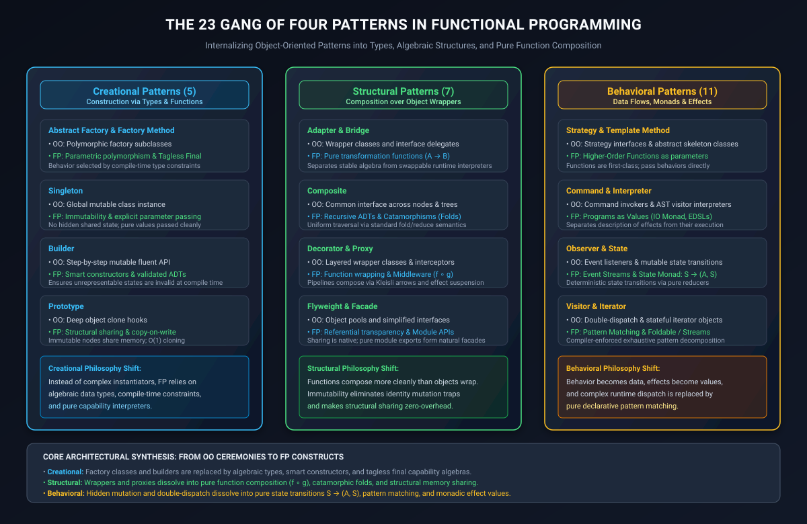
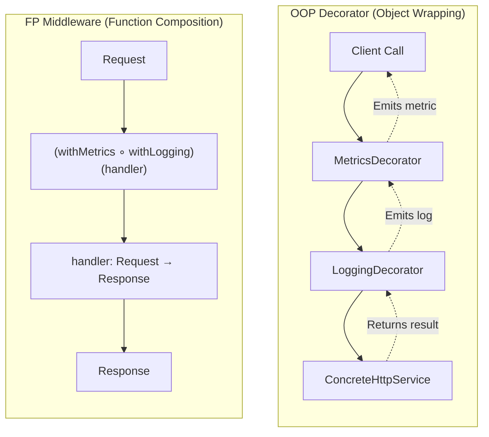
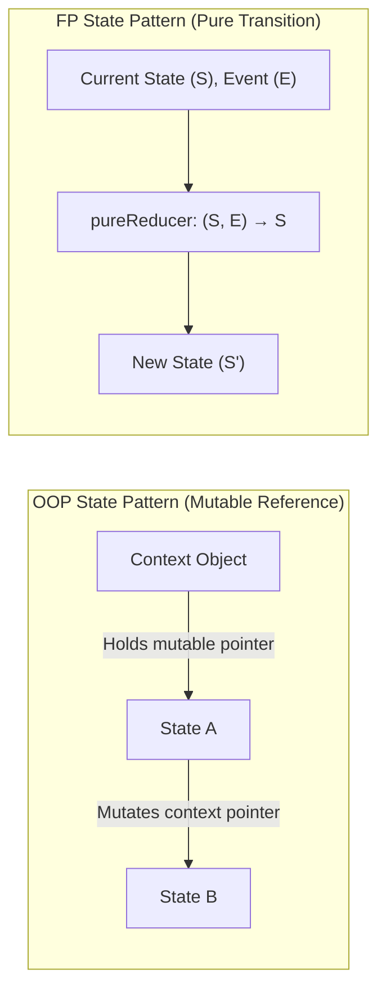
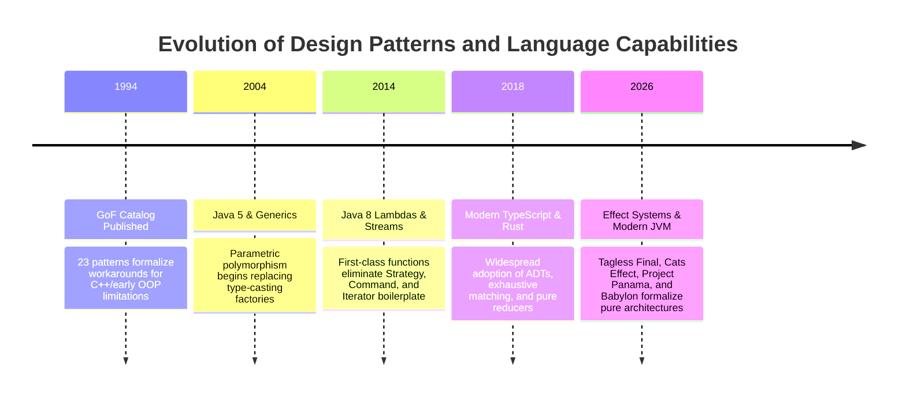
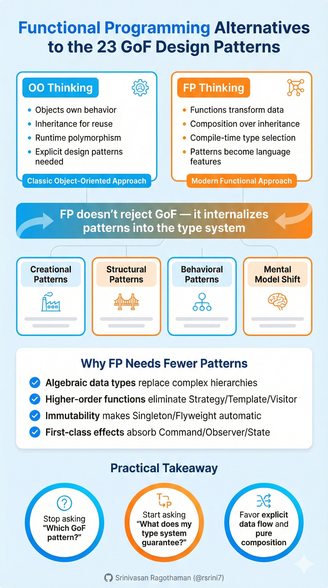
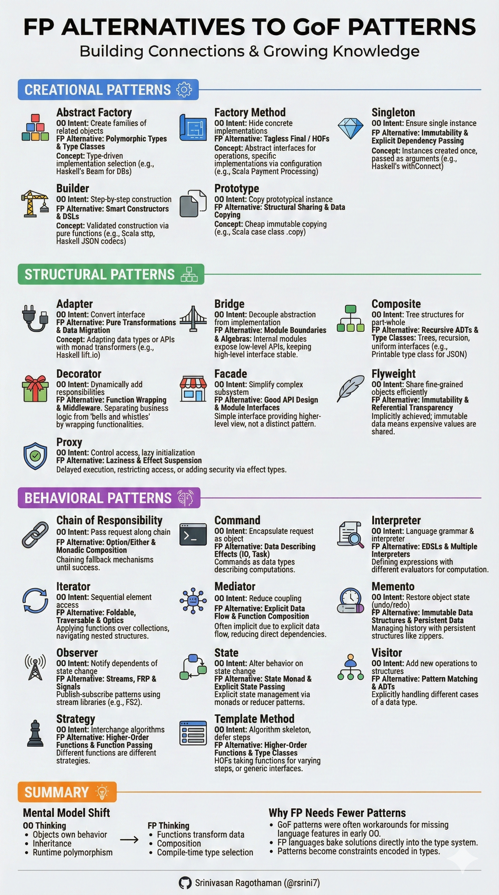

# Gang of Four (GoF) Design Patterns in Functional Programming: The 23 Patterns Internalized into Types and Functions

Learning note · Revised November 2026 · Software Architecture &amp; Design Patterns  
*By Srinivasan Ragothaman ([@rsrini7](https://github.com/rsrini7))*

> **Core idea:** Functional programming does not eliminate or reject the 23 Gang of Four (GoF) design patterns; it absorbs them directly into language primitives, algebraic data types, and composition mechanics. Where object-oriented design relies on polymorphic class hierarchies, mutable references, and runtime indirection, functional paradigms replace them with first-class functions, pure higher-order combinators, and compile-time type constraints.


*Figure 1: Architectural mapping showing how the 23 GoF patterns transition from object-oriented class hierarchies into functional algebraic structures, function composition, and pure monadic effects.*

---

## 1. Foundations: The Historical Absence of Language Primitives

In 1994, Erich Gamma, Richard Helm, Ralph Johnson, and John Vlissides published *Design Patterns: Elements of Reusable Object-Oriented Software* (the "Gang of Four" or GoF book). The book documented 23 cataloged design patterns across Creational, Structural, and Behavioral categories.

The primary architectural motivation behind the original GoF catalog was navigating the expressive limitations of early object-oriented languages (specifically C++ and early Java), which lacked:
- First-class and higher-order functions (closures, lambdas).
- Algebraic Data Types (sum and product types).
- Exhaustive pattern matching.
- Immutability by default and persistent data structures.
- Parametric type polymorphism and typeclasses.
- Reified monadic effects (programs as values).

Because early OOP lacked these primitives, software engineers were forced to invent structural workarounds. For instance, the **Strategy pattern** required creating an abstract interface and multiple implementing classes simply to pass an algorithm as an argument—a problem that dissolves in any language supporting first-class function parameters:

$$\text{Strategy Pattern (OOP)} \iff f: A \to B \quad (\text{FP})$$

Similarly, the **Command pattern** introduced invokers, receivers, and command classes to encapsulate an action and its parameters—a pattern superseded by treating computations as pure values via effect monads:

$$\text{Command Pattern (OOP)} \iff \text{Program Value } (\text{IO}[A]) \quad (\text{FP})$$

Functional programming does not reject design patterns; rather, **patterns in FP are internalized into the type system**.

### The 23 GoF Patterns: Object-Oriented Intent vs. Functional Equivalent

| Category | GoF Pattern | Object-Oriented Intent | Functional Equivalent | FP Mechanism |
| :--- | :--- | :--- | :--- | :--- |
| **Creational** | **Abstract Factory** | Create families of related objects | Parametric polymorphism &amp; typeclasses | Type-driven capability selection |
| **Creational** | **Factory Method** | Delegate instantiation to subclasses | Tagless Final &amp; higher-order functions | Abstract algebra with swappable interpreter |
| **Creational** | **Singleton** | Enforce single global class instance | Immutability &amp; explicit parameter passing | Pure values; no hidden global mutable state |
| **Creational** | **Builder** | Step-by-step object construction | Smart constructors &amp; validated ADTs | Pure functions returning `Either[Error, A]` |
| **Creational** | **Prototype** | Clone existing objects via hooks | Structural sharing &amp; copy-on-write | Invariant memory sharing; cheap copying |
| **Structural** | **Adapter** | Convert incompatible interfaces | Pure transformation functions | Functions of type $A \to B$ or natural transformations |
| **Structural** | **Bridge** | Decouple abstraction from implementation | Module signatures &amp; typeclasses | Separate algebra from concrete interpreters |
| **Structural** | **Composite** | Uniform tree-like node structures | Recursive ADTs &amp; Catamorphisms (Folds) | Inductive data structures with `fold` |
| **Structural** | **Decorator** | Dynamically add responsibilities | Function composition &amp; Middleware | $(f \circ g)$ and Kleisli composition |
| **Structural** | **Facade** | Simplify a complex subsystem | Clean module exports &amp; API boundaries | Standard module boundary design |
| **Structural** | **Flyweight** | Share fine-grained objects to save memory | Immutability &amp; referential transparency | Hash-consing and native structural sharing |
| **Structural** | **Proxy** | Control access or delay execution | Lazy evaluation &amp; effect suspension | Thunks (`() => A`) and suspended effects (`IO[A]`) |
| **Behavioral** | **Chain of Resp.** | Pass requests along a handler pipeline | Monadic fallbacks &amp; Alternative | `Option`, `Either`, or `firstSuccess(f1, f2, f3)` |
| **Behavioral** | **Command** | Encapsulate request as an object | Programs as values | Pure data describing effects (`IO`, `Task`) |
| **Behavioral** | **Interpreter** | Define grammar and evaluation engine | Embedded Domain Specific Languages (EDSLs) | AST data types + multiple pure interpreters |
| **Behavioral** | **Iterator** | Sequential access without exposing internals | `Foldable`, `Traversable`, and Streams | Pull/push stream combinators (`map`, `filter`, `fold`) |
| **Behavioral** | **Mediator** | Decouple interacting components | Explicit data flows &amp; event pipelines | Pure orchestration functions and streams |
| **Behavioral** | **Memento** | Capture and restore previous state | Persistent data structures &amp; Zippers | Immutable revision history for zero extra code |
| **Behavioral** | **Observer** | One-to-many publish-subscribe notification | Event Streams &amp; Functional Reactive Prog. | Signals, Topics, and reactive push/pull streams |
| **Behavioral** | **State** | Alter behavior when internal state changes | State Monad &amp; Pure Reducers | Pure transition functions: $S \to (A, S)$ |
| **Behavioral** | **Strategy** | Family of interchangeable algorithms | First-class functions | Passing $A \to B$ directly as an argument |
| **Behavioral** | **Template Method**| Skeleton algorithm with overridable hooks | Higher-order functions with function hooks | Passing callback combinators to pure algorithms |
| **Behavioral** | **Visitor** | Add operations to classes without modifying | Pattern matching &amp; ADT decomposition | Exhaustive pattern match over algebraic variants |

---

## 2. Deep Technical Mechanisms

### 2.1 Creational Patterns: From Instantiators to Capability Algebras

In object-oriented code, creational patterns manage the mechanics of object instantiation to prevent tight coupling to concrete classes. In functional programming, construction is governed by **algebraic types, smart constructors, and capability algebras**:

1. **Abstract Factory &amp; Factory Method $\to$ Tagless Final &amp; Algebras:** Instead of abstract factory hierarchies, FP defines a capability interface (an algebra) parameterized over an effect type $F[_]$:
   ```scala
   trait PaymentGateway[F[_]] {
     def charge(amount: Money, account: AccountId): F[Receipt]
   }
   ```
   At runtime, the application selects a concrete interpreter (e.g., Stripe, PayPal, or In-Memory Mock) based on environment configuration without modifying business logic.
2. **Builder $\to$ Smart Constructors:** Rather than a mutable class with chaining methods (`.withHost().withPort().build()`), FP introduces pure factory functions that enforce domain invariants at creation time, returning `Either[ValidationError, Config]`. Invalid states cannot be represented in the type system.
3. **Singleton $\to$ Explicit Dependency Passing:** Singletons in OOP introduce hidden global mutable state, tightly coupling components and complicating concurrent testing. In FP, data is immutable; singletons are replaced by constructing a value once at application entry and passing it explicitly (or via reader monads/contextual parameters) to pure functions.

### 2.2 Structural Patterns: Composition over Object Wrappers



Structural patterns in OOP focus on class composition and object wrappers. In FP, these patterns collapse into **function composition, recursive data structures, and catamorphisms**:

1. **Decorator $\to$ Function Composition ($f \circ g$):** Rather than wrapping an object inside multiple nested decorator classes implementing a shared interface, FP represents cross-cutting concerns (logging, retries, rate limiting, authentication) as **middleware combinators**: $\text{Middleware}: (A \to B) \to (A \to B)$. Decorating a service is simply piping higher-order functions: `withMetrics(withLogging(handler))`.
2. **Composite $\to$ Recursive Algebraic Data Types &amp; Folds:** OOP Composite models trees by forcing leaf nodes and composite branches to implement the same interface. In FP, trees are modeled naturally using recursive sum types: $\text{Tree}[A] = \text{Leaf}(A) \mid \text{Node}(\text{Tree}[A], \text{Tree}[A])$. Processing a tree is performed using a pure catamorphism (`fold`), eliminating the need for composite visitor dispatch.
3. **Adapter $\to$ Pure Transformations:** An OOP adapter converts one object interface into another. In FP, an adapter is simply a pure function converting data type $A$ into data type $B$ ($f: A \to B$), or a natural transformation between functors ($\tau: F[A] \to G[A]$).

### 2.3 Behavioral Patterns: Monadic Effects, Streams, and Pattern Matching



Behavioral patterns manage algorithms and responsibilities between objects. In FP, these patterns are replaced by **data flows, pure state transitions, and pattern matching**:

1. **Strategy $\to$ Higher-Order Functions:** In OOP, the Strategy pattern requires an interface and concrete strategy classes. In FP, functions are first-class citizens; an algorithm simply accepts a function parameter $(A \to B)$ that defines the strategy directly.
2. **State $\to$ Pure State Transitions ($S \to (A, S)$):** The OOP State pattern delegates behavior to a mutable state object that mutates the parent context. In FP, state transitions are pure functions taking current state $S$ and an input event, returning the next state $S'$ and an optional output $A$. This is formalized mathematically by the **State Monad**: $\text{State}[S, A] = S \to (A, S)$. This ensures deterministic, testable state management without side effects, forming the core architecture of Elm, Redux, and modern actor systems.
3. **Visitor $\to$ Pattern Matching:** The Visitor pattern is an OOP workaround for the absence of sum types, using "double-dispatch" (`element.accept(visitor)`) to add operations to existing class hierarchies without editing them. In FP, sum types (ADTs) paired with exhaustive pattern matching allow developers to add new operations as standalone pure functions without modifying the data definitions.

---

## 3. Production Implementations & Code Recipes

### 3.1 Creational: Smart Constructor with Validation (TypeScript)

This recipe demonstrates replacing the OOP Builder pattern with a functional smart constructor that prevents invalid objects from being instantiated.

```typescript
/**
 * Functional Smart Constructor replacing the OOP Builder Pattern.
 * Guarantees that Port and Host invariants are verified at creation time.
 */

export type Port = number & { readonly __brand: unique symbol };
export type Host = string & { readonly __brand: unique symbol };

export interface ServerConfig {
  readonly host: Host;
  readonly port: Port;
  readonly timeoutMs: number;
}

export type Result<T, E> =
  | { readonly success: true; readonly value: T }
  | { readonly success: false; readonly error: E };

export function makePort(rawPort: number): Result<Port, string> {
  if (Number.isInteger(rawPort) && rawPort >= 1 && rawPort <= 65535) {
    return { success: true, value: rawPort as Port };
  }
  return { success: false, error: `Invalid port: ${rawPort}. Must be 1-65535.` };
}

export function makeHost(rawHost: string): Result<Host, string> {
  if (rawHost.trim().length > 0) {
    return { success: true, value: rawHost.trim() as Host };
  }
  return { success: false, error: "Host cannot be empty." };
}

export function makeServerConfig(
  rawHost: string,
  rawPort: number,
  timeoutMs: number = 5000
): Result<ServerConfig, string[]> {
  const hostRes = makeHost(rawHost);
  const portRes = makePort(rawPort);

  const errors: string[] = [];
  if (!hostRes.success) errors.push(hostRes.error);
  if (!portRes.success) errors.push(portRes.error);
  if (timeoutMs < 0) errors.push("Timeout cannot be negative.");

  if (errors.length > 0) {
    return { success: false, error: errors };
  }

  return {
    success: true,
    value: {
      host: (hostRes as { success: true; value: Host }).value,
      port: (portRes as { success: true; value: Port }).value,
      timeoutMs,
    },
  };
}

// Verification
const valid = makeServerConfig("api.internal.net", 8443, 3000);
console.log("Valid Config:", valid);

const invalid = makeServerConfig("", 99999, -100);
console.log("Validation Errors:", invalid);
```

### 3.2 Structural: Decorator via Pure Middleware Composition (Python)

This recipe demonstrates replacing the OOP Decorator pattern with pure higher-order function composition.

```python
"""
Functional Decorator Pattern via Pure Higher-Order Middleware Composition.
Demonstrates function chaining (f ∘ g) for logging, timing, and error handling.
"""

from typing import Callable, TypeVar, Any
from functools import reduce
import time

Req = TypeVar("Req")
Res = TypeVar("Res")

# Handler type: Req -> Res
Handler = Callable[[Req], Res]
# Middleware type: Handler -> Handler
Middleware = Callable[[Handler[Req, Res]], Handler[Req, Res]]


def compose_middleware(*middlewares: Middleware) -> Middleware:
    """Composes multiple middlewares into a single middleware pipeline."""
    return lambda base_handler: reduce(
        lambda handler, mw: mw(handler), reversed(middlewares), base_handler
    )


def with_logging(next_handler: Handler[Any, Any]) -> Handler[Any, Any]:
    def wrapped(req: Any) -> Any:
        print(f"[LOG] Processing request: {req}")
        res = next_handler(req)
        print(f"[LOG] Completed response: {res}")
        return res

    return wrapped


def with_timing(next_handler: Handler[Any, Any]) -> Handler[Any, Any]:
    def wrapped(req: Any) -> Any:
        start = time.perf_counter()
        res = next_handler(req)
        elapsed = (time.perf_counter() - start) * 1000
        print(f"[METRIC] Execution latency: {elapsed:.2f} ms")
        return res

    return wrapped


def with_recovery(fallback_response: Any) -> Middleware:
    def decorator(next_handler: Handler[Any, Any]) -> Handler[Any, Any]:
        def wrapped(req: Any) -> Any:
            try:
                return next_handler(req)
            except Exception as exc:
                print(f"[WARN] Caught exception: {exc}; returning fallback.")
                return fallback_response

        return wrapped

    return decorator


# Core business handler (pure function)
def process_order(order: dict) -> dict:
    if order.get("amount", 0) <= 0:
        raise ValueError("Order amount must be positive")
    return {"order_id": order["id"], "status": "APPROVED", "fee": 2.50}


# Build decorated pipeline
pipeline = compose_middleware(
    with_logging, with_timing, with_recovery({"status": "REJECTED"})
)(process_order)

if __name__ == "__main__":
    print("--- Successful Request ---")
    res1 = pipeline({"id": "ORD-101", "amount": 150.0})

    print("\n--- Failed Request (Handled via Middleware Fallback) ---")
    res2 = pipeline({"id": "ORD-102", "amount": -20.0})
```

### 3.3 Behavioral: State Pattern via Pure Reducer (Python)

This recipe demonstrates replacing the OOP State pattern with a pure state reducer, guaranteeing deterministic transitions without mutable pointers.

```python
"""
Functional State Pattern via Pure Reducer.
Replaces OOP state classes with an Algebraic Data Type and a deterministic transition function.
"""

from dataclasses import dataclass
from typing import Union


# Define State variants (Sum Type / ADT)
@dataclass(frozen=True)
class Draft:
    author: str
    content: str


@dataclass(frozen=True)
class InReview:
    author: str
    content: str
    reviewer: str


@dataclass(frozen=True)
class Published:
    author: str
    content: str
    published_at: str


State = Union[Draft, InReview, Published]


# Define Event variants
@dataclass(frozen=True)
class SubmitForReview:
    reviewer: str


@dataclass(frozen=True)
class Approve:
    timestamp: str


@dataclass(frozen=True)
class RequestChanges:
    feedback: str


Event = Union[SubmitForReview, Approve, RequestChanges]


def transition(state: State, event: Event) -> State:
    """
    Pure transition function: (State, Event) -> State.
    Deterministic, free of side effects, and trivial to unit test.
    """
    match (state, event):
        case (Draft(author, content), SubmitForReview(reviewer)):
            return InReview(author=author, content=content, reviewer=reviewer)

        case (InReview(author, content, _), Approve(timestamp)):
            return Published(
                author=author, content=content, published_at=timestamp
            )

        case (InReview(author, content, _), RequestChanges(_)):
            return Draft(author=author, content=content)

        case _:
            # Illegal transition: return current state unmodified
            print(f"[REJECTED] Invalid event {type(event).__name__} for state {type(state).__name__}")
            return state


if __name__ == "__main__":
    s0: State = Draft(author="Alice", content="FP replaces GoF")
    print("Initial State:", s0)

    s1 = transition(s0, SubmitForReview(reviewer="Bob"))
    print("After Review Submission:", s1)

    s2 = transition(s1, Approve(timestamp="2026-11-16T12:00:00Z"))
    print("After Approval:", s2)

    # Attempt illegal transition from Published
    s3 = transition(s2, SubmitForReview(reviewer="Charlie"))
    assert s3 == s2, "State must remain unchanged on invalid transition"
    print("Illegal Transition Handled Cleanly:", s3)
```

---

## 4. Impact, Real-World Edge Cases & Gotchas

### 4.1 Engineering Trade-offs & Practical Failure Modes

1. **Persistent Data Structure Allocation Overhead:** While immutable data structures provide thread-safe copying and structural sharing, updating deep nested records creates garbage collector allocation churn. In performance-critical hot paths (e.g., high-frequency trading or low-level packet processing), pure copying cannot match contiguous, pre-allocated mutable memory arrays.
2. **The Tagless Final Boilerplate Trap:** Using Tagless Final and capability algebras in languages like Scala or Haskell abstracts side effects cleanly, but introducing multiple capability constraints (`[F[_]: Monad: Sync: Logger: Config]`) dramatically increases compilation times, cognitive overhead, and compiler error complexity.
3. **The Expression Problem in Pattern Matching vs. OOP:**
   - In **OOP**, adding a new data variant (subclass) is easy (just implement the interface), but adding a new operation requires modifying every class in the hierarchy.
   - In **FP**, adding a new operation is easy (just write a new function over the ADT), but adding a new data variant requires updating every pattern matching expression across the codebase.
4. **Stack Overflow in Un-optimized Catamorphisms:** Recursive folds over deeply nested composite structures can exhaust the call stack if the compiler does not support tail-call optimization (TCO). In production runtimes without TCO (such as Python or default Node.js), developers must use trampoline abstractions or explicit iterative loops.

### 4.2 Common Claims vs. Technical Realities

| Common Claim | Technical Reality | Systems Engineering Implication |
| :--- | :--- | :--- |
| **"Functional programming makes all design patterns obsolete."** | FP eliminates boilerplate patterns born from missing primitives (Strategy, Command, Visitor), but introduces its own architectural patterns (Monad Transformers, Optics/Lenses, Capability Algebras). | Engineers should focus on domain boundaries and type constraints rather than memorizing pattern names. |
| **"Immutability makes Singletons impossible to implement."** | Immutability makes global *mutable* singletons impossible (which is desirable). Shared constants or configuration instances are simply constructed once at application bootstrap and passed explicitly. | Avoid thread-unsafe double-checked locking; initialize dependencies at the application entrypoint. |
| **"Pattern matching violates the Open/Closed Principle."** | Pattern matching trades extensibility of data variants for extensibility of operations. When operations change frequently, pattern matching is strictly superior to the OOP Visitor pattern. | Use OOP subtype polymorphism when data variants expand frequently; use FP ADTs when operations on fixed data expand frequently. |
| **"Functional composition hurts runtime performance."** | Modern JIT compilers (HotSpot JVM, V8) aggressively inline pure higher-order functions. Inlining collapses middleware chains ($f \circ g \circ h$) into flat machine code identical to hand-written loops. | Profile before micro-optimizing; composition readability does not inherently introduce latency bottlenecks. |

---

## 5. Practical Adoption Blueprint & Verification Checklist

### 5.1 Refactoring Blueprint: Migrating from GoF to Idiomatic FP

```
Step 1: Identify Pattern Ceremonies
  ├── Is a class hierarchy used solely to pass an algorithm? ──> Replace with a first-class function (Strategy)
  ├── Is an interface used solely to add hooks to a loop? ───────> Replace with a higher-order function (Template)
  └── Is an abstract class used to simulate multiple types? ────> Replace with an Algebraic Data Type (Visitor)

Step 2: Eliminate Shared Mutable State
  ├── Replace global mutable singletons with explicit dependency arguments or Reader contexts
  └── Replace setter-based builders with validated smart constructors returning Either/Result

Step 3: Flatten Nested Object Wrappers
  ├── Replace layered Decorator classes with composable middleware combinators (f ∘ g)
  └── Replace Adapter classes with pure transformation functions (A → B)

Step 4: Formalize State Transitions
  └── Replace state-altering object hierarchies with pure reducer functions (State, Event) → State
```

### 5.2 Architecture Review Checklist

- [ ] **Data Immutability Audit:** Ensure domain entities are defined as immutable records or frozen dataclasses.
- [ ] **Smart Constructor Invariants:** Confirm that domain entities cannot be instantiated in an invalid state; constructor functions must return validation errors (`Result` or `Either`).
- [ ] **Zero Global Singletons:** Verify that no component accesses mutable static/global variables; all capabilities are passed explicitly via function parameters or effect environments.
- [ ] **Middleware Composability:** Ensure cross-cutting concerns (logging, retries, metrics) are implemented as composable higher-order functions rather than inheritance layers.
- [ ] **Exhaustive Pattern Matching:** Ensure compiler warnings for non-exhaustive pattern matches are treated as build errors (`-Werror` or equivalent).

---

## 6. Timeline and Evolution: From Object Catalogs to Functional Primitives



- **1994 — The GoF Catalog:** Gamma, Helm, Johnson, and Vlissides publish *Design Patterns*, establishing the standard vocabulary for object-oriented software engineering.
- **2004 — Java 5 and Parametric Polymorphism:** Introduction of generics on the JVM reduces the need for object-casting factories and generic collection adapters.
- **2014 — Java 8 Lambdas and Streams:** Java introduces first-class lambda expressions and the Streams API, officially absorbing the Strategy, Command, and Iterator patterns into the language standard library.
- **2018–2022 — Rust, TypeScript, and Functional Web Frameworks:** Mainstream software development shifts toward sum types, tagged unions, immutable state reducers (Redux/Elm), and exhaustive pattern matching.
- **2025–2026 — Modern Effect Systems & JVM Evolution:** Modern effect runtimes (Cats Effect, ZIO, Effect-TS) and JDK enhancements (Projects Panama, Babylon, and Amber record patterns) complete the formalization of programs as values, cementing functional idioms as the standard foundation of enterprise software.

---

## 7. Primary Sources & References

### Foundational Literature & Pattern Disclosures

1. [Design Patterns: Elements of Reusable Object-Oriented Software](https://www.oreilly.com/library/view/design-patterns-elements/0201633612/) — Erich Gamma, Richard Helm, Ralph Johnson, John Vlissides (Addison-Wesley, 1994). The seminal GoF catalog establishing the 23 design patterns.
2. [Functional Programming in Scala](https://www.manning.com/books/functional-programming-in-scala) — Paul Chiusano and Rúnar Bjarnason (Manning, 2014). Demonstrates how functional primitives and pure effect algebras replace object-oriented structural patterns.
3. [Theorems for Free!](https://dl.acm.org/doi/10.1145/99370.99404) — Philip Wadler (FPCA, 1989). Establishes how parametric polymorphism constrains function behavior without runtime reflection or factory classes.
4. [Typed Tagless Final Interpreters](https://okmij.org/ftp/tagless-final/) — Oleg Kiselyov (2012). The foundational formalization of Tagless Final algebras as extensible, type-safe replacements for OOP factories and interpreters.
5. [Out of the Tar Pit](https://github.com/papers-we-love/papers-we-love/blob/master/design/out-of-the-tar-pit.pdf) — Ben Moseley and Peter Marks (2006). Analyzes how mutable state and complex OOP control flow cause architectural complexity, arguing for pure functional dataflow.

### Companion Architecture Notes

6. [Java Next-Gen Programming Models (Babylon &amp; Panama)](../Engineering/JVM/Java-Next-Gen-Programming-Models-Babylon-Panama-Nov-2026.md) — Examines how Project Babylon and code reflection bring foreign function interop and native computational graphs into modern JVM runtimes.
7. [AI Coding Loops &amp; Clean Architecture](../AI-ML/Agents/development/AI-Coding-Loops.md) — Connects pure functional modularity to verifiable test-driven development in AI-assisted workflows.

---

## 8. Supplementary Visuals

The following visual documentation preserves the foundational infographics illustrating the structural shift from object-oriented Gang of Four patterns to functional programming primitives:


*Figure 2: Conceptual mapping illustrating the replacement of object-oriented structural ceremonies with algebraic types, first-class functions, and immutability.*

---


*Figure 3: Detailed taxonomy comparing the classical GoF catalog against functional programming primitives across Creational, Structural, and Behavioral categories.*

---

**Related:**
- [Java-AI-Roadmap](../Content/LinkedIn/Java-AI-Roadmap.md) — FP alternatives to GoF patterns inform Java's enterprise runtime and control-plane role around AI systems.
- [Java-Next-Gen-Programming-Models-Babylon-Panama-Nov-2026](../Engineering/JVM/Java-Next-Gen-Programming-Models-Babylon-Panama-Nov-2026.md) — Modern Java runtime evolution absorbing functional paradigms and low-level memory layouts.
- [Team-Level-Learning-Roadmap-for-Banking](../Content/LinkedIn/Team-Level%20Learning%20Roadmap%20for%20Banking.md) — Translates architectural design principles and GoF functional alternatives into banking software engineering curricula.
- [RFC-10008-HTTP-QUERY-Method](../Engineering/Architecture/HTTP-QUERY-Method-RFC-10008-Nov-2026.md) — Architectural protocol patterns for safe, idempotent query dispatch mirroring functional transformations.