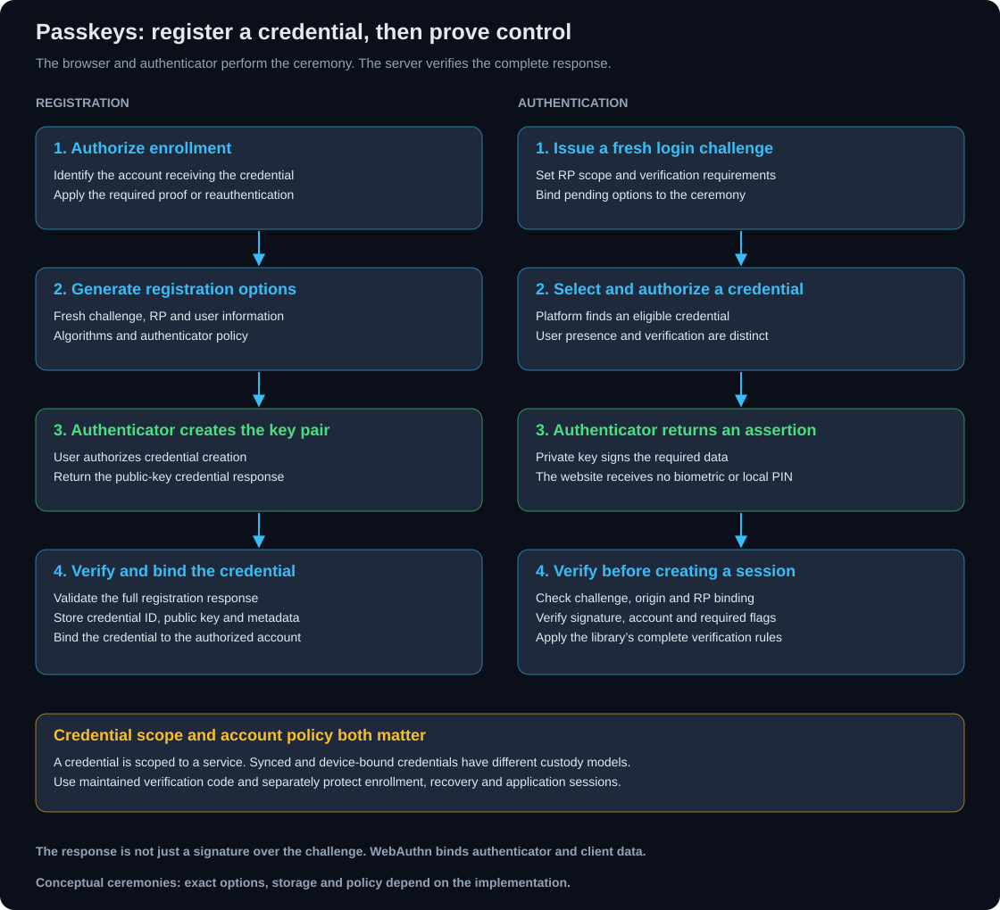
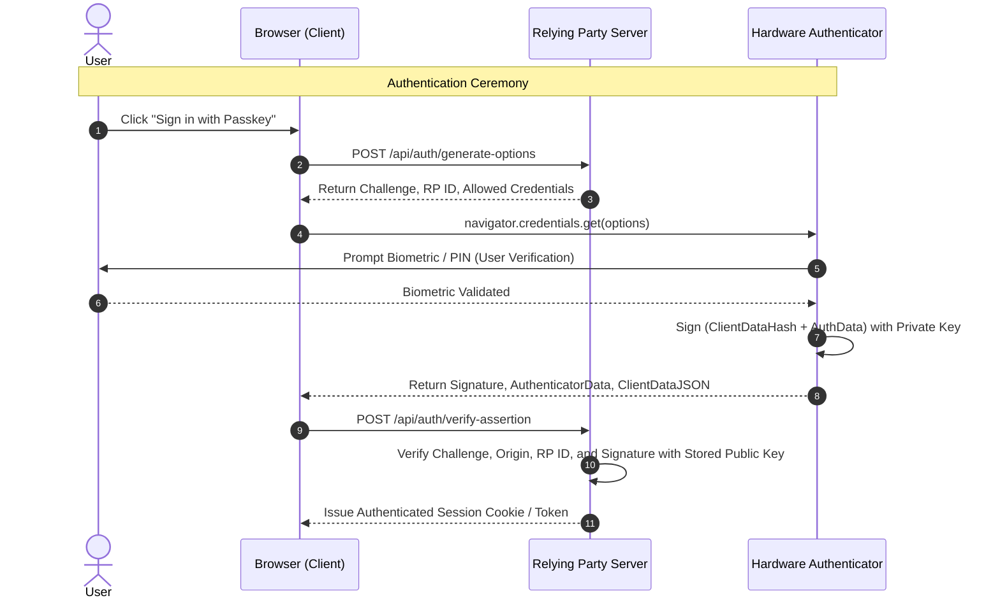
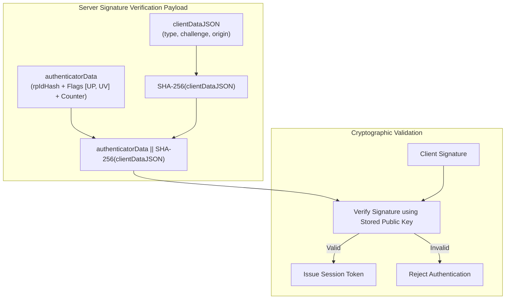
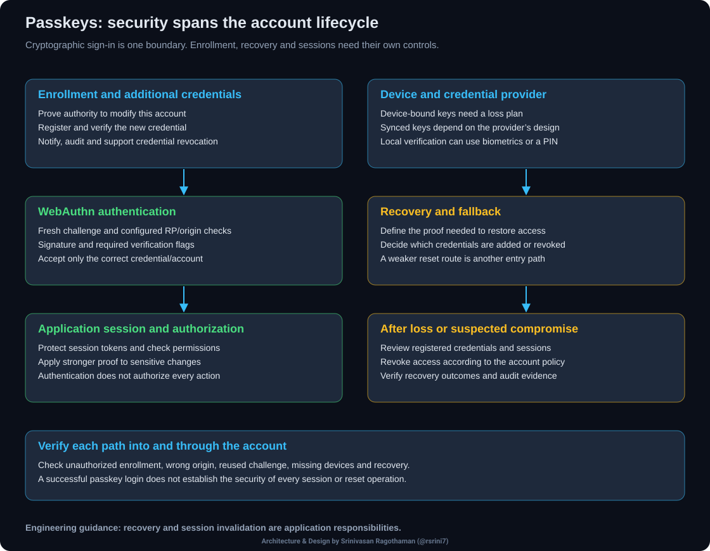
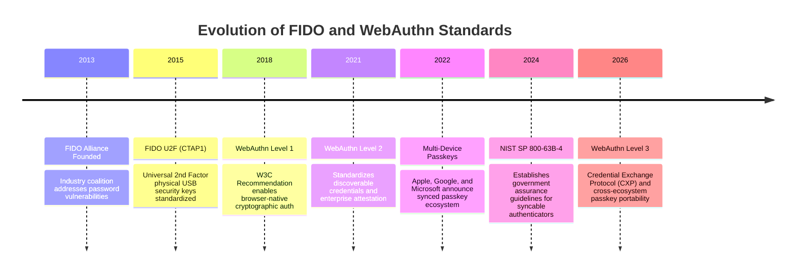
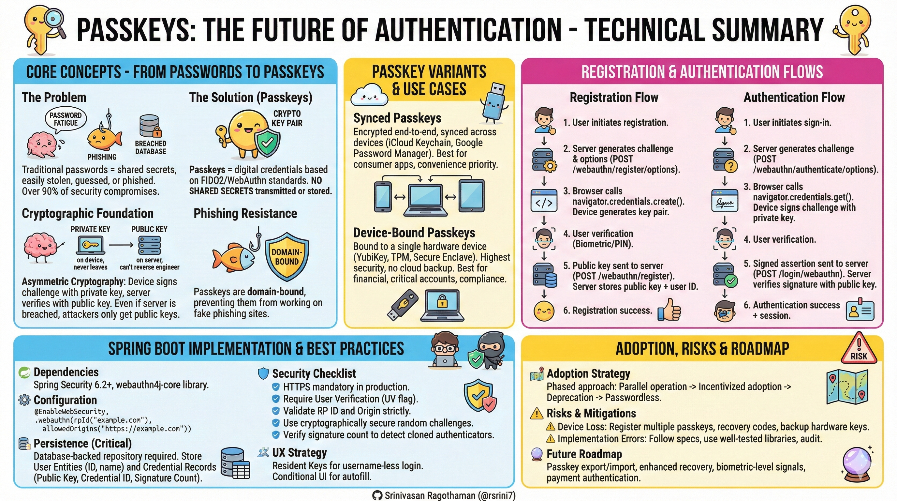

# Passkeys: WebAuthn Cryptographic Authentication, Origin Binding, and Account Lifecycle Security

Learning note · Revised November 2026 · WebAuthn, FIDO Protocols &amp; Identity Architecture  
*By Srinivasan Ragothaman ([@rsrini7](https://github.com/rsrini7))*

> **Core idea:** A passkey authenticates users via public-key cryptography scoped strictly to a website's domain origin, replacing reusable shared secrets (passwords) with asymmetric cryptographic signatures generated inside client hardware authenticators. While WebAuthn verification eliminates credential stuffing, phishing, and server-side password leaks, comprehensive account security still hinges on account recovery channels, session management, and credential lifecycle controls.


*Figure 1: Core WebAuthn ceremonies illustrating public-key credential registration and challenge-response authentication between the browser, authenticator hardware, and relying party server.*

---

## 1. Foundations: The Relying Party, Authenticator, and Client

WebAuthn (Web Authentication) is a W3C and FIDO Alliance standard that enables passwordless, phishing-resistant authentication. The architecture decouples local user verification from network identity proof through three interconnected entities:

1. **The Relying Party (RP):** The server-side web application that initiates authentication ceremonies, supplies cryptographic challenges, and validates digital assertions against registered public keys.
2. **The Client (User Agent / Operating System):** The browser or platform subsystem (Chrome, Safari, Windows Hello, Android, macOS) that mediates interactions between the web application and the cryptographic hardware, enforcing strict domain origin boundaries.
3. **The Authenticator:** The cryptographic hardware module that generates and securely stores private keys, signs server challenges, and performs local user presence or biometric checks (e.g., Apple Touch ID/Face ID, Windows Hello, Android Biometrics, or external YubiKey security keys).



### Essential Terminology

| Term | Technical Meaning &amp; Architectural Function |
| :--- | :--- |
| **Challenge** | Cryptographically random, single-use server bytes (minimum 16 bytes) preventing replay attacks. |
| **RP ID** | The domain scope of the credential (e.g., `example.com`). Subdomains (`auth.example.com`) can inherit parent RP IDs. |
| **Origin** | The exact scheme, host, and port (`https://example.com:443`) validated strictly by the browser to prevent phishing. |
| **Credential ID** | An opaque unique identifier generated by the authenticator to locate the specific public key; not a private key. |
| **User Presence (UP)** | A bitflag confirming physical interaction (e.g., touching a key); does not guarantee biometric identity. |
| **User Verification (UV)** | A bitflag confirming the user was locally authenticated via biometric match or device PIN. |
| **Discoverable Credential** | A "resident" passkey storing user handle and RP ID on the authenticator, enabling username-less sign-in. |

---

## 2. Deep Technical Mechanism: Step-by-Step Ceremonies

### 2.1 Credential Registration (Enrollment Ceremony)

1. **Session Authorization:** The server verifies that the current user is authorized to attach a credential (e.g., active session or step-up MFA).
2. **Option Generation:** The relying party issues `PublicKeyCredentialCreationOptions`:
   - Cryptographically random `challenge`.
   - `rp: { id: "example.com", name: "Example Corp" }`.
   - `user: { id: opaqueId, name: "alice@example.com", displayName: "Alice" }`.
   - `pubKeyCredParams`: Allowed algorithms (e.g., `-7` for ES256, `-257` for RS256, `-8` for Ed25519).
   - `authenticatorSelection`: `userVerification: "preferred"` or `"required"`, `residentKey: "preferred"`.
3. **Hardware Keypair Generation:** The client prompts the user. The authenticator creates a fresh public/private keypair scoped strictly to the RP ID.
4. **Attestation &amp; Verification:** The authenticator returns `clientDataJSON` and `attestationObject`. The server parses `clientDataJSON`, verifies the challenge matches the cached session challenge, verifies `origin == "https://example.com"`, extracts the public key and `credentialId`, and stores them in the database.

### 2.2 Challenge-Response Authentication Ceremony

1. **Option Generation:** The server issues `PublicKeyCredentialRequestOptions` containing a fresh single-use challenge and allowed credential IDs.
2. **Assertion Signing:** The client invokes `navigator.credentials.get()`. The authenticator prompts for user presence/biometrics, increments its internal monotonic signature counter, and signs a concatenation of: $\text{Signature} = \text{Sign}_{K_{\text{priv}}}\left(\text{authenticatorData} \parallel \text{SHA-256}(\text{clientDataJSON})\right)$.
3. **Server-Side Verification:** The RP server verifies:
   - Challenge matches the cached challenge issued to this session.
   - `origin` exactly matches the expected relying party origin.
   - `rpIdHash` in `authenticatorData` matches `SHA-256("example.com")`.
   - The User Presence (`UP`) bit (bit 0) is set to 1.
   - The User Verification (`UV`) bit (bit 2) is set to 1 (if policy required UV).
   - The signature validates against the stored public key.
   - The signature counter is greater than the previously stored counter (anomaly detection for cloned credentials).



---

## 3. Account Lifecycle, Recovery, and Session Boundaries

Authentication is only one link in the identity chain. Even with mathematical immunity to phishing, accounts remain vulnerable if enrollment and recovery channels are weakly architected:


*Figure 2: Comprehensive account security model showing how recovery fallback paths, device lifecycle changes, and session revocations interact with passkey authentication.*

### The Recovery Trap
If a user loses their phone, how do they recover access?
- If the service offers an **"Email one-time link"** fallback, the security of the account degrades to the security of the user's email account. An attacker who compromises the email inbox completely bypasses passkey protection.
- If the service uses **SMS OTP** fallback, the account becomes vulnerable to SIM swapping.
- **Enterprise Best Practice:** Require secondary passkeys (e.g., backup YubiKey), recovery codes stored offline, or trusted peer/administrator identity verification for account resets.

---

## 4. Synced Passkeys vs. Device-Bound Credentials

FIDO2 differentiates between **Multi-Device Credentials (Synced Passkeys)** and **Single-Device Credentials (Device-Bound Passkeys)**:

| Architectural Property | Multi-Device Passkeys (Synced) | Single-Device Passkeys (Device-Bound) |
| :--- | :--- | :--- |
| **Storage Module** | OS Cloud Keychains (iCloud Keychain, Google Password Manager, 1Password) | Hardware Security Module (YubiKey, Titan Key, Nitrokey, TPM) |
| **Key Exportability** | Exportable across end-to-end encrypted device ecosystems | Hardware non-exportable; private key never leaves the chip |
| **Backup &amp; Recovery** | Automatic recovery via cloud ecosystem account | Manual registration of secondary physical backup keys required |
| **Enterprise Assurance** | NIST SP 800-63B Authenticator Assurance Level 2 (AAL2) | NIST SP 800-63B Authenticator Assurance Level 3 (AAL3) |
| **Threat Vector** | Cloud provider account takeover or sync malware | Physical theft of the hardware key |
| **Target Audience** | Consumer web apps, retail banking, general SaaS | High-assurance government, defense, infrastructure root access |

---

## 5. Production Implementations & Code Recipes

### Server-Side WebAuthn Verification Handler (Node.js / TypeScript)

The following production recipe demonstrates challenge generation and cryptographic verification using the standardized `@simplewebauthn/server` library.

```typescript
/**
 * Production WebAuthn Relying Party Server Handlers.
 * Demonstrates challenge generation, registration verification, and assertion validation.
 */

import {
  generateRegistrationOptions,
  verifyRegistrationResponse,
  generateAuthenticationOptions,
  verifyAuthenticationResponse,
  VerifiedRegistrationResponse,
  VerifiedAuthenticationResponse,
} from "@simplewebauthn/server";
import type {
  RegistrationResponseJSON,
  AuthenticationResponseJSON,
} from "@simplewebauthn/types";

// Relying Party Configuration
const RP_NAME = "Enterprise Cloud Services";
const RP_ID = "example.com";
const EXPECTED_ORIGIN = "https://example.com";

// In-memory mock storage (use PostgreSQL / DynamoDB in production)
interface UserRecord {
  id: string;
  email: string;
  currentChallenge?: string;
  credentials: Array<{
    id: string;
    publicKey: Uint8Array;
    counter: number;
    transports?: string[];
  }>;
}

const db = new Map<string, UserRecord>();

// ==========================================
// 1. REGISTRATION CEREMONY
// ==========================================

export async function handleGenerateRegistrationOptions(userEmail: string) {
  let user = db.get(userEmail);
  if (!user) {
    user = { id: crypto.randomUUID(), email: userEmail, credentials: [] };
    db.set(userEmail, user);
  }

  const options = await generateRegistrationOptions({
    rpName: RP_NAME,
    rpID: RP_ID,
    userID: new TextEncoder().encode(user.id),
    userName: user.email,
    userDisplayName: user.email.split("@")[0],
    attestationType: "none",
    excludeCredentials: user.credentials.map((cred) => ({
      id: cred.id,
      transports: cred.transports as any,
    })),
    authenticatorSelection: {
      residentKey: "preferred",
      userVerification: "preferred",
    },
  });

  // Securely cache the challenge in session or database
  user.currentChallenge = options.challenge;
  return options;
}

export async function handleVerifyRegistration(
  userEmail: string,
  response: RegistrationResponseJSON
): Promise<{ verified: boolean; message: string }> {
  const user = db.get(userEmail);
  if (!user || !user.currentChallenge) {
    throw new Error("Invalid registration state or expired challenge");
  }

  let verification: VerifiedRegistrationResponse;
  try {
    verification = await verifyRegistrationResponse({
      response,
      expectedChallenge: user.currentChallenge,
      expectedOrigin: EXPECTED_ORIGIN,
      expectedRPID: RP_ID,
      requireUserVerification: true,
    });
  } finally {
    // Single-use challenge: always invalidate challenge after verification attempt
    user.currentChallenge = undefined;
  }

  if (verification.verified && verification.registrationInfo) {
    const { credential } = verification.registrationInfo;
    user.credentials.push({
      id: credential.id,
      publicKey: credential.publicKey,
      counter: credential.counter,
      transports: response.response.transports,
    });
    return { verified: true, message: "Passkey registered successfully" };
  }

  return { verified: false, message: "Registration verification failed" };
}

// ==========================================
// 2. AUTHENTICATION CEREMONY
// ==========================================

export async function handleGenerateAuthenticationOptions(userEmail?: string) {
  let allowCredentials = undefined;

  if (userEmail) {
    const user = db.get(userEmail);
    if (user) {
      allowCredentials = user.credentials.map((cred) => ({
        id: cred.id,
        transports: cred.transports as any,
      }));
    }
  }

  const options = await generateAuthenticationOptions({
    rpID: RP_ID,
    allowCredentials,
    userVerification: "preferred",
  });

  return options;
}

export async function handleVerifyAuthentication(
  userEmail: string,
  expectedChallenge: string,
  response: AuthenticationResponseJSON
): Promise<{ verified: boolean; userId: string }> {
  const user = db.get(userEmail);
  if (!user) throw new Error("User not found");

  const matchingCred = user.credentials.find((c) => c.id === response.id);
  if (!matchingCred) throw new Error("Unregistered credential presented");

  const verification: VerifiedAuthenticationResponse =
    await verifyAuthenticationResponse({
      response,
      expectedChallenge,
      expectedOrigin: EXPECTED_ORIGIN,
      expectedRPID: RP_ID,
      credential: {
        id: matchingCred.id,
        publicKey: matchingCred.publicKey,
        counter: matchingCred.counter,
      },
      requireUserVerification: true,
    });

  if (verification.verified) {
    // Signature counter rollback detection
    const newCounter = verification.authenticationInfo.newCounter;
    if (newCounter > 0 && newCounter <= matchingCred.counter) {
      console.warn("[ALERT] Potential cloned authenticator counter rollback!");
      throw new Error("Authenticator anomaly detected");
    }
    matchingCred.counter = newCounter;
    return { verified: true, userId: user.id };
  }

  throw new Error("Authentication assertion invalid");
}
```

---

## 6. Impact, Real-World Edge Cases & Gotchas

### Common Claims vs. Technical Realities

| Common Claim | Technical Reality | Systems Engineering Implication |
| :--- | :--- | :--- |
| **"Passkeys store user biometric scans on the server."** | Servers never receive biometrics. The authenticator performs a local biometric check and returns a public-key digital signature over a server challenge. | Compliance audits (GDPR, HIPAA) treat passkeys as standard cryptographic assertions, avoiding biometric data storage obligations. |
| **"Passkeys completely eliminate Account Takeover (ATO)."** | Passkeys stop credential stuffing, credential stuffing, and phishing. They do not prevent session cookie theft, malware on client endpoints, or compromised email fallback resets. | Layer passkeys with short-lived session tokens, device fingerprinting, and hardened recovery channels. |
| **"Signature counters reliably detect cloned credentials in all cases."** | Many modern synced authenticators (Apple, Google) intentionally report a counter of `0` because keys sync across multiple active devices without centralized state. | Use counters as an anomaly heuristic for physical security keys (YubiKeys), but do not reject assertions from synced providers reporting zero. |
| **"Subdomains can share passkeys without special configuration."** | By default, an authenticator created on `app.example.com` cannot authenticate `api.example.com` unless both explicitly configure their RP ID to the registrable top-level domain `example.com`. | Set `rpID: "example.com"` consistently across all authentication endpoints and configure explicit `allowedOrigins`. |

---

## 7. Practical Adoption Blueprint & Verification Checklist

### 7.1 Rollout Strategy for Engineering Teams

1. **Dual-Stack Phase (Optional Passkeys):** Offer passkeys as a secondary login method alongside existing passwords/MFA. Measure enrollment conversion and monitor browser error rates.
2. **Passwordless Step-Up:** Use passkeys for high-risk actions (updating billing, exporting customer data, adding team members) before promoting to primary login.
3. **Passkey-First Architecture:** Prompt new users to register passkeys upon signup. Offer secondary backup passkey registration immediately upon successful enrollment.

### 7.2 Security Verification Checklist

- [ ] **Origin Binding Rigor:** Confirm server rejects assertions where `origin` does not strictly equal `https://expected-domain.com` (test with `http://`, port mismatches, and typo domains).
- [ ] **Challenge Replay Prevention:** Verify that challenges expire within 120 seconds and are immediately invalidated in database storage upon the first verification attempt.
- [ ] **User Verification Enforcement:** For financial and administrative operations, ensure `requireUserVerification: true` is validated on the server and the `UV` flag in `authenticatorData` is checked.
- [ ] **Session Re-authentication on Revocation:** Ensure that revoking a passkey immediately revokes all active session tokens associated with that credential.
- [ ] **Account Recovery Review:** Audit all self-service account recovery flows. Ensure that automated reset links do not bypass MFA requirements without administrative approval.

---

## 8. Timeline and Standards Evolution



---

## 9. Primary Sources & References

### Standards & Official Specifications

1. [W3C: Web Authentication: An API for accessing Public Key Credentials Level 3](https://www.w3.org/TR/webauthn-3/) — World Wide Web Consortium (W3C). Formal specification defining clientDataJSON, authenticatorData flags, and verification algorithms.
2. [FIDO Alliance: Passkeys Overview & Architecture](https://fidoalliance.org/passkeys/) — FIDO Alliance. Foundational guide on multi-device credentials, synced passkeys, and user experience guidelines.
3. [NIST SP 800-63B-4: Digital Identity Guidelines — Authentication and Lifecycle Management](https://pages.nist.gov/800-63-4/sp800-63b.html) — National Institute of Standards and Technology (2024). Establishes AAL2 and AAL3 assurance criteria for hardware-bound vs syncable passkeys.
4. [Apple Platform Security: Passkeys and iCloud Keychain End-to-End Encryption](https://support.apple.com/guide/security/passkeys-overview-sec1b29a2884/web) — Apple Security Disclosure. Architecture of escrow proxy recovery and sync security.
5. [Google Identity: Passkeys Implementation & Developer Guide](https://developers.google.com/identity/passkeys) — Google Developers. Best practices for discoverable credentials and Android credential manager integration.

### Maintained Implementation Libraries

6. [SimpleWebAuthn Documentation & Server Guide](https://simplewebauthn.dev/docs/packages/server) — Matthew Miller. Leading open-source TypeScript implementation for WebAuthn RP servers.
7. [Yubico: java-webauthn-server](https://github.com/Yubico/java-webauthn-server) — Yubico official enterprise Java library for WebAuthn relying party verification.

---

## 10. Supplementary Visuals

The following visual documentation preserves the foundational schematic contextualizing passkey identity flows against legacy authentication mechanisms:


*Figure 3: Previously collected architectural illustration detailing passkey user interactions, retained for technical context.*

---

**Related:**
- [EMudhra-Weak-CA-Keys-And-PKI-Trust-Oct-2026](../News/Security/EMudhra-Weak-CA-Keys-And-PKI-Trust-Oct-2026.md) — Explains how cryptographic algorithms, key handling, and client verification operate across PKI and origin-bound authentication.
- [HTTP-Egress-Credential-Proxies-Vs-MCP-Gateways-Nov-2026](../News/Security/HTTP-Egress-Credential-Proxies-Vs-MCP-Gateways-Nov-2026.md) — Contrasts human user passkey sign-in with service-to-service credential custody and API gateways.
- [Local-AI-And-Agent-Security-Threat-Model-Nov-2026](../News/Security/Local-AI-And-Agent-Security-Threat-Model-Nov-2026.md) — Examines how account authentication and session boundaries interact with local execution agents.
- [Gang-Of-Four-Design-Patterns-In-Functional-Programming-2026](Gang-Of-Four-Design-Patterns-In-Functional-Programming-2026.md) — Software design patterns and clean capability algebras underpinning authentication services.