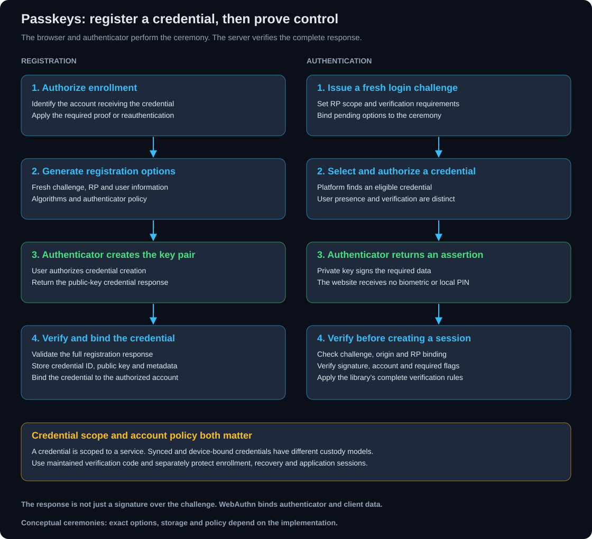
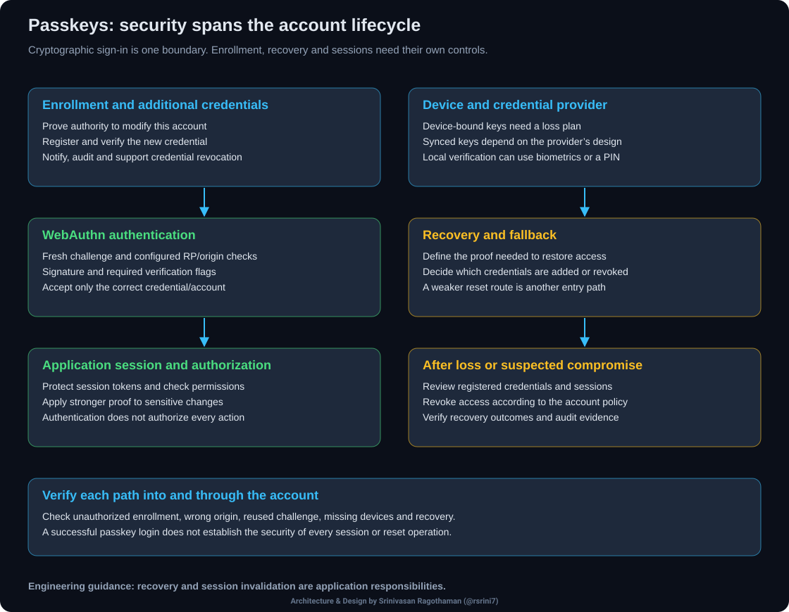
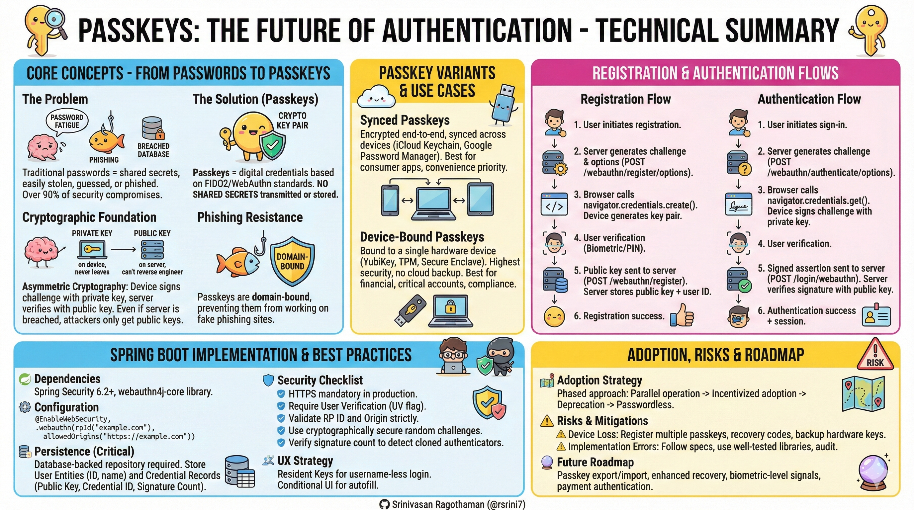

# Passkeys: How Authentication Works and Where Security Depends on the Account

**Learning note · Revised 15 November 2026 · WebAuthn, FIDO and implementation guidance checked**  
*By Srinivasan Ragothaman ([@rsrini7](https://github.com/rsrini7))*

> **Core idea:** A passkey authenticates with a public/private key pair scoped to a service, rather than a password the user types into a page. Correct WebAuthn verification provides strong phishing resistance, while enrollment, device/provider recovery and the application's sessions remain part of account security.

## 1. Foundations: who does what?

A **relying party**, or RP, is the service the user signs into. The browser or operating system connects that service to an **authenticator**, which can be built into a phone/computer or provided by a security key. A credential provider may store and synchronize passkeys across the user's devices.

During registration, a credential key pair is created. The service stores the public key and related credential metadata. During sign-in, the authenticator signs data tied to a fresh challenge and the service's identity. The server verifies the result with the registered public key. [FIDO passkey overview](https://fidoalliance.org/passkeys/), [WebAuthn specification](https://www.w3.org/TR/webauthn-3/).

A fingerprint, face check or local PIN can authorize the authenticator's use of the credential. The website receives the WebAuthn response, not the user's fingerprint image or local PIN. The exact local verification and storage mechanism depends on the authenticator and platform.

| Term | Plain meaning |
|---|---|
| Challenge | Fresh server-supplied data binding a response to a particular authentication ceremony. |
| Credential ID | An identifier used to locate a registered credential; it is not the private key. |
| RP ID | The domain scope of the credential, such as `example.com`. It is not a full URL. |
| Origin | The web context, including scheme, host and port, that the server must validate against its policy. |
| User presence, UP | Evidence of interaction with the authenticator; it does not by itself mean a biometric/PIN check occurred. |
| User verification, UV | Evidence that the authenticator verified the user locally using an accepted method. |
| Discoverable credential | A credential that can support account discovery/selection without first supplying a username to locate it. |

These distinctions and verification rules are defined in [WebAuthn](https://www.w3.org/TR/webauthn-3/). The service must choose and enforce the intended verification requirement; merely showing a biometric-looking UI is not a server-side check.

## 2. Registration and sign-in, step by step

*Registration binds a new credential to an account. Authentication proves control of an already registered credential using a fresh challenge.*

### Registration

1. **Authorize enrollment.** Establish which account may receive a new credential. For an existing sensitive account, use an appropriate reauthentication step.
2. **Create registration options.** The server supplies a fresh challenge, RP information, an opaque user identifier, supported algorithms and the intended authenticator/verification policy.
3. **Create the credential.** The browser invokes the authenticator. The user authorizes the operation, and a response containing the new public-key credential is returned.
4. **Verify and store.** The server validates the registration response and binds its credential ID and public key to the authorized account, with metadata needed by the chosen library.

### Authentication

1. **Create authentication options.** The server issues a fresh challenge and the intended RP/verification requirements. The flow may first identify the account or use discoverable credentials.
2. **Select and authorize the credential.** The platform selects an eligible credential and performs the required local interaction or verification.
3. **Return the assertion.** The authenticator signs the required data using the credential's private key.
4. **Verify before creating a session.** The server validates the challenge, origin, RP ID binding, credential/account relationship, signature and required flags, along with other checks required by the specification and library.

The response includes more than a signature over the challenge alone. WebAuthn binds the signed authenticator data to the hash of client data, which includes the challenge and origin. Use a maintained verification library for the complete process. [WebAuthn registration and authentication verification](https://www.w3.org/TR/webauthn-3/), [SimpleWebAuthn server guide](https://simplewebauthn.dev/docs/packages/server).

## 3. Why passkeys resist phishing, and what they do not prove

A password can be typed into an impersonating site and reused at the real service. A WebAuthn credential is scoped to its RP ID, while the browser and server enforce the applicable origin and RP rules. A different phishing domain cannot simply obtain a valid assertion for the legitimate service. The server must perform the required verification correctly. [WebAuthn security considerations](https://www.w3.org/TR/webauthn-3/), [Google passkey overview](https://developers.google.com/identity/passkeys).

This does not make every signed-in action safe. A stolen session cookie, compromised endpoint, malicious authorized extension or weak recovery process can affect the account through a different path. Authentication establishes a session or authorizes a step; the application still needs session protection and authorization for actions.

| Claim | More precise interpretation |
|---|---|
| The private key never leaves the device. | A device-bound credential and a synced credential have different storage/transfer models. Syncable credentials may move between devices through the provider's protected mechanism. |
| The server stores a biometric. | The normal WebAuthn response carries cryptographic data and flags, not the biometric or local PIN. |
| Any passkey login is automatically two-factor authentication. | Assurance depends on the authenticator, local user verification, server checks and account policy. Do not infer UV from presence alone. |
| Passkeys remove account takeover. | They address important authentication attacks; enrollment, recovery, endpoints and sessions remain relevant. |
| Every security key behaves like a synced passkey provider. | Storage, discoverability, verification and recovery differ by product and credential type. |

## 4. Synced and device-bound credentials

[FIDO](https://fidoalliance.org/passkeys/) distinguishes passkeys synchronized across devices from device-bound passkeys. Synced credentials can improve recovery and device continuity, with security depending in part on the provider's synchronization and recovery design. Device-bound credentials keep the credential tied to a particular authenticator and need an alternate plan if it is lost.

For example, [Apple's security explanation](https://support.apple.com/en-us/102195) describes end-to-end protection for iCloud Keychain and a recovery process. That is evidence about Apple's design, not a guarantee that all providers use the same mechanisms.

For formal assurance requirements, check the applicable standard. [NIST SP 800-63B-4](https://pages.nist.gov/800-63-4/sp800-63b.html) defines authenticator assurance requirements, including conditions for syncable authenticators and the non-exportable-key requirement at AAL3. A passkey label alone is insufficient evidence that a deployment meets a particular assurance level.

## 5. Enrollment, recovery and sessions complete the design

*The cryptographic login protects one part of the account lifecycle. A reset route or existing session can authorize other operations, so their controls need explicit design.*

Allow users to view and revoke registered credentials, add a backup authenticator where appropriate and understand the recovery choices. Require an appropriate level of proof before adding or replacing a credential. Notify users of material credential changes and retain an audit trail.

Define whether recovery can reset the account, register a new passkey or revoke existing access. A password or email fallback creates an additional path into the account; its security must be evaluated alongside the passkey flow. After recovery or suspected compromise, decide which credentials and sessions to revoke.

These are account-design recommendations. Recovery and session invalidation do not happen automatically because a login used WebAuthn.

## 6. Implementation choices and checks

| Area | What to configure or verify |
|---|---|
| Challenge state | Bind challenges to the intended ceremony and account/session context, expire them and prevent successful reuse. |
| RP and origin policy | Configure the intended domain scope and allowed origins. Legitimate subdomain arrangements need a deliberate policy. |
| Verification requirements | Request and verify UV when the account policy requires it; verify the other required response fields too. |
| Credential storage | Persist the credential ID, public key, account binding and the metadata required by the library. Support more than one credential per account where appropriate. |
| Signature counters | Follow the library/specification policy. Some authenticators report zero; synced credentials complicate counter interpretation. A counter anomaly is a signal to evaluate, not universal proof of compromise. |
| User experience | Verify account selection, cancelled prompts, missing credentials, cross-device use and a user who has lost the usual device. |
| Sessions and recovery | Check session creation, authorization, credential addition/revocation and recovery independently. |

The [SimpleWebAuthn guide](https://simplewebauthn.dev/docs/packages/server) documents response verification, stored credential metadata and signature-counter limitations. The [WebAuthn specification](https://www.w3.org/TR/webauthn-3/) defines the underlying verification procedures.

## 7. Maintained tools and a practical starting point

- **[SimpleWebAuthn](https://simplewebauthn.dev/docs/packages/server):** JavaScript/TypeScript server helpers for generating options and verifying registration/authentication responses. Start with the full registration and authentication examples. The application still owns challenge storage, account authorization and sessions.
- **[Yubico java-webauthn-server](https://github.com/Yubico/java-webauthn-server):** Java verification library built around a relying-party configuration and credential repository. Follow its quickstart and example relying party; configure the actual RP ID, origins and user-verification policy.
- **[Spring Security passkeys](https://docs.spring.io/spring-security/reference/servlet/authentication/passkeys.html):** Framework integration for a Spring web application. Use the guide for the installed version and configure persistent credential/user storage and the intended account flows.

Before rollout, check valid login, wrong origin, expired/reused challenge, unauthorized enrollment, a revoked credential, UV-required policy, missing devices and recovery. Run those checks against the complete application. A browser prompt appearing or a single successful signature verification does not establish account-level security.

## 8. Source context

Reworked from collected repository notes using the WebAuthn specification, FIDO overview, NIST requirements and maintained implementation guidance. WebAuthn Level 3 is an evolving specification: check the publication status and the features supported by the browsers, authenticators and library versions being adopted. Provider-specific security claims are attributed to that provider's documentation.

### Supplementary visual

*Previously collected illustration, retained for reference. The revised explanation and source qualifications above govern the technical claims.*

---

**Related:**
- [eMudhra and PKI Trust](../News/Security/EMudhra-Weak-CA-Keys-And-PKI-Trust-Oct-2026.md) — Explains how cryptographic algorithms, key handling and client verification have separate roles in authentication trust.
- [HTTP Egress Credential Proxies and MCP Gateways](../News/Security/HTTP-Egress-Credential-Proxies-Vs-MCP-Gateways-Nov-2026.md) — Contrasts user sign-in with service/API credential custody and access boundaries.
- [Local AI and Agent Security](../News/Security/Local-AI-And-Agent-Security-Threat-Model-Nov-2026.md) — Connects account credentials and sessions to endpoint and application threat boundaries.
